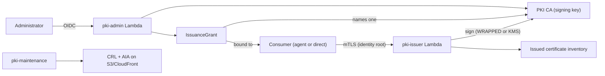
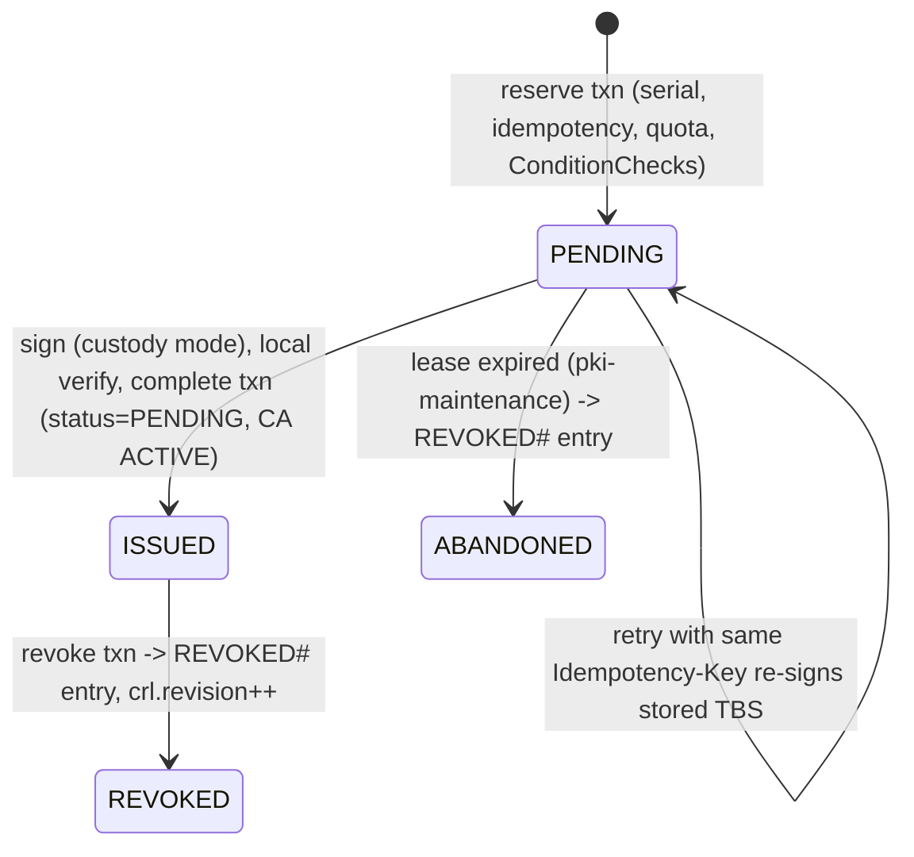

# Hemlig PKI plan

::: info Proposed design
Written November 2026. Nothing here is implemented yet. Current behavior is in the [guide](/guide/what-is-hemlig).
:::

## Purpose and scope

An administrator can create or import a certificate authority (CA) in an environment. They can build an intermediate hierarchy, and they can issue, revoke and renew certificates. A cluster can obtain certificates only inside an administrator-owned entitlement, held in Hemlig and bound to the cluster's mTLS consumer identity. The Kubernetes controller acts as a cert-manager external issuer. The PKI never touches Hemlig's own identity root, its truststore or its client certificates.

In scope:

- CA lifecycle: Hemlig-generated root, Hemlig-signed intermediate, intermediate signed externally from a Hemlig CSR, and imported key material.
- Entitlements (IssuanceGrant) and the issuance policy engine.
- Certificate inventory, revocation and CRLs.
- The cert-manager issuer, admin-issued certificates, and managed certificates delivered as Hemlig secrets.
- In-cluster distribution of CA bundles and CRLs (`HemligTrustBundle`).

Out of scope for v1: OCSP, delta CRLs, ACME/EST/SCEP/CMP, the Kubernetes CSR API signer, cross-signing, Certificate Transparency, SSH certificates and `certificateHold`.

## Fixed decisions

| Decision               | Chosen design                                                                                                                                                                           | Why                                                                                                                                                                                                                 |
| ---------------------- | --------------------------------------------------------------------------------------------------------------------------------------------------------------------------------------- | ------------------------------------------------------------------------------------------------------------------------------------------------------------------------------------------------------------------- |
| CA key custody         | Per-CA custody mode, chosen at creation and immutable: `WRAPPED` (default), `WRAPPED_PASSWORD` or `KMS` (explicit opt-in)                                                               | `WRAPPED` costs about $0 per CA and supports automated issuance. `KMS` keeps the key non-exportable (certificates signed during a compromise stay valid). `WRAPPED_PASSWORD` keys are useless without the password. |
| Identity root          | Unchanged and fully separate (`SYSTEM#ISSUER`, envelope key, node-forge)                                                                                                                | A PKI-issued certificate must never authenticate to Hemlig.                                                                                                                                                         |
| X.509 stack            | New `src/pki/` on `@peculiar/asn1-schema`, `@peculiar/asn1-x509` and `@peculiar/asn1-csr` (MIT). `node:crypto` verifies signatures.                                                     | node-forge cannot parse EC keys and signs synchronously.                                                                                                                                                            |
| Entitlement object     | New IssuanceGrant: one consumer, one CA, a named policy                                                                                                                                 | AgentGrant `PUT` replaces scope in full. A separate record keeps PKI policy from being overwritten by secret-grant edits and gives it its own ETag.                                                                 |
| Who holds entitlements | Any active consumer: agents (with an ACTIVE AgentGrant) and direct consumers                                                                                                            | The IssuanceGrant is the only boundary for both.                                                                                                                                                                    |
| Lambdas                | Three new: `pki-admin` (JWT), `pki-issuer` (mTLS) and `pki-maintenance` (scheduled). KMS custody adds a fourth, `pki-key-provisioner`, that only creates and tags keys.                 | Only the three hold `kms:Sign` on PKI keys and decrypt for `purpose=pki-ca`. None of them holds `issuer-ca` decrypt or KMS key-creation rights.                                                                     |
| Storage                | Every PKI item's `pk` starts with `PKI_`; one new GSI, `pki-directory`                                                                                                                  | IAM can then deny PKI writes to non-PKI roles, and identity writes to PKI roles, by prefix. CloudFormation adds only one GSI per table update.                                                                      |
| Revocation             | Full CRLs on S3. No public hosting by default. With an opt-in `pkiPublicationFqdn`, CloudFront serves them over HTTP and HTTPS. Consumers also fetch them in-cluster. OCSP is deferred. | CRLs are pre-signed and cheap, and OCSP is being phased out industry-wide.                                                                                                                                          |
| CSR handling           | The CSR is input to policy, never a template. Hemlig builds every extension itself.                                                                                                     | A cluster can't smuggle extensions into a certificate.                                                                                                                                                              |
| Lifetime               | Clamped, never denied (except below the minimum). Never past the issuing CA's `notAfter`.                                                                                               | Matches cert-manager expectations.                                                                                                                                                                                  |
| Names, usages, keys    | Denied, never silently dropped. The one exception is normalizing cert-manager's default `key encipherment` on EC keys.                                                                  | The requester always gets the names it asked for, or a clear failure.                                                                                                                                               |
| Kubernetes API         | `HemligIssuer` and `HemligClusterIssuer` in group `hemlig.zyno.io`, version `v1alpha1`                                                                                                  | A new surface that may change before beta. Uses the new group.                                                                                                                                                      |
| Deployment             | PKI is always deployed: the three Lambdas, routes, GSI, publication bucket, wrapping key and maintenance schedule. Only `pkiPublicationFqdn` (with CloudFront) is optional.             | The only always-on PKI cost is the wrapping key (about $1/month per deployment). Maintenance exits early when no CAs exist.                                                                                         |
| Key import transport   | CA private keys never cross the wire in plaintext. Clients encrypt to a deployment-wide KMS RSA wrapping key (`alias/hml-NAME-pki-wrapping`).                                           | A compromised TLS hop or log never sees a CA key, and the server decrypts only in `pki-admin` memory.                                                                                                               |

## Concepts and terminology

New glossary entries. "Issuing root" keeps its current meaning and never appears in PKI APIs.

| Term                               | Definition                                                                                                                                                                                                                                                                                                                                             |
| ---------------------------------- | ------------------------------------------------------------------------------------------------------------------------------------------------------------------------------------------------------------------------------------------------------------------------------------------------------------------------------------------------------ |
| PKI CA (certificate authority)     | An environment-owned CA record (`ca-<uuid>`) with a signing key in one of three custody modes, a certificate and a chain. It is one of four kinds: `ROOT`, `INTERMEDIATE` (signed by a Hemlig CA), `EXTERNAL_INTERMEDIATE` (signed outside Hemlig from a Hemlig CSR) or `IMPORTED` (existing key material imported). Kind and custody are independent. |
| Custody mode                       | How a CA key is stored and where it signs: `WRAPPED`, `WRAPPED_PASSWORD` or `KMS`. Immutable. See "CA key custody".                                                                                                                                                                                                                                    |
| Signing session                    | A short-lived server-side record that hands a deterministic TBS to an administrator's client to sign, for `WRAPPED_PASSWORD` CAs.                                                                                                                                                                                                                      |
| CA name                            | An immutable slug, unique per environment and never reused. URLs use `caId`, not the name.                                                                                                                                                                                                                                                             |
| Anchor                             | A self-signed root, or the topmost known certificate **only when the operator explicitly promotes it** (`anchorPromoted` on the CA). Only anchors are returned as `ca.crt`; intermediates go in `chain.crt`. A chain that doesn't reach a self-signed certificate and isn't promoted is incomplete (`chainComplete: false`).                           |
| IssuanceGrant                      | An administrator-owned entitlement for one consumer. It names one CA and the names, subject, usages, key algorithms, lifetimes and CA permission the consumer may request, plus the attributes Hemlig forces. Deny by default. It is identified by `(consumerId, name)` and holds an immutable `uid`.                                                  |
| Forced attribute                   | A subject attribute, SAN, policy OID or extension that Hemlig adds to every certificate issued under a grant.                                                                                                                                                                                                                                          |
| Issued certificate                 | The inventory record for one serial under one CA: status, fingerprint, names, requester and validity.                                                                                                                                                                                                                                                  |
| Reservation                        | A `PENDING` issued-certificate record written before anything signs.                                                                                                                                                                                                                                                                                   |
| Revocation entry                   | `PKI_CA#caId / REVOKED#serial`, the input to CRL generation.                                                                                                                                                                                                                                                                                           |
| CRL number                         | A per-CA counter that strictly increases.                                                                                                                                                                                                                                                                                                              |
| Publication endpoint               | `http://<pkiPublicationFqdn>/crl/<caId>.crl` and `/ca/<caId>.crt`, frozen into a CA at creation.                                                                                                                                                                                                                                                       |
| Managed certificate                | A certificate whose key Hemlig generates, stored as the payload of a normal Hemlig secret (`tls.crt`, `tls.key`, `ca.crt`) and renewed by Hemlig.                                                                                                                                                                                                      |
| HemligIssuer / HemligClusterIssuer | cert-manager external issuer resources that bind a HemligConsumer to one IssuanceGrant name.                                                                                                                                                                                                                                                           |

How they relate:



## Architecture and trust boundaries

| Caller                     | Authenticates with                        | Route and Lambda                    | May do                                                                          |
| -------------------------- | ----------------------------------------- | ----------------------------------- | ------------------------------------------------------------------------------- |
| Administrator              | OIDC JWT, plus optional PKI roles         | `/v1/admin/pki/*` → `pki-admin`     | CA lifecycle, grants, admin issuance, revocation, managed certificates          |
| Consumer (agent or direct) | Hemlig client certificate (identity root) | `/v1/pki/*` → `pki-issuer`          | Read its own grants; issue within a grant                                       |
| Relying party              | None                                      | CloudFront `pkiPublicationFqdn`     | Fetch CRLs and CA certificates                                                  |
| Scheduler                  | Lambda role                               | `pki-maintenance`, every 15 minutes | CRL refresh (not for password-mode CAs), reservation recovery, renewals, alarms |

### Trust separation from the identity root

The invariant: a PKI-issued certificate never authenticates to the delivery API, AWS IoT or any Hemlig route. It's enforced at seven independent layers.

| #   | Layer               | Enforcement                                                                                                                                                                                                                                                                                                                                                                                                                                                                                                                                                                                                                                                                                                                                                                                                                                                                                                                                                                                | Test                                                                                                                                                                                                |
| --- | ------------------- | ------------------------------------------------------------------------------------------------------------------------------------------------------------------------------------------------------------------------------------------------------------------------------------------------------------------------------------------------------------------------------------------------------------------------------------------------------------------------------------------------------------------------------------------------------------------------------------------------------------------------------------------------------------------------------------------------------------------------------------------------------------------------------------------------------------------------------------------------------------------------------------------------------------------------------------------------------------------------------------------ | --------------------------------------------------------------------------------------------------------------------------------------------------------------------------------------------------- |
| 1   | TLS                 | The API Gateway truststore is built only from `TRUSTSTORE#ROOTS` items, which only the enrollment path writes (`src/services/consumers.ts`). PKI code has no method that writes them. PKI roles get no truststore bucket write and no `apigateway:*` (contrast `grantTruststorePublisher`, `cdk/stack.ts:1257`).                                                                                                                                                                                                                                                                                                                                                                                                                                                                                                                                                                                                                                                                           | CDK assertion. Unit test: creating PKI CAs leaves the truststore anchor set unchanged. AWS gate PKI-3: API Gateway rejects a PKI client certificate (403) once the identity truststore is attached. |
| 2   | Identity lookup     | `consumerActorFromEvent` requires `IDENTITY#sha256`, kind `api`, `ACTIVE` (`src/auth/actors.ts:86-99`). PKI never writes `IDENTITY#`.                                                                                                                                                                                                                                                                                                                                                                                                                                                                                                                                                                                                                                                                                                                                                                                                                                                      | IAM deny (layer 4). Repository test.                                                                                                                                                                |
| 3   | Keys                | CA keys are either envelope-encrypted under the application CMK (`purpose=pki-ca`, or `pki-ca-password` for password blobs), or distinct KMS `SIGN_VERIFY` keys. PKI roles get `kms:Decrypt` on the application CMK only with `kms:EncryptionContext:purpose = pki-ca` (`pki-admin` also gets `pki-ca-password`, and `pki-admin` and `pki-maintenance` also get `pki-managed-staging`), and no decrypt or `GenerateDataKey` for `issuer-ca` (compare `cdk/stack.ts:424-470`). Identity, admin, bootstrap, identity-rotation and consumer roles get no decrypt for `pki-ca` or `pki-ca-password` and no `kms:Sign` on PKI-tagged KMS keys.                                                                                                                                                                                                                                                                                                                                                  | CDK template assertions in both directions.                                                                                                                                                         |
| 4   | Data plane IAM      | The PKI roles don't get `grantReadWriteData`. Each gets a per-role write allowlist: `Put/Update/DeleteItem` and `BatchWriteItem` with `ForAllValues:StringLike dynamodb:LeadingKeys` limited to `PKI_*` plus its own idempotency and audit-suppress prefixes (`pki-admin`: `IDEMPOTENCY#human#*`; `pki-issuer`: `AUDIT_SUPPRESS#*`; `pki-maintenance`: none beyond `PKI_*`). Transactions are evaluated per item action (`Put`, `Update`, `Delete`, `ConditionCheck`), so one key outside the allowlist fails the whole `TransactWriteItems` or `BatchWriteItem`. PKI roles are read-only (`GetItem`, `Query`, `BatchGetItem`) on `CONSUMER#*`, `IDENTITY#*`, `AGENT_GRANT#*` and `SYSTEM#ISSUER`, and get no access to `TRUSTSTORE#*`, `SYSTEM#TRUSTSTORE`, `ENROLLMENT#*` or `BOOTSTRAP#*`. Belt and braces: an explicit `Deny` on writes to every identity prefix. Non-PKI roles: `Deny` writes on `PKI_*`. The LeadingKeys condition already has a precedent (`cdk/stack.ts:398-404`). | CDK assertion. AWS gate PKI-1 (IAM policy simulator): mixed-key `BatchWriteItem` and `TransactWriteItems` (one `PKI_` key plus one `CONSUMER#` key) are denied for every PKI role.                  |
| 5   | Code                | `src/pki/**` must not import `services/issuer`, `services/consumers` or `services/agent-notifications`.                                                                                                                                                                                                                                                                                                                                                                                                                                                                                                                                                                                                                                                                                                                                                                                                                                                                                    | `src/pki/import-boundary.test.ts` scans the imports.                                                                                                                                                |
| 6   | Reserved identities | Reject a PKI CA (created, imported or external) whose SPKI or subject DN equals the identity root's, or whose uploaded chain contains it. The check reads `SYSTEM#ISSUER` (read-only, strongly consistent) and a `PKI_SPKI#<sha256>` registry (see "CA creation flows"). Before the identity root exists, the DN check uses the fixed identity-root subject and the SPKI check is vacuous (a lazily created root gets a fresh random key). Every grant and admin request denies the URI prefix `spiffe://hemlig/` (the identity SAN, `issuer.ts:63`).                                                                                                                                                                                                                                                                                                                                                                                                                                      | Policy unit tests.                                                                                                                                                                                  |
| 7   | IoT                 | PKI roles have no `iot:*`. PKI certificates are never registered.                                                                                                                                                                                                                                                                                                                                                                                                                                                                                                                                                                                                                                                                                                                                                                                                                                                                                                                          | CDK assertion.                                                                                                                                                                                      |

The rule is symmetric. There is no API that adds an arbitrary root to the truststore, and the plan keeps it that way.

## CA key custody

### Custody modes

Each CA picks a mode at creation. It's immutable and independent of `kind`.

| Mode                                             | Key at rest                                                                                                                                                                                                                                                                                                                                                                                                                               | Signs where                                                                                          | Automated issuance (IssuanceGrants, managed certs, scheduled CRLs)                                              | Cost                             |
| ------------------------------------------------ | ----------------------------------------------------------------------------------------------------------------------------------------------------------------------------------------------------------------------------------------------------------------------------------------------------------------------------------------------------------------------------------------------------------------------------------------- | ---------------------------------------------------------------------------------------------------- | --------------------------------------------------------------------------------------------------------------- | -------------------------------- |
| `WRAPPED` (default)                              | PKCS#8 DER envelope-encrypted under the existing application CMK (the identity-root envelope pattern, `src/crypto/envelope.ts`), encryption context `{service: "hemlig", purpose: "pki-ca", caId, environment}`, stored on the CA record (`key.wrapped`)                                                                                                                                                                                  | PKI Lambda, `node:crypto.sign`. The key is in memory only during the call, and the buffer is zeroed. | Yes                                                                                                             | About $0                         |
| `WRAPPED_PASSWORD`                               | PKCS#8 encrypted **client-side** with a password (PBKDF2-HMAC-SHA256, 600,000 iterations, random 16-byte salt → AES-256-GCM, AAD = `hemlig-pki-ca-key:v1\|environment\|caName\|spkiSha256`; the name is immutable and never reused, and `caId` doesn't exist yet when the client encrypts). That blob is then envelope-encrypted under the CMK with its own context `{service: "hemlig", purpose: "pki-ca-password", caId, environment}`. | Administrator's client: CLI via `node:crypto`, console via WebCrypto                                 | No. Only administrator-interactive operations: issuing intermediates and admin certs, signing CRLs, revocations | About $0                         |
| `KMS` (explicit opt-in per CA, `custody: "KMS"`) | Non-exportable KMS asymmetric `SIGN_VERIFY` key, created at runtime by the PKI admin Lambda (tags, alias), or imported with `ImportKeyMaterial`                                                                                                                                                                                                                                                                                           | KMS `Sign`                                                                                           | Yes                                                                                                             | About $1/month per CA + requests |

**Trade-off.** In `WRAPPED` mode, a compromised PKI Lambda role (decrypt on `purpose=pki-ca`) can exfiltrate wrapped CA keys and sign offline indefinitely. `KMS` mode means the key can't be exported, and every `Sign` lands in CloudTrail. But certificates signed during a compromise (including subordinate CA certificates) stay valid afterwards until revoked, and application policy and inventory don't mediate direct use of a role's `kms:Sign`. Automated issuer roles therefore get no `Sign` on root-like CAs (see IAM). `WRAPPED_PASSWORD` keys are useless without the password. KMS mode is also the only mode with HSM-backed keys (FIPS 140-3 Level 3) and adds 20–50 ms per `Sign`.

- **KDF choice.** PBKDF2 rather than argon2id, so the console can use WebCrypto without WASM. argon2id via WASM is a later option.
- **Password floor.** At least 16 characters, enforced in the client (the server never sees the password). The server enforces the PBKDF2 floor structurally on uploaded blobs (see rewrap).
- **Lost password** means the CA is unusable, by design. There is no recovery or escrow.
- **Envelope:** `GenerateDataKey` on the application CMK with the context above, then AES-256-GCM, the same shape as `IssuerKeyEnvelope` (`src/services/issuer.ts:208-238`). The context carries `service: "hemlig"` like the existing ones. The wrapped blob never leaves the CA record except to a signing session. Only `pki-admin` can decrypt the `pki-ca-password` envelope: `pki-issuer` and `pki-maintenance` never sign for password CAs.

For comparison, AWS Private CA is $400 per month per general-purpose CA ($50 in short-lived mode) plus per-certificate fees. Even KMS custody keeps Hemlig's cost position, and wrapped custody costs nothing.

**Recommendation: `WRAPPED` by default.** For a long-lived root, use `WRAPPED_PASSWORD` or an external offline root (an `EXTERNAL_INTERMEDIATE`: Hemlig generates the key and the operator's root signs Hemlig's CSR). Typical topology: **password root → `WRAPPED` or `KMS` intermediate → cert-manager leaves.** Password-mode CAs can't back IssuanceGrants or managed certificates (`ca_requires_interactive_signing`). Import exists only to migrate an existing CA. The original material then still exists outside Hemlig, which is the operator's responsibility and is stated in the docs.

### Key generation and import per mode

| Mode               | Generation                                                                                                                                                                             | Import                                                                                                                                  |
| ------------------ | -------------------------------------------------------------------------------------------------------------------------------------------------------------------------------------- | --------------------------------------------------------------------------------------------------------------------------------------- |
| `WRAPPED`          | In the PKI Lambda with `node:crypto.generateKeyPair`; wrapped immediately                                                                                                              | The client encrypts to the PKI wrapping key (CLI or console); plaintext never crosses the wire. The server re-envelopes it immediately. |
| `WRAPPED_PASSWORD` | On the client (CLI `node:crypto`, console WebCrypto), encrypted locally with the password and uploaded as `{encryptedKey, publicKeySpkiDer}`. The server never sees the plaintext key. | The CLI encrypts locally first. The server never sees the plaintext key.                                                                |
| `KMS`              | `CreateKey` at runtime, with tags and alias (see creation flows)                                                                                                                       | The existing `ImportKeyMaterial` flow with a client-side wrapped blob                                                                   |

### PKI wrapping key

One deployment-wide KMS asymmetric key, created by CDK: `KeyUsage ENCRYPT_DECRYPT`, `KeySpec RSA_4096`, algorithm `RSAES_OAEP_SHA_256`, alias `alias/hml-NAME-pki-wrapping`. It costs about $1/month per deployment, the only always-on PKI cost. It carries CA keys from clients to `pki-admin`, so no CA key ever crosses the wire in plaintext in any mode.

- **Public half:** `GET /v1/admin/pki/wrapping-key` → `{keyId, publicKeySpkiPem, fingerprint (sha256 of the SPKI DER), algorithm}`. CDK also outputs the fingerprint. The CLI pins it on first use (stored in its config dir) and refuses a changed fingerprint unless `--accept-new-wrapping-key`. `--verify-with-aws` optionally checks it with `kms:GetPublicKey` using the operator's own AWS credentials. The console shows the fingerprint before upload.
- **Client-side wrap** (CLI `node:crypto`, console WebCrypto; both support it, so the console can import `WRAPPED` keys too): generate a random AES-256 key, AES-256-GCM-encrypt the PKCS#8 DER with AAD `hemlig-pki-import:v1|environment|caName|spkiSha256`, and RSA-OAEP-SHA256-encrypt the AES key with the wrapping public key. Upload `{wrappedKey: {keyId, encryptedDataKey, iv, ciphertext}, publicKeySpkiDer}`. KMS RSA decrypt takes no encryption context, so the binding lives in the AAD. The server recomputes the AAD from the request and rejects mismatches.
- **Server** (`pki-admin` only): `kms:Decrypt` on the wrapping key with `kms:EncryptionAlgorithm = RSAES_OAEP_SHA_256`, then AES-GCM decrypt, verify the key matches the certificate or SPKI with a test signature, re-envelope under the application CMK (`purpose=pki-ca`) as the normal `WRAPPED` at-rest format, and zero the buffers. The plaintext exists only in `pki-admin` memory, never on the wire, never logged. There's one at-rest format and a cheap symmetric decrypt on every sign.
- **Applies to** `WRAPPED` import. `WRAPPED_PASSWORD` already encrypts client-side (unchanged). `KMS`-custody import keeps KMS's own `ImportKeyMaterial` wrapping (unchanged).
- **IAM:** only `pki-admin` may `Decrypt` with the wrapping key. No role may call `Encrypt` with it (clients encrypt with the public key locally). A CDK assertion and the PKI-1 gate check both.
- **Rotation:** create a new key (new alias version and `keyId`), serve the new one, keep the old one able to decrypt for 7 days, then disable it. Documented in `operations/pki-wrapping-key.md`.

### Password-mode signing protocol (signing session)

1. **Start.** An administrator starts an operation that needs the CA's signature: create a root or intermediate signed by a password CA, admin issuance, renew, revoke plus CRL, CRL re-sign, retire (final CRL). Every operation under a password CA requires `oidcPkiCaAdminRole` (when set), because it releases the key blob, and only that role can complete the session. The server runs the full validation and policy pipeline, builds the deterministic TBS (or TBSCertList) and writes the inventory reservation (the invariant "inventory record before signature" holds). It then writes `PKI_SIGNING#sessionId / PROFILE` (see `SigningSessionRecord`, `expiresAt = now + 10 min`). Signing inputs over 64 KiB (large CRLs) are stored as an immutable S3 object with their digest in the session, and the `202` carries a presigned `tbsUrl` and `tbsSha256` instead of `tbsDer`. It KMS-decrypts only the outer envelope (`purpose=pki-ca-password`, `pki-admin` only) and returns `202 {signingSessionId, tbsDer, signatureAlgorithm, encryptedKey: {salt, iterations, iv, ciphertext}}`. There is no server-supplied summary. Audit `pki.ca.key-release` (no key material in the event), rate-limited to 10 per hour per CA, with an alarm.
2. **Decrypt, verify, sign locally.** The client prompts for the password, decrypts the key and derives the CA public key from it. It treats the server-supplied CA certificate as untrusted, and verifies every signature it checks against the derived key. It decodes `tbsDer` itself (the console ignores any server hint) and verifies it matches what it asked for:
   - subject, SANs, `isCA`/pathLen, validity, issuer and extensions;
   - `subjectPublicKeyInfo`: for CSR issuance it equals the local CSR's SPKI; for renew it equals the prior certificate's (after verifying that certificate's signature); for a root it equals the client's own generated key;
   - the inner `signature` AlgorithmIdentifier equals `signatureAlgorithm`;
   - for a CRL (TBSCertList): the client fetches the last published CRL and verifies it against the derived key. It also pins the last CRL number and digest it accepted in its config dir (first use is trust-on-first-use, shown to the administrator for confirmation), so a backend can't present an older, correctly signed CRL as the latest. `crlNumber` must exceed the pinned number, and a fetched CRL older than the pin is refused. The new entries must be a superset of the previous ones. An entry may be dropped only when the server supplies the revoked certificate and the client verifies its signature with the derived key and sees that `notAfter` plus one period has passed (CRL entries carry no `notAfter`, so unauthenticated removals are never accepted). `thisUpdate` must be within ±5 minutes of now and `nextUpdate ≤ thisUpdate + 1 year`. It displays the entries being added. After a successful signature it updates the pin.

   The CLI compares field by field and shows a summary, and the console shows its own decoded summary. After confirmation the client signs, zeroes the key, then calls `POST /v1/admin/pki/signing-sessions/{id}/signature {signature}`. A compromised server therefore can't get an arbitrary TBS signed. The one gap, a child CA whose key the server generated, is in the threat model.

3. **Complete.** The server verifies the signature against the CA certificate's public key over the stored TBS, assembles the certificate or CRL, runs the normal completion transaction and audits. Only the same OIDC `sub` may complete a session, and a session is single-use. An expired session abandons its reservation through the existing recovery path.

The password never reaches the server.

### Password rotation (rewrap)

`POST /cas/{caId}/rewrap` (ca-admin):

1. The client fetches the blob through a signing session (`202 {signingSessionId, encryptedKey, nonce}`; audited as `pki.ca.key-release`, with the same rate limit). The nonce is exactly 32 random bytes, and the client refuses anything else.
2. It decrypts with the old password and re-encrypts with the new one (floor applies). It then decrypts the **new** blob and signs a message it constructs itself with that key, as proof the new blob works.
3. It uploads `{encryptedKey, popSignature}` to the signature endpoint. The server verifies the proof against the CA public key, runs structural checks on the new blob, and swaps it in with a condition on `keyVersion` (no concurrent-rewrap race; `keyVersion` is bumped).

**Proof of possession** (rewrap and password import). The client never signs a server-chosen blob. The message is `"hemlig-pki-pop:v1\0" || operation || "\0" || caId || "\0" || nonce`, where `operation` is `rewrap` or `import`. The ASCII prefix means it can never parse as DER (a TBS starts with `0x30`). The server verifies the same construction.

**Structural checks** on every uploaded blob (this also enforces the PBKDF2 floor): iterations ≥ 600,000, a 16-byte salt, a 12-byte IV, and a ciphertext length within the PKCS#8 bounds for the `keySpec` (plus the 16-byte tag).

**Recovery and limits.**

- The previous blob is kept 30 days. `POST /cas/{caId}/rewrap/restore` (ca-admin) swaps it back inside that window.
- `purgePrevious` is allowed only after a later successful signing session at the new `keyVersion`.
- Rewrap doesn't remediate a leaked password plus blob. A leaked password requires a new CA.

### Signer abstraction

- `CaSigner` has two implementations: `WrappedCaSigner` (decrypt, `node:crypto.sign`, zero) and `KmsCaSigner` (KMS mode). Password mode doesn't implement `CaSigner`. Its sign step returns `SigningRequired {sessionId}`, and the signing-session path completes the operation.
- `SoftwareCaSigner` isn't needed for MiniStack: `WRAPPED` runs on MiniStack's KMS symmetric support, which already works. It stays only as a test-only helper if a unit test wants a signer without a KMS mock.

### Algorithms

| CA key      | KMS `KeySpec` (KMS mode)                             | KMS `SigningAlgorithm` (KMS mode, `MessageType=DIGEST`) | Offered for                                                            |
| ----------- | ---------------------------------------------------- | ------------------------------------------------------- | ---------------------------------------------------------------------- |
| ECDSA P-256 | `ECC_NIST_P256`                                      | `ECDSA_SHA_256`                                         | All kinds (default)                                                    |
| ECDSA P-384 | `ECC_NIST_P384`                                      | `ECDSA_SHA_384`                                         | All kinds (suggested for roots)                                        |
| RSA 3072    | `RSA_3072`                                           | `RSASSA_PKCS1_V1_5_SHA_256`                             | All kinds                                                              |
| RSA 4096    | `RSA_4096`                                           | `RSASSA_PKCS1_V1_5_SHA_256`                             | All kinds                                                              |
| RSA 2048    | `RSA_2048`                                           | `RSASSA_PKCS1_V1_5_SHA_256`                             | `IMPORTED` only (legacy)                                               |
| P-521       | `ECC_NIST_P521`                                      | `ECDSA_SHA_512`                                         | Not offered (poor TLS stack support)                                   |
| Ed25519     | `ECC_NIST_EDWARDS25519` (if available in the region) | `ED25519_SHA_512`, `RAW` only                           | Not offered: client support for Ed25519 certificate signatures is weak |
| ML-DSA      | `ML_DSA_*`                                           | —                                                       | Later (no mainstream X.509 client support)                             |

`WRAPPED` and `WRAPPED_PASSWORD` sign with `node:crypto` or WebCrypto, so the KMS limits above apply only to KMS mode. The CA key set is the same in every mode: RSA 3072/4096, P-256 and P-384 (RSA 2048 import only). ECDSA signatures are DER `ECDSA-Sig-Value`, which is exactly the X.509 `signatureValue` content: KMS and `node:crypto` (`dsaEncoding: "der"`) return it directly, and the console converts WebCrypto's raw `r||s`. In KMS mode Hemlig computes SHA-256 or SHA-384 locally and signs the digest, so there's no 4 KB message limit.

Leaf keys in CSRs are independent of the CA key: RSA 2048–8192 (e = 65537), P-256 and P-384 by default; P-521 and Ed25519 only if a grant lists them.

### CA creation flows

All four flows are idempotent (human idempotency key, `operationType: pki.ca.create`). They're recoverable through `PKI_WORKFLOW#DUE`, the same `workflow-due` GSI with a distinct partition, so `recovery.ts` never sees them. They're audited. The request carries `custody` (default `WRAPPED`). A parent CA must be in the same environment as the new CA: there is no environment crossing.

**Registration.** When a CA's public key is known (generation, upload or import), one transaction updates the CA record and puts `PKI_SPKI#<sha256(SPKI DER)> / LOOKUP` with `attribute_not_exists`. A duplicate is rejected (`409 ca_key_already_registered`), so the same issuing authority can never run under two independent CRL counters. The registry is also the authoritative lookup for the reserved-key checks. The identity root is checked through a read-only, strongly consistent read of `SYSTEM#ISSUER` (see trust-separation layer 6); its provisioning code is unchanged.

**Activation sequence (every flow).** A CA is `ACTIVE` only after all of these hold:

1. its certificate verifies against its **issuer's** public key (itself for a self-signed root);
2. the certificate's SPKI equals the CA key's public key;
3. its initial CRL is signed and stored.

Certificate signing and initial-CRL signing are separate recoverable steps: `PREPARED` → `PENDING_CERTIFICATE` (external only) → `PENDING_CRL` → `ACTIVE`. The initial CRL is always written to the private publication bucket, even when public hosting is disabled (the admin and consumer CRL routes serve it). The CRL is signed by the CA's own key, so under a password CA it's a second signing session (`crl.sign`) over a different object than the certificate. A password child under an automated parent needs no session for its certificate, but still needs its own client to sign its initial CRL.

1. **ROOT**
   1. Transaction: `PKI_CA_NAME#env#name` (`attribute_not_exists`) plus `PKI_CA#caId` `PREPARED`, with `crl` initialized (`revision: 0`, `lastNumber: 0`).
   2. Create the key, by mode:
      - `WRAPPED`: `node:crypto.generateKeyPair`, envelope-encrypt the PKCS#8 DER under the CMK and store `key.wrapped` on the CA record. The plaintext buffer is zeroed.
      - `WRAPPED_PASSWORD`: the client generates and encrypts the key and uploads `{encryptedKey, publicKeySpkiDer}`. The server envelope-wraps the blob. It never sees the plaintext key.
      - `KMS` (Phase 10): `pki-admin` invokes `pki-key-provisioner`, which runs `CreateKey` with tags `hemlig:deployment`, `hemlig:purpose=pki-ca`, `hemlig:environment`, `hemlig:ca-id` (and `hemlig:automation=allowed` only for a leaf-issuing CA), then `CreateAlias alias/hml-<deploymentName>-pki-<caId>` (matching the IAM alias pattern; the runtime environment isn't the deployment name).
   3. Register the SPKI, build the self-signed TBS and sign it. `WRAPPED`: the PKI Lambda signs. `KMS`: `GetPublicKey`, then `Sign`. `WRAPPED_PASSWORD`: a signing session, the client signs the self-signed root TBS and posts the signature. In every mode, verify locally. Then `PENDING_CRL`.
   4. Sign and store the initial CRL (a second signing session for a password root). If publication is enabled, also publish `ca/<caId>.crt` and the CRL.
   5. Set `ACTIVE`.

   Recovery for signing is keyed on the **signer's** custody: the CA itself for a ROOT, the parent for an INTERMEDIATE, not the child's. Certificate and initial-CRL steps recover independently.

   - A `WRAPPED` or `KMS` signer resumes and re-signs the stored TBS.
   - A password signer: when the signing session expires, the CA becomes `FAILED` and any generated wrapped key or uploaded blob is deleted. The administrator starts over. This covers a `WRAPPED` child under a password parent, where creation is a signing session.
   - A password child under a `WRAPPED` parent needs no session for its certificate, so recovery re-signs the stored TBS. Its initial CRL is a session of its own.
   - For a `KMS` child, key creation also recovers through the alias. A missing alias marks the CA `FAILED`. A daily orphan sweep schedules deletion of tagged keys only for real orphans: every live workflow (`PREPARED`, `PENDING_CERTIFICATE`, `PENDING_IMPORT`, `PENDING_CRL`, an open signing session) owns its key. The sweep makes a strongly consistent ownership check by the `hemlig:ca-id` tag against the CA record, and applies an age threshold (7 days) before scheduling deletion.

2. **INTERMEDIATE**: the same flow, signed by the parent per the **parent's** custody mode (independent of the child's). A `WRAPPED` or `KMS` parent signs inline. A password parent runs a signing session. The parent checks are in the issuance pipeline section ("Parent checks for intermediates"), including that the parent is in the same environment. The child certificate is recorded in the parent's inventory, so the parent's CRL can revoke it.
3. **EXTERNAL_INTERMEDIATE**
   1. Create the key per mode, build a CertificationRequest (subject, SPKI, requested BasicConstraints/KU), sign it and return `csrPem`. `WRAPPED`: the server signs. `KMS`: KMS signs. `WRAPPED_PASSWORD`: the client builds and signs the CSR locally and uploads it with the encrypted key; the server verifies it. The CA is now `PENDING_CERTIFICATE`. It can stay there a long time while an external CA signs, so it's never an orphan.
   2. `POST .../certificate` with the signed certificate and chain. Hemlig checks:
      - the certificate's SPKI equals the CA key's public key (KMS `GetPublicKey`, or the stored `spkiSha256`);
      - it is a CA (`cA=true`) and, when KeyUsage is present, it carries **both** `keyCertSign` and `cRLSign` (the key must verify Hemlig's CRLs);
      - every chain signature, validity window, pathLen and name constraint holds;
      - the chain contains no `policyConstraints`, `inhibitAnyPolicy` or `policyMappings` extension (unsupported in v1, rejected at activation), and RFC 5280 path validation of a proposed child certificate under the chain succeeds;
      - the chain does not contain the identity root;
      - the chain reaches a self-signed certificate. Otherwise the CA is activated only when the operator sets `anchorPromoted: true`, an explicit trust decision recorded on the CA.
   3. Then `PENDING_CRL`: sign and store the initial CRL, publish AIA when publication is enabled, and set `ACTIVE`.
4. **IMPORTED**: `POST /cas` with the certificate and chain first, and Hemlig derives the key spec from the SPKI. The activation checks of an external intermediate apply to the chain. Then:
   - **History.** An imported CA that has ever issued must bring its history: its latest CRL (verified against the CA key) and an operator-declared `previouslyIssuedNotAfter` (the latest `notAfter` of any certificate it issued). Hemlig seeds `REVOKED#` entries from that CRL and continues the CRL number from it, so its first CRL is `number + 1`. A CA that never issued sets `previouslyIssued: false`. The old CDP URLs stay the operator's job: certificates already issued point at them, and Hemlig can't serve them (documented). `destroy-key` is conditioned on `previouslyIssuedNotAfter` too.
   - Then, by mode:
     - `WRAPPED`: the same request carries `{wrappedKey, publicKeySpkiDer}`, encrypted client-side to the PKI wrapping key. `pki-admin` decrypts it, verifies key ↔ certificate with a test signature, re-envelopes it under the application CMK and zeroes the plaintext. The plaintext never crosses the wire and is never logged or audited. Then `PENDING_CRL` and `ACTIVE` as above.
     - `WRAPPED_PASSWORD`: the CA is `PENDING_IMPORT` and the response returns a nonce. The nonce is exactly 32 bytes (the client enforces it). The CLI loads the PKCS#8 key, verifies it against the certificate locally, encrypts it with the password and calls `POST .../key-material {encryptedKey, publicKeySpkiDer, popSignature}` over the proof-of-possession message defined under rewrap. The server checks the SPKI against the certificate, verifies the proof and the blob's structure, and wraps the blob. The server never sees the plaintext key. Then `PENDING_CRL` (a signing session) and `ACTIVE`.
     - `KMS` (Phase 10):
       1. Call `CreateKey Origin=EXTERNAL` (through the provisioner) and `GetParametersForImport` (`RSA_AES_KEY_WRAP_SHA_256`, `RSA_4096` wrapping key; the token is valid 24 hours). Return the wrapping public key and token. The CA is now `PENDING_IMPORT`.
       2. The CLI loads the PKCS#8 key and verifies locally that it matches the certificate. It then wraps the key: AES-256 KWP (RFC 5649) of the PKCS#8 DER, followed by RSA-OAEP-SHA256 of the AES key.
       3. `POST .../key-material` calls `ImportKeyMaterial` with `KEY_MATERIAL_DOES_NOT_EXPIRE`, then `GetPublicKey`. A mismatch marks the CA `FAILED` and schedules the key for deletion, because KMS only accepts re-import of identical material. A match triggers a test `Sign` plus local verify, then `PENDING_CRL` and `ACTIVE`.
       4. `POST .../import-parameters` refreshes an expired token.

   `KMS` import is CLI-only, because WebCrypto lacks AES-KWP. `WRAPPED` import works from the CLI or the console (both can RSA-OAEP and AES-GCM). `WRAPPED_PASSWORD` import is CLI-only. Pulumi state must never hold key material, so Pulumi doesn't import.

When publication is enabled, the CA's AIA certificate must be stored before it is ACTIVE, along with the first CRL. Clients that hard-fail on an unreachable CRL would otherwise reject its first leaves.

### Rotation and rollover

- CA keys never rotate in place (KMS doesn't rotate asymmetric keys either). Rotating a CA means creating a new CA. Password rotation (rewrap) changes only the password, not the key.
- **Issuing-intermediate rollover (routine).** Create a new intermediate under the same root. Then call `POST /cas/{old}/migrate-grants {toCaId}`, which repoints every grant with an ETag check. Retire the old intermediate. Relying parties that trust the root see no change.
- **Root rollover.** Create a new root and distribute both anchors, then move intermediates. Keep the old anchor until the last certificate that needs it expires, measured from the cutover (the last issuance under the old hierarchy plus the maximum leaf lifetime), not from the day both anchors were distributed. Cross-signing comes later.
- **Retire.** Stops issuance immediately. CRLs keep publishing until the last issued certificate expires plus one CRL period. Maintenance then disables the KMS key (wrapped modes are blocked by the CA status alone). `destroy-key` is a separate, explicit action with one precondition in every mode: the CA is `RETIRED` and `now` is past `max(maxIssuedNotAfter, previouslyIssuedNotAfter)` on the CA record. The check never relies on the eventually consistent certificate GSI. KMS mode uses the 30-day KMS window. Wrapped modes soft-delete: the blob is tombstoned and unusable for 30 days, then purged (with any previous blob). A retired password-mode CA gets a final CRL at retirement through a signing session (`202`), valid up to the maximum (1 year); if its last certificate outlives that, the administrator re-signs.
- **Expiry rail.** Leaves are clamped to the CA's `notAfter`, so lifetimes shrink silently near CA expiry. Alarm when a CA's `notAfter` is less than the maximum leaf lifetime plus 30 days away.

## Data model

All in the existing control table. Every item's `pk` starts with `PKI_` except the human idempotency records, which reuse `IDEMPOTENCY#human#…`.

| `pk`                         | `sk`                                | Purpose                                                                                                                                   | Lifetime                                                   |
| ---------------------------- | ----------------------------------- | ----------------------------------------------------------------------------------------------------------------------------------------- | ---------------------------------------------------------- |
| `PKI_CA#caId`                | `PROFILE`                           | CA record (below)                                                                                                                         | Forever                                                    |
| `PKI_CA_NAME#env#name`       | `LOOKUP`                            | Name → `caId`. Uniqueness; never released                                                                                                 | Forever                                                    |
| `PKI_SPKI#sha256`            | `LOOKUP`                            | Public-key registry: SPKI digest → `caId`. Written transactionally at CA registration; the authoritative reserved-key and duplicate check | Forever                                                    |
| `PKI_SIGNING#sessionId`      | `PROFILE`                           | Password-mode signing session (below)                                                                                                     | TTL = `expiresAt` + 1 day                                  |
| `PKI_CA#caId`                | `REVOKED#serial`                    | Revocation entry: serial, revocation time, reason, invalidity date, certificate `notAfter`                                                | TTL = cert `notAfter` + CRL validity + 1 day               |
| `PKI_CERT#caId#serial`       | `PROFILE`                           | Issued certificate (below)                                                                                                                | Forever                                                    |
| `PKI_CONSUMER#consumerId`    | `CERT#issuedAt#caId#serial`         | Strongly consistent per-consumer inventory pointer                                                                                        | Forever                                                    |
| `PKI_GRANT#consumerId`       | `NAME#name`                         | IssuanceGrant; `DELETED` tombstone keeps the uid                                                                                          | Forever                                                    |
| `PKI_QUOTA#grantUid`         | `HOUR#yyyymmddhh` or `DAY#yyyymmdd` | Issuance counters                                                                                                                         | TTL 48 hours or 3 days                                     |
| `PKI_MANAGED#mcId`           | `PROFILE`                           | Managed certificate spec and state                                                                                                        | Forever                                                    |
| `PKI_IDEMPOTENCY#consumerId` | `REQUEST#key`                       | Consumer issuance idempotency, scoped to the consumer, not the fingerprint. Holds a result pointer.                                       | `ISSUED`: certificate `notAfter` + 1 day; otherwise 7 days |
| `IDEMPOTENCY#human#sub`      | `REQUEST#key`                       | Admin PKI operations (existing pattern, `dynamo.ts:2546`)                                                                                 | Existing                                                   |

### GSI `pki-directory` (`pkiDirectoryPk`, `pkiDirectorySk`, ALL projection, sparse)

| Item                | `pkiDirectoryPk`     | `pkiDirectorySk`  | Used for                                                    |
| ------------------- | -------------------- | ----------------- | ----------------------------------------------------------- |
| CA                  | `PKI_CAS#env`        | `name`            | Listing CAs per environment                                 |
| IssuanceGrant       | `PKI_CA_GRANTS#caId` | `consumerId#name` | Grants by CA; migration; CA retire impact                   |
| Issued certificate  | `PKI_CERTS#caId`     | `notAfter#serial` | Inventory browsing and expiring-soon views                  |
| Managed certificate | `PKI_MANAGED#env`    | `secretId`        | Listing; maintenance renewal scan (≤ 1,000 per environment) |

Reservations also set `workflowDuePk=PKI_WORKFLOW#DUE` and `workflowDueSk=leaseExpiry` on the existing `workflow-due` index. A signing session's expiry equals its reservation lease. CRL inputs (`REVOKED#`) are never read from a GSI: they're queried strongly consistent on the base table, so a just-committed revocation can't be missed.

### Record shapes (load-bearing fields)

```ts
// src/pki/types.ts
type CaKind = "ROOT" | "INTERMEDIATE" | "EXTERNAL_INTERMEDIATE" | "IMPORTED";
type CaStatus =
  | "PREPARED"
  | "PENDING_CERTIFICATE"
  | "PENDING_CRL"
  | "PENDING_IMPORT"
  | "ACTIVE"
  | "RETIRED"
  | "REVOKED"
  | "FAILED";
type CaCustody = "WRAPPED" | "WRAPPED_PASSWORD" | "KMS"; // immutable
type PkiKeyAlgorithm =
  "ECDSA_P256" | "ECDSA_P384" | "RSA_2048" | "RSA_3072" | "RSA_4096";

interface CaRecord {
  pk: string;
  sk: "PROFILE";
  caId: string;
  environment: string;
  name: string;
  displayName?: string;
  kind: CaKind;
  status: CaStatus;
  version: string; // ETag
  parentCaId?: string;
  depth: number; // root = 0, max 3
  key: {
    custody: CaCustody;
    keySpec: string;
    signingAlgorithm: string;
    // KMS only
    kmsKeyArn?: string;
    aliasName?: string;
    origin?: "AWS_KMS" | "EXTERNAL";
    // WRAPPED: PKCS#8 envelope under the application CMK, context
    // { service: "hemlig", purpose: "pki-ca", caId, environment }.
    // WRAPPED_PASSWORD: an envelope (purpose "pki-ca-password") around
    // the client-encrypted blob.
    wrapped?: {
      algorithm: "AES-256-GCM";
      encryptedDataKey: string;
      iv: string;
      tag: string;
      ciphertext: string;
    };
    // WRAPPED_PASSWORD only
    passwordProtected?: {
      kdf: "PBKDF2-HMAC-SHA256";
      iterations: number;
      keyVersion: number; // bumped by rewrap; the swap is conditioned on it
      lastSignedKeyVersion?: number; // purgePrevious needs this to equal keyVersion
      previousWrapped?: unknown; // same shape as `wrapped`; kept 30 days after rewrap
      previousExpiresAt?: string;
    };
    // wrapped modes, after destroy-key: unusable until purgeAt
    tombstone?: { deletedAt: string; purgeAt: string };
  };
  certificatePem?: string;
  chainPem?: string; // ancestors up to the anchor
  anchorPromoted?: boolean; // operator trust decision for an incomplete chain
  maxIssuedNotAfter?: string; // conservative max notAfter of anything issued; bumped in the reservation txn
  previouslyIssuedNotAfter?: string; // imported CAs: operator-declared history
  fingerprint?: string;
  spkiSha256?: string; // set at key creation for wrapped modes (AAD of password blobs)
  subjectDer?: string; // base64; copied byte-exact into issued certificates
  subjectKeyIdentifier?: string; // hex, taken from the certificate, never recomputed
  notBefore?: string;
  notAfter?: string;
  effectiveConstraints: {
    pathLenRemaining?: number;
    nameConstraints?: NameConstraintSet;
    extendedKeyUsages?: string[];
  };
  policy: {
    issueLeaves: boolean;
    issueSubordinates: boolean;
    maxLeafLifetimeSeconds: number;
    maxSubordinateLifetimeSeconds: number;
    keyAlgorithms: PkiKeyAlgorithm[];
  };
  publication?: { crlUrl: string; caIssuersUrl: string }; // frozen at creation
  crl: {
    validitySeconds: number;
    lastNumber: number;
    revision: number;
    publishedRevision: number;
    publishedNumber?: number;
    thisUpdate?: string;
    nextUpdate?: string;
    objectEtag?: string;
    leaseOwner?: string;
    leaseExpiresAt?: string;
  };
  pendingCsrPem?: string;
  importTokenExpiresAt?: string;
  createdAt: string;
  createdBy: Actor;
  retiredAt?: string;
  revokedAt?: string;
  revocationReason?: string;
}

interface SigningSessionRecord {
  pk: string; // PKI_SIGNING#sessionId
  sk: "PROFILE";
  sessionId: string;
  caId: string;
  environment: string;
  operation:
    | "ca.create"
    | "ca.issue-intermediate"
    | "certificate.issue"
    | "certificate.renew"
    | "certificate.revoke"
    | "crl.sign"
    | "ca.rewrap";
  tbsDer?: string; // absent for ca.rewrap and import, which carry `nonce`
  tbsRef?: { s3Key: string; sha256: string }; // inputs > 64 KiB: immutable S3 object
  nonce?: string; // exactly 32 bytes
  reservationKey?: { pk: string; sk: string }; // the PENDING inventory record
  serial?: string;
  childCaId?: string; // ca.create and ca.issue-intermediate
  idempotencyKey?: string;
  crlNumber?: number; // crl.sign
  startRevision?: number; // crl.sign
  leaseOwner?: string; // crl.sign: the CRL lease this session holds
  keyVersion?: number; // the blob version released to the client
  digestAlgorithm: string;
  signatureAlgorithm: string;
  requesterSub: string; // only this OIDC sub may complete
  status: "PENDING" | "COMPLETED" | "EXPIRED"; // single-use
  expiresAt: string; // 10 minutes
  ttl: number;
}

interface IssuanceGrantRecord {
  pk: string;
  sk: string;
  uid: string;
  consumerId: string;
  environment: string;
  name: string;
  caId: string;
  status: "ACTIVE" | "DISABLED" | "DELETED";
  policy: IssuancePolicy;
  policyDigest: string;
  version: string;
  expiresAt?: string;
  createdAt: string;
  createdBy: Actor;
  updatedAt: string;
  updatedBy: Actor;
}

interface IssuedCertificateRecord {
  pk: string;
  sk: "PROFILE";
  caId: string;
  environment: string;
  serial: string;
  status: "PENDING" | "ISSUED" | "REVOKED" | "ABANDONED";
  tbsDer?: string; // PENDING only: makes a retry re-sign the identical TBS
  certificatePem?: string;
  fingerprint?: string;
  spkiSha256: string;
  subject: string;
  sans: { dns: string[]; ip: string[]; uri: string[]; email: string[] };
  keyAlgorithm: string;
  keyUsages: string[];
  extendedKeyUsages: string[];
  isCa: boolean;
  pathLen?: number;
  notBefore: string;
  notAfter: string;
  issuedAt?: string;
  requester: {
    type: "consumer" | "human" | "system";
    id: string;
    consumerId?: string;
    issuanceGrant?: { name: string; uid: string; version: string };
    managedCertificateId?: string;
    asserted?: {
      kubernetes?: {
        namespace: string;
        name: string;
        uid: string;
        certificateName?: string;
        revision?: string;
      };
    };
  };
  revocation?: {
    at: string;
    reason: RevocationReason;
    invalidityDate?: string;
    by: Actor;
  };
}
```

Effective status is computed when the record is read: `EXPIRED` once `notAfter` has passed, and `CA_REVOKED` when an ancestor is revoked. No fan-out writes.

### Concurrency, ETags and idempotency (reused patterns)

- Mutable PKI records (CA policy settings, IssuanceGrant) carry `version` (`pkv-<uuid>`) as the ETag. `PUT`/`DELETE` require `If-Match`, and a mismatch is `412 precondition_failed`, matching the secret control routes. Creates use `POST` plus `Idempotency-Key`.
- Admin mutations use `IDEMPOTENCY#human#<sub>` with `operationType` and `requestDigest = sha256(stableJson(request))`. A conflicting replay is a `409` (`assertIdempotency`, `consumers.ts:758-771`). The terminal audit marker uses `humanOperation` and `markAuditSucceeded` (`operations.ts`).
- Consumer issuance uses `PKI_IDEMPOTENCY#<consumerId>`, not the actor fingerprint. That way a cert-manager retry that spans an mTLS identity rotation still replays to the same certificate.

### Limits (new section of `docs/reference/limits.md`)

| Item                                                        | Value                                                                                                                                                                                                                    |
| ----------------------------------------------------------- | ------------------------------------------------------------------------------------------------------------------------------------------------------------------------------------------------------------------------ |
| CAs per environment                                         | 50                                                                                                                                                                                                                       |
| Hierarchy depth                                             | 4 (root plus 3)                                                                                                                                                                                                          |
| CA validity                                                 | Root ≤ 20 years; intermediate ≤ 10 years and ≤ parent's remaining validity; min 30 days                                                                                                                                  |
| Leaf lifetime                                               | min 300 s, max 397 days (a private-PKI product ceiling; public TLS is limited to 200 days as of March 2026); default 90 days; per-CA and per-grant ceilings below that                                                   |
| Consumer-requested CA certificate                           | Off per grant (`ca.allow: false`). When enabled: lifetime ≤ 1 year, pathLen 0 (`ca.maxPathLen` must be 0 in v1), critical NameConstraints                                                                                |
| CSR                                                         | ≤ 32 KiB, one PEM block (matches `issuer.ts:28`)                                                                                                                                                                         |
| SANs per certificate                                        | 100 (grant `maxSans` may lower it)                                                                                                                                                                                       |
| DNS name / label / URI / email                              | 253 / 63 / 2,048 / 254 characters                                                                                                                                                                                        |
| IssuanceGrants per consumer                                 | 20                                                                                                                                                                                                                       |
| Name rules per grant                                        | 200 total; forced SANs 10; policy OIDs 10                                                                                                                                                                                |
| Issuance quota per grant                                    | Default 100 per hour and 1,000 per day; ceiling 10,000 per hour                                                                                                                                                          |
| `POST /v1/pki/issuance-grants/{name}/certificates` throttle | 20 rps, burst 40 (configurable)                                                                                                                                                                                          |
| CRL validity                                                | 1 hour to 30 days, default 7 days; refreshed once `now ≥ nextUpdate − margin` (margin = `min(max(validity/3, 45 min), validity/2)`) and on revoke. Password-mode CAs: default 180 days, max 1 year, never auto-refreshed |
| Revocation entries per CA                                   | Hard cap 20,000 (about 600 KiB DER; warning at 16,000), enforced before a revocation is accepted (`409 crl_entry_limit`)                                                                                                 |
| Signing inputs                                              | Up to 64 KiB inline in the session; larger objects are stored as immutable S3 objects with their digest in the session                                                                                                   |
| Reservation lease                                           | 10 minutes, then `ABANDONED`                                                                                                                                                                                             |
| Signing session                                             | 10 minutes, single-use, same OIDC `sub`; a CRL session's lease is session expiry plus 2 minutes                                                                                                                          |
| `pki.ca.key-release`                                        | 10 per hour per CA, with an alarm                                                                                                                                                                                        |
| CA key password                                             | ≥ 16 characters (client-enforced); PBKDF2 600,000 iterations                                                                                                                                                             |
| Previous password blob after rewrap                         | Kept 30 days                                                                                                                                                                                                             |
| Consumer issuance idempotency                               | Until the certificate's `notAfter` + 1 day (7 days for pending or abandoned)                                                                                                                                             |
| Managed certificates per environment                        | 1,000                                                                                                                                                                                                                    |

## Issuance pipeline

One implementation (`src/pki/issuance-service.ts`) serves consumer, admin and managed issuance. The policy engine (`src/pki/policy.ts`) is pure. It returns either an `IssuancePlan` or a `Denial`, plus a decision trace that the dry-run evaluate endpoint returns.

### Evaluation order

0. **Preconditions** (strongly consistent reads):
   - the caller's identity is ACTIVE; an agent also needs an ACTIVE AgentGrant in the same environment;
   - the IssuanceGrant is `ACTIVE`, unexpired and in the same environment;
   - the CA is `ACTIVE`, in the same environment, inside its validity window, with `issueLeaves` set (or `issueSubordinates` for a CA request);

- the CA's custody allows the path: consumer and managed issuance under a `WRAPPED_PASSWORD` CA fail with `409 ca_requires_interactive_signing`.

1. **Parse and verify the CSR.** Proof of possession plus the hard key-strength floor.
2. **Normalize the request.**
   - Merge requested names from the CSR and the API.
   - With `commonName.addToSans`, treat the CN as a requested DNS or IP name.
   - Canonicalize names.
   - Map usages, then apply the algorithm-specific KeyUsage matrix. The only silent normalization is dropping cert-manager's default `keyEncipherment` on EC and Ed25519 keys. Any other incompatible explicit usage is rejected (`key_usage_not_permitted`). The matrix is checked again on the final set.
   - Resolve `isCA` as the CSR's BasicConstraints OR the API's `isCA`.
   - Require a non-empty subject DN for CA requests, and a non-empty critical SAN for a leaf with an empty subject.
3. **Entitlement (IssuanceGrant).** Check, in turn:
   - key algorithm;
   - `isCA` permission and pathLen;
   - key usages and EKUs (requested ⊆ allowed; empty → the grant's default EKU);
   - SAN count;
   - DNS, IP, URI and email rules (deny first, then allow);
   - the CN rule;
   - subject attributes;
   - a quota pre-check.
4. **CA constraints**:
   - the CA's Hemlig policy: key algorithms, max lifetimes, issuance flags;
   - the certificate's constraints: effective pathLen across the chain, CA EKU nesting (leaf EKUs ⊆ any ancestor EKU);
   - lifetime clamping (see Lifetime below).
5. **Forced attributes.** Subject attributes, extra SANs and policy OIDs come from the grant. CRL DP and AIA come from the CA's frozen publication URLs. A CA request also gets mandatory critical NameConstraints and EKU, derived from the grant.
6. **Final name check.** The _final_ name set (requested plus forced) is checked against every ancestor's NameConstraints and against the reserved names. This runs after step 5 so that a forced attribute can never produce an invalid chain. Grant validation catches the same conflict at write time.
7. **Build the deterministic TBS → reserve → sign → verify → complete** (see "Serial, reservation, signing and completion" below). Under a password CA, the sign step is a signing session.

### CSR validation (`src/pki/csr.ts`)

- Exactly one `CERTIFICATE REQUEST` PEM block, ≤ 32 KiB. DER parses as CertificationRequest version 0.
- The signature verifies over `certificationRequestInfo` with `node:crypto.verify` (RSA PKCS#1 v1.5 or PSS, ECDSA, Ed25519).
- Keys:
  - RSA: 2048–8192 bits, odd modulus, no prime factors below 1,000, e = 65537.
  - EC: named curves only (reject explicit parameters).
  - DSA and unknown algorithms are rejected.
- Rejected outright:
  - a public key equal to any PKI CA key (a strongly consistent `PKI_SPKI#` lookup) or the identity root key (`SYSTEM#ISSUER`, read-only);
  - any attribute other than `extensionRequest`.
- Requested extensions read: SAN, KU, EKU and BasicConstraints. Every other requested extension is ignored and never copied.

### Name normalization and matching (`src/pki/names.ts`)

Normalization: lowercase ASCII, no trailing dot, LDH labels of 1–63 characters, total ≤ 253. Any `xn--` label must round-trip through `domainToUnicode` then `domainToASCII`. U-labels and `_` are rejected. `*` may appear only as the full leftmost label. IPs are byte-canonical, with IPv4-mapped IPv6 converted to IPv4. URIs are WHATWG-parsed with no userinfo or fragment, a lowercase host, and a normalized path. Email local parts match exactly; email domains normalize like DNS.

| Rule form                                                    | Type  | Permits                                                                                                                                                    | Does not permit                                  |
| ------------------------------------------------------------ | ----- | ---------------------------------------------------------------------------------------------------------------------------------------------------------- | ------------------------------------------------ |
| `api.example.com`                                            | DNS   | `api.example.com`                                                                                                                                          | `x.api.example.com`                              |
| `*.example.com`                                              | DNS   | `a.example.com`                                                                                                                                            | `example.com`, `a.b.example.com`                 |
| `**.example.com`                                             | DNS   | `a.example.com`, `a.b.example.com`                                                                                                                         | `example.com`                                    |
| requested `*.x.example.com` (only with `allowWildcardNames`) | DNS   | Permitted by `**.example.com` or exact `*.x.example.com`                                                                                                   | `*.example.com` (it would cover two labels deep) |
| `10.20.0.0/16`, `fd00::/8`                                   | IP    | Addresses inside                                                                                                                                           | —                                                |
| `spiffe://prod.example.com/ns/payments/**`                   | URI   | Scheme and host must match exactly; `*` matches one path segment; `**` matches the rest of the path (final segment only); the host may use DNS rule syntax | Ports, query strings                             |
| `user@example.com`, `*@example.com`, `*@**.example.com`      | Email | As written                                                                                                                                                 | —                                                |

- Deny rules use the same grammar and win over allow rules.
- A requested wildcard is denied if any name it could cover matches a deny rule.
- A rule's base must have at least two labels (`**.com` is rejected), except that exact single-label rules such as `localhost` are allowed.
- `spiffe://hemlig/**` is always denied.

**CN modes:**

- `san` (default): the CN, if present, must equal a final DNS or IP SAN. `addToSans` defaults to true.
- `pattern`: for non-DNS CNs such as client names. Takes an allow list.
- `forbid`: a CN causes denial.

**Subject:** CN plus `subject.allow` attributes (with value patterns) pass through. Any other requested attribute → `subject_not_permitted`. Forced attributes are added. A requested value that conflicts with a forced value → deny. DN order is C, ST, L, O, OU, CN. `C` is encoded as PrintableString, everything else as UTF8String.

**CA-capable grants (`ca.allow: true`, off by default).** Every rule must be expressible as an RFC 5280 subtree, and the grant is rejected at write time otherwise. The issued sub-CA certificate's NameConstraints must cover **every** name form: a form with no permitted subtree is unconstrained in RFC 5280, so each form the grant doesn't allow gets an excluded subtree that covers the whole form.

- DNS rules must come in `D` plus `**.D` pairs → permitted dNSName `D`. Single-label `*.` rules and exact names without their subtree are rejected. A grant with no DNS rules excludes the whole form with an excluded dNSName of the empty string.
- Deny rules → excluded subtrees.
- IP CIDRs → permitted iPAddress. A grant with no IP rules excludes `0.0.0.0/0` and `::/0`.
- URI rules **must not restrict the scheme**, because a URI constraint covers the host only (RFC 5280): host-only rules `*://D/**` or `*://**.D/**` → uniformResourceIdentifier `D` or `.D`. A rule that names a scheme, port or path other than `/**` is rejected. A grant with no URI rules excludes the whole form with an excluded uniformResourceIdentifier of the empty string.
- `*@D` → permitted rfc822Name `D`. A grant with no email rules excludes the whole form with an excluded rfc822Name of the empty string.
- **Validator caveat:** "none" for DNS, URI and email is expressed as an empty-string excluded constraint. Validators differ: OpenSSL and Go treat it as matching every name of that form, but some reject or ignore empty constraints. Test each relying-party stack. NameConstraints bind only validators that enforce them.

**A sub-CA grant is a delegation.** The forced attributes, subject rules, quotas, inventory and per-leaf lifetime of the grant do **not** apply to what the sub-CA signs. The only usage bound is EKU nesting (plus NameConstraints and pathLen 0). Enable `ca.allow` only for a consumer you'd trust with its own CA.

### Usages and cert-manager mapping

| cert-manager usage                                                                        | Hemlig                      | Notes                                                                                                 |
| ----------------------------------------------------------------------------------------- | --------------------------- | ----------------------------------------------------------------------------------------------------- |
| `digital signature`, `signing`                                                            | KU `digitalSignature`       |                                                                                                       |
| `key encipherment`                                                                        | KU `keyEncipherment`        | Dropped for EC and Ed25519 keys (cert-manager requests it by default)                                 |
| `content commitment`, `data encipherment`, `key agreement`                                | KU of the same name         | `dataEncipherment` dropped for EC keys                                                                |
| `cert sign`, `crl sign`                                                                   | KU `keyCertSign`, `cRLSign` | CA requests only                                                                                      |
| `server auth`, `client auth`, `code signing`, `email protection`/`s/mime`, `timestamping` | EKU                         | `codeSigning` and `timeStamping` only if the grant allows them; `timeStamping` makes the EKU critical |
| `ocsp signing`, `any`                                                                     | —                           | Always denied (`extended_key_usage_not_permitted`)                                                    |
| `ipsec *`, `microsoft sgc`, `netscape sgc`, `encipher only`, `decipher only`              | —                           | Unsupported; denied                                                                                   |

**KeyUsage matrix** (RFC 5280, RFC 9295):

| Key               | Allowed KeyUsage                                                               |
| ----------------- | ------------------------------------------------------------------------------ |
| RSA               | `digitalSignature`, `contentCommitment`, `keyEncipherment`, `dataEncipherment` |
| EC (P-256, P-384) | `digitalSignature`, `contentCommitment`, `keyAgreement`                        |
| Ed25519           | `digitalSignature`, `contentCommitment`                                        |

A leaf always carries an EKU extension. When none is requested, the grant's `extendedKeyUsages.default` applies, so Hemlig never issues an any-purpose leaf.

### Lifetime

- `notBefore = max(now − 60 s, CA notBefore)`.
- `notAfter = min(notBefore + requested-or-default duration, notBefore + grant max, notBefore + CA policy max, earliest notAfter across the whole chain)`. Durations are added to `notBefore` before comparing instants. An imported chain can have an ancestor that expires before the immediate parent.
- If the result is below the grant's `minSeconds` (default 1 hour), the request is denied with `lifetime_too_short` (detail `ca_validity_insufficient` when the cause is CA expiry).
- The response sets `lifetimeClamped: true` when the lifetime was cut.
- cert-manager's explicit `renewBefore` can exceed a clamped lifetime and cause continuous re-issuance. Document percentage-based renewal (`renewBeforePercentage`) for Hemlig issuers.

### Extensions Hemlig builds

| Extension               | Leaf                                                                        | CA certificate (admin or consumer)                                                                         |
| ----------------------- | --------------------------------------------------------------------------- | ---------------------------------------------------------------------------------------------------------- |
| BasicConstraints        | critical, `cA=false`                                                        | critical, `cA=true`, `pathLen`                                                                             |
| KeyUsage                | critical; evaluated set                                                     | critical; `keyCertSign`, `cRLSign` (+ `digitalSignature`)                                                  |
| ExtendedKeyUsage        | non-critical (critical only when `timeStamping` is present); always present | Present when the grant or parent restricts it                                                              |
| SubjectAltName          | Critical only when the subject is empty                                     | Rare                                                                                                       |
| SubjectKeyIdentifier    | RFC 7093 method 1 (SHA-256 truncated to 160 bits)                           | Same                                                                                                       |
| AuthorityKeyIdentifier  | Issuer's SKI **bytes from its certificate**                                 | Same                                                                                                       |
| CRL Distribution Points | `crlUrl` of the issuing CA, when publication is enabled                     | Same (parent's URL)                                                                                        |
| AIA caIssuers           | `caIssuersUrl`; no OCSP                                                     | Same                                                                                                       |
| Certificate Policies    | Forced OIDs                                                                 | Same                                                                                                       |
| NameConstraints         | —                                                                           | Critical. Mandatory for consumer-requested CAs; inherited from the parent by default for admin-created CAs |

The `issuer` field is a byte-exact copy of the CA certificate's subject DER, which matters for imported CAs. UTCTime is used before 2050 and GeneralizedTime from 2050 on.

### Parent checks for intermediates (admin `INTERMEDIATE`, consumer `isCA`)

- Parent is in the same environment as the child. There is no environment crossing.
- Parent `ACTIVE` with `issueSubordinates`.
- Parent certificate has `cA=true` and `keyCertSign`.
- Effective `pathLenRemaining ≥ 1` (minimum over ancestors of `pathLen − distance`), and child `pathLen ≤ remaining − 1`.
- Child NameConstraints are a subset of the parent's effective constraints (permitted ⊆, excluded ⊇). If the child has none, the parent's are copied.
- Child EKU ⊆ ancestor EKU.
- Depth ≤ 3.
- Child validity is clamped to the earliest `notAfter` across the chain, with a 30-day minimum.
- Policy constraints, `inhibitAnyPolicy` and `policyMappings` are never emitted. Chains that carry them are rejected at activation (see the creation flows).

### Serial, reservation, signing and completion



- **Serial:** 20 random bytes with the top bit cleared (159 bits, positive, non-zero). It's stored as lowercase hex.
- **Reserve** (one `TransactWriteItems`):
  - `Put PKI_CERT#ca#serial` `PENDING` with `tbsDer`, `attribute_not_exists`;
  - `Put` idempotency `PREPARED` (digest, serial) with `attribute_not_exists`. A losing concurrent caller reads the winner's record and replays it, so two simultaneous first requests can't reserve different serials;
  - `Update` quota counters: `ADD count :one` with the condition `attribute_not_exists(count) OR count < :limit` (the first issuance in a new window has no counter yet);
  - `ConditionCheck` grant `version = :loaded AND status = ACTIVE AND (attribute_not_exists(expiresAt) OR expiresAt > :now)`;
  - `Update` the issuing CA (DynamoDB forbids a `ConditionCheck` and an `Update` on one item in a transaction): condition `status = ACTIVE AND version = :loadedCaVersion` (so a policy narrowing, which bumps `version`, either precedes or follows) and `maxIssuedNotAfter` equal to the value loaded (or absent); set `maxIssuedNotAfter = max(loaded, :notAfter)`. A concurrent issuance that raises the max forces a retry;
  - `ConditionCheck` each ancestor CA (≤ 3) `status = ACTIVE`, so a descendant can't issue while an ancestor's revocation is propagating;
  - `ConditionCheck IDENTITY#fp status = ACTIVE` and not expired at `:now` (consumer path);
  - `ConditionCheck` AgentGrant ACTIVE (agents).

  This transaction is the linearization point: a concurrent grant narrowing, CA policy change, retirement, ancestor revocation or identity revocation either precedes it (deny) or follows it. The idempotency record is retained as a result pointer until the certificate's `notAfter` + 1 day, so a CertificateRequest replayed after a long controller outage still gets the original certificate.

- **Sign**, by custody mode:
  - `WRAPPED`: decrypt the key (`kms:Decrypt`, `purpose=pki-ca`), `node:crypto.sign` over the TBS, zero the buffer.
  - `KMS`: digest locally, call KMS `Sign` with `MessageType=DIGEST`.
  - `WRAPPED_PASSWORD` (administrator operations only): return `202` with a signing session. The reservation waits for the client's signature, which the server verifies against the CA public key.

  In every mode, assemble the certificate, then verify it with `node:crypto` against the CA certificate. Re-parse it and assert the extensions equal the plan (guards against encoder bugs).

- **Complete** (`TransactWriteItems`):
  - `Update` cert → `ISSUED`, condition `status = PENDING`; remove `tbsDer`; set GSI keys;
  - `ConditionCheck` CA `ACTIVE`;
  - `Put PKI_CONSUMER#…` pointer;
  - `Update` idempotency → `READY`.

  Then audit `succeeded` and mark the idempotency record. If the CA's condition fails at completion, the certificate becomes `ABANDONED` plus a revocation entry, and the caller gets `409 ca_not_active`.

- **Invariants:**
  - Every certificate Hemlig assembles has an inventory record written _before_ signing (for a password CA, before the TBS is released to the client). A compromised client holding the key and password can sign outside Hemlig with no record (see the threat model).
  - At most one certificate per `(caId, serial)` leaves Hemlig: concurrent completions race on `status = PENDING`, and the loser discards its signature and returns the winner's certificate.
  - A retry re-signs the stored TBS, never a new one.
- **Recovery:** `pki-maintenance` queries `PKI_WORKFLOW#DUE`. A `PENDING` record older than 10 minutes becomes `ABANDONED`, gets a `REVOKED#` entry (`cessationOfOperation`) and bumps `crl.revision`. Its idempotency record becomes `ABANDONED`, and a replay gets `409 issuance_abandoned`. A password-mode reservation whose signing session expires is abandoned the same way.
- **Key errors:** KMS throttling or 5xx → `503`, and the reservation is kept for retry. `KMSInvalidStateException`, a disabled KMS key or a wrapped key that fails to decrypt or parse → `409 ca_key_unavailable`. `AccessDenied` → `503` plus an alarm.

### Admin issuance and managed certificates

- **Admin issuance from a CSR:** `POST /v1/admin/pki/cas/{caId}/certificates`. There's no IssuanceGrant, but CSR verification and normalization (steps 1–2: signature, key strength, reserved-key check) always run, then steps 4–7 apply, plus the hard ceilings and reserved names. Any request that issues a CA certificate (`isCA`) requires `oidcPkiCaAdminRole` when set, on every route. Names come explicitly from the request (`sans`, `subject`) or from the CSR (`"useCsrNames": true`). Under a password CA the response is `202` with a signing session.
- **Managed certificate (Hemlig-generated key):**
  1. `POST /v1/admin/pki/managed-certificates {environment, secretId, caId, keyAlgorithm, subject, sans, usages, lifetimeSeconds, renewBeforeSeconds, metadata, acl}`. A `WRAPPED_PASSWORD` CA is rejected with `ca_requires_interactive_signing`.
  2. `pki-admin` creates a normal secret through `SecretService.create`, with reserved tags `managed-by: hemlig-pki` and `pki-managed-certificate: mc-…`. This follows the controller's reserved-tag ownership pattern. The record stores the immutable secret UID.
  3. It generates the key with `node:crypto.generateKeyPair` (P-256 by default) and **stages it durably before issuing**: the PKCS#8 key is envelope-encrypted (context `purpose=pki-managed-staging`) into `PKI_MANAGED#mcId` with state `STAGED`. A crash after issuance therefore can't lose the only copy of the key. It then issues the certificate through the admin path and records the serial.
  4. It writes the payload `{tls.crt (leaf + chain), tls.key (PKCS#8 PEM), ca.crt}` with `If-Match` through `SecretService.update`. Each secret mutation uses its **own operation key** (`mc-<mcId>-<serial>`; `SecretService` rejects reused keys) and sets the reserved tag `pki-managed-serial: <serial>` in the same update. Then it clears the staged key (state `DELIVERED`) and zeroes the buffers.

  **Recovery** (maintenance) works against the immutable secret UID and committed revision. For a `STAGED` record: if the secret's UID differs from the record's, it's `RENEWAL_CONFLICT`. If the secret's current revision carries the tag `pki-managed-serial: <serial>`, the update committed, so only the ETag and state are saved. If its control version still equals the recorded `If-Match` value, the update didn't commit, so the write is retried with the staged key under a fresh operation key. Any other version is a human edit: `RENEWAL_CONFLICT`. A crash after the secret update but before the ETag is saved is therefore not mistaken for a conflict.

  Delivery reuses everything that exists: an ACL or AgentGrant read grant, change hints, and a `HemligSecretImport` with `target.type: kubernetes.io/tls`. The private key exists only in Lambda memory, in the encrypted staged item until delivery, and in the envelope-encrypted payload. It never appears in DynamoDB plaintext, audit or logs. `pki-admin` and `pki-maintenance` get `GenerateDataKey` for `purpose=secret-payload` but no `Decrypt`, so they can write a payload but never read one. They get `Decrypt` and `GenerateDataKey` for `purpose=pki-managed-staging` only, to resume a staged write.

- **Renewal:** `pki-maintenance` renews when `now ≥ notAfter − renewBefore` (default one third of the lifetime), with a new key and a new serial, using the staged-write flow above. The payload write uses `If-Match` on the last control version Hemlig wrote. A mismatch that the recovery rules can't explain sets `RENEWAL_CONFLICT` and raises an alarm. It never overwrites a human edit. The superseded certificate isn't revoked by default; an optional `revokeSupersededAfterSeconds` must be at least 3,600.

### Renewal semantics

| Flow                | Renew means                                                                                                                             | API                                                                |
| ------------------- | --------------------------------------------------------------------------------------------------------------------------------------- | ------------------------------------------------------------------ |
| cert-manager        | A new CertificateRequest with a new CSR. Hemlig treats it as a fresh issuance (new serial) and records `certificateName` and `revision` | `POST /v1/pki/issuance-grants/{name}/certificates`                 |
| Admin, from CSR     | Same key, same names, fresh validity and serial; re-evaluated against current CA constraints (a password CA runs a signing session)     | `POST /v1/admin/pki/cas/{caId}/certificates/{serial}/renew`        |
| Managed certificate | Re-key and re-issue as a new payload revision of the same secret                                                                        | Automatic, or `POST /v1/admin/pki/managed-certificates/{id}/renew` |

Hemlig never extends an existing certificate.

## Revocation

### Reasons

Supported RFC 5280 reasons: `unspecified` (encoded by omitting the reason), `keyCompromise`, `caCompromise` (CA certificates only), `affiliationChanged`, `superseded`, `cessationOfOperation` and `privilegeWithdrawn`. `certificateHold` and `removeFromCRL` are not supported, and revocation is irreversible.

A repeated revoke returns the current state. The first reason wins, except that an upgrade to `keyCompromise` is allowed. An optional `invalidityDate` applies to `keyCompromise`.

### CRL generation and publication (`src/pki/crl-service.ts`)

- **Format:** full v2 CRL. Signature algorithm and issuer DER as the CA's. `thisUpdate`, `nextUpdate = thisUpdate + validity`. Entries carry serial, revocation date, `reasonCode` and `invalidityDate`. Extensions: AKI and CRLNumber. No IssuingDistributionPoint and no delta CRLs.
- **Dirty tracking:** a revocation transaction does `SET crl.revision = crl.revision + :one` (on the initialized `crl` map; `ADD` can't target a nested attribute). The CRL is dirty while `revision > publishedRevision`. This avoids a lost-update race: a revocation that lands mid-generation leaves it dirty for the next run.
- **Generation:**
  1. Acquire the per-CA lease (`crl.leaseOwner` and `leaseExpiresAt`, 60 seconds), the same pattern as `acquireTruststoreLease`.
  2. Read `startRevision`.
  3. Assign `number = lastNumber + 1` with a conditional update. Numbers only increase, and a failed sign skips one, which is allowed.
  4. Query `REVOKED#` strongly consistent. Include entries until certificate `notAfter` plus one CRL period. The size cap (20,000 entries) is enforced before a revocation is accepted, so a CRL never outgrows the supported limits. A password session stores inputs over 64 KiB as an immutable S3 object (`signing-inputs/<sessionId>.der`), with its digest in the session.
  5. Sign: `WRAPPED` and `KMS` inline. For a password-mode CA, open a CRL signing session and resume at step 6 when the client posts the signature (the lease then lasts session expiry plus a 2-minute completion margin, 12 minutes; completion's S3 write is conditioned on the lease owner and `If-Match`).
  6. Store the immutable copy `crl-archive/<caId>/<number>.crl`.
  7. Write the current object `crl/<caId>.crl`: the first write uses `If-None-Match: *`, later writes `If-Match: <objectEtag>`, so a stale writer can't regress it. If a previous run replaced the object and then died before step 8, the `If-Match` fails with `412`. Recovery then reads the current object (`s3:GetObject`), reconciles its signed CRL number and the recorded generation against DynamoDB, and, if it is the generation this CA's lease just produced, adopts its ETag; otherwise it retries conditionally.
  8. Conditionally update `publishedRevision = startRevision`, `publishedNumber`, `nextUpdate` and `objectEtag`, conditioned on the lease owner.
- **Triggers:**
  - inline, after a revocation commits (bounded to 5 seconds; the response reports `crlPublished` and `crlNumber`);
  - `pki-maintenance` every 15 minutes, for any dirty CA and any CA with `now ≥ nextUpdate − margin` (see the limits table), except password-mode CAs (see below).

  The margin is at least three maintenance intervals and, for a 1-hour CRL, half the validity, so a supported CRL can't expire between refreshes. With the 7-day default it refreshes with about 2.3 days left, so an outage has that long to clear. CloudFront caches `crl/*` for at most 300 seconds (min, default and max TTL), which is shorter than the margin, because an S3 update alone doesn't evict a cached CRL. `ca/*` uses a 1-hour TTL.

- **Alarm:** `CrlSecondsToNextUpdate < 2 days` for any active or retired CA (30 days for password-mode CAs), and maintenance errors.

### Password-mode CAs

- Maintenance can't re-sign their CRLs. Default CRL validity is 180 days (max 1 year). Maintenance raises an alarm, and the console shows a banner, 30 days before `nextUpdate`. `hemlig pki ca crl sign` runs a CRL signing session.
- Revoking a certificate under a password CA records the entry and bumps `crl.revision` immediately, but the entry isn't on the CRL until the administrator completes the CRL signing session. The CLI and console do revoke plus CRL sign in one flow: revoke returns `202` with the session and `crlPublished: false` until it completes. The same applies to bulk revoke, to a retire's final CRL and to the parent CRL in a CA revoke. While a CRL session holds the lease, a further revoke records its entry and returns `{crlPublished: false, crlPending: true, signingSessionId}`, where `signingSessionId` is the existing session (only to the same `sub`, otherwise `null`). The pending session's TBS doesn't include the new entry, so its CRL is completed and the next session carries the rest.
- Alarms for password CAs: a CRL dirty (`revision > publishedRevision`) for more than 1 hour, and any abandoned reservation under a password CA.

### Hosting

**Decided:** the default is no public hosting. CAs carry no CDP or AIA unless `pkiPublicationFqdn` (CloudFront in front of the private publication bucket) is set. That's opt-in. In-cluster consumers get CA bundles and CRLs through the consumer routes and `HemligTrustBundle`, with no public hosting.

| Option                                                                                       | Verdict                                                                                                                                                                                                                                        |
| -------------------------------------------------------------------------------------------- | ---------------------------------------------------------------------------------------------------------------------------------------------------------------------------------------------------------------------------------------------- |
| Private S3 bucket plus CloudFront (OAC) at `pkiPublicationFqdn`, viewer protocol `allow-all` | **Chosen.** CRL and AIA URLs are conventionally `http://` (an HTTPS CRL creates a validation loop), it's cached, and the bucket stays private. The us-east-1 certificate reuses the console mechanism (`cdk/stack.ts:1086-1154`, generalized). |
| An API Gateway route on `adminFqdn`                                                          | Rejected: HTTPS only, Lambda per fetch, and limited by the stage throttle of 50 rps (`cdk/stack.ts:730`)                                                                                                                                       |
| S3 website endpoint                                                                          | Rejected: public bucket, the bucket name must equal the FQDN, no TLS                                                                                                                                                                           |
| CloudFront default domain                                                                    | Rejected: changes if the distribution is replaced, which would break every issued CDP                                                                                                                                                          |
| Direct S3 URL                                                                                | Rejected: the bucket name and region are frozen into every certificate, the bucket must be public, and a deleted bucket name can be re-registered by someone else                                                                              |

The URLs (`http://pki.example.com/crl/<caId>.crl`, `/ca/<caId>.crt` as DER, `application/pkix-crl` and `application/pkix-cert`) are frozen into the CA at creation. Changing `pkiPublicationFqdn` later affects only new CAs, and the old hostnames must keep serving for the lifetime of their frozen URLs. CDK therefore takes `pkiLegacyPublicationFqdns` (a list): each keeps its CloudFront alias, certificate and DNS records. Without `pkiPublicationFqdn`, CAs carry no CDP or AIA. CRLs are still generated and available through `GET /v1/admin/pki/cas/{caId}/crl` and the consumer route `GET /v1/pki/cas/{caId}/crl`.

### CA revocation and retirement

- **Retire** (any kind): `status=RETIRED` with a version bump, effective at once because the reservation `Update` requires `status = ACTIVE`. CRLs keep publishing. Grants that reference the CA fail with `409 ca_not_active`.
- **Revoke** (Hemlig-signed `INTERMEDIATE` only), in order:
  1. One transaction: the `REVOKED#` entry on the parent (`caCompromise` or another reason, `crl.revision` bump) and the CA's own `status=REVOKED`. This is the authoritative revocation; the reservation checks every ancestor, so descendants can't issue from this point.
  2. Then set all descendants to `status=REVOKED` (bounded cleanup walk, depth ≤ 3).
  3. Publish the parent CRL (a password-mode parent needs a CRL signing session, run in the same flow).

  The revoked CA's own CRL is no longer refreshed. Its leaves show `CA_REVOKED` when read, and there's no per-leaf fan-out. RFC 5280 path validation already rejects the subtree for relying parties that check the parent's CRL.

- **Roots** can't be revoked by a CRL. Retire the root and remove it from trust bundles. An `EXTERNAL_INTERMEDIATE` or `IMPORTED` CA must be revoked by its external parent; Hemlig only retires it and records a reason.
- Revoking a consumer's identity or AgentGrant doesn't revoke its certificates. There's a bulk action: `POST /v1/admin/pki/consumers/{id}/certificates/revoke`, filterable by grant.

### OCSP: deferred

OCSP needs an always-on responder, with a signature per response (or pre-signed responses), and its own throttling. Most internal TLS stacks (Go, Envoy, nginx upstream) don't use it. The CA/Browser Forum made CRLs mandatory and OCSP optional, and Let's Encrypt shut OCSP down in 2025. Short lifetimes plus CRLs are the revocation story. Adding OCSP later only affects certificates issued after an OCSP URL is added to AIA.

## Entitlements (IssuanceGrant)

### Shape

```json
{
  "name": "web",
  "caId": "ca-0a1b2c3d",
  "displayName": "payments web certificates",
  "names": {
    "dns": {
      "allow": [
        "**.payments.svc.cluster.local",
        "api.payments.example.com",
        "*.payments.example.com"
      ],
      "deny": ["internal.payments.example.com"],
      "allowWildcardNames": false
    },
    "ip": { "allow": ["10.20.0.0/16"] },
    "uri": { "allow": ["spiffe://prod.example.com/ns/payments/**"] },
    "email": { "allow": [] },
    "commonName": { "mode": "san", "addToSans": true },
    "maxSans": 50
  },
  "subject": { "allow": { "organizationalUnit": ["payments-*"] } },
  "keyAlgorithms": ["ECDSA_P256", "ECDSA_P384", "RSA_2048", "RSA_3072"],
  "keyUsages": ["digitalSignature", "keyEncipherment"],
  "extendedKeyUsages": {
    "allow": ["serverAuth", "clientAuth"],
    "default": ["serverAuth", "clientAuth"]
  },
  "lifetime": {
    "defaultSeconds": 7776000,
    "maxSeconds": 7776000,
    "minSeconds": 3600
  },
  "ca": { "allow": false, "maxPathLen": 0, "maxLifetimeSeconds": 31536000 },
  "forced": {
    "subject": { "organization": ["Example Corp"], "country": "US" },
    "sans": { "uri": ["spiffe://prod.example.com/cluster/prod-a"] },
    "certificatePolicies": ["1.3.6.1.4.1.55555.1.1"]
  },
  "quotas": { "perHour": 100, "perDay": 1000 },
  "expiresAt": "2027-12-31T00:00:00Z"
}
```

Everything is deny by default: an empty `allow` permits nothing. Arbitrary custom extensions (`forced.extensions: [{oid, critical:false, valueDer}]`) come later. When they do, they must avoid `2.5.29.*` and `1.3.6.1.5.5.7.1.*`, be non-critical, be ≤ 1 KiB and be valid DER.

### Validation at write time (`src/pki/grant-service.ts`)

- Consumer: it has an AgentGrant (PENDING allowed, so the grant can be pre-created before bootstrap) or an ACTIVE ConsumerRecord, in the same environment as the CA.
- CA: `ACTIVE` with `issueLeaves` (or `issueSubordinates` when `ca.allow`), and custody `WRAPPED` or `KMS`. A `WRAPPED_PASSWORD` CA is rejected with `ca_requires_interactive_signing`, because grants need automated issuance. The same check covers `migrate-grants` targets.
- Every rule parses. No rule uses a reserved name. Every rule overlaps the CA's effective NameConstraints: a rule entirely outside is an error, a partial overlap is a warning in the response.
- Forced SANs satisfy the CA constraints and the reserved names.
- Key algorithms, usages and EKUs are valid. `lifetime.maxSeconds ≤ CA policy ≤ the Hemlig ceiling`.
- `ca.allow` (default false; a delegation, see the name-matching section) requires subtree-expressible, scheme-free URI rules, a CA with `pathLenRemaining ≥ 1`, `ca.maxPathLen = 0`, `ca.maxLifetimeSeconds ≤ 31,536,000` (1 year) and mandatory critical NameConstraints.
- `policyDigest = sha256(stableJson(policy))` is stored and audited.
- Deletion leaves a `DELETED` tombstone. Re-creating the name produces a new `uid`, so old certificates never point at a different policy (UID principle, as for secrets).
- Full policy revision history comes later. Audit holds the digests.

### Relation to AgentGrant

- IssuanceGrant is a **separate object** bound to `consumerId`. AgentGrant semantics are unchanged.
- **Change:** `AgentGrantService.create` accepts `capabilities: []` and `secretGrants: []` together, for a PKI-only cluster (`src/services/agent-grants.ts:71-75`: call `parseAgentCapabilities(…, true)` and `parseSecretGrants(…, true)` when both are empty). The `/v1/agent/sync` and `/v1/agent/config` routes already work with an empty active grant. Update `docs/reference/limits.md` (“1 to 1,000 on create” → “0 to 1,000”), the console form and the Pulumi validation.
- Bootstrap, MQTT and identity rotation are reused unchanged. An agent's PKI access ends when its identity is revoked.

### Direct consumers and administrators

- Direct consumers may hold IssuanceGrants and call `/v1/pki/*` with their client certificate. This lets a VM or CI job renew its own TLS certificate.
- Administrators bypass IssuanceGrants (admin issuance path) but not CA constraints, Hemlig ceilings or reserved names.

### Admin RBAC

Two optional IdP roles, checked in the handler with the same parser as `oidcAdminRole` (`src/auth/actors.ts:129-166`):

| Role (DeploymentConfig) | Required for                                                                                                                                         |
| ----------------------- | ---------------------------------------------------------------------------------------------------------------------------------------------------- |
| `oidcPkiCaAdminRole`    | CA create, import, activate, update, retire, revoke, `destroy-key`, `migrate-grants`, `rewrap`; any operation that issues or renews a CA certificate |
| `oidcPkiOperatorRole`   | IssuanceGrant create, update and delete; admin issue, renew and revoke of leaf certificates; CRL force-publish; managed certificates                 |
| (admin JWT only)        | All PKI `GET` routes and `evaluate`                                                                                                                  |

When a role is unset, the existing admin authorization applies, matching today's single-role model. Any operation under a password CA (it opens a signing session and releases the key blob) requires `oidcPkiCaAdminRole` when set, including operator operations such as admin issue and revoke. Completion needs the same `sub`.

### Audit events

Operation names are semantic, as in the dedicated `agent.identity.rotate` handler. Every event has the actor, correlation ID, environment and `caId`.

| Operation                                                                                        | Actor                     | Extra target fields                                                                                         |
| ------------------------------------------------------------------------------------------------ | ------------------------- | ----------------------------------------------------------------------------------------------------------- |
| `pki.ca.create`, `pki.ca.activate`, `pki.ca.import`                                              | human                     | `kind`, `custody`, `keyAlgorithm`, `kmsKeyId` (KMS only), `parentCaId`, `fingerprint`, `anchorFingerprint`  |
| `pki.ca.key-release`, `pki.ca.rewrap`, `pki.ca.rewrap-restore`                                   | human                     | `signingSessionId`, `operation`, `keyVersion`; never key material. Key release is rate-limited and alarmed. |
| `pki.ca.update`, `pki.ca.retire`, `pki.ca.revoke`, `pki.ca.destroy-key`, `pki.ca.migrate-grants` | human                     | `version`, `reason`, `toCaId`                                                                               |
| `pki.crl.publish`                                                                                | system or human           | `crlNumber`, `entryCount` (human for a CRL signing session)                                                 |
| `pki.grant.create`, `pki.grant.update`, `pki.grant.delete`                                       | human                     | `consumerId`, `issuanceGrant`, `issuanceGrantUid`, `policyDigest`, `version`                                |
| `pki.certificate.issue`                                                                          | consumer, human or system | `serial`, `fingerprint`, `consumerId`, `issuanceGrant`, `notAfter`, `k8sNamespace` (caller-asserted)        |
| `pki.certificate.issue` (failed)                                                                 | same                      | `reasonCode` = denial reason; `deniedNameType` and `deniedName` (≤ 253 characters)                          |
| `pki.certificate.revoke`, `pki.certificate.renew`                                                | human                     | `serial`, `reason`, `previousSerial`                                                                        |
| `pki.managed.create`, `pki.managed.renew`                                                        | human or system           | `secretId`, `serial`, `controlVersionId`                                                                    |
| `pki.workflow.recovery`                                                                          | system                    | `serial`, `reasonCode=issuance_abandoned`                                                                   |

Rules:

- **Never logged:** private keys, wrapped or password-encrypted key blobs, passwords (never received), import tokens, CSR or certificate PEM (an existing convention).
- Successful consumer `GET /v1/pki/issuance-grants*` writes no events, following the agent sync precedent (`src/handlers/consumer.ts:51-76`). Failures are recorded.
- `withErrorResponse` uses `ApiError.safeReason` (the field exists unused at `src/domain/errors.ts:6`) as the failed event's `reasonCode` instead of `request_failed` (`src/handlers/shared.ts:61`).

## API surface

All new paths go into `openapi/consumer-secrets.yaml` (the docs promise one document) under new tags `pki-admin` and `pki`, with `Pki*` schemas. Path IDs:

- `caId`: `^ca-[a-z0-9-]{3,80}$`
- `name`: the identifier grammar (`validation.ts:11`)
- `serial`: `^[0-9a-f]{2,40}$`

### Admin routes (`/v1/admin/pki/*` → `pki-admin`)

| Method and path                                                                                             | Purpose                                                                                                              | Role           |
| ----------------------------------------------------------------------------------------------------------- | -------------------------------------------------------------------------------------------------------------------- | -------------- |
| `GET /cas?environment=`                                                                                     | List CAs                                                                                                             | read           |
| `GET /wrapping-key`                                                                                         | PKI wrapping public key: `{keyId, publicKeySpkiPem, fingerprint, algorithm}`                                         | read           |
| `POST /cas`                                                                                                 | Create any of the four kinds, in any custody mode (`202` with a signing session when a password CA must sign)        | ca-admin       |
| `GET /cas/{caId}`                                                                                           | Detail: certificate, chain, constraints, policy, CRL state                                                           | read           |
| `PUT /cas/{caId}`                                                                                           | Policy settings (`If-Match`)                                                                                         | ca-admin       |
| `POST /cas/{caId}/certificate`                                                                              | Activate an external intermediate                                                                                    | ca-admin       |
| `POST /cas/{caId}/import-parameters` (KMS), `POST /cas/{caId}/key-material`                                 | Key import                                                                                                           | ca-admin       |
| `POST /cas/{caId}/rewrap`, `POST /cas/{caId}/rewrap/restore`                                                | Password rotation; restore the previous blob within 30 days                                                          | ca-admin       |
| `POST /signing-sessions/{sessionId}/signature`                                                              | Complete a password-mode signing session (same `sub`, single-use)                                                    | ca-admin       |
| `POST /cas/{caId}/retire`, `/revoke`, `/destroy-key`, `/migrate-grants`                                     | Lifecycle. For a password CA (or a password parent), `retire` and `/revoke` return `202` with a CRL signing session. | ca-admin       |
| `GET /cas/{caId}/crl`, `POST /cas/{caId}/crl`                                                               | Download, force-publish (`202` signing session for a password CA)                                                    | read, operator |
| `GET /cas/{caId}/certificates?status=&expiringBefore=&cursor=`                                              | Inventory                                                                                                            | read           |
| `POST /cas/{caId}/certificates`                                                                             | Admin issuance from CSR                                                                                              | operator       |
| `GET /cas/{caId}/certificates/{serial}`; `POST …/{serial}/revoke`, `…/{serial}/renew`                       |                                                                                                                      | read, operator |
| `GET /cas/{caId}/issuance-grants`                                                                           | Grants by CA                                                                                                         | read           |
| `GET`, `POST /consumers/{consumerId}/issuance-grants`                                                       | List, create                                                                                                         | read, operator |
| `GET`, `PUT`, `DELETE /consumers/{consumerId}/issuance-grants/{name}`                                       | `If-Match` on `PUT` and `DELETE`                                                                                     | read, operator |
| `POST /consumers/{consumerId}/issuance-grants/{name}/evaluate`                                              | Dry run with names or a CSR; returns the decision trace                                                              | read           |
| `GET /consumers/{consumerId}/certificates`; `POST …/certificates/revoke`                                    | Per-consumer inventory, bulk revoke                                                                                  | read, operator |
| `GET`, `POST /managed-certificates`; `GET /managed-certificates/{id}`; `POST …/{id}/renew`, `…/{id}/retire` | Managed certificates                                                                                                 | read, operator |

Every mutation requires `Idempotency-Key`. Pagination uses the existing `CursorService` with a scope of `admin:pki:<route>:<actor>:<filters digest>` (as in `admin.ts:152`).

### Consumer routes (`/v1/pki/*` → `pki-issuer`)

| Method and path                                    | Purpose                                                                                                                                                                                                            | Audit                                      |
| -------------------------------------------------- | ------------------------------------------------------------------------------------------------------------------------------------------------------------------------------------------------------------------ | ------------------------------------------ |
| `GET /v1/pki/issuance-grants`                      | The caller's grants: name, uid, status, version, policy view, CA summary (name, fingerprint, `notAfter`, status, `chainComplete`)                                                                                  | Failures only                              |
| `GET /v1/pki/issuance-grants/{name}`               | One grant                                                                                                                                                                                                          | Failures only                              |
| `POST /v1/pki/issuance-grants/{name}/certificates` | Issue (requires `Idempotency-Key`)                                                                                                                                                                                 | attempted, authorized, succeeded or failed |
| `GET /v1/pki/cas?name=`                            | Resolve a CA name to its immutable `caId` in the caller's environment                                                                                                                                              | Failures only                              |
| `GET /v1/pki/cas/{caId}/bundle`                    | Anchors (`ca.crt`), intermediates (`chain.crt`) and the IDs of the CAs on the path whose CRLs a relying party needs. Readable by any active consumer in the environment, not only grant holders (public material). | Failures only                              |
| `GET /v1/pki/cas/{caId}/crl`                       | The current DER CRL of a CA in the caller's environment, readable by any active consumer there; `ETag` and `If-None-Match` (`304`)                                                                                 | Failures only                              |

**Issue request and response:**

```json
// POST /v1/pki/issuance-grants/web/certificates   Idempotency-Key: hml-cr-<CertificateRequest uid>
{
  "certificateSigningRequestPem": "-----BEGIN CERTIFICATE REQUEST-----…",
  "durationSeconds": 7776000,
  "usages": ["digitalSignature", "keyEncipherment", "serverAuth"],
  "isCA": false,
  "requester": { "kubernetes": { "namespace": "payments", "name": "api-1", "uid": "…",
                                 "certificateName": "api", "revision": "3" } }
}
// 201
{
  "caId": "ca-0a1b2c3d", "serial": "4f1c…", "fingerprint": "…",
  "certificatePem": "<leaf>", "chainPem": "<intermediates, excluding the anchor>", "caPem": "<anchor, or empty when the chain is incomplete and not promoted>",
  "notBefore": "…", "notAfter": "…", "issuanceGrant": "web", "lifetimeClamped": false
}
```

`requestDigest = sha256(stableJson({op, consumerId, grantName, csrDerSha256, durationSeconds, sortedUsages, isCA}))`. Requester metadata isn't part of the digest; it's recorded as caller-asserted, bounded and charset-validated, and never used for authorization.

**Create CA request (sketch):**

```json
{
  "environment": "prod",
  "name": "prod-issuing-1",
  "kind": "INTERMEDIATE",
  "parentCaId": "ca-root…",
  "keyAlgorithm": "ECDSA_P256",
  "subject": {
    "commonName": "Example Prod Issuing CA 1",
    "organization": ["Example Corp"]
  },
  "custody": "WRAPPED",
  "validitySeconds": 157680000,
  "pathLenConstraint": 0,
  "nameConstraints": {
    "permitted": { "dns": ["example.com"], "ip": ["10.0.0.0/8"] }
  },
  "policy": {
    "issueLeaves": true,
    "issueSubordinates": false,
    "maxLeafLifetimeSeconds": 7776000
  },
  "crl": { "validitySeconds": 604800 },
  "displayName": "…"
}
```

The response is 201 with CA detail and an `ETag`, or `202` with a signing session when a password CA must sign. `custody` defaults to `WRAPPED`. For `WRAPPED_PASSWORD` the request also carries `{encryptedKey, publicKeySpkiDer}` (generated and encrypted on the client). An external intermediate adds `csrPem`. A `KMS` import adds `import: {wrappingPublicKeyPem, importToken, wrappingAlgorithm, expiresAt}`, and a `WRAPPED_PASSWORD` import returns a `nonce`. Imports send `certificatePem` and `chainPem` and omit `keyAlgorithm` and `subject`; a `WRAPPED` import also sends `{wrappedKey, publicKeySpkiDer}` (see "PKI wrapping key").

### Errors (new rows in `docs/reference/api/errors.md`)

`ApiError` gains optional `details` (safe, non-secret) and response `headers`. `errorResponse` adds `error.details` (`src/http/responses.ts:15-24`).

| Code                                                     | Status              | Meaning                                                                                                                                                                                                                                                                                                                                                     | Controller handling          |
| -------------------------------------------------------- | ------------------- | ----------------------------------------------------------------------------------------------------------------------------------------------------------------------------------------------------------------------------------------------------------------------------------------------------------------------------------------------------------- | ---------------------------- |
| `invalid_csr`                                            | 400                 | Existing code: malformed, weak, oversized or reserved key                                                                                                                                                                                                                                                                                                   | Failed                       |
| `issuance_denied`                                        | 403                 | `details.reason`: `name_not_permitted`, `wildcard_not_permitted`, `reserved_name`, `common_name_not_permitted`, `subject_not_permitted`, `key_algorithm_not_permitted`, `key_usage_not_permitted`, `extended_key_usage_not_permitted`, `ca_not_permitted`, `path_length_not_permitted`, `too_many_names`, `lifetime_too_short`, `name_constraint_violation` | Failed                       |
| `issuance_grant_not_found` / `issuance_grant_inactive`   | 404 / 403           | No such grant, disabled or expired                                                                                                                                                                                                                                                                                                                          | Pending                      |
| `ca_not_active`                                          | 409                 | CA retired, revoked, pending or expired                                                                                                                                                                                                                                                                                                                     | Pending                      |
| `ca_key_unavailable`                                     | 409                 | KMS key disabled or pending deletion, or a wrapped key can't be decrypted                                                                                                                                                                                                                                                                                   | Pending, plus an alarm       |
| `ca_requires_interactive_signing`                        | 409                 | The CA is `WRAPPED_PASSWORD`: grants, managed certificates and automatic signing are not available                                                                                                                                                                                                                                                          | Failed                       |
| `ca_key_already_registered`                              | 409                 | The SPKI is already registered to another CA, or is the identity root's                                                                                                                                                                                                                                                                                     | —                            |
| `crl_entry_limit`                                        | 409                 | The CA's CRL is at the 20,000-entry cap; revocation refused                                                                                                                                                                                                                                                                                                 | —                            |
| `signing_session_expired` / `signature_invalid`          | 410 / 400           | Session past its 10 minutes or already used; signature doesn't verify over the stored TBS                                                                                                                                                                                                                                                                   | —                            |
| `ca_constraint_violation`                                | 409                 | Admin: parent pathLen, NameConstraints, depth or validity                                                                                                                                                                                                                                                                                                   | —                            |
| `chain_invalid` / `key_material_mismatch`                | 400 / 409           | External activation or import verification failed                                                                                                                                                                                                                                                                                                           | —                            |
| `issuance_abandoned`                                     | 409                 | Replay of an expired reservation                                                                                                                                                                                                                                                                                                                            | Failed                       |
| `issuance_rate_limited`                                  | 429 + `Retry-After` | Grant quota or route throttle                                                                                                                                                                                                                                                                                                                               | Pending, honor `Retry-After` |
| `precondition_failed`, `conflict`, `service_unavailable` | 412, 409, 503       | Existing codes                                                                                                                                                                                                                                                                                                                                              | 503 → Pending                |

## cert-manager external issuer

### Contract (what cert-manager expects; mirrors Go `issuer-lib`, which can't be used from TypeScript)

- cert-manager creates `CertificateRequest` (`cert-manager.io/v1`) with:
  - `spec.request` (base64 PEM CSR);
  - `spec.issuerRef {group, kind, name}`;
  - `spec.duration` (a Go duration such as `2160h0m0s`);
  - `spec.usages`;
  - `spec.isCA`;
  - `spec.username` and `spec.groups` (requester);
  - annotations `cert-manager.io/certificate-name` and `cert-manager.io/certificate-revision`.
- The issuer acts only when `issuerRef.group` and `kind` are its own. An empty kind means cert-manager's `Issuer`, so it isn't ours.
- It **must not sign until `Approved=True`**, and **must not sign once `Denied=True`**. On denial it sets `Ready=False` with reason `Denied` and `status.failureTime`.
- Success: `status.certificate` (PEM leaf plus chain, base64 in JSON), `status.ca` (PEM, best effort), `Ready=True` with reason `Issued`.
- Permanent failure: `Ready=False`, reason `Failed`, `status.failureTime`. cert-manager then retries with a new CertificateRequest after its own failed-issuance backoff (1 hour, doubling up to 32 hours). Transient failure: `Ready=False`, reason `Pending`; the issuer retries.
- Terminal states are never changed: `Ready=True`, or `Ready=False` with reason `Failed` or `Denied`.
- **Approval signer names**:
  - `hemligissuers.hemlig.zyno.io/<namespace>.<name>`
  - `hemligclusterissuers.hemlig.zyno.io/<name>`

  An approver needs RBAC `approve` on `signers` (`cert-manager.io`) for those resource names.

### CRDs (`hemlig.zyno.io/v1alpha1`, status subresource, CEL validation for syntax)

```yaml
apiVersion: hemlig.zyno.io/v1alpha1
kind: HemligIssuer
metadata: { name: payments-web, namespace: payments }
spec:
  consumerRef: payments-prod # HemligConsumer; same namespace by default
  # consumerNamespace: hemlig-system  # requires that consumer's allowCrossNamespaceReferences: true
  issuanceGrant: web # IssuanceGrant name on that consumer
status:
  observedGeneration: 1
  consumerId: payments-prod
  environment: prod
  caId: ca-0a1b2c3d
  caFingerprint: "…"
  caNotAfter: "…"
  issuanceGrantVersion: pkv-…
  conditions:
    [
      {
        type: Ready,
        status: "True",
        reason: Ready,
        message: "",
        lastTransitionTime: "…",
      },
    ]
---
apiVersion: hemlig.zyno.io/v1alpha1
kind: HemligClusterIssuer
metadata: { name: mesh }
spec:
  consumerRef: { name: cluster-pki, namespace: hemlig-system } # consumer must set allowClusterIssuers: true
  issuanceGrant: mesh
  allowedNamespaces: # optional; default all namespaces
    matchLabels: { pki.example.com/mesh: "true" }
```

- Short names `hmlissuer` and `hmlclusterissuer`. Printer columns Ready, Reason, CA, Grant and Age.
- `spec` is immutable except `issuanceGrant`.
- **HemligConsumer** gains an additive `spec.allowClusterIssuers` (boolean, default false). A HemligClusterIssuer is usable from any namespace, so it's an explicit, separate opt-in from `allowCrossNamespaceReferences` (`v1beta.ts:228-235`).
- The provider namespace selector applies to the issuer's namespace (HemligIssuer) or the consumer's namespace (cluster issuer), as `assertNamespaceAllowed` does for imports and exports. Today that check runs while reconciling the **consumer** (`v1beta.ts:478`), so reusing a ready consumer doesn't check a cross-namespace HemligIssuer's namespace. The issuer reconciler and the CertificateRequest path therefore re-check the issuer's namespace against the provider at use time.
- Hemlig can't see Kubernetes namespaces. For mutually untrusted namespaces, give each its own HemligConsumer and IssuanceGrant (the existing per-namespace consumer model). A cluster issuer's grant is the union.

Usage:

```yaml
apiVersion: cert-manager.io/v1
kind: Certificate
metadata: { name: api, namespace: payments }
spec:
  secretName: api-tls
  dnsNames: [api.payments.example.com]
  privateKey: { algorithm: ECDSA, size: 256 }
  duration: 2160h
  issuerRef: { group: hemlig.zyno.io, kind: HemligIssuer, name: payments-web }
```

### Issuer reconciliation

On create or change, on a consumer status change, and on each resync:

1. Resolve the HemligConsumer under the reference rules.
2. Require it `Ready` (a ReadyConsumer from the main pass).
3. Call `GET /v1/pki/issuance-grants/{name}`.
4. Set `Ready` and status. Reasons: `Ready`, `ConsumerNotFound`, `ConsumerNotReady`, `ConsumerReferenceNotPermitted`, `ClusterIssuerNotPermitted`, `ProviderNotPermitted`, `IssuanceGrantNotFound`, `IssuanceGrantInactive`, `CaNotActive`.

### CertificateRequest reconciliation

| Observed state                                                                                              | Action                          | Resulting status                                                                                   |
| ----------------------------------------------------------------------------------------------------------- | ------------------------------- | -------------------------------------------------------------------------------------------------- |
| Not our group or kind                                                                                       | Ignore                          | —                                                                                                  |
| Terminal (`Ready=True`; `Ready=False` with reason `Failed` or `Denied`; `status.certificate` set)           | Ignore                          | —                                                                                                  |
| `Denied=True` or `InvalidRequest=True`                                                                      | Stop (never sign)               | Denied: `Ready=False Denied`, `failureTime`. `InvalidRequest`: `Ready=False Failed`, `failureTime` |
| No `Approved=True`                                                                                          | Wait for a watch event          | `Ready=False Pending` "Waiting for approval" (set once)                                            |
| HemligClusterIssuer `allowedNamespaces` excludes the CR's namespace                                         | Stop                            | `Ready=False Failed` "NamespaceNotPermitted"                                                       |
| Issuer missing or not Ready                                                                                 | Requeue 30 s → 5 min            | `Ready=False Pending` with the issuer reason                                                       |
| Issued                                                                                                      | —                               | `certificate` = leaf + `chainPem`; `ca` = `caPem`; `Ready=True Issued`                             |
| `400 invalid_csr`, `403 issuance_denied`, `409 issuance_abandoned` or `conflict`                            | Stop                            | `Ready=False Failed` (message = safe reason, plus `deniedName`), `failureTime`                     |
| `403/404` grant missing or inactive, `409 ca_not_active` or `ca_key_unavailable`, `403 identity_not_active` | Backoff 30 s → 5 min            | `Ready=False Pending`                                                                              |
| `429` (honor `Retry-After`), `5xx`, network                                                                 | Backoff 1 s → 5 min with jitter | `Ready=False Pending`                                                                              |

- **Idempotency key:** `hml-cr-<metadata.uid>`, stable for the CertificateRequest's life (its spec is immutable). A lost response or failed status write replays to the same certificate.
- **Status writes:** read the CR, keep foreign conditions (`Approved`, `Denied`, `InvalidRequest`), then `PUT …/status` with `resourceVersion`. On `409`, re-read and retry, and check that the re-read object still has the **original UID** before attaching the issuance result (a deleted and recreated CertificateRequest must not receive it). Never merge-patch the `conditions` array, because that would erase approval conditions. `CustomApi` gains `replaceNamespacedCustomObjectStatus` and `getNamespacedCustomObject`.
- **Inputs:** `spec.request` is base64-decoded to PEM, `spec.duration` is parsed to seconds, and `spec.usages` maps through the usage table. Unsupported usages are a local `Failed` without a remote call.
- **Logging:** none of CSR, certificate, response body or tokens is logged. Events and conditions carry only safe reason codes, serial and CA ID.

### Runtime

- New module: `packages/kubernetes-controller/src/pki/` with a keyed work queue: per-key dedupe, global concurrency 4 (`HEMLIG_PKI_CONCURRENCY`), at most 2 in-flight per consumer, and a per-key backoff map like `rotationBackoff`. It isn't the full-pass loop (`v1beta.ts:327-458`): issuance is request-driven, and a cluster may hold many terminal CertificateRequests.
- **Consumer registry:** `HemligV1BetaController` exposes a read-only `ConsumerRegistry` (ReadyConsumer by key, with its `HemligClient`), refreshed each pass. It is the only way the PKI module obtains an mTLS client, so it always uses the current identity.
- **Watches** (added to `startWatches`, `v1beta.ts:1913-1927`, only while the cert-manager CRD is present):
  - `/apis/cert-manager.io/v1/certificaterequests`
  - `/apis/hemlig.zyno.io/v1alpha1/hemligissuers`
  - `/apis/hemlig.zyno.io/v1alpha1/hemligclusterissuers`

  Startup lists CertificateRequests paginated (`limit=500`) and filters on the client side; cert-manager declares no selectable `issuerRef` fields. A missing cert-manager CRD (404) disables the module with a log line and is re-probed each resync.

- Single replica stays required until Lease leadership ships. Idempotency makes a duplicate issuance replay-safe, but status writers would race.

### Approval options (documented; the chart doesn't approve by default)

| Option                        | Setup                                                                                                                                                                                                                                                                                                                                                                                                                                                                                                                                         |
| ----------------------------- | --------------------------------------------------------------------------------------------------------------------------------------------------------------------------------------------------------------------------------------------------------------------------------------------------------------------------------------------------------------------------------------------------------------------------------------------------------------------------------------------------------------------------------------------- |
| cert-manager default approver | cert-manager Helm `approveSignerNames` += `hemligissuers.hemlig.zyno.io/*`, `hemligclusterissuers.hemlig.zyno.io/*`                                                                                                                                                                                                                                                                                                                                                                                                                           |
| approver-policy               | Disable the default approver. A `CertificateRequestPolicy` selects `issuerRef {group: hemlig.zyno.io, kind: HemligIssuer, name: "*"}`. Configure approver-policy's external signer permissions: its ServiceAccount needs `approve` on `hemligissuers.hemlig.zyno.io/*` and `hemligclusterissuers.hemlig.zyno.io/*`. Bind `use` of the policy (RBAC on the `CertificateRequestPolicy`) to the actual requester, normally cert-manager's ServiceAccount for `Certificate`-generated requests. An issuer selector alone leaves requests pending. |
| Chart convenience             | `certManager.approval.grantDefaultApprover: true` (default false) renders a ClusterRole and binding that give the cert-manager ServiceAccount (`certManager.approval.serviceAccount`, `.namespace`) `approve` on those signers                                                                                                                                                                                                                                                                                                                |

The Hemlig controller's own ServiceAccount never gets `approve` on its signers.

### RBAC and Helm

- `config/manager.yaml` (the supported raw installation): the same RBAC additions, since its ClusterRole can't watch CertificateRequests or update PKI status today.
- `crds/hemlig.zyno.io-pki.yaml` (new; always installed with the chart's CRDs, including `HemligTrustBundle`) and `config/crds.yaml`.
- `templates/rbac.yaml` (always rendered; the module self-disables when the CertificateRequest CRD is absent and re-probes each resync):
  - `cert-manager.io` `certificaterequests`: get, list, watch
  - `certificaterequests/status`: get, update, patch
  - `hemlig.zyno.io` `hemligissuers`, `hemligclusterissuers`: get, list, watch
  - their `/status`: get, update, patch
  - `configmaps`: get, list, watch, create, update, delete (trust bundles; exact-owner markers)
  - `hemlig.zyno.io` `hemligtrustbundles` and their `/status`
  - the HemligConsumer schema adds `allowClusterIssuers`
- `templates/cert-manager-approval.yaml` (optional, see above).
- `values.yaml` and `values.schema.json`:
  - `certManager.maxConcurrentRequests: 4`
  - `certManager.approval.{grantDefaultApprover, serviceAccount, namespace}`
- `templates/deployment.yaml` sets env `HEMLIG_PKI_CONCURRENCY`. `NOTES.txt` gets the approval hint.

### Trust bundle and CRL distribution

`HemligTrustBundle` (`hemlig.zyno.io/v1alpha1`, namespaced) writes ConfigMaps for in-cluster relying parties (trust-manager, Envoy, nginx):

```yaml
apiVersion: hemlig.zyno.io/v1alpha1
kind: HemligTrustBundle
metadata: { name: payments-trust, namespace: payments }
spec:
  consumerRef: payments-prod # same reference rules as HemligIssuer
  caIds: [ca-0a1b2c3d] # immutable IDs
  # caNames: [prod-issuing-1]  # optional; resolved once through GET /v1/pki/cas?name=
  includeCrl: true # default true
  target: { name: payments-trust } # the ConfigMap
```

- **ConfigMap keys:** `ca.crt` holds the **explicitly trusted anchors only**, so a relying party that loads it as its root pool can never terminate validation at an intermediate. Intermediates go in a separate `chain.crt`. Both come from `GET /v1/pki/cas/{caId}/bundle`. A CA whose chain is incomplete and not promoted contributes no anchor and reports a condition.
- **CRLs:** the bundle includes the CRL of every CA on each path (the issuing CA and its Hemlig-signed ancestors), from `GET /v1/pki/cas/{caId}/crl`. CRLs of external parents are the operator's responsibility.
- **Size:** a CRL is capped at 20,000 entries (about 600 KiB DER, 800 KiB PEM), so each CRL gets **its own ConfigMap** (`<target.name>-crl-<caId>`, key `crl.pem`) to stay under the 1 MiB ConfigMap limit. The certificate ConfigMap holds `ca.crt` and `chain.crt` only. The cap is documented in limits.
- **Access:** the bundle and CRL routes are readable by any active consumer in the environment, not only those with an IssuanceGrant. CA certificates and CRLs are public material. The controller downloads them through the client's binary mode (bytes plus ETag, explicit `304`).
- **Refresh:** on resync, using conditional `GET`s (`If-None-Match`) so unchanged bundles and CRLs cost a `304`. MQTT `pki.*` change hints (Later) will make it immediate.
- **Ownership:** exact-owner markers (`hemlig.zyno.io/managed-by: trust-bundle`, `hemlig.zyno.io/trust-bundle-owner`), following the import-owner pattern. A ConfigMap without the markers is never overwritten.
- **Status:** conditions `Ready` and reasons for a missing consumer, an inactive CA, an incomplete chain and a ConfigMap owned by someone else. It reports the CRL `nextUpdate` per CA.
- **RBAC:** `configmaps` get, list, watch, create, update and delete; `hemligtrustbundles` get, list, watch, and their `/status`: get, update, patch.

## Console, CLI and Pulumi

- **Client** (`packages/client/src/index.ts`):
  - types `PkiCa`, `IssuanceGrant`, `IssuancePolicy`, `IssueCertificateRequest`, `IssuedCertificate`;
  - consumer methods `listIssuanceGrants`, `getIssuanceGrant`, `issueCertificate`, `resolveCa`, `getCaBundle`, `getCaCrl`;
  - a binary response mode in both transports (`src/node.ts` and `src/index.ts` currently decode UTF-8 JSON and discard DER): it returns bytes plus the ETag, with an explicit `304` result;
  - every admin route;
  - `HemligError.details`.
- **CLI** (`packages/cli/src/pki.ts`, dispatched from `index.ts`):
  - `hemlig pki ca list|get|create|csr|activate|import|rewrap|rewrap restore|retire|revoke|destroy-key|crl|migrate-grants`, and `hemlig pki ca crl sign`
  - `hemlig pki grant list|get|create|update|delete|evaluate`
  - `hemlig pki cert list|get|issue|revoke|renew`
  - `hemlig pki managed create|list|renew|retire`
  - Password mode: the CLI generates and encrypts keys locally (`packages/client/src/pki-ca-key.ts`, `node:crypto`), runs signing sessions and verifies the TBS field by field before prompting for the password.
  - `import` verifies key ↔ certificate before upload and never echoes key material. For `KMS` it wraps locally (`packages/cli/src/kms-import.ts`, `id-aes256-wrap-pad` plus RSA-OAEP-SHA256); for `WRAPPED_PASSWORD` it encrypts locally; for `WRAPPED` it encrypts to the PKI wrapping key. The CLI pins the wrapping-key fingerprint on first use (`--accept-new-wrapping-key`, `--verify-with-aws`).
- **Pulumi** (`packages/pulumi-provider/src/pki.ts`):
  - `hemlig.CertificateAuthority` covers `ROOT`, `INTERMEDIATE` and `EXTERNAL_INTERMEDIATE`. The external form is two-phase: it outputs `csrPem` and takes an input `signedCertificatePem`. `custody` is `WRAPPED` or `KMS`; `WRAPPED_PASSWORD` isn't supported (it needs interactive signing), and the provider rejects any CA whose parent is a password-mode CA, since it would receive a `202` it can't complete. Delete means retire; `protect: true` is recommended. Import is not supported.
  - `hemlig.IssuanceGrant` does ETag read-modify-write.
  - `hemlig.ManagedCertificate` creates the secret and reports the current serial and `notAfter`.
- **Console** (`packages/console/src/views/`):
  - `PkiOverview.vue`: CA tree per environment with status and expiry.
  - `CaDetail.vue`: certificate and chain download, constraints, custody, CRL status and number (with a banner 30 days before `nextUpdate` on password CAs), inventory, grants.
  - `CaCreate.vue`: root and intermediate with a custody choice, CSR download and certificate upload for external intermediates; `WRAPPED` import encrypts to the wrapping key with WebCrypto and shows its fingerprint before upload; `KMS` and password import show CLI instructions. Password mode generates and encrypts keys with WebCrypto.
  - `PkiSigningDialog.vue`: runs a signing session (decoded TBS summary, password prompt, WebCrypto signing).
  - `IssuanceGrantEditor.vue`: structured rules plus a live evaluate tester.
  - `CertificateDetail.vue` with a revoke dialog and reason.
  - `ManagedCertificateCreate.vue`.
  - A ConsumerDetail tab "Certificate grants", plus router and schemas.

## CDK and infrastructure

### DeploymentConfig additions (`cdk/config.ts`, plus matching context keys and validation)

| Prop                                            | Default | Rule                                                                                                                                                   |
| ----------------------------------------------- | ------- | ------------------------------------------------------------------------------------------------------------------------------------------------------ |
| `pkiPublicationFqdn`                            | —       | Optional. Inside the zone; distinct from the other FQDNs; requires `existingHostedZoneId` or `pkiPublicationCertificateArn` (same rule as the console) |
| `pkiPublicationCertificateArn`                  | —       | us-east-1 ACM ARN (`isUsEast1CertificateArn`)                                                                                                          |
| `pkiLegacyPublicationFqdns`                     | —       | Optional list. Previous publication hostnames keep their CloudFront alias, certificate and DNS records for the lifetime of their frozen URLs           |
| `oidcPkiCaAdminRole`, `oidcPkiOperatorRole`     | —       | Optional handler role checks                                                                                                                           |
| `pkiIssuanceRateLimit`, `pkiIssuanceBurstLimit` | 20, 40  | Route throttle                                                                                                                                         |

### Resources

- **Unconditional** (PKI is always deployed):
  - GSI `pki-directory`, also added in `src/scripts/dev-ministack.ts`;
  - the `Deny PKI_*` write statements on non-PKI roles;
  - the PKI wrapping key `alias/hml-NAME-pki-wrapping` (RSA_4096, `ENCRYPT_DECRYPT`) and a CDK output of its fingerprint (added in Phase 8 with `WRAPPED` import);
  - Lambdas `hml-NAME-pki-admin`, `-pki-issuer`, `-pki-maintenance` (Node 24, 512 MB, 29 s), plus `-pki-key-provisioner` in the KMS custody phase. The wrapping key is the only always-on cost (about $1/month), and `pki-maintenance` exits early when no CAs exist;
  - routes `GET|POST|PUT|DELETE /v1/admin/pki/{proxy+}` on the admin API. These are explicit methods, **not `ANY`**, so `OPTIONS /{proxy+}` (`cdk/stack.ts:670`) still answers CORS preflight;
  - `GET|POST /v1/pki/{proxy+}` on the consumer API, with a stage `routeSettings` throttle on `POST /v1/pki/{proxy+}`;
  - EventBridge `rate(15 minutes)` → `pki-maintenance`;
  - publication bucket `hml-NAME-pki-publication` (versioned, SSE-S3, BlockPublicAccess all, `crl-archive/` noncurrent expiry 400 days);
  - alarms: CRL staleness, CA expiry, maintenance errors, KMS sign errors (KMS custody), `RENEWAL_CONFLICT`, `pki.ca.key-release` rate, password-CA CRL dirty for over 1 hour, abandoned reservations under password CAs.
- **With `pkiPublicationFqdn`:** CloudFront distribution (OAC; `ALLOW_ALL` viewer protocol; GET and HEAD only; no query strings; min, default and max TTL of 300 seconds on `crl/*` and 1 hour on `ca/*`), us-east-1 certificate through a generalized `resolveUsEast1Certificate()`, and Route 53 A and AAAA records.

### IAM per new Lambda

| Lambda                            | DynamoDB                                                                                                                                                     | KMS                                                                                                                                                                                                                                                                                                                                                                                                                                                 | S3                                                                               | Other                                                                        |
| --------------------------------- | ------------------------------------------------------------------------------------------------------------------------------------------------------------ | --------------------------------------------------------------------------------------------------------------------------------------------------------------------------------------------------------------------------------------------------------------------------------------------------------------------------------------------------------------------------------------------------------------------------------------------------- | -------------------------------------------------------------------------------- | ---------------------------------------------------------------------------- |
| pki-admin                         | Write allowlist `PKI_*` and `IDEMPOTENCY#human#*`; read-only `CONSUMER#`, `IDENTITY#`, `AGENT_GRANT#`, `SYSTEM#ISSUER`; GSI query (trust-separation layer 4) | `Decrypt` and `GenerateDataKey` on the application CMK with `purpose=pki-ca`, `pki-ca-password` and `pki-managed-staging`; `GenerateDataKey` `secret-payload` only; `Decrypt` (`RSAES_OAEP_SHA_256`) and `GetPublicKey` on the PKI wrapping key. KMS custody: Sign, GetPublicKey, DescribeKey, DisableKey, ScheduleKeyDeletion, GetParametersForImport, ImportKeyMaterial on tagged and aliased PKI keys. No CreateKey, TagResource or CreateAlias. | Revision mutate (managed certificates), publication get and put, audit put       | No IoT, API Gateway or truststore; KMS custody: invoke `pki-key-provisioner` |
| pki-issuer                        | Write allowlist `PKI_*` and `AUDIT_SUPPRESS#*`; read-only `CONSUMER#`, `IDENTITY#`, `AGENT_GRANT#`, `SYSTEM#ISSUER`                                          | `Decrypt` only on the application CMK with `purpose=pki-ca` (no `GenerateDataKey`, no `pki-ca-password`). KMS custody: Sign, GetPublicKey, DescribeKey only on keys that also carry `hemlig:automation=allowed`, so no `Sign` on root-like CAs (`issueSubordinates` without `issueLeaves`).                                                                                                                                                         | Publication put (inline CRL), publication get (CRL and bundle routes), audit put | —                                                                            |
| pki-maintenance                   | Write allowlist `PKI_*`; read-only `CONSUMER#`, `IDENTITY#`, `AGENT_GRANT#`, `SYSTEM#ISSUER`; GSI query                                                      | `Decrypt` only with `purpose=pki-ca` and `pki-managed-staging` (no `pki-ca-password`); `GenerateDataKey` `secret-payload` and `pki-managed-staging`. KMS custody: Sign only on `hemlig:automation=allowed` keys; DisableKey, ScheduleKeyDeletion on tagged and aliased PKI keys.                                                                                                                                                                    | Revision mutate, publication get and put, audit put                              | KMS custody: `tag:GetResources` (orphan-key sweep)                           |
| pki-key-provisioner (KMS custody) | None                                                                                                                                                         | `CreateKey`, `TagResource` (and `UntagResource` for `hemlig:automation` only), `CreateAlias`. No `Sign`, `Decrypt` or import actions.                                                                                                                                                                                                                                                                                                               | None                                                                             | Invoked by `pki-admin` only                                                  |

Wrapped-custody statements (`cdk/stack.ts`, next to the `issuer-ca` and `secret-payload` grants):

- `kms:Decrypt` on the application CMK for all three PKI roles, and `kms:GenerateDataKey` for `pki-admin` only, with `StringEquals kms:EncryptionContext:purpose = pki-ca` and `ForAllValues:StringEquals kms:EncryptionContextKeys` ∈ {`service`, `purpose`, `caId`, `environment`}. `pki-admin` repeats both for `purpose = pki-ca-password`. `pki-admin` and `pki-maintenance` get both actions for `purpose = pki-managed-staging` (`pki-admin` and `pki-maintenance` only; this is how a staged managed-certificate key is resumed). No statement grants these to a PKI role without a `purpose` condition, and none grants `purpose=issuer-ca`.
- Wrapping key: `kms:Decrypt` with `kms:EncryptionAlgorithm = RSAES_OAEP_SHA_256` and `kms:GetPublicKey` for `pki-admin` only. No role gets `kms:Encrypt` on it. Key rotation keeps the previous key decryptable for 7 days.
- Identity, admin, bootstrap, identity-rotation and consumer roles get no decrypt for `purpose=pki-ca` or `pki-ca-password`, and none touches the wrapping key.
- Only the PKI role's own `caId` and `environment` binding is cryptographic (the encryption context is the AAD of the data key); IAM can condition on `purpose` only.

KMS-custody statements (`cdk/stack.ts`, new helper `grantPkiKeyUse`, shipped with KMS custody). Key **creation** and **tagging** belong to `pki-key-provisioner`, a separate role and Lambda with no `Sign` or `Decrypt`; the signing roles can use keys but not mint or claim them:

- `pki-key-provisioner`: `kms:CreateKey` on `*` with:
  - `kms:KeyUsage = SIGN_VERIFY`;
  - `kms:KeySpec` ∈ {`RSA_2048` (import only, enforced in code), `RSA_3072`, `RSA_4096`, `ECC_NIST_P256`, `ECC_NIST_P384`};
  - `kms:KeyOrigin` ∈ {`AWS_KMS`, `EXTERNAL`};
  - `kms:MultiRegion = false`;
  - `aws:RequestTag/hemlig:deployment = hml-NAME`, `aws:RequestTag/hemlig:purpose = pki-ca`;
  - `ForAllValues:StringEquals aws:TagKeys` = the `hemlig:*` keys (including `hemlig:automation`).
- `kms:TagResource` with the same request-tag conditions plus `kms:KeyUsage = SIGN_VERIFY` (CreateKey `Tags` needs it, and the condition stops it tagging the application CMK). On an **existing** key it may only change `hemlig:automation`, and only when the key already carries `aws:ResourceTag/hemlig:deployment = hml-NAME`, so it can't claim a key that isn't already ours.
- `kms:CreateAlias` on `alias/hml-NAME-pki-*` and on PKI-tagged keys.
- **Use actions** (signing roles) on `arn:…:key/*` require all of: `aws:ResourceTag/hemlig:deployment`, `aws:ResourceTag/hemlig:purpose = pki-ca`, `kms:KeyUsage = SIGN_VERIFY` **and** `ForAnyValue:StringLike kms:ResourceAliases = alias/hml-NAME-pki-*`. `pki-issuer` and `pki-maintenance` `Sign` additionally require `aws:ResourceTag/hemlig:automation = allowed`, a tag set only on leaf-issuing CAs. Additionally:
  - `ScheduleKeyDeletion` requires `kms:ScheduleKeyDeletionPendingWindowInDays ≥ 30`;
  - `GetParametersForImport` requires `kms:WrappingAlgorithm = RSA_AES_KEY_WRAP_SHA_256` and `kms:WrappingKeySpec = RSA_4096`. `ImportKeyMaterial` is a separate statement requiring `kms:ExpirationModel = KEY_MATERIAL_DOES_NOT_EXPIRE`. (`kms:WrappingAlgorithm` applies only to the parameters call and `kms:ExpirationModel` only to the import call, so requiring both on each action would deny both.)
- **Residual risk in a shared account.** `kms:KeyUsage = SIGN_VERIFY` also matches other teams' signing keys. Anyone who can tag a foreign key and alias it (`kms:TagResource` plus `kms:CreateAlias` on it, where its key policy enables IAM) brings it under the signing roles' use statements, which is why both the tags and the alias are required. Recommend a dedicated account for KMS custody.

- The default key policy enables IAM. Role ARNs are deliberately not in key policies: a replaced role would orphan them.
- Every condition key is checked in the IAM policy simulator in acceptance gate PKI-1 (the `pki-ca` and `pki-ca-password` decrypt conditions) and PKI-10 (the KMS-custody conditions, a repeat of the application-CMK `ScheduleKeyDeletion` denial, and denial against an unrelated asymmetric signing key).

An option for organizations that forbid runtime key creation (later): `POST /cas` accepts `kmsKeyArn` for a pre-created, pre-tagged key, and `pkiAllowRuntimeKeyCreation: false` drops `CreateKey`. Wrapped custody needs no key-creation permission.

### Application wiring

- `src/pki/app.ts` `createPkiApplication(config)` builds the repository, ObjectStore, AuditWriter, CursorService, PkiRepository, `WrappedCaSigner` (plus `KmsCaSigner` once KMS custody ships) and the PKI services, and `SecretService` for pki-admin and maintenance only. It never builds `IssuerService` or `ConsumerService`.
- `withErrorResponse` (`src/handlers/shared.ts:21`) takes an application factory.
- Optional PKI fields go in `AppConfig` (`src/aws/config.ts`): `PKI_DIRECTORY_INDEX`, `PKI_PUBLICATION_BUCKET_NAME`, `PKI_PUBLICATION_BASE_URL`, `ADMIN_PKI_CA_ROLE`, `ADMIN_PKI_OPERATOR_ROLE`, and, for KMS custody only, `PKI_KMS_ALIAS_PREFIX` and `PKI_DEPLOYMENT_TAG`. A separate `loadPkiConfig` requires only the always-present fields (such as `PKI_DIRECTORY_INDEX`) in PKI Lambdas. The `ADMIN_PKI_*` roles, the publication bucket and base URL, and the KMS-only fields are optional.
- **Local development:** `WRAPPED` runs on MiniStack's KMS symmetric support, which already works, so there's no dev signer flag and no `HEMLIG_DEV_SOFTWARE_CA_SIGNER`. `dev-admin-bridge.ts` routes `/v1/admin/pki/*` to the pki-admin handler. `verify-ministack.ts` probes MiniStack (1.4.21) for S3 `If-Match` (Phase 3, CRL publication in every custody mode; the repo only uses `IfNoneMatch` today, `src/repositories/object-store.ts:30`) and, for KMS custody, `CreateKey ECC_NIST_P256` and `Sign`. It skips with a notice when they're unsupported.

## Threat model additions (new "PKI" section of `docs/security/threat-model.md`)

| Threat                                                                                     | Control                                                                                                                                                                                                                                                                                                                                                                                                 | Where enforced                                                                   | Residual risk                                                                                                                                                                                                                                                                                                                                                                                                                                                                    |
| ------------------------------------------------------------------------------------------ | ------------------------------------------------------------------------------------------------------------------------------------------------------------------------------------------------------------------------------------------------------------------------------------------------------------------------------------------------------------------------------------------------------- | -------------------------------------------------------------------------------- | -------------------------------------------------------------------------------------------------------------------------------------------------------------------------------------------------------------------------------------------------------------------------------------------------------------------------------------------------------------------------------------------------------------------------------------------------------------------------------- |
| A PKI certificate authenticates to Hemlig                                                  | Seven trust-separation layers                                                                                                                                                                                                                                                                                                                                                                           | `cdk/stack.ts`, `src/auth/actors.ts`, `src/pki/**`                               | None known                                                                                                                                                                                                                                                                                                                                                                                                                                                                       |
| A compromised cluster mints names outside its entitlement                                  | Server-side deny-by-default policy; CSR never a template; the final name check runs after forced attributes                                                                                                                                                                                                                                                                                             | `src/pki/policy.ts`, `src/pki/names.ts`                                          | The cluster can mint anything inside its own grant                                                                                                                                                                                                                                                                                                                                                                                                                               |
| A compromised cluster mints a CA                                                           | `ca.allow` defaults to false. When true: scheme-free URI rules, mandatory critical NameConstraints that cover every name form (permitted subtrees from the grant, an excluded subtree for every form the grant doesn't allow), pathLen 0, EKU nesting, lifetime ≤ 1 year                                                                                                                                | `src/pki/policy.ts`                                                              | A sub-CA grant is a delegation: forced attributes, subject rules, quotas, inventory and per-leaf lifetime don't apply to what the sub-CA signs, and NameConstraints bind only validators that enforce them (empty excluded constraints are validator-dependent)                                                                                                                                                                                                                  |
| Issuance flood or cost exhaustion                                                          | Per-grant hourly and daily quotas in the reservation transaction; route throttle; KMS request quotas (KMS mode)                                                                                                                                                                                                                                                                                         | `src/repositories/pki.ts`, `cdk/stack.ts`                                        | Up to the quota until an administrator disables the grant                                                                                                                                                                                                                                                                                                                                                                                                                        |
| Grant narrowed, CA retired or ancestor revoked during issuance                             | The reservation conditions on grant `version`, status and expiry, the issuing CA's `version` and status (an `Update`), every ancestor's status, identity validity and AgentGrant; the CA again at completion. An ancestor revocation commits before descendant cleanup.                                                                                                                                 | `src/repositories/pki.ts`                                                        | A certificate authorized at reservation stands until revoked                                                                                                                                                                                                                                                                                                                                                                                                                     |
| Duplicate serials, or two certificates per serial                                          | Conditional reservation; stored TBS; completion races on `PENDING`                                                                                                                                                                                                                                                                                                                                      | `src/pki/issuance-service.ts`                                                    | None known                                                                                                                                                                                                                                                                                                                                                                                                                                                                       |
| Unrecorded issuance by a compromised PKI Lambda                                            | Inventory before signing; CloudTrail `kms:Sign` events per CA key (KMS mode) or `kms:Decrypt` events with `purpose=pki-ca` (wrapped modes); automated issuer roles get no `Sign` on root-like CAs (`hemlig:automation` tag); reconciliation script (later) compares CloudTrail counts with inventory                                                                                                    | `src/pki/issuance-service.ts`, CloudTrail, `cdk/stack.ts`                        | A KMS key can't be exported, but certificates signed during a compromise (including subordinate CA certificates, where the chain permits delegation) stay valid until revoked. In `WRAPPED` mode the attacker can also exfiltrate the key (next rows).                                                                                                                                                                                                                           |
| CA key exfiltration                                                                        | KMS-mode keys are non-exportable and KMS import carries only wrapped material. Wrapped modes keep keys encrypted at rest under the CMK, never plaintext in DynamoDB, logs, audit or on the wire (imports are encrypted to the PKI wrapping key).                                                                                                                                                        | `src/pki/kms-keys.ts`, `src/pki/wrapped-keys.ts`, `src/pki/wrapping-key.ts`      | An imported key's original copy exists outside Hemlig                                                                                                                                                                                                                                                                                                                                                                                                                            |
| A compromised server serves its own public key as the wrapping key                         | The client would encrypt the CA key to the attacker. Controls: the CLI pins the fingerprint on first use and refuses a change, CDK outputs the fingerprint, `--verify-with-aws` checks it with the operator's own `kms:GetPublicKey`, and the console shows the fingerprint before upload.                                                                                                              | `packages/cli/src/pki.ts`, `cdk/stack.ts`                                        | The first use without verification                                                                                                                                                                                                                                                                                                                                                                                                                                               |
| Wrapped-key exfiltration by a compromised PKI role                                         | A `WRAPPED` key can be decrypted by every PKI role (`purpose=pki-ca`). Use `KMS` custody (non-exportable key, though certificates signed during a compromise stay valid) or `WRAPPED_PASSWORD` (useless without the password) for high-value CAs. The topology password root → `WRAPPED` or `KMS` intermediate limits the exposed keys to short-lived issuing CAs.                                      | `cdk/stack.ts`, `src/pki/wrapped-keys.ts`                                        | A `WRAPPED` issuing CA can be copied and used offline until revoked                                                                                                                                                                                                                                                                                                                                                                                                              |
| Malicious TBS substituted against password-mode signing                                    | The client decodes the TBS itself and checks subject, SANs, isCA/pathLen, validity, issuer, extensions, SPKI and the inner signature algorithm (SPKI against the local CSR, the prior certificate, or its own root key), and verifies CRLs against the previous one. All signatures are checked against the key derived from the decrypted blob. The server verifies the signature over the stored TBS. | `packages/cli/src/pki.ts`, console signing dialog, `src/pki/signing-sessions.ts` | **Residual:** for a child CA whose key the server generates (`WRAPPED` or `KMS` child under a password parent), the client can't verify the SPKI, so a compromised `pki-admin` could get a password root to sign an attacker-keyed intermediate. Showing the child SPKI fingerprint and cross-checking it against the server isn't sufficient. Create password-root intermediates as a one-time ceremony while `pki-admin` is trusted, and monitor `pki.ca.create` audit events. |
| Compromised administrator client (CLI host malware, console XSS or a malicious dependency) | Captures the password or key and signs without limit, with no inventory record. Controls: a strict CSP and no third-party scripts in the console; use the CLI for root CAs.                                                                                                                                                                                                                             | `packages/console`, `packages/cli`                                               | Anything the compromised client signs is outside Hemlig's inventory until detected                                                                                                                                                                                                                                                                                                                                                                                               |
| Offline brute force of a password blob after server compromise                             | PBKDF2-HMAC-SHA256 at 600,000 iterations (enforced structurally on upload), a 16-character floor, AAD binding, and the outer KMS envelope (an attacker needs `Decrypt` for `purpose=pki-ca-password`, held only by `pki-admin`)                                                                                                                                                                         | `packages/client/src/pki-ca-key.ts`, `cdk/stack.ts`                              | A weak password above the floor; PBKDF2 is less memory-hard than argon2id; a leaked password plus blob requires a new CA (rewrap doesn't help)                                                                                                                                                                                                                                                                                                                                   |
| Lost CA key password                                                                       | None by design: no escrow or recovery. Rewrap needs the old password. Keep an offline copy or create a new CA.                                                                                                                                                                                                                                                                                          | Docs, `hemlig pki ca rewrap`                                                     | The CA is unusable; its CRL can't be re-signed                                                                                                                                                                                                                                                                                                                                                                                                                                   |
| A compromised administrator                                                                | Optional PKI roles; every mutation audited with policy digests                                                                                                                                                                                                                                                                                                                                          | `src/auth/actors.ts`, `src/handlers/pki-admin.ts`                                | A PKI CA admin can create CAs and issue anything                                                                                                                                                                                                                                                                                                                                                                                                                                 |
| Name confusion (IDN, case, trailing dot, wildcard reach)                                   | A-label round-trip, canonicalization, wildcard coverage semantics                                                                                                                                                                                                                                                                                                                                       | `src/pki/names.ts`                                                               | Clients that compare U-labels                                                                                                                                                                                                                                                                                                                                                                                                                                                    |
| Stale, regressed or forged CRL                                                             | CA-signed; strictly increasing CRL number; lease plus S3 `If-Match`; staleness alarm; refresh scheduled against `nextUpdate` with a margin (password CAs: 180 days, alarm and console banner 30 days before `nextUpdate`)                                                                                                                                                                               | `src/pki/crl-service.ts`                                                         | Relying parties that ignore CRLs                                                                                                                                                                                                                                                                                                                                                                                                                                                 |
| PKI KMS key deleted by a PKI role (KMS mode)                                               | 30-day minimum window; `destroy-key` only on a RETIRED CA past `max(maxIssuedNotAfter, previouslyIssuedNotAfter)`, or an orphan older than 7 days with no live workflow; `kms:KeyUsage=SIGN_VERIFY` plus the tag and alias conditions keep the application CMK and foreign keys out of reach                                                                                                            | `cdk/stack.ts`, `src/pki/ca-service.ts`                                          | Operator error within the window (recoverable with `CancelKeyDeletion`); in a shared account, an insider who tags and aliases a foreign key. Use a dedicated account for KMS custody.                                                                                                                                                                                                                                                                                            |
| An older CRL is presented to the password client as the latest                             | The client pins the last accepted CRL number and digest in its config dir (first use is shown to the administrator), refuses an older CRL, keeps previous entries unless it gets authenticated certificate evidence for a removal                                                                                                                                                                       | `packages/cli/src/pki.ts`, console                                               | First use on a new client is trust-on-first-use                                                                                                                                                                                                                                                                                                                                                                                                                                  |
| Spoofed requester metadata                                                                 | Recorded as caller-asserted; never used for authorization                                                                                                                                                                                                                                                                                                                                               | `src/pki/issuance-service.ts`                                                    | Misleading inventory annotations from a compromised cluster                                                                                                                                                                                                                                                                                                                                                                                                                      |
| Private key or CSR leaks into logs or audit                                                | Field allowlists; tests scan audit and log output for `-----BEGIN`; a staged managed-certificate key is envelope-encrypted (`pki-managed-staging`) and cleared on delivery                                                                                                                                                                                                                              | `src/handlers/pki-*.ts`                                                          | Plaintext managed-certificate key in Lambda memory                                                                                                                                                                                                                                                                                                                                                                                                                               |
| A namespace user gets certificates through a shared cluster issuer                         | `allowClusterIssuers` opt-in; HemligClusterIssuer `allowedNamespaces`; in-cluster approval                                                                                                                                                                                                                                                                                                              | Controller                                                                       | A shared consumer carries the union of its grants (as for secrets)                                                                                                                                                                                                                                                                                                                                                                                                               |

## Implementation phases

Each phase is one PR. PKI is always deployed, so a phase either ships complete or its routes return `404` until implemented. Every phase must pass `yarn lint`, `yarn test`, the relevant workspace tests and `docs:lint`, and update docs in the same PR. **MVP = `WRAPPED` custody + grants + cert-manager (Phases 1–5).**

### Phase 1 — PKI crypto core (no API, no infrastructure)

- **Adds:**
  - `src/pki/asn1/{certificate,crl,csr,names,extensions}.ts`
  - `src/pki/{csr,names,policy,chain,signer,wrapped-keys}.ts` (`CaSigner` with `WrappedCaSigner`, which depends on `wrapped-keys.ts`; test-only `SoftwareCaSigner` if needed)
  - `packages/client/src/pki-ca-key.ts`: the password-blob format (PBKDF2, AES-256-GCM, AAD) with `node:crypto` and WebCrypto implementations
  - `src/pki/types.ts`
  - dependencies `@peculiar/asn1-schema`, `@peculiar/asn1-x509`, `@peculiar/asn1-csr`
- **Tests** (jest):
  - table tests for every name grammar row, wildcard coverage, deny precedence, CIDR, URI, email and CN modes;
  - a property test: rule matching agrees with brute-force expansion;
  - CSR negatives: multiple PEM blocks, bad signature, weak RSA, explicit EC parameters, extra attributes;
  - usage normalization, including EC `keyEncipherment`;
  - lifetime clamping;
  - chain constraint intersection;
  - DER golden files: criticality, AKI bytes, issuer DN byte copy, UTCTime/GeneralizedTime around 2050;
  - CRL encoding;
  - `WrappedCaSigner` against a mocked KMS client (context `purpose=pki-ca`, key buffer zeroed, DER ECDSA output);
  - password-blob round trip, AAD binding (wrong `caId` or SPKI fails), and cross-implementation vectors (`node:crypto` vs WebCrypto);
  - CI cross-checks with `openssl verify -x509_strict -purpose sslserver`, a NameConstraints violation that OpenSSL must reject, and `openssl crl -verify`;
  - `src/pki/import-boundary.test.ts`.

### Phase 2 — Storage and infrastructure skeleton

- **Adds:** `src/repositories/pki.ts`, `src/pki/app.ts`, config, error and response `details`, the `shared.ts` factory and `safeReason` audit code. CDK: GSI, three Lambdas (handlers return `404` until later phases), routes, IAM (both deny directions, `purpose=pki-ca` decrypt conditions), publication bucket, optional CloudFront, alarms, config validation. `dev-ministack.ts` GSI. AgentGrant empty-scope creation, including the OpenAPI contract: `CreateAgentGrantRequest` in `openapi/consumer-secrets.yaml` drops `minItems: 1` on `capabilities` and `secretGrants` (paired-empty rule: both empty or both non-empty) and raises the `secretGrants` cap from 20 to the service's 1,000. The `PKI_SPKI#` registry and `SYSTEM#ISSUER` read access are in the repository.
- **Tests:**
  - MiniStack: reservation, completion and abandon transactions, quota boundary, every `ConditionCheck`, the GSI, TTL attributes;
  - `cdk/stack.test.ts`: PKI roles decrypt only with `purpose=pki-ca` and lack `issuer-ca`, truststore, IoT and `apigateway`; identity, admin and consumer roles lack `pki-ca` decrypt and `kms:Sign` on PKI keys; route methods exclude `ANY`; throttle;
  - `cdk/config.test.ts`;
  - agent-grant tests for empty scope, and a contract test that the OpenAPI schema accepts the same bodies as the service;
  - per-role DynamoDB allowlists (no `grantReadWriteData`); mixed-key `BatchWriteItem` and `TransactWriteItems` are denied.
- **AWS acceptance:**
  - PKI-0: deploy; the PKI Lambdas, routes and GSI exist, and maintenance exits early with no CAs;
  - PKI-1: the IAM policy simulator shows `pki-issuer` cannot `PutItem` `IDENTITY#x`, none of the PKI roles can `BatchWriteItem` or `TransactWriteItems` a mix of a `PKI_` key and a `CONSUMER#`, `IDENTITY#` or `AGENT_GRANT#` key, admin cannot `PutItem` `PKI_CA#x`, `pki-admin` cannot `kms:Decrypt` with `purpose=issuer-ca` but can with `purpose=pki-ca`, identity, admin and consumer roles cannot decrypt `purpose=pki-ca`, and `pki-admin` cannot `ScheduleKeyDeletion` on the application CMK;
  - Gate 1 re-run for `OPTIONS /v1/admin/pki/cas`.

### Phase 3 — CA lifecycle (ROOT, INTERMEDIATE) with `WRAPPED` custody, and CRL publication

- **Adds:** `src/pki/{ca-service,crl-service,publication-store}.ts`, the shared reservation, sign and completion core of `src/pki/issuance-service.ts` (a parent signs the child's intermediate certificate into its inventory; Phase 4 layers grants and policy on it), CA admin routes, the activation sequence (certificate, `PENDING_CRL`, initial CRL), the CRL refresh scheduler against `nextUpdate`, CloudFront TTLs, `pki-maintenance` (CRL refresh, CA workflow recovery), OpenAPI, client admin methods, CLI `pki ca`, docs (`guide/pki.md`, `reference/api/admin-pki.md`, data model, limits, AWS resources, glossary).
- **Tests:** handler tests (audit events, idempotent replay, ETag `412`, same-environment parent check); CRL lease, `If-Match` and `revision` dirty-race tests (with the MiniStack S3 `If-Match` probe in `verify-ministack.ts`, skipped with a notice if unsupported); recovery from every crash point (including a CRL object replaced but its ETag unsaved, and `PENDING_CRL`); `If-None-Match: *` on the first CRL write; refresh margin for a 1-hour CRL; the `maxIssuedNotAfter` bump and the destroy precondition; duplicate-SPKI rejection; MiniStack end to end (its KMS symmetric support covers `WRAPPED`, so no software signer).
- **AWS acceptance:**
  - PKI-2: create a P-256 root and intermediate with `WRAPPED` against real KMS; check the stored envelope's encryption context; `openssl verify` the chain; CloudTrail shows `Decrypt` with `purpose=pki-ca`;
  - PKI-4a: with `pkiPublicationFqdn`, `curl http://pki…/crl/<caId>.crl | openssl crl -inform DER -text` and `ca/<caId>.crt` both resolve before the CA reports ACTIVE.

### Phase 4 — Entitlements, issuance and revocation (server MVP)

- **Adds:** `src/pki/{grant-service,issuance-service}.ts`, `src/handlers/pki-issuer.ts`, grant routes (rejecting `WRAPPED_PASSWORD` CAs with `ca_requires_interactive_signing`), `evaluate`, admin issue, renew and revoke, bulk revoke, CA revoke cascade, `migrate-grants`, quotas, reservation recovery, client consumer methods, CLI `pki grant` and `pki cert`, `reference/api/pki.md`, threat model section.
- **Tests:**
  - policy integration with the step-order trace;
  - grant write validation, including CA-capable subtree rules (scheme-free URI rules, excluded subtrees for every unallowed name form) and the custody check;
  - the CSR check and CA-admin requirement on admin issuance of `isCA`;
  - the algorithm-specific KeyUsage matrix, subjectless-leaf SAN rule and CA subject rule;
  - validity clamping to the earliest chain expiry;
  - quota first-window `attribute_not_exists` path and the idempotency `attribute_not_exists` race;
  - concurrency (grant narrowed between read and reservation, CA retired between sign and completion, double completion, replay across identity rotation);
  - `429` with `Retry-After`;
  - no audit on successful grant reads;
  - the audit and log no-PEM scan.
- **AWS acceptance:**
  - PKI-3: first provision and publish the identity root (the consumer domain starts without mTLS), confirm the custom domain reports the expected truststore version, then present a PKI client certificate to `apiFqdn`. API Gateway rejects it (403) before integration, and the truststore anchor count is unchanged;
  - PKI-4b: revoke, and within 60 seconds the CRL lists the serial with a higher number; `openssl verify -crl_check` fails;
  - PKI-8: quota exhaustion returns `429`.

### Phase 5 — cert-manager external issuer

- **Adds:** `packages/kubernetes-controller/src/pki/{types,cert-manager,issuers,certificate-requests,queue}.ts`, `ConsumerRegistry` and watches in `v1beta.ts` (auto-detected, no enable flag), `allowClusterIssuers`, CRDs, always-rendered chart RBAC, values, schema and approval template, `docs/guide/cert-manager.md`, `reference/crds.md`. RBAC goes in both `chart/hemlig-controller/templates/rbac.yaml` and `packages/kubernetes-controller/config/manager.yaml` (and `docs/guide/kubernetes.md`), and the issuer-namespace check runs at use time.
- **Tests** (node:test with fakes):
  - group and kind filtering;
  - no call before `Approved`;
  - `Denied` → `Ready=False Denied` with `failureTime`;
  - terminal states untouched;
  - foreign conditions preserved on `409` retry, and the UID re-check before attaching a result;
  - `InvalidRequest=True` is never signed;
  - a stable idempotency key across a restart and an identity rotation;
  - the error-classification table;
  - usage and duration parsing;
  - cluster-issuer and cross-namespace rules, including the issuer-namespace check against the provider at use time;
  - no-log guarantee.
- **Kind e2e:** cert-manager plus the controller, against an in-test mTLS Hemlig PKI double. Covers a Certificate reaching Ready, a denial ending `Failed`, approver-policy gating (external signer permissions and `use` bound to cert-manager's ServiceAccount), and a restart during issuance.
- **AWS acceptance PKI-7:** Kind or EKS against the deployed stack. A Certificate becomes Ready and `tls.crt` chains to the anchor in `ca.crt`. A name outside the grant fails with `name_not_permitted`.
- **MVP is complete here:** `WRAPPED` custody, grants and cert-manager.

### Phase 6 — Trust bundles and in-cluster CRL distribution

- **Adds:** consumer routes `GET /v1/pki/cas?name=`, `GET /v1/pki/cas/{caId}/bundle` (anchors, `chain.crt`, path CA IDs) and `/crl` (`pki-issuer` reads the publication bucket; `ETag`, `304`; readable by any active consumer in the environment), the client binary response mode (`packages/client/src/{index,node}.ts`: bytes, ETag, explicit `304`) and methods, the CRL size cap (20,000 entries, `crl_entry_limit`), `HemligTrustBundle` CRD with `caIds` and controller module (`packages/kubernetes-controller/src/pki/trust-bundles.ts`), ConfigMap RBAC in the chart and `config/manager.yaml`, `docs/guide/trust-bundles.md`, `reference/crds.md`.
- **Tests:** `ETag` and `If-None-Match` on both routes; the binary mode returns exact DER bytes and `304`; environment scoping and non-grant-holder access; `ca.crt` holds anchors only and `chain.crt` the intermediates; an incomplete, unpromoted chain contributes no anchor; CRLs for every CA on the path; a CRL at the cap fits one ConfigMap under 1 MiB; DER → PEM conversion; exact-owner markers (a foreign ConfigMap is never overwritten); refresh and conditional GET; name resolution through `?name=`; no CRL or key material in logs.
- **AWS acceptance PKI-12:** a ConfigMap from a deployed stack contains `ca.crt` that verifies a cert-manager leaf; after a revoke, `openssl verify -crl_check` against the CRL ConfigMaps fails the leaf.

### Phase 7 — `WRAPPED_PASSWORD` custody and signing sessions (CLI first)

- **Adds:** `src/pki/signing-sessions.ts`, `POST /signing-sessions/{id}/signature`, `POST /cas/{caId}/rewrap` and `/rewrap/restore`, `202` signing-session paths for password CAs (create, admin issue, renew, revoke plus CRL, CRL sign, retire's final CRL, CA-revoke's parent CRL), the CRL lease and `crlPending` handling, the key-release rate limit and alarms, password CRL defaults and the maintenance alarm, client-side key generation and encryption, CLI `pki ca create --custody WRAPPED_PASSWORD`, `crl sign`, `rewrap` and the field-by-field TBS verifier, docs.
- **Tests:**
  - session state machine: single use, `sub` mismatch, expiry → `ABANDONED` reservation, bad signature;
  - a substituted TBS is rejected by the CLI verifier, for every compared field;
  - rewrap proof of possession (a nonce signed with the **new** blob, over the constructed message), a DER-shaped nonce refused by the client, a non-32-byte nonce refused, structural checks (iterations, salt, IV, length), concurrent-rewrap race on `keyVersion`, 30-day previous-blob retention, `restore`, `purgePrevious` only after a later successful session;
  - client TBS verification of SPKI (CSR, prior certificate) and inner algorithm, and CRL checks (pinned number and digest, older CRL refused, superset, evidence-only removals, `thisUpdate`, `nextUpdate`);
  - signing inputs over 64 KiB stored in S3 with a digest check, and a second revoke during a CRL session (`crlPending`);
  - a second revoke during a CRL session returns `crlPending`;
  - grants reject password CAs (the managed-certificate rejection is tested in Phase 9);
  - the password floor;
  - no password or key material in audit or logs (scan).
- **AWS acceptance PKI-9:** create a password root, sign a `WRAPPED` intermediate under it, issue a cert-manager leaf from that intermediate, revoke plus CRL sign in one flow, rewrap, a wrong password fails locally, and the maintenance alarm fires 30 days before `nextUpdate`.

### Phase 8 — External intermediate, key import and the PKI wrapping key (`WRAPPED`, `WRAPPED_PASSWORD`)

- **Adds:** the CDK-created PKI wrapping key (`RSA_4096`, `alias/hml-NAME-pki-wrapping`, fingerprint output, IAM and assertions), `GET /wrapping-key`, `src/pki/wrapping-key.ts` (client wrap, server unwrap and re-envelope), `WRAPPED` import from the CLI and console, fingerprint pinning (`--accept-new-wrapping-key`, `--verify-with-aws`), `operations/pki-wrapping-key.md` (rotation); activation and key-material routes; imported-CA history (`previouslyIssuedNotAfter`, latest CRL verified against the CA key, `REVOKED#` seeding, CRL numbering continued); chain validation for uploads; CLI `pki ca csr|activate|import`.
- **Tests:** chain validation negatives (wrong key, non-CA, pathLen, NameConstraints, contains the identity root); import state machine per mode; imported-CA history (seeded revocations, CRL number continues, destroy conditioned on `previouslyIssuedNotAfter`, duplicate SPKI rejected); activation rejects a chain without `cRLSign`, with policy extensions, or incomplete and unpromoted; password import nonce proof; `WRAPPED` import: AAD mismatch (wrong environment, name or SPKI) rejected, unknown `keyId` rejected, wrapping key rotation with the old key valid for 7 days, CLI refuses a changed fingerprint, plaintext never in logs or audit; CDK assertions that only `pki-admin` can decrypt and no role can encrypt with the wrapping key.
- **AWS acceptance:**
  - PKI-5: OpenSSL offline root signs Hemlig's CSR, upload, issue, verify;
  - PKI-6: CLI import of an RSA-3072 and a P-256 CA in `WRAPPED` and `WRAPPED_PASSWORD` modes, and a console `WRAPPED` import; a mismatched key fails; the served fingerprint equals the CDK output and `kms:GetPublicKey`.
  - PKI-1b (the wrapping-key half of the IAM simulator gate, here because the key lands in this phase): only `pki-admin` can `kms:Decrypt` with the wrapping key, and no role can `kms:Encrypt` with it.

### Phase 9 — Managed certificates

- **Adds:** `src/pki/managed-certificates.ts`, routes, renewal in maintenance, reserved tags, staged-key flow (`pki-managed-staging`), per-mutation operation keys, `RENEWAL_CONFLICT` alarm, CLI `pki managed`.
- **Tests:** create and renew idempotency; `If-Match` conflict; rejection of password CAs (`ca_requires_interactive_signing`); staged-key recovery: a crash after issuance and before the secret update, and after the update but before the ETag is saved (committed serial tag, immutable UID, fresh operation key); `pki-managed-staging` context isolation; the key never reaches the audit, logs or DynamoDB (scan); the import target `kubernetes.io/tls` receives the renewed payload through the existing controller path.
- **AWS acceptance:** a renewal propagates to a HemligSecretImport target through MQTT without waiting for resync.

### Phase 10 — KMS custody

- **Adds:** `src/pki/kms-keys.ts`, `src/handlers/pki-key-provisioner.ts` (the separate `pki-key-provisioner` Lambda and role: `CreateKey`, `TagResource`, `CreateAlias`, no `Sign` or `Decrypt`), `KmsCaSigner`, alias and tags including `hemlig:automation=allowed` on leaf-issuing CAs, `ImportKeyMaterial` routes (`import-parameters`, `key-material`), the KMS IAM statements and conditions in CDK, the orphan-key sweep (live-workflow ownership check, 7-day age threshold, `tag:GetResources`), KMS sign-error alarm, `packages/cli/src/kms-import.ts`, `verify-ministack.ts` KMS probe (`CreateKey`, `Sign`), docs.
- **Tests:** KMS signer against a mocked client (DIGEST mode, algorithm map); KMS import state machine; CLI wrap compatibility against an OpenSSL reference vector; CDK assertions for the KMS conditions (tag plus alias, automation tag, provisioner isolation, split import statements); the orphan sweep never touches `PENDING_CERTIFICATE`, `PENDING_IMPORT` or `PENDING_CRL` keys.
- **AWS acceptance:**
  - PKI-10: create a P-256 root and intermediate with `custody: "KMS"` in real KMS; check tags and alias; CloudTrail shows the `Sign` events; the IAM simulator confirms every KMS condition key, that `pki-admin` cannot `ScheduleKeyDeletion` on the application CMK (vacuous in Phase 2), that the signing roles are denied against an unrelated asymmetric signing key, and that `pki-issuer` cannot `Sign` with a root-like CA's key;
  - PKI-11: CLI import of an RSA-3072 and a P-256 CA into KMS (the real `GetParametersForImport` and `ImportKeyMaterial` calls both succeed under the deployed role); `GetPublicKey` matches; a mismatched key gives `key_material_mismatch` and the key is scheduled for deletion.

### Phase 11 — Console and Pulumi

- Console views and tests with vitest, including WebCrypto password mode (key generation, encrypted upload, the signing dialog with a decoded TBS summary, the CRL expiry banner). Pulumi resources and tests: the two-phase external CA, grant ETag behavior, delete meaning retire.

### Later

Consumer self-revocation; MQTT `pki.*` hints (outbox kinds) and Certificate re-issue on CA revocation; grant policy revision history; custom forced extensions; cross-signing and root rollover helpers; pre-created KMS keys; CloudTrail sign reconciliation script; argon2id via WASM for password mode; OCSP; delta CRLs; ML-DSA; two-person approval for root operations.

## File-level implementation map

| Area                | Files                                                                                                                                                                                                                                                                                                                                                    |
| ------------------- | -------------------------------------------------------------------------------------------------------------------------------------------------------------------------------------------------------------------------------------------------------------------------------------------------------------------------------------------------------- |
| Crypto and policy   | `src/pki/asn1/*`, `src/pki/{csr,names,policy,chain,signer,types}.ts`                                                                                                                                                                                                                                                                                     |
| Services            | `src/pki/{ca-service,wrapped-keys,wrapping-key,signing-sessions,kms-keys,grant-service,issuance-service,crl-service,publication-store,managed-certificates,app}.ts`                                                                                                                                                                                      |
| Repository          | `src/repositories/pki.ts` (+ tests)                                                                                                                                                                                                                                                                                                                      |
| Handlers            | `src/handlers/pki-admin.ts`, `src/handlers/pki-issuer.ts`, `src/handlers/pki-maintenance.ts`, `src/handlers/pki-key-provisioner.ts` (KMS custody) (+ tests)                                                                                                                                                                                              |
| Shared changes      | `src/domain/errors.ts`, `src/http/responses.ts`, `src/handlers/shared.ts`, `src/aws/config.ts`, `src/auth/actors.ts`, `src/services/agent-grants.ts`                                                                                                                                                                                                     |
| Local and dev       | `src/scripts/dev-ministack.ts`, `src/scripts/verify-ministack.ts`, `src/scripts/dev-admin-bridge.ts`                                                                                                                                                                                                                                                     |
| Infrastructure      | `cdk/stack.ts`, `cdk/config.ts`, `cdk/stack.test.ts`, `cdk/config.test.ts`                                                                                                                                                                                                                                                                               |
| Contract            | `openapi/consumer-secrets.yaml` (PKI paths and the `CreateAgentGrantRequest` schema fix)                                                                                                                                                                                                                                                                 |
| Client, CLI, Pulumi | `packages/client/src/{index,node,pki-ca-key}.ts` (binary response mode); `packages/cli/src/{pki,kms-import}.ts`, `index.ts`; `packages/pulumi-provider/src/pki.ts`, `index.ts`                                                                                                                                                                           |
| Controller          | `packages/kubernetes-controller/src/pki/*`, `src/v1beta.ts`, `src/main.ts`, `config/crds.yaml`, `config/manager.yaml` (RBAC), `docs/guide/kubernetes.md`, `chart/hemlig-controller/{crds/hemlig.zyno.io-pki.yaml,templates/rbac.yaml,templates/cert-manager-approval.yaml,templates/deployment.yaml,values.yaml,values.schema.json,templates/NOTES.txt}` |
| Console             | `packages/console/src/views/{PkiOverview,CaDetail,CaCreate,PkiSigningDialog,IssuanceGrantEditor,CertificateDetail,ManagedCertificateCreate}.vue`, `api/schemas.ts`, `router/index.ts`, `views/ConsumerDetail.vue`                                                                                                                                        |
| Docs                | `guide/{pki,cert-manager,concepts,architecture,identity-and-trust}.md`, `reference/{data-model,limits,glossary,aws-resources,crds,openapi}.md`, `reference/api/{admin-pki,pki,errors}.md`, `security/threat-model.md`, `operations/{acceptance,pki-ca-rollover,pki-wrapping-key}.md`, `guide/trust-bundles.md`, `design/index.md` (add this plan)        |

## Acceptance criteria

- A PKI-issued certificate, including one with `clientAuth` and a `spiffe://` SAN, is rejected by API Gateway (403) once the identity truststore is attached, and is never in the truststore, IoT or `IDENTITY#`.
- PKI roles hold per-role DynamoDB write allowlists (batch and transactional writes included) and can decrypt only `pki-ca` (plus `pki-ca-password` for `pki-admin` and `pki-managed-staging` for `pki-admin` and `pki-maintenance`): they can't decrypt `issuer-ca` or write identity prefixes. Identity, admin and consumer roles can't decrypt `pki-ca` or sign with PKI-tagged KMS keys. The template tests and the IAM simulator both prove it.
- A consumer can obtain only leaf certificates its IssuanceGrant permits. A sub-CA grant (`ca.allow`, off by default) is a delegation: the sub-CA certificate carries critical NameConstraints covering every name form, pathLen 0 and EKU nesting, but the grant's forced attributes, subject rules, quotas, inventory and per-leaf lifetime do not apply to what the sub-CA signs.
- Every certificate Hemlig assembles has an inventory record created before signing. No serial maps to two certificates, and replays return the original.
- Revocation shows on the published CRL within 15 minutes (normally seconds), except under password-mode CAs, where it appears when the administrator completes the CRL signing session. CRL numbers strictly increase, and a stale writer can't regress the current object.
- cert-manager Certificates become Ready through HemligIssuer and HemligClusterIssuer only after approval. Denials and policy failures end in the documented terminal states.
- Admin and consumer operations are idempotent and audited, and no audit event or log line contains a private key, wrapped key, import token, CSR or certificate PEM.
- No mode ever sends plaintext CA key material or a password to Hemlig. `WRAPPED` import is encrypted to the PKI wrapping key, `WRAPPED_PASSWORD` is encrypted client-side, and `KMS` import uses KMS's own wrapping. Plaintext exists only in `pki-admin` memory (and never in logs or audit).
- A CA key is never stored in plaintext. An imported CA that has issued brings its CRL history, and Hemlig's CRL numbers continue from it. Password-mode signing succeeds only for a TBS the client has verified, only for the same `sub`, and only once. Grants and managed certificates reject password-mode CAs.

## Explicit exclusions

OCSP, delta CRLs, ACME/EST/SCEP/CMP, the Kubernetes `certificates.k8s.io` signer, Certificate Transparency, `certificateHold`, CA key export or escrow, automatic root rotation, PKCS#12 output, SSH certificates, an AWS Private CA backend, and Kubernetes-namespace-templated name rules. Templated rules would rest on a namespace the controller asserts and would need their own design.

## Resolved decisions

| Decision                                                                                                             | Rationale                                                                                                                                                             |
| -------------------------------------------------------------------------------------------------------------------- | --------------------------------------------------------------------------------------------------------------------------------------------------------------------- |
| Direct (non-agent) consumers may hold IssuanceGrants                                                                 | The IssuanceGrant is the boundary for both. A VM or CI job can renew its own certificate.                                                                             |
| Separate optional PKI admin roles `oidcPkiCaAdminRole` and `oidcPkiOperatorRole`                                     | Separates CA lifecycle from daily issuance. Both unset falls back to the admin role.                                                                                  |
| No environment crossing: a CA's parent is in the same environment                                                    | Everything PKI is environment-local, which keeps IAM, grants and blast radius simple.                                                                                 |
| Lifetime over the maximum is clamped and reported as `lifetimeClamped`; leaf ceiling 397 days                        | Matches cert-manager expectations. 397 days is a private-PKI product ceiling; public TLS is limited to 200 days as of March 2026.                                     |
| No `pkiEnabled` flag; PKI is always deployed                                                                         | Idle cost is about $1/month (the wrapping key) and maintenance exits early without CAs. One less config path.                                                         |
| cert-manager support is auto-detected (no `certManager.enabled`)                                                     | The module already disables itself without the CertificateRequest CRD and re-probes each resync.                                                                      |
| Default CA key custody is `WRAPPED`                                                                                  | About $0, supports automation. `KMS` and `WRAPPED_PASSWORD` cover higher-assurance CAs.                                                                               |
| Revocation list hosting: no public hosting by default; opt-in `pkiPublicationFqdn` with CloudFront; no direct S3 URL | A direct S3 URL freezes the bucket and region into every certificate and needs a public bucket. In-cluster consumers use the consumer routes and `HemligTrustBundle`. |
| Consumer-requested CA certificates are implemented, off per grant (`ca.allow: false`)                                | Enabling needs subtree-expressible scheme-free rules, pathLen 0, lifetime ≤ 1 year and critical NameConstraints covering every name form. It is a delegation.         |
| CA keys never cross the wire in plaintext: a KMS RSA wrapping key (`alias/hml-NAME-pki-wrapping`)                    | Clients encrypt to it locally. About $1/month per deployment, the only always-on PKI cost.                                                                            |

## Open questions

| #   | Question                                                            | Recommended default                                                                                            |
| --- | ------------------------------------------------------------------- | -------------------------------------------------------------------------------------------------------------- |
| 1   | Hemlig-generated roots, or require an external offline root?        | Allow both; document external roots (or `WRAPPED_PASSWORD` roots) for long-lived or cross-org trust            |
| 2   | Ed25519 CA keys                                                     | Not offered. Ed25519 leaf keys allowed per grant.                                                              |
| 3   | `status.ca`, `ca.crt`: anchor or issuing CA?                        | The anchor (topmost known certificate)                                                                         |
| 4   | Default CRL validity and refresh                                    | 7 days, refreshed within the margin before `nextUpdate` and on revoke (password CAs: 180 days, manual re-sign) |
| 5   | Revoke certificates when a grant is deleted or an identity revoked? | No automatic revocation; offer the bulk action                                                                 |
| 6   | Chart grants cert-manager's approver `approve` on Hemlig signers?   | Off; document `approveSignerNames` and approver-policy                                                         |

## References

- [AWS KMS asymmetric keys](https://docs.aws.amazon.com/kms/latest/developerguide/symmetric-asymmetric.html), [importing key material](https://docs.aws.amazon.com/kms/latest/developerguide/importing-keys.html), [condition keys](https://docs.aws.amazon.com/kms/latest/developerguide/policy-conditions.html)
- [DynamoDB fine-grained access (`dynamodb:LeadingKeys`)](https://docs.aws.amazon.com/amazondynamodb/latest/developerguide/specifying-conditions.html)
- RFC 5280 (path validation, NameConstraints, CRLs), RFC 7093 (key identifiers), RFC 5649 (AES key wrap with padding), RFC 8018 (PBKDF2)
- [cert-manager external issuers](https://cert-manager.io/docs/contributing/external-issuers/), [CertificateRequest approval](https://cert-manager.io/docs/usage/certificaterequest/#approval), [approver-policy](https://cert-manager.io/docs/policy/approval/approver-policy/), [trust-manager](https://cert-manager.io/docs/trust/trust-manager/)
