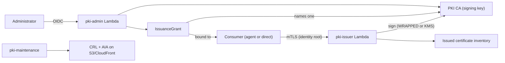
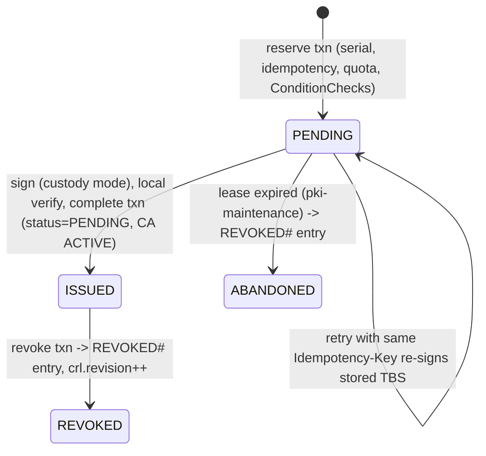

# Hemlig PKI plan

::: info Proposed design
Written November 2026. Nothing here is implemented yet. Current behavior is in the [guide](/guide/what-is-hemlig).
:::

## Purpose and scope

An administrator can create or import a certificate authority (CA) in an environment. They can build an intermediate hierarchy, and they can issue, revoke and renew certificates. A cluster can obtain certificates only inside an administrator-owned entitlement, held in Hemlig and bound to the cluster's mTLS consumer identity. The Kubernetes controller acts as a cert-manager external issuer. The PKI never touches Hemlig's own identity root, its truststore or its client certificates.

In scope:

- CA lifecycle: intermediate signed externally from a Hemlig CSR (the recommended topology), Hemlig-signed intermediate, Hemlig-generated root (allowed, but an external offline root is strongly recommended), and imported key material.
- Entitlements (IssuanceGrant) and the issuance policy engine.
- Certificate inventory, revocation and CRLs.
- The cert-manager issuer, admin-issued certificates, and managed certificates delivered as Hemlig secrets.
- In-cluster distribution of CA bundles and CRLs (`HemligTrustBundle`).

Out of scope for v1: OCSP, delta CRLs, ACME/EST/SCEP/CMP, the Kubernetes CSR API signer, cross-signing, Certificate Transparency, SSH certificates and `certificateHold`.

## Primary use case: automated in-cluster renewal

The must-have: leaf certificates signed by a **Hemlig-owned intermediate** renew automatically inside the user's cluster, with no human step after setup. Everything else in this plan supports this path, and it is the MVP acceptance test (gate PKI-7).

Topology: an external offline root (strongly recommended) or a `WRAPPED_PASSWORD` root signs a Hemlig intermediate in `WRAPPED` (or `KMS`) custody, which signs the cluster's leaves. The intermediate must use automated custody: a password-mode CA can't back an IssuanceGrant. Flag names below are indicative.

1. **Enroll the cluster** (existing flow): a HemligConsumer `payments-prod` with a PKI-only AgentGrant (empty secret scope).
2. **Create the intermediate.** With an external root (the default path in the console and docs):

   ```sh
   hemlig pki ca create --environment prod --name prod-issuing-1 \
     --kind EXTERNAL_INTERMEDIATE --custody WRAPPED --key-algorithm ECDSA_P256 \
     --subject 'CN=Example Prod Issuing CA 1,O=Example Corp' --path-len 0 \
     --permit-dns example.com --permit-dns svc.cluster.local --csr-out issuing.csr
   # offline: the root signs issuing.csr (openssl ca, an HSM, a corporate CA) -> issuing.pem
   hemlig pki ca activate prod-issuing-1 --certificate issuing.pem --chain root.pem
   ```

   Or, with a Hemlig root: `hemlig pki ca create --kind ROOT --custody WRAPPED_PASSWORD --name prod-root …`, then `hemlig pki ca create --kind INTERMEDIATE --parent prod-root --custody WRAPPED --name prod-issuing-1 …` (signed in a signing session).

3. **Grant the cluster** an IssuanceGrant (policy as in "Shape"):

   ```sh
   hemlig pki grant create payments-prod web --ca prod-issuing-1 --file grant.json
   ```

4. **Declare the issuer and the certificate:**

   ```yaml
   apiVersion: hemlig.zyno.io/v1alpha1
   kind: HemligIssuer
   metadata: { name: payments-web, namespace: payments }
   spec: { consumerRef: payments-prod, issuanceGrant: web }
   ---
   apiVersion: cert-manager.io/v1
   kind: Certificate
   metadata: { name: api, namespace: payments }
   spec:
     secretName: api-tls
     dnsNames: [api.payments.example.com]
     duration: 2160h # renewBefore defaults to one third of the lifetime
     issuerRef:
       { group: hemlig.zyno.io, kind: HemligIssuer, name: payments-web }
   ```

5. **Renewal is automatic.** cert-manager creates a new CertificateRequest when `renewBefore` is reached (by default when one third of the lifetime remains, two thirds elapsed). The chart's default approver (ON) approves it, the controller issues it through the grant with the stable `hml-cr-<uid>` idempotency key, and cert-manager updates the `api-tls` Secret in place. No human is involved.
6. **Near intermediate expiry,** leaf lifetimes clamp to the intermediate's `notAfter` and shrink silently. Maintenance alarms at `notAfter − maximum leaf lifetime − 30 days`. Rollover is a new intermediate (with a new subject DN, such as a generation suffix), distributing both CRLs and verifying a leaf under it, then `migrate-grants`, which is **admin-driven in v1**; the `HemligIssuer` names the grant, so Certificates keep working. Automated intermediate rollover is in Later.
7. **Revocation reaches workloads** through a `HemligTrustBundle` that writes the anchors (`ca.crt`), the intermediates and the CRL ConfigMaps. That ships in Phase 6, right after the MVP. Until then, short lifetimes are the revocation story.

**MVP acceptance (PKI-7):** a `Certificate` with `duration: 1h` and `renewBefore: 40m` against a `WRAPPED` intermediate renews at least twice with no human step, and each distinct renewed serial verifies against the independently retained offline `root.pem` (with `ca.crt`'s fingerprint asserted separately). The MVP phases (1–5) contain everything this path needs, including `EXTERNAL_INTERMEDIATE` activation (Phase 3).

## Fixed decisions

| Decision               | Chosen design                                                                                                                                                                                   | Why                                                                                                                                                                                                                 |
| ---------------------- | ----------------------------------------------------------------------------------------------------------------------------------------------------------------------------------------------- | ------------------------------------------------------------------------------------------------------------------------------------------------------------------------------------------------------------------- |
| CA key custody         | Per-CA custody mode, chosen at creation and immutable: `WRAPPED` (default), `WRAPPED_PASSWORD` or `KMS` (explicit opt-in)                                                                       | `WRAPPED` costs about $0 per CA and supports automated issuance. `KMS` keeps the key non-exportable (certificates signed during a compromise stay valid). `WRAPPED_PASSWORD` keys are useless without the password. |
| Identity root          | Unchanged and fully separate (`SYSTEM#ISSUER`, envelope key, node-forge)                                                                                                                        | A PKI-issued certificate must never authenticate to Hemlig.                                                                                                                                                         |
| X.509 stack            | New `src/pki/` on `@peculiar/asn1-schema`, `@peculiar/asn1-x509` and `@peculiar/asn1-csr` (MIT). `node:crypto` verifies signatures.                                                             | node-forge cannot parse EC keys and signs synchronously.                                                                                                                                                            |
| Entitlement object     | New IssuanceGrant: one consumer, one CA, a named policy                                                                                                                                         | AgentGrant `PUT` replaces scope in full. A separate record keeps PKI policy from being overwritten by secret-grant edits and gives it its own ETag.                                                                 |
| Who holds entitlements | Any active consumer: agents (with an ACTIVE AgentGrant) and direct consumers                                                                                                                    | The IssuanceGrant is the only boundary for both.                                                                                                                                                                    |
| Lambdas                | Three new: `pki-admin` (JWT), `pki-issuer` (mTLS) and `pki-maintenance` (scheduled). KMS custody adds a fourth, `pki-key-provisioner`, that only creates and tags keys.                         | Only the three hold `kms:Sign` on PKI keys and decrypt for `purpose=pki-ca`. None of them holds `issuer-ca` decrypt or KMS key-creation rights.                                                                     |
| Storage                | Every PKI item's `pk` starts with `PKI_`; one new GSI, `pki-directory`                                                                                                                          | IAM can then deny PKI writes to non-PKI roles, and identity writes to PKI roles, by prefix. CloudFormation adds only one GSI per table update.                                                                      |
| Revocation             | Full CRLs on S3. No public hosting by default. With an opt-in `pkiPublicationFqdn`, CloudFront serves them over HTTP and HTTPS. Consumers also fetch them in-cluster. OCSP is deferred.         | CRLs are pre-signed and cheap, and OCSP is being phased out industry-wide.                                                                                                                                          |
| CSR handling           | The CSR is input to policy, never a template. Hemlig builds every extension itself.                                                                                                             | A cluster can't smuggle extensions into a certificate.                                                                                                                                                              |
| Lifetime               | Clamped, never denied (except below the minimum). Never past the issuing CA's `notAfter`.                                                                                                       | Matches cert-manager expectations.                                                                                                                                                                                  |
| Names, usages, keys    | Denied, never silently dropped. The one exception is normalizing cert-manager's default `key encipherment` on EC keys.                                                                          | The requester always gets the names it asked for, or a clear failure.                                                                                                                                               |
| Kubernetes API         | `HemligIssuer` and `HemligClusterIssuer` in group `hemlig.zyno.io`, version `v1alpha1`                                                                                                          | A new surface that may change before beta. Uses the new group.                                                                                                                                                      |
| Deployment             | PKI is always deployed: the three Lambdas, routes, GSI, publication and signing-inputs buckets, wrapping key and maintenance schedule. Only `pkiPublicationFqdn` (with CloudFront) is optional. | The only always-on PKI cost is the wrapping key (about $1/month per deployment). Maintenance exits early when no CAs exist.                                                                                         |
| Key import transport   | CA private keys never cross the wire in plaintext. Clients encrypt to a deployment-wide KMS RSA wrapping key (`alias/hml-NAME-pki-wrapping`).                                                   | A compromised TLS hop or log never sees a CA key, and the server decrypts only in `pki-admin` memory.                                                                                                               |

## Concepts and terminology

New glossary entries. "Issuing root" keeps its current meaning and never appears in PKI APIs.

| Term                               | Definition                                                                                                                                                                                                                                                                                                                                                                                                                                                                           |
| ---------------------------------- | ------------------------------------------------------------------------------------------------------------------------------------------------------------------------------------------------------------------------------------------------------------------------------------------------------------------------------------------------------------------------------------------------------------------------------------------------------------------------------------ |
| PKI CA (certificate authority)     | An environment-owned CA record (`ca-<uuid>`) with a signing key in one of three custody modes, a certificate and a chain. It is one of four kinds: `ROOT`, `INTERMEDIATE` (signed by a Hemlig CA), `EXTERNAL_INTERMEDIATE` (signed outside Hemlig from a Hemlig CSR) or `IMPORTED` (existing key material imported). Kind and custody are independent.                                                                                                                               |
| Custody mode                       | How a CA key is stored and where it signs: `WRAPPED`, `WRAPPED_PASSWORD` or `KMS`. Immutable. See "CA key custody".                                                                                                                                                                                                                                                                                                                                                                  |
| Signing session                    | A short-lived server-side record that hands a deterministic TBS to an administrator's client to sign, for `WRAPPED_PASSWORD` CAs.                                                                                                                                                                                                                                                                                                                                                    |
| CA name                            | An immutable slug, unique per environment and never reused. URLs use `caId`, not the name.                                                                                                                                                                                                                                                                                                                                                                                           |
| Anchor                             | A self-signed root, or the topmost known certificate **only when the operator explicitly promotes it** (`anchorPromoted` on the CA). Only anchors are returned as `ca.crt`; intermediates go in `chain.crt`. A chain that doesn't reach a self-signed certificate and isn't promoted is incomplete (`chainComplete: false`). An anchor outside Hemlig (the offline root above an `EXTERNAL_INTERMEDIATE`) is registered as a public-only **anchor record** with a stable `anc-…` ID. |
| IssuanceGrant                      | An administrator-owned entitlement for one consumer. It names one CA and the names, subject, usages, key algorithms, lifetimes and CA permission the consumer may request, plus the attributes Hemlig forces. Deny by default. It is identified by `(consumerId, name)` and holds an immutable `uid`.                                                                                                                                                                                |
| Forced attribute                   | A subject attribute, SAN, policy OID or extension that Hemlig adds to every certificate issued under a grant.                                                                                                                                                                                                                                                                                                                                                                        |
| Issued certificate                 | The inventory record for one serial under one CA: status, fingerprint, names, requester and validity.                                                                                                                                                                                                                                                                                                                                                                                |
| Reservation                        | A `PENDING` issued-certificate record written before anything signs.                                                                                                                                                                                                                                                                                                                                                                                                                 |
| Revocation entry                   | `PKI_CA#caId / REVOKED#serial`, the input to CRL generation.                                                                                                                                                                                                                                                                                                                                                                                                                         |
| CRL number                         | A per-CA counter that strictly increases.                                                                                                                                                                                                                                                                                                                                                                                                                                            |
| Publication endpoint               | `http://<pkiPublicationFqdn>/crl/<caId>.crl` and `/ca/<caId>.crt`, frozen into a CA at creation.                                                                                                                                                                                                                                                                                                                                                                                     |
| Managed certificate                | A certificate whose key Hemlig generates, stored as the payload of a normal Hemlig secret (`tls.crt`, `tls.key`, `ca.crt`) and renewed by Hemlig.                                                                                                                                                                                                                                                                                                                                    |
| HemligIssuer / HemligClusterIssuer | cert-manager external issuer resources that bind a HemligConsumer to one IssuanceGrant name.                                                                                                                                                                                                                                                                                                                                                                                         |

How they relate:



## Architecture and trust boundaries

| Caller                     | Authenticates with                        | Route and Lambda                    | May do                                                                          |
| -------------------------- | ----------------------------------------- | ----------------------------------- | ------------------------------------------------------------------------------- |
| Administrator              | OIDC JWT, plus optional PKI roles         | `/v1/admin/pki/*` → `pki-admin`     | CA lifecycle, grants, admin issuance, revocation, managed certificates          |
| Consumer (agent or direct) | Hemlig client certificate (identity root) | `/v1/pki/*` → `pki-issuer`          | Read its own grants; issue within a grant                                       |
| Relying party              | None                                      | CloudFront `pkiPublicationFqdn`     | Fetch CRLs and CA certificates                                                  |
| Scheduler                  | Lambda role                               | `pki-maintenance`, every 15 minutes | CRL refresh (not for password-mode CAs), reservation recovery, renewals, alarms |

### Trust separation from the identity root

The invariant: a PKI-issued certificate never authenticates to the delivery API, AWS IoT or any Hemlig route. It's enforced at seven independent layers.

| #   | Layer               | Enforcement                                                                                                                                                                                                                                                                                                                                                                                                                                                                                                                                                                                                                                                                                                                                                                                                                                                                                                                                                                                                                                                                                                                                                                                                                                                                                                                                                                                                                                                   | Test                                                                                                                                                                                                                                                                                                                                                                                                                |
| --- | ------------------- | ------------------------------------------------------------------------------------------------------------------------------------------------------------------------------------------------------------------------------------------------------------------------------------------------------------------------------------------------------------------------------------------------------------------------------------------------------------------------------------------------------------------------------------------------------------------------------------------------------------------------------------------------------------------------------------------------------------------------------------------------------------------------------------------------------------------------------------------------------------------------------------------------------------------------------------------------------------------------------------------------------------------------------------------------------------------------------------------------------------------------------------------------------------------------------------------------------------------------------------------------------------------------------------------------------------------------------------------------------------------------------------------------------------------------------------------------------------- | ------------------------------------------------------------------------------------------------------------------------------------------------------------------------------------------------------------------------------------------------------------------------------------------------------------------------------------------------------------------------------------------------------------------- |
| 1   | TLS                 | The API Gateway truststore is built only from `TRUSTSTORE#ROOTS` items, which only the enrollment path writes (`src/services/consumers.ts`). PKI code has no method that writes them. PKI roles get no truststore bucket write and no `apigateway:*` (contrast `grantTruststorePublisher`, `cdk/stack.ts:1257`).                                                                                                                                                                                                                                                                                                                                                                                                                                                                                                                                                                                                                                                                                                                                                                                                                                                                                                                                                                                                                                                                                                                                              | CDK assertion. Unit test: creating PKI CAs leaves the truststore anchor set unchanged. AWS gate PKI-3: API Gateway rejects a PKI client certificate (403) once the identity truststore is attached.                                                                                                                                                                                                                 |
| 2   | Identity lookup     | `consumerActorFromEvent` requires `IDENTITY#sha256`, kind `api`, `ACTIVE` (`src/auth/actors.ts:86-99`). PKI never writes `IDENTITY#`.                                                                                                                                                                                                                                                                                                                                                                                                                                                                                                                                                                                                                                                                                                                                                                                                                                                                                                                                                                                                                                                                                                                                                                                                                                                                                                                         | IAM deny (layer 4). Repository test.                                                                                                                                                                                                                                                                                                                                                                                |
| 3   | Keys                | CA keys are either envelope-encrypted under the application CMK (`purpose=pki-ca`, or `pki-ca-password` for password blobs), or distinct KMS `SIGN_VERIFY` keys. PKI roles get `kms:Decrypt` on the application CMK only with `kms:EncryptionContext:purpose = pki-ca` (`pki-admin` also gets `pki-ca-password`, and `pki-admin` and `pki-maintenance` also get `pki-managed-staging`), and no decrypt or `GenerateDataKey` for `issuer-ca` (compare `cdk/stack.ts:424-470`). Identity, admin, bootstrap, identity-rotation and consumer roles get no decrypt for `pki-ca` or `pki-ca-password` and no `kms:Sign` on PKI-tagged KMS keys.                                                                                                                                                                                                                                                                                                                                                                                                                                                                                                                                                                                                                                                                                                                                                                                                                     | CDK template assertions in both directions.                                                                                                                                                                                                                                                                                                                                                                         |
| 4   | Data plane IAM      | The PKI roles don't get `grantReadWriteData`. Each gets a per-role write allowlist: `Put/Update/DeleteItem` and `BatchWriteItem` with `ForAllValues:StringLike dynamodb:LeadingKeys` limited to `PKI_*` plus its own idempotency and audit-suppress prefixes (`pki-admin`: `IDEMPOTENCY#human#*`; `pki-issuer`: `AUDIT_SUPPRESS#*`; `pki-maintenance`: none beyond `PKI_*`). Transactions are evaluated per item action (`Put`, `Update`, `Delete`, `ConditionCheck`), so one key outside the allowlist fails the whole `TransactWriteItems` or `BatchWriteItem`. A transactional `ConditionCheck` is authorized by `dynamodb:ConditionCheckItem`, which each PKI role gets on exactly the partitions its issuance path checks (`IDENTITY#*`, `AGENT_GRANT#*`, `CONSUMER#*`, and `PKI_*`) and nowhere else. It checks but never writes, and the write denies stay. PKI roles are read-only (`GetItem`, `Query`, `BatchGetItem`) on `CONSUMER#*`, `IDENTITY#*`, `AGENT_GRANT#*`, `SYSTEM#ISSUER` and the environment registry `SYSTEM#ENVIRONMENTS` (CA creation uses `requireEnvironment`, maintenance enumerates environments for the per-environment CA directory), and get no access to `TRUSTSTORE#*`, `SYSTEM#TRUSTSTORE`, `ENROLLMENT#*` or `BOOTSTRAP#*`. Belt and braces: an explicit `Deny` on writes to every identity prefix. Non-PKI roles: `Deny` writes on `PKI_*`. The LeadingKeys condition already has a precedent (`cdk/stack.ts:398-404`). | CDK assertion. AWS gate PKI-1 (IAM policy simulator): mixed-key `BatchWriteItem` and `TransactWriteItems` (one `PKI_` key plus one `CONSUMER#` key) are denied for every PKI role, **and** a successful deployed reservation succeeds for `pki-issuer` (every `ConditionCheck` on the identity, AgentGrant, grant and ancestor items). A gate of denials alone could pass while every valid reservation also fails. |
| 5   | Code                | `src/pki/**` must not import `services/issuer`, `services/consumers` or `services/agent-notifications`.                                                                                                                                                                                                                                                                                                                                                                                                                                                                                                                                                                                                                                                                                                                                                                                                                                                                                                                                                                                                                                                                                                                                                                                                                                                                                                                                                       | `src/pki/import-boundary.test.ts` scans the imports.                                                                                                                                                                                                                                                                                                                                                                |
| 6   | Reserved identities | Reject a PKI CA (created, imported or external) whose SPKI or subject DN equals the identity root's, or whose uploaded chain contains it. The check reads `SYSTEM#ISSUER` (read-only, strongly consistent) and a `PKI_SPKI#<sha256>` registry (see "CA creation flows"). Before the identity root exists, the DN check uses the fixed identity-root subject and the SPKI check is vacuous (a lazily created root gets a fresh random key). Every grant and admin request denies the URI prefix `spiffe://hemlig/` (the identity SAN, `issuer.ts:63`).                                                                                                                                                                                                                                                                                                                                                                                                                                                                                                                                                                                                                                                                                                                                                                                                                                                                                                         | Policy unit tests.                                                                                                                                                                                                                                                                                                                                                                                                  |
| 7   | IoT                 | PKI roles have no `iot:*`. PKI certificates are never registered.                                                                                                                                                                                                                                                                                                                                                                                                                                                                                                                                                                                                                                                                                                                                                                                                                                                                                                                                                                                                                                                                                                                                                                                                                                                                                                                                                                                             | CDK assertion.                                                                                                                                                                                                                                                                                                                                                                                                      |

The rule is symmetric. There is no API that adds an arbitrary root to the truststore, and the plan keeps it that way.

## CA key custody

### Custody modes

Each CA picks a mode at creation. It's immutable and independent of `kind`.

| Mode                                             | Key at rest                                                                                                                                                                                                                                                                                                                                                                                                                               | Signs where                                                                                          | Automated issuance (IssuanceGrants, managed certs, scheduled CRLs)                                              | Cost                             |
| ------------------------------------------------ | ----------------------------------------------------------------------------------------------------------------------------------------------------------------------------------------------------------------------------------------------------------------------------------------------------------------------------------------------------------------------------------------------------------------------------------------- | ---------------------------------------------------------------------------------------------------- | --------------------------------------------------------------------------------------------------------------- | -------------------------------- |
| `WRAPPED` (default)                              | PKCS#8 DER envelope-encrypted under the existing application CMK (the identity-root envelope pattern, `src/crypto/envelope.ts`), encryption context `{service: "hemlig", purpose: "pki-ca", caId, environment}`, stored on the CA record (`key.wrapped`)                                                                                                                                                                                  | PKI Lambda, `node:crypto.sign`. The key is in memory only during the call, and the buffer is zeroed. | Yes                                                                                                             | About $0                         |
| `WRAPPED_PASSWORD`                               | PKCS#8 encrypted **client-side** with a password (PBKDF2-HMAC-SHA256, 600,000 iterations, random 16-byte salt → AES-256-GCM, AAD = `hemlig-pki-ca-key:v1\|environment\|caName\|spkiSha256`; the name is immutable and never reused, and `caId` doesn't exist yet when the client encrypts). That blob is then envelope-encrypted under the CMK with its own context `{service: "hemlig", purpose: "pki-ca-password", caId, environment}`. | Administrator's client: CLI via `node:crypto`, console via WebCrypto                                 | No. Only administrator-interactive operations: issuing intermediates and admin certs, signing CRLs, revocations | About $0                         |
| `KMS` (explicit opt-in per CA, `custody: "KMS"`) | Non-exportable KMS asymmetric `SIGN_VERIFY` key, created at runtime by the PKI admin Lambda (tags, alias), or imported with `ImportKeyMaterial`                                                                                                                                                                                                                                                                                           | KMS `Sign`                                                                                           | Yes                                                                                                             | About $1/month per CA + requests |

**Trade-off.** In `WRAPPED` mode, a compromised PKI Lambda role (decrypt on `purpose=pki-ca`) can exfiltrate wrapped CA keys and sign offline indefinitely. `KMS` mode means the key can't be exported, and every `Sign` lands in CloudTrail. But certificates signed during a compromise (including subordinate CA certificates) stay valid afterwards until revoked, and application policy and inventory don't mediate direct use of a role's `kms:Sign`. Automated issuer roles therefore get no `Sign` on root-like CAs (see IAM). `WRAPPED_PASSWORD` keys are useless without the password. KMS mode is also the only mode with HSM-backed keys (FIPS 140-3 Level 3) and adds 20–50 ms per `Sign`.

- **KDF choice.** PBKDF2 rather than argon2id, so the console can use WebCrypto without WASM. argon2id via WASM is a later option.
- **Password floor.** At least 16 characters, enforced in the client (the server never sees the password). The server enforces the PBKDF2 floor structurally on uploaded blobs (see rewrap).
- **Lost password** means the CA is unusable, by design. There is no recovery or escrow.
- **Envelope:** `GenerateDataKey` on the application CMK with the context above, then AES-256-GCM, the same shape as `IssuerKeyEnvelope` (`src/services/issuer.ts:208-238`). The context carries `service: "hemlig"` like the existing ones. The wrapped blob never leaves the CA record except to a signing session. Only `pki-admin` can decrypt the `pki-ca-password` envelope: `pki-issuer` and `pki-maintenance` never sign for password CAs.

For comparison, AWS Private CA is $400 per month per general-purpose CA ($50 in short-lived mode) plus per-certificate fees. Even KMS custody keeps Hemlig's cost position, and wrapped custody costs nothing.

**Recommendation: `WRAPPED` by default.** For the root, an external offline root is **strongly recommended**: Hemlig creates an `EXTERNAL_INTERMEDIATE` (it generates the key, and the operator's root signs Hemlig's CSR). A Hemlig-generated ROOT is allowed in any custody; if you choose one, use `WRAPPED_PASSWORD`. Typical topology: **password root → `WRAPPED` or `KMS` intermediate → cert-manager leaves.** Password-mode CAs can't back IssuanceGrants or managed certificates (`ca_requires_interactive_signing`). Import exists only to migrate an existing CA. The original material then still exists outside Hemlig, which is the operator's responsibility and is stated in the docs.

### Key generation and import per mode

| Mode               | Generation                                                                                                                                                                             | Import                                                                                                                                  |
| ------------------ | -------------------------------------------------------------------------------------------------------------------------------------------------------------------------------------- | --------------------------------------------------------------------------------------------------------------------------------------- |
| `WRAPPED`          | In the PKI Lambda with `node:crypto.generateKeyPair`; wrapped immediately                                                                                                              | The client encrypts to the PKI wrapping key (CLI or console); plaintext never crosses the wire. The server re-envelopes it immediately. |
| `WRAPPED_PASSWORD` | On the client (CLI `node:crypto`, console WebCrypto), encrypted locally with the password and uploaded as `{encryptedKey, publicKeySpkiDer}`. The server never sees the plaintext key. | The CLI encrypts locally first. The server never sees the plaintext key.                                                                |
| `KMS`              | `CreateKey` at runtime, with tags and alias (see creation flows)                                                                                                                       | The existing `ImportKeyMaterial` flow with a client-side wrapped blob                                                                   |

### PKI wrapping key

One deployment-wide KMS asymmetric key, created by CDK: `KeyUsage ENCRYPT_DECRYPT`, `KeySpec RSA_4096`, algorithm `RSAES_OAEP_SHA_256`, alias `alias/hml-NAME-pki-wrapping`. It costs about $1/month per deployment, the only always-on PKI cost. It carries CA keys from clients to `pki-admin`, so no CA key ever crosses the wire in plaintext in any mode.

- **Public half:** `GET /v1/admin/pki/wrapping-key` → `{keyId, publicKeySpkiPem, fingerprint (sha256 of the SPKI DER), algorithm}`. CDK also outputs the fingerprint. The CLI pins it on first use (stored in its config dir) and refuses a changed fingerprint unless `--accept-new-wrapping-key`. `--verify-with-aws` optionally checks it with `kms:GetPublicKey` using the operator's own AWS credentials. The console shows the fingerprint before upload.
- **Client-side wrap** (CLI `node:crypto`, console WebCrypto; both support it, so the console can import `WRAPPED` keys too): generate a random AES-256 key, AES-256-GCM-encrypt the PKCS#8 DER with AAD `hemlig-pki-import:v1|environment|caName|spkiSha256`, and RSA-OAEP-SHA256-encrypt the AES key with the wrapping public key. Upload `{wrappedKey: {keyId, encryptedDataKey, iv, ciphertext}, publicKeySpkiDer}`. KMS RSA decrypt takes no encryption context, so the binding lives in the AAD. The server recomputes the AAD from the request and rejects mismatches.
- **Server** (`pki-admin` only): `kms:Decrypt` on the wrapping key with `kms:EncryptionAlgorithm = RSAES_OAEP_SHA_256`, then AES-GCM decrypt, verify the key matches the certificate or SPKI with a test signature, re-envelope under the application CMK (`purpose=pki-ca`) as the normal `WRAPPED` at-rest format, and zero the buffers. The plaintext exists only in `pki-admin` memory, never on the wire, never logged. There's one at-rest format and a cheap symmetric decrypt on every sign.
- **Applies to** `WRAPPED` import. `WRAPPED_PASSWORD` already encrypts client-side (unchanged). `KMS`-custody import keeps KMS's own `ImportKeyMaterial` wrapping (unchanged).
- **IAM:** only `pki-admin` may `Decrypt` with the wrapping key. No role may call `Encrypt` with it (clients encrypt with the public key locally). A CDK assertion and the PKI-1 gate check both.
- **Rotation:** create a new key (new alias version and `keyId`), serve the new one, keep the old one able to decrypt for 7 days, then disable it. Documented in `operations/pki-wrapping-key.md`.

### Password-mode signing protocol (signing session)

1. **Start.** An administrator starts an operation that needs the CA's signature: create a root or intermediate signed by a password CA, admin issuance, renew, revoke plus CRL, CRL re-sign, retire (final CRL). Every operation under a password CA requires `oidcPkiCaAdminRole` (when set), because it releases the key blob, and only that role can complete the session. The server runs the full validation and policy pipeline, builds the deterministic TBS (or TBSCertList) and writes the inventory reservation (the invariant "inventory record before signature" holds). It then writes `PKI_SIGNING#sessionId / PROFILE` (see `SigningSessionRecord`, `expiresAt = now + 10 min`). Signing inputs over 64 KiB (large CRLs) are stored as an immutable S3 object in a separate **private signing-inputs bucket** (never the publication bucket, which CloudFront can reach) with their digest in the session. The `202` then carries `tbsSha256` and `inputPath` instead of `tbsDer`, and the client fetches the bytes through the authenticated admin route `GET /v1/admin/pki/signing-sessions/{id}/input`, bound to the session (same `sub`, `PENDING` only). No presigned S3 URL is used: the console's CSP `connect-src` allows only itself, the admin API and the IdP, so it couldn't fetch one. It KMS-decrypts only the outer envelope (`purpose=pki-ca-password`, `pki-admin` only) and returns `202 {signingSessionId, tbsDer, signatureAlgorithm, encryptedKey: {salt, iterations, iv, ciphertext}}`. There is no server-supplied summary. Audit `pki.ca.key-release` (no key material in the event), rate-limited to 10 per hour per CA, with an alarm.
2. **Decrypt, verify, sign locally.** The client prompts for the password, decrypts the key and derives the CA public key from it. It treats the server-supplied CA certificate as untrusted, and verifies every signature it checks against the derived key. It decodes `tbsDer` itself (the console ignores any server hint) and verifies it matches what it asked for:
   - subject, SANs, `isCA`/pathLen, validity, issuer and extensions;
   - `subjectPublicKeyInfo`: for CSR issuance it equals the local CSR's SPKI; for renew it equals the prior certificate's (after verifying that certificate's signature); for a root it equals the client's own generated key;
   - the inner `signature` AlgorithmIdentifier equals `signatureAlgorithm`;
   - for a CRL (TBSCertList): the client fetches the last published CRL and verifies it against the derived key. For the **first** CRL of a new CA there is none: it expects `crlNumber = 1` and no entries (for an imported CA, the imported number plus one, with entries exactly equal to the handoff CRL's, which the CLI verified and recorded at import). The initial CRL is a persisted generation (`crl.initial`). **Supersede rule:** the first generation must be number 1 (imported plus one). A later generation is accepted only when the CA is still `PENDING_CRL`, the server presents the full **supersession chain** (every earlier generation's number, `thisUpdate` and TBS digest, all unpublished), and that chain is consecutive from the initial number (1, or imported plus one) or from the client's highest journaled number, so a missed response can't strand it. The client independently checks that the entries equal its pinned initial entries or the import handoff it recorded (a fresh client has no pin and shows the chain for confirmation), that `thisUpdate` is fresh (±5 minutes), and that no number in the chain appears on a published CRL. For a new root, completion is verified against the registered public key, because its certificate is still being assembled. It also pins the last CRL number and digest it accepted in its config dir (first use is trust-on-first-use, shown to the administrator for confirmation), so a backend can't present an older, correctly signed CRL as the latest. `crlNumber` must exceed the pinned number, and a fetched CRL older than the pin is refused. The new entries must be a superset of the previous ones. **The client never needs a certificate to keep an entry, only to remove one early.** It accepts a removal only with evidence it can check, by entry kind: an ordinary entry needs the revoked certificate (signature verified with the derived key, and `notAfter` earlier than the `thisUpdate` of an already committed CRL that carried the entry; CRL entries carry no `notAfter`); an abandoned reservation is checked against the client's local journal of the TBS it was shown (planned `notAfter` earlier than the `thisUpdate` of an already committed CRL that carried it); an imported or seeded entry is checked against the cutoff (`previouslyIssuedNotAfter` earlier than the `thisUpdate` of an already committed CRL that carried the entry) the CLI recorded at import. Entries it has no local evidence for (such as a newly designated signing client) are retained: the server lists them with their stated bounds, the client accepts that list only as retain-until-bound, and any removal after the bound is shown for explicit confirmation. Otherwise a removal is refused, and abandoned and imported entries stay on the CRL and in `outstandingCount` for their bound. `thisUpdate` must be within ±5 minutes of now and `nextUpdate ≤ thisUpdate + 1 year`. It displays the entries being added. It journals the pending signature locally before posting it, so a lost completion request can be retried, and advances the **committed** pin only after confirming the CRL is published. A second administrator's local pin can't see a CRL accepted only by the first, so rollback protection across clients is either one designated signing client per CA (the default) or a shared, independently trusted checkpoint that replaces the local pin.

   The CLI compares field by field and shows a summary, and the console shows its own decoded summary. After confirmation the client signs, zeroes the key, then calls `POST /v1/admin/pki/signing-sessions/{id}/signature {signature}`. A compromised server therefore can't get an arbitrary TBS signed. The one gap, a child CA whose key the server generated, is in the threat model.

3. **Complete.** The server verifies the signature against the CA certificate's public key over the stored TBS, assembles the certificate or CRL, runs the normal completion transaction and audits. Only the same OIDC `sub` may complete a session, and a session is single-use. An expired session abandons its reservation through the existing recovery path.

The password never reaches the server.

### Password rotation (rewrap)

`POST /cas/{caId}/rewrap` (ca-admin):

1. The client fetches the blob through a signing session (`202 {signingSessionId, encryptedKey, nonce}`; audited as `pki.ca.key-release`, with the same rate limit). The nonce is exactly 32 random bytes, and the client refuses anything else.
2. It decrypts with the old password and re-encrypts with the new one (floor applies). It then decrypts the **new** blob and signs a message it constructs itself with that key, as proof the new blob works.
3. It uploads `{encryptedKey, popSignature}` to the signature endpoint. The server verifies the proof against the CA public key, runs structural checks on the new blob, and swaps it in with a condition on `keyVersion` (no concurrent-rewrap race; `keyVersion` is bumped).

**Proof of possession** (rewrap and password import). The client never signs a server-chosen blob. The message is `"hemlig-pki-pop:v1\0" || operation || "\0" || caId || "\0" || nonce`, where `operation` is `rewrap` or `import`. The ASCII prefix means it can never parse as DER (a TBS starts with `0x30`). The server verifies the same construction.

**Structural checks** on every uploaded blob (this also enforces the PBKDF2 floor): iterations ≥ 600,000, a 16-byte salt, a 12-byte IV, and a ciphertext length within the PKCS#8 bounds for the `keySpec` (plus the 16-byte tag).

**Recovery and limits.**

- The previous blob is kept 30 days. `POST /cas/{caId}/rewrap/restore` (ca-admin) swaps it back inside that window.
- `purgePrevious` is allowed only after a later successful signing session at the new `keyVersion`.
- Rewrap doesn't remediate a leaked password plus blob. A leaked password requires a new CA.

### Signer abstraction

- `CaSigner` has two implementations: `WrappedCaSigner` (decrypt, `node:crypto.sign`, zero) and `KmsCaSigner` (KMS mode). Password mode doesn't implement `CaSigner`. Its sign step returns `SigningRequired {sessionId}`, and the signing-session path completes the operation.
- `SoftwareCaSigner` isn't needed for MiniStack: `WRAPPED` runs on MiniStack's KMS symmetric support, which already works. It stays only as a test-only helper if a unit test wants a signer without a KMS mock.

### Algorithms

| CA key      | KMS `KeySpec` (KMS mode)                    | KMS `SigningAlgorithm` (KMS mode, `MessageType=DIGEST`) | Offered for                                                                                                                     |
| ----------- | ------------------------------------------- | ------------------------------------------------------- | ------------------------------------------------------------------------------------------------------------------------------- |
| ECDSA P-256 | `ECC_NIST_P256`                             | `ECDSA_SHA_256`                                         | All kinds (default)                                                                                                             |
| ECDSA P-384 | `ECC_NIST_P384`                             | `ECDSA_SHA_384`                                         | All kinds (suggested for roots)                                                                                                 |
| RSA 3072    | `RSA_3072`                                  | `RSASSA_PKCS1_V1_5_SHA_256`                             | All kinds                                                                                                                       |
| RSA 4096    | `RSA_4096`                                  | `RSASSA_PKCS1_V1_5_SHA_256`                             | All kinds                                                                                                                       |
| RSA 2048    | `RSA_2048`                                  | `RSASSA_PKCS1_V1_5_SHA_256`                             | `IMPORTED` only (legacy)                                                                                                        |
| P-521       | `ECC_NIST_P521`                             | `ECDSA_SHA_512`                                         | Not offered (poor TLS stack support)                                                                                            |
| Ed25519     | `ECC_NIST_EDWARDS25519` (KMS, if available) | `ED25519_SHA_512`, `RAW` only, message ≤ 4,096 bytes    | `WRAPPED` and `WRAPPED_PASSWORD` only. Not offered for `KMS`: the RAW cap is smaller than a CRL. See the compatibility warning. |
| ML-DSA      | `ML_DSA_*`                                  | —                                                       | Later (no mainstream X.509 client support)                                                                                      |

`WRAPPED` and `WRAPPED_PASSWORD` sign with `node:crypto` or WebCrypto, so the KMS limits above apply only to KMS mode. The CA key set is RSA 3072/4096, P-256 and P-384 in every mode (RSA 2048 import only), plus Ed25519 in the wrapped modes (`node:crypto` and WebCrypto sign it natively; `KMS` custody rejects it at creation). Ed25519 signatures are the raw 64-byte value with no digest (RFC 8410). WebCrypto Ed25519 support is recent, so the console feature-detects it and falls back to the CLI. ECDSA signatures are DER `ECDSA-Sig-Value`, which is exactly the X.509 `signatureValue` content: KMS and `node:crypto` (`dsaEncoding: "der"`) return it directly, and the console converts WebCrypto's raw `r||s`. In KMS mode Hemlig computes SHA-256 or SHA-384 locally and signs the digest, so there's no 4 KB message limit.

**Ed25519 compatibility warning** (console and docs): Ed25519 certificate chains are not accepted by browsers, and some TLS stacks, libraries and hardware don't support them. Go, OpenSSL 1.1.1 and later, and rustls support Ed25519; test BoringSSL-based and JVM stacks (such as Envoy and Java) yourself before relying on them. Prefer P-256 or P-384 unless every verifier is known.

Leaf keys in CSRs are independent of the CA key and are policed by `LeafKeyAlgorithm`, which covers `RSA_2048`, `RSA_3072`, `RSA_4096` and `RSA_8192` (the CSR validator accepts 2048 to 8192 bits, e = 65537; a size outside the listed four is denied `key_algorithm_not_permitted`), P-256 and P-384 by default; P-521 and Ed25519 only if a grant lists them.

### CA creation flows

All four flows are idempotent (human idempotency key, `operationType: pki.ca.create`). They're recoverable through `PKI_WORKFLOW#DUE`, the same `workflow-due` GSI with a distinct partition, so `recovery.ts` never sees them. They're audited. The request carries `custody` (default `WRAPPED`). A parent CA must be in the same environment as the new CA: there is no environment crossing.

**Registration.** When a CA's public key is known (generation, upload or import), one transaction updates the CA record and puts `PKI_SPKI#<sha256(canonical SPKI DER)> / LOOKUP` with `attribute_not_exists`. The registry key is the digest of a **canonical** public-key encoding (EC points uncompressed, RSA as `rsaEncryption` with NULL parameters), applied at every registration and lookup; non-canonical encodings (for example a compressed EC point) are rejected. The certificate's original DER is kept separately for signature and issuer-name checks. A duplicate is rejected (`409 ca_key_already_registered`), so the same issuing authority can never run under two independent CRL counters. **External ancestors.** When an `EXTERNAL_INTERMEDIATE` or non-self-signed `IMPORTED` CA is activated, the canonical SPKI digest of every certificate above it in the validated chain (including the offline root) is registered as an external-only entry, `PKI_SPKI#<sha256> / EXTERNAL`, by an upsert, conditioned on `attribute_not_exists(revokedAt)`, that also adds the CA to its `dependents`. The same transaction carries a `ConditionCheck` that `PKI_SPKI#<sha256> / LOOKUP` doesn't exist. Managed-key registration is the mirror image: its `Put LOOKUP` (`attribute_not_exists`) carries a `ConditionCheck` that `EXTERNAL` doesn't exist, refused as `409 ca_key_already_registered` (details reason `external_ancestor`). The two designations are therefore mutually exclusive in either registration order and under concurrent registration, so a key that is an external ancestor of an existing Hemlig CA can never later be imported as a managed CA. The CA record keeps `externalAncestors` (the digests) for the revocation lookup. **Distinct subject DNs.** Each independently numbered issuing CA in the same trust hierarchy must have a distinct X.509 subject DN. The hierarchy is identified by its trust anchor's **canonical SPKI digest** (`anchorSpkiSha256`), which is deployment-wide, so two environments that use the same offline root conflict too; `rootRef`/`ancId` stay environment-scoped and are used only for discovery. RFC 5280 identifies a CRL issuer by name, and a change of signing key doesn't change CRL scope, so a replacement CA that reused the old DN would publish a competing full CRL (its own entries, its number restarting at 1) that omits still-live revocations. Registration writes `PKI_SUBJECT#<anchorSpkiSha256>#<sha256(comparison form)> / LOOKUP` with `attribute_not_exists` in the same transaction as the key registration, for ROOT and INTERMEDIATE creation, external activation and import (external CSR creation also checks the requested subject as an early, advisory check). A duplicate is `409 ca_subject_in_use`. Activation also claims, under the same anchor, the comparison-form DN of every known external issuer in the validated chain (each external ancestor's subject), recording that issuer's SPKI digest: the claim is reusable by the same issuer key (a second Hemlig CA under the same external intermediate passes) and rejected for a different key, in either registration order (`ca_subject_in_use`; the claim `Put` is conditioned on `attribute_not_exists` or a matching key digest). Two issuers can therefore never publish full CRLs under one name. The entry is never released: a retired CA's DN stays reserved, so rollover always needs a new DN, such as one with a generation suffix. The **comparison form** follows RFC 5280 section 7.1: compare attribute type OIDs and values per RDN; an RDN's attributes are sorted by their canonical encoding; string-valued attributes (PrintableString, UTF8String, TeletexString, UniversalString, BMPString) are converted to UTF-8 and prepared with the RFC 4518 profile as applicable (map to space or delete, NFKC, prohibited-character check, case-fold to lowercase, then trim and collapse internal whitespace); non-string values compare by DER. The same CN encoded as PrintableString or UTF8String therefore maps to one key. The original DER is kept for encoding (`subjectDer`, byte-exact issuer copy). The registry is also the authoritative lookup for the reserved-key checks. The identity root is checked through a read-only, strongly consistent read of `SYSTEM#ISSUER` (see trust-separation layer 6); its provisioning code is unchanged.

**Anchors.** Topology is classified from the **validated chain**, not from `kind`: the CA record carries `selfSigned`. A self-signed `IMPORTED` root (`selfSigned: true`) is a Hemlig root: its own `caId` is its `rootRef`, it is **not** registered as an anchor (its SPKI already belongs to it in the registry, so there is no `409`), it follows the root rules (retire it and remove it from trust bundles; a CRL can't revoke it), and `record-external-revocation` rejects it. For every non-self-signed `EXTERNAL_INTERMEDIATE` or `IMPORTED` CA, when it is activated and its chain reaches a self-signed certificate (or the operator promotes the topmost one), Hemlig registers that certificate as a public-only anchor record in the CA's environment, keyed `PKI_SPKI#<sha256> / ANCHOR#<environment>` with `attribute_not_exists`. If it already exists, the existing `ancId` is reused, so two intermediates under the same offline root share one stable ID. An SPKI that belongs to a Hemlig CA is refused with `409 ca_key_already_registered` (use that CA's ID). The CA's `rootRef` is the anchor ID. A Hemlig `ROOT`'s `rootRef` is its own `caId`, and a Hemlig-signed `INTERMEDIATE` inherits its parent's. A chain that is incomplete and not promoted has no `rootRef` and isn't discoverable by hierarchy.

**Activation sequence (every flow).** A CA is `ACTIVE` only after all of these hold:

1. its certificate verifies against its **issuer's** public key (itself for a self-signed root);
2. the certificate's SPKI equals the CA key's public key;
3. its initial CRL is signed and stored.

Certificate signing and initial-CRL signing are separate recoverable steps: `PREPARED` → `PENDING_CERTIFICATE` (external only) → `PENDING_CRL` → `ACTIVE`. The initial CRL is always written to the private publication bucket, even when public hosting is disabled (the admin and consumer CRL routes serve it). The CRL is signed by the CA's own key, so under a password CA it's a second signing session (`crl.sign`) over a different object than the certificate. A password child under an automated parent needs no session for its certificate, but still needs its own client to sign its initial CRL.

**The initial CRL is a persisted generation.** When the CA reaches `PENDING_CRL`, one conditional update allocates `crl.lastNumber` (1, or the imported number plus one) and stores `crl.initial = {number, tbsDigest, tbsDer or tbsRef, handoffCrlSha256?}` together. A retry or recovery pass while the generation is fresh (its `thisUpdate` still inside the client's ±5-minute acceptance window) reuses that number and exact TBS. A **stale** unpublished generation (its session expired, so its `thisUpdate` can no longer pass the client's check) is **superseded**. First reconcile: read the CRL object and any completed session, and if the old generation was signed or published, finalize it as the CA's initial CRL and supersede nothing. Otherwise one update conditioned on `crl.initial.number` replaces `crl.initial` with a fresh generation (new `thisUpdate` and `nextUpdate`, `number + 1`, the same entries), appends the old one to `crl.initial.superseded`, advances `crl.lastNumber` in the same update (so the first ordinary refresh also gets a higher number), and marks the old session `EXPIRED`. The signing input of the pending generation, including a large imported first CRL's referenced object, is retained for as long as the generation is pending. The client applies the supersede rule above, so a crash can never leave a password CA unable to publish its first CRL. For an import, `crl.initial` is bound to the verified handoff CRL: its entries are exactly the seeded `REVOKED#` entries (digest `handoffCrlSha256`), and `thisUpdate` and `nextUpdate` are fixed in the stored TBS.

1. **ROOT**
   1. In `pki-admin`, generate the `caId` and, for `WRAPPED`, the key and its CMK envelope first. Then one transaction: `PKI_CA_NAME#env#name` (`attribute_not_exists`) plus `PKI_CA#caId` `PREPARED`, carrying the envelope (`key.wrapped`) and the planned certificate inputs (subject, validity, constraints), with `crl` initialized (`revision: 0`, `lastNumber: 0`). A losing concurrent creator zeroes and discards its unused key. A `PREPARED` wrapped CA therefore always already holds its key.
   2. Create the key, by mode (for `WRAPPED` it already exists from step 1):
      - `WRAPPED`: `node:crypto.generateKeyPair`, envelope-encrypt the PKCS#8 DER under the CMK and store `key.wrapped` on the CA record. The plaintext buffer is zeroed.
      - `WRAPPED_PASSWORD`: the client generates and encrypts the key and uploads `{encryptedKey, publicKeySpkiDer}`. The server envelope-wraps the blob. It never sees the plaintext key.
      - `KMS` (Phase 10): `pki-admin` invokes `pki-key-provisioner`, which runs `CreateKey` with tags `hemlig:deployment`, `hemlig:purpose=pki-ca`, `hemlig:environment`, `hemlig:ca-id`, `hemlig:created-by=pki-key-provisioner` (and `hemlig:automation=allowed` only for a leaf-issuing CA), then `CreateAlias alias/hml-<deploymentName>-pki-<caId>` (matching the IAM alias pattern; the runtime environment isn't the deployment name).
   3. Register the SPKI, build the self-signed TBS and sign it. `WRAPPED`: the PKI Lambda signs. `KMS`: `GetPublicKey`, then `Sign`. `WRAPPED_PASSWORD`: a signing session, the client signs the self-signed root TBS and posts the signature. In every mode, verify locally. Then `PENDING_CRL`.
   4. Sign and store the initial CRL (a second signing session for a password root). If publication is enabled, also publish `ca/<caId>.crt` and the CRL.
   5. Set `ACTIVE`.

   Recovery for signing is keyed on the **signer's** custody: the CA itself for a ROOT, the parent for an INTERMEDIATE, not the child's. Certificate and initial-CRL steps recover independently.

   - A `WRAPPED` or `KMS` signer resumes and re-signs the stored TBS, rebuilt deterministically from the planned inputs on the `PREPARED` record when it wasn't yet stored. Maintenance never generates or wraps a key (it has no `GenerateDataKey` for `purpose=pki-ca`). The exception is a subordinate-only (root-like) KMS signer: maintenance has no `kms:Sign` on it, so recovery leaves the creation in a persisted, admin-resumable step (`signingStep: AWAITING_ADMIN` on the CA record, with the stored TBS and reservation intact) and raises an alarm. An idempotent CA-admin retry of the same `POST /cas` (same `Idempotency-Key`) finishes the original creation, with `pki-admin` signing the stored TBS under the existing reservation. The same admin-resumable step covers **incomplete KMS key provisioning or public-key registration** for every KMS CA, automation-eligible ones included: `PREPARED` committed before `pki-admin` invoked the provisioner, or the invocation stopped after `CreateAlias` and before `GetPublicKey` (maintenance can't invoke the provisioner and has no `kms:GetPublicKey`). Recovery marks the creation `AWAITING_ADMIN` with its original `caId` and name claim, and the idempotent CA-admin retry invokes the provisioner (which recovers an existing key by ARN or `hemlig:ca-id` tag), runs `GetPublicKey`, registers the SPKI, stores the TBS and continues. **The waiting state is persisted on the parent's inventory reservation itself** (`awaitingAdmin: true` on the `PENDING` record), in the same transaction that marks the creation `AWAITING_ADMIN`, and the ordinary recovery worker skips reservations with that flag (no 10-minute abandonment). An explicit CA-admin cancellation (`POST /cas/{caId}/cancel-creation`, idempotent) abandons the reservation the usual way (`REVOKED#` entry, `pendingReservations` decrement) and marks the CA `FAILED`. A creation left waiting more than 24 hours raises an alarm.
   - A password signer: when the signing session expires, the CA becomes `FAILED` and any generated wrapped key or uploaded blob is deleted. The administrator starts over. This covers a `WRAPPED` child under a password parent, where creation is a signing session.
   - A password child under a `WRAPPED` parent needs no session for its certificate, so recovery re-signs the stored TBS. Its initial CRL is a session of its own. An expired initial-CRL session leaves the CA `PENDING_CRL`, and the administrator starts a new session; a stored TBS that has gone stale is superseded under the rule in the activation sequence.
   - For a `KMS` child, key creation also recovers through the alias. If `CreateKey` succeeded and `CreateAlias` didn't, the trusted provisioner recovers the creation from the key ARN, or, if the `CreateKey` response was lost before the ARN was recorded, by finding the key through its `hemlig:ca-id` creation tags (`tag:GetResources` on its own role), verifies ownership, and finishes the alias (without the alias, the signing roles' alias condition would make the key undeletable). A key whose CA can't be found at all is an orphan. A daily orphan sweep considers **only** keys carrying `hemlig:created-by=pki-key-provisioner`, which only the runtime provisioner sets. A pre-provisioned key (`hemlig:provisioning=external`, no `created-by` tag) is never swept or auto-deleted, however long it waits for registration. The sweep schedules deletion only for real orphans: every live workflow (`PREPARED`, `PENDING_CERTIFICATE`, `PENDING_IMPORT`, `PENDING_CRL`, an open signing session) owns its key. The sweep makes a strongly consistent ownership check by the `hemlig:ca-id` tag against the CA record, and applies an age threshold (7 days) before scheduling deletion.

2. **INTERMEDIATE**: the same flow, signed by the parent per the **parent's** custody mode (independent of the child's). A `WRAPPED` or `KMS` parent signs inline. A password parent runs a signing session. The parent checks are in the issuance pipeline section ("Parent checks for intermediates"), including that the parent is in the same environment. The child certificate is recorded in the parent's inventory, so the parent's CRL can revoke it. The child's creation transaction also increments the parent's `childCount`, conditioned on the parent being `ACTIVE` and not `migrating`; `childCount` is decremented when the child becomes `RETIRED`, `REVOKED` or `FAILED`.
3. **EXTERNAL_INTERMEDIATE**
   1. Create the key per mode, build a CertificationRequest that carries the requested subject, SPKI and extensions (BasicConstraints with `pathLen`, KeyUsage, NameConstraints, EKU), persist those requested constraints on the CA (`requestedConstraints`), sign it and return `csrPem`. `WRAPPED`: the server signs. `KMS`: KMS signs. `WRAPPED_PASSWORD`: the client builds and signs the CSR locally and uploads it with the encrypted key; the server verifies it. The CA is now `PENDING_CERTIFICATE`. It can stay there a long time while an external CA signs, so it's never an orphan.
   2. `POST .../certificate` with the signed certificate and chain. Hemlig checks:
      - the certificate's SPKI equals the CA key's public key (KMS `GetPublicKey`, or the stored `spkiSha256`);
      - it is a CA (`cA=true`) and, when KeyUsage is present, it carries **both** `keyCertSign` and `cRLSign` (the key must verify Hemlig's CRLs);
      - every chain signature, validity window, pathLen and name constraint holds;
      - the chain contains no `policyConstraints`, `inhibitAnyPolicy` or `policyMappings` extension (unsupported in v1, rejected at activation), and RFC 5280 path validation of a proposed child certificate under the chain succeeds;
      - the chain does not contain the identity root;
      - no chain certificate's key belongs to a Hemlig CA (every chain certificate's SPKI is resolved against the `PKI_SPKI#` CA registry, excluding the CA's own certificate and the anchor-by-design record): otherwise `409 chain_contains_managed_ca`. A subordinate of a Hemlig CA must be created as an `INTERMEDIATE`, never imported or activated externally, so its revocation can't diverge from its parent's inventory;
      - the returned certificate satisfies the persisted `requestedConstraints`: subject, `pathLen`, name constraints and usages are no broader than requested. A broader certificate (for example an unconstrained intermediate when `pathLen: 0` and DNS constraints were requested) is refused unless an administrator explicitly authorizes it (`acceptBroaderConstraints: true`);
      - the chain reaches a self-signed certificate. Otherwise the CA is activated only when the operator sets `anchorPromoted: true`, an explicit trust decision recorded on the CA.
   3. Then `PENDING_CRL`: sign and store the initial CRL, publish AIA when publication is enabled, and set `ACTIVE`.
4. **IMPORTED**: `POST /cas` with the certificate and chain first, and Hemlig derives the key spec from the SPKI. The activation checks of an external intermediate apply to the chain. Then:
   - **History.** An imported CA that has ever issued must bring its history: its latest CRL (verified against the CA key) and an operator-declared `previouslyIssuedNotAfter` (the latest `notAfter` of any certificate it issued). The CRL must be a verified **full-scope** CRL (no delta, IssuingDistributionPoint or partitioning), and every entry's reason must be one Hemlig supports. A live `certificateHold` (or `removeFromCRL`) entry is rejected (`400 import_crl_unsupported_entry`, listing the serials) **before the CA name is claimed or any key is imported**, because Hemlig can neither drop it (that would restore trust early) nor preserve it (revocation is irreversible); the source CA resolves the hold and publishes a new handoff CRL. Hemlig seeds `REVOKED#` entries from it (retained until a CRL issued after `previouslyIssuedNotAfter` has been published, because per-certificate expiry is unknown) and continues the CRL number from it, so its first CRL is `number + 1`. Import also requires a declared, conservative bound on the outstanding live certificates the CA issued (`declaredOutstanding`); seeded entries plus that bound are charged to `outstandingCount` at handoff and the import is refused if they exceed the cap. Capacity is therefore reserved for their later revocation. The bound is tracked separately as `importedAllowance` (the remaining declared allowance, included in `outstandingCount`): the first `revoke-by-certificate` of an imported certificate transfers one slot from the allowance to that certificate's inventory row (`importedAllowance - 1`, `outstandingCount` unchanged), and maintenance releases whatever allowance remains once, at `previouslyIssuedNotAfter` (conditioned on the loaded value), so a CA imported at the cap isn't full forever after the cohort expires. Each seeded revocation keeps its own slot through post-expiry publication, released under the same one-time rule. An imported certificate that is **already expired** when first presented is recorded as an audit-only revocation (inventory row marked `imported`, status `REVOKED`, no `REVOKED#` entry) and changes neither `importedAllowance` nor `outstandingCount`: it may have expired before the handoff and never held a slot, and any allowance conservatively held for it is released with the residual at `previouslyIssuedNotAfter`. Certificates that were issued and are still valid but unrevoked have no inventory row, so the operator uses **`revoke-by-certificate`** (`POST /cas/{caId}/revoke-certificate`): an administrator presents the certificate, Hemlig verifies it was signed by this CA's key and revokes its serial, creating an inventory row marked `imported`. A CA that never issued sets `previouslyIssued: false` and skips the handoff. The old CDP URLs stay the operator's job: certificates already issued point at them, and Hemlig can't serve them (documented). `destroy-key` is conditioned on `previouslyIssuedNotAfter` too.
   - Then, by mode:
     - `WRAPPED`: the same request carries `{wrappedKey, publicKeySpkiDer}`, encrypted client-side to the PKI wrapping key. `pki-admin` decrypts it, verifies key ↔ certificate with a test signature, re-envelopes it under the application CMK and zeroes the plaintext. The plaintext never crosses the wire and is never logged or audited. Then `PENDING_CRL` and `ACTIVE` as above.
     - `WRAPPED_PASSWORD`: the CA is `PENDING_IMPORT` and the response returns a nonce. The nonce is exactly 32 bytes (the client enforces it). The CLI loads the PKCS#8 key, verifies it against the certificate locally, encrypts it with the password and calls `POST .../key-material {encryptedKey, publicKeySpkiDer, popSignature}` over the proof-of-possession message defined under rewrap. The server checks the SPKI against the certificate, verifies the proof and the blob's structure, and wraps the blob. The server never sees the plaintext key. Then `PENDING_CRL` (a signing session) and `ACTIVE`.
     - `KMS` (Phase 10):
       1. Call `CreateKey Origin=EXTERNAL` (through the provisioner) and `GetParametersForImport` (`RSA_AES_KEY_WRAP_SHA_256`, `RSA_4096` wrapping key; the token is valid 24 hours). Return the wrapping public key and token. The CA is now `PENDING_IMPORT`.
       2. The CLI loads the PKCS#8 key and verifies locally that it matches the certificate. It then wraps the key: AES-256 KWP (RFC 5649) of the PKCS#8 DER, followed by RSA-OAEP-SHA256 of the AES key.
       3. `POST .../key-material` calls `ImportKeyMaterial` with `KEY_MATERIAL_DOES_NOT_EXPIRE`, then `GetPublicKey`. A mismatch marks the CA `FAILED`. A runtime-created key (`hemlig:created-by`) is also scheduled for deletion, because KMS only accepts re-import of identical material. A pre-provisioned `external` key fails registration and its disposal is left to its owner. A match triggers a test `Sign` plus local verify, then `PENDING_CRL` and `ACTIVE`.
       4. `POST .../import-parameters` refreshes an expired token.

   `KMS` import is CLI-only, because WebCrypto lacks AES-KWP. `WRAPPED` import works from the CLI or the console (both can RSA-OAEP and AES-GCM). `WRAPPED_PASSWORD` import is CLI-only. Pulumi state must never hold key material, so Pulumi doesn't import.

When publication is enabled, the CA's AIA certificate must be stored before it is ACTIVE, along with the first CRL. Clients that hard-fail on an unreachable CRL would otherwise reject its first leaves.

### Rotation and rollover

- CA keys never rotate in place (KMS doesn't rotate asymmetric keys either). Rotating a CA means creating a new CA. Password rotation (rewrap) changes only the password, not the key.
- **Issuing-intermediate rollover (routine).** Create a new intermediate under the same root. Then call `POST /cas/{old}/migrate-grants {toCaId}` (admin-driven). It first sets `migrating` on the old CA, which fences new grant, managed-certificate and child-CA attachments to it (`409 ca_migrating`). Cutover is also refused (`409 ca_has_children`) while the source has any non-terminal child CA (active children, or creations in `PREPARED`, `PENDING_*` or `AWAITING_ADMIN`), tracked by a transactional `childCount` on the CA record, because every renewal under a child checks its ancestors `ACTIVE` and retiring the source would break them. The child hierarchies are rolled over first. The CA record's transactional `grantCount` (the authoritative membership, since the CA-to-grants GSI can omit a recent grant) is maintained by grant create, update and delete. **Preflight:** before moving anything, migration requires the target CA to support what each grant currently permits within the source CA's constraints: full coverage of its name rules (not mere overlap, so a `**.example.com` grant doesn't move to a CA restricted to `payments.example.com`), usages, EKUs, key algorithms and lifetime ceilings. It also evaluates each managed certificate's concrete renewal request (names, key algorithm, usages, lifetime) against the target. `POST /cas/{old}/migrate-grants {toCaId, dryRun?: true}` reports every affected grant or managed certificate before cutover, and a real run refuses while any is narrowed (`409 ca_migration_narrows`, with the list in `details`) unless the CA admin repeats it with `acceptNarrowing: true`. Migration repoints every non-deleted grant, ACTIVE or DISABLED, with an ETag check, preserving each grant's status and UID (a disabled grant re-enabled later therefore targets the new CA), is resumable, and finishes only when `grantCount` reaches zero. It also repoints every managed certificate on the source CA (found through the `PKI_MANAGED#env` directory) to the target CA. Each repoint is an ETag-conditioned update that preserves `mcId`, the secret UID and the last-delivered payload version, and requires no in-flight staged renewal: a `STAGED` record is skipped and retried by the resumable migration after it completes or is fenced. Migration finishes only when both `grantCount` and `managedCount` on the source CA are zero. `managedCount` is maintained transactionally (incremented with the managed record at create, decremented at retire, and moved from source to target atomically with each repoint); the `PKI_MANAGED#env` directory only enumerates work and is never the authority, since the GSI can omit a recent record. The next renewal then issues from the new CA with a new key and serial, and the old certificate isn't revoked by default. Otherwise an existing `HemligIssuer` could stop renewing at cutover. **Cutover sequence:** (1) create the new intermediate with a **new subject DN** (a generation suffix, for example `CN=Example Prod Issuing CA 2`; reusing the old DN is refused with `ca_subject_in_use`, so two full CRLs never share one issuer name); (2) distribute **both** intermediates' CRLs through `HemligTrustBundle` (a bundle that selects the issuing hierarchy, `underRootCaId`, includes the new intermediate automatically; an explicit `caIds` bundle needs the new ID added) and confirm workloads mounted them; (3) issue and verify a test leaf under the new issuer, checking revocation with the bundle; (4) only then `migrate-grants`, after a `dryRun: true` preflight; (5) retire the old intermediate. Keep serving and distributing the old CA's CRL until its last leaf expires plus one CRL period. Relying parties that trust the root see no change.
- **Root rollover.** Create a new root and distribute both anchors, then move intermediates. Keep the old anchor until the last certificate that needs it expires, measured from the cutover (the last issuance under the old hierarchy plus the maximum leaf lifetime), not from the day both anchors were distributed. Cross-signing comes later.
- **Retire.** Refused with `409 ca_has_children` while the CA has any non-terminal child CA (`childCount > 0`), since renewals under a child need its ancestors `ACTIVE`. Otherwise stops issuance immediately. CRLs keep publishing until the last issued certificate has expired and a CRL issued after that has been published (the final-publication check below). Only then does maintenance disable the KMS key (wrapped modes are blocked by the CA status alone). `destroy-key` is a separate, explicit action with one precondition in every mode (a `REVOKED` CA is exempt, see "CA revocation and retirement"): the CA is `RETIRED` and `now` is past `max(maxIssuedNotAfter, previouslyIssuedNotAfter)` on the CA record **and** the final-publication check holds: `crl.lastPublication.thisUpdate` is strictly later than the **current** `max(maxIssuedNotAfter, previouslyIssuedNotAfter)`, and `crl.lastPublication.revision` equals the current `crl.revision` (the publication covers the last revocation). The check is evaluated against live values and never cached, so a cohort issued after an earlier post-expiry CRL invalidates it. It also requires `pendingReservations = 0` on the (already `RETIRED`, so reservation-blocked) CA: a pending reservation can still be abandoned into a `REVOKED#` entry and dirty the CRL after the publication. It applies equally to disabling the KMS key and to `destroy-key`, so signing is never made impossible before the final CRL. The check never relies on the eventually consistent certificate GSI. KMS mode uses the 30-day KMS window. Wrapped modes soft-delete: the blob is tombstoned and unusable for 30 days, then purged (with any previous blob). A retired password-mode CA gets a final CRL at retirement through a signing session (`202`), valid up to the maximum (1 year); if its last certificate outlives that, the administrator re-signs, and signs the final post-expiry CRL before disable or `destroy-key` is allowed.
- **Expiry rail.** Leaves are clamped to the CA's `notAfter`, so lifetimes shrink silently near CA expiry. Alarm when a CA's `notAfter` is less than the maximum leaf lifetime plus 30 days away.

## Data model

All in the existing control table. Every item's `pk` starts with `PKI_` except the human idempotency records, which reuse `IDEMPOTENCY#human#…`.

| `pk`                            | `sk`                                | Purpose                                                                                                                                                                                                                                              | Lifetime                                                                                                                                                              |
| ------------------------------- | ----------------------------------- | ---------------------------------------------------------------------------------------------------------------------------------------------------------------------------------------------------------------------------------------------------- | --------------------------------------------------------------------------------------------------------------------------------------------------------------------- |
| `PKI_CA#caId`                   | `PROFILE`                           | CA record (below)                                                                                                                                                                                                                                    | Forever                                                                                                                                                               |
| `PKI_CA_NAME#env#name`          | `LOOKUP`                            | Name → `caId`. Uniqueness; never released                                                                                                                                                                                                            | Forever                                                                                                                                                               |
| `PKI_SPKI#sha256`               | `LOOKUP`                            | Public-key registry: SPKI digest → `caId`. Written transactionally at CA registration; the authoritative reserved-key and duplicate check                                                                                                            | Forever                                                                                                                                                               |
| `PKI_ANCHOR#ancId`              | `PROFILE`                           | Public-only anchor record: `ancId` (`anc-…`), `environment`, certificate, fingerprint, `spkiSha256`, subject, `notAfter`. Holds no key and issues nothing; never written to the truststore                                                           | Forever                                                                                                                                                               |
| `PKI_SPKI#sha256`               | `ANCHOR#environment`                | Anchor registry: SPKI digest → `ancId`, one per environment (`attribute_not_exists`; registering the same anchor again returns the existing ID)                                                                                                      | Forever                                                                                                                                                               |
| `PKI_SPKI#sha256`               | `EXTERNAL`                          | External-ancestor registry entry: marks a key that belongs to an external CA above a Hemlig CA, with `dependents` (the Hemlig CAs whose validated chain contains it). Mutually exclusive with `LOOKUP` (checked in the same transaction)             | Forever                                                                                                                                                               |
| `PKI_SUBJECT#anchorSpki#sha256` | `LOOKUP`                            | Subject-DN registry per trust anchor (deployment-wide, RFC 5280 comparison form of the DN): one independently numbered issuing CA per subject DN, so two CRLs never share an issuer name. Written with the CA registration (`attribute_not_exists`)  | Forever                                                                                                                                                               |
| `PKI_SIGNING#sessionId`         | `PROFILE`                           | Password-mode signing session (below)                                                                                                                                                                                                                | TTL = `expiresAt` + 1 day; for a session with an S3 signing input (`tbsRef`) the TTL attribute is not set until the object delete succeeds (maintenance then sets it) |
| `PKI_CA#caId`                   | `REVOKED#serial`                    | Revocation entry: serial, revocation time, reason, invalidity date, certificate `notAfter`, `postExpiryPublishedAt`                                                                                                                                  | No TTL until `postExpiryPublishedAt` is set, then that time + 1 day                                                                                                   |
| `PKI_CERT#caId#serial`          | `PROFILE`                           | Issued certificate (below)                                                                                                                                                                                                                           | Forever                                                                                                                                                               |
| `PKI_CONSUMER#consumerId`       | `CERT#issuedAt#caId#serial`         | Strongly consistent per-consumer inventory pointer                                                                                                                                                                                                   | Forever                                                                                                                                                               |
| `PKI_GRANT#consumerId`          | `NAME#name`                         | IssuanceGrant; `DELETED` tombstone keeps the uid                                                                                                                                                                                                     | Forever                                                                                                                                                               |
| `PKI_QUOTA#grantUid`            | `HOUR#yyyymmddhh` or `DAY#yyyymmdd` | Issuance counters                                                                                                                                                                                                                                    | TTL 48 hours or 3 days                                                                                                                                                |
| `PKI_MANAGED#mcId`              | `PROFILE`                           | Managed certificate spec and state                                                                                                                                                                                                                   | Forever                                                                                                                                                               |
| `PKI_REQUEST#crUid`             | `PROFILE`                           | Deployment-wide replay record for a controller request, written in the reservation transaction (`attribute_not_exists`): `{consumerId, grantUid, caId, serial, digest}`. A UID under a different consumer or grant UID is `issuance_binding_changed` | Forever, alongside the permanent inventory                                                                                                                            |
| `PKI_IDEMPOTENCY#consumerId`    | `REQUEST#key`                       | Consumer issuance idempotency, scoped to the consumer, not the fingerprint. A compact UID → terminal-result pointer (issued serial, or abandoned).                                                                                                   | Forever, alongside the permanent inventory                                                                                                                            |
| `IDEMPOTENCY#human#actorId`     | `REQUEST#key`                       | Admin PKI operations: the existing digest check (`dynamo.ts:2546`, key `IDEMPOTENCY#${actor.type}#${actor.id}`) plus a **pointer** to the recoverable operation (`PKI_OP#opId`)                                                                      | Existing                                                                                                                                                              |
| `PKI_OP#opId`                   | `STATE`                             | Recoverable operation state for admin issuance, renewal and revoke: kind, status (`PREPARED`, `READY`, `ABANDONED`), serial, `caId`, request digest, result pointer. Maintenance-writable                                                            | Forever                                                                                                                                                               |

### GSI `pki-directory` (`pkiDirectoryPk`, `pkiDirectorySk`, ALL projection, sparse)

| Item                | `pkiDirectoryPk`     | `pkiDirectorySk`  | Used for                                                    |
| ------------------- | -------------------- | ----------------- | ----------------------------------------------------------- |
| CA                  | `PKI_CAS#env`        | `name`            | Listing CAs per environment                                 |
| IssuanceGrant       | `PKI_CA_GRANTS#caId` | `consumerId#name` | Grants by CA; migration; CA retire impact                   |
| Issued certificate  | `PKI_CERTS#caId`     | `notAfter#serial` | Inventory browsing and expiring-soon views                  |
| Anchor              | `PKI_ANCHORS#env`    | `ancId`           | Anchor listing and hierarchy lookup                         |
| Managed certificate | `PKI_MANAGED#env`    | `secretId`        | Listing; maintenance renewal scan (≤ 1,000 per environment) |

Reservations also set `workflowDuePk=PKI_WORKFLOW#DUE` and `workflowDueSk=leaseExpiry` on the existing `workflow-due` index. A signing session's expiry equals its reservation lease. CRL inputs (`REVOKED#`) are never read from a GSI: they're queried strongly consistent on the base table, so a just-committed revocation can't be missed.

### Record shapes (load-bearing fields)

```ts
// src/pki/types.ts
type CaKind = "ROOT" | "INTERMEDIATE" | "EXTERNAL_INTERMEDIATE" | "IMPORTED";
type CaStatus =
  | "PREPARED"
  | "PENDING_CERTIFICATE"
  | "PENDING_CRL"
  | "PENDING_IMPORT"
  | "ACTIVE"
  | "RETIRED"
  | "REVOKED"
  | "FAILED";
type CaCustody = "WRAPPED" | "WRAPPED_PASSWORD" | "KMS"; // immutable
// CA signing keys (P-521 isn't offered; ED25519 only in wrapped custody; RSA_2048 import only)
type PkiKeyAlgorithm =
  | "ECDSA_P256"
  | "ECDSA_P384"
  | "ED25519"
  | "RSA_2048"
  | "RSA_3072"
  | "RSA_4096";
// Leaf keys in grants and CA leaf policy (the advertised CSR range: RSA 2048 to 8192)
type LeafKeyAlgorithm =
  | "ECDSA_P256"
  | "ECDSA_P384"
  | "ECDSA_P521" // only when a grant lists it
  | "ED25519" // only when a grant lists it
  | "RSA_2048"
  | "RSA_3072"
  | "RSA_4096"
  | "RSA_8192";

interface CaRecord {
  pk: string;
  sk: "PROFILE";
  caId: string;
  environment: string;
  name: string;
  displayName?: string;
  kind: CaKind;
  status: CaStatus;
  version: string; // ETag
  parentCaId?: string;
  depth: number; // root = 0, max 3
  key: {
    custody: CaCustody;
    keySpec: string;
    signingAlgorithm: string;
    // KMS only
    kmsKeyArn?: string;
    aliasName?: string;
    origin?: "AWS_KMS" | "EXTERNAL";
    // WRAPPED: PKCS#8 envelope under the application CMK, context
    // { service: "hemlig", purpose: "pki-ca", caId, environment }.
    // WRAPPED_PASSWORD: an envelope (purpose "pki-ca-password") around
    // the client-encrypted blob.
    wrapped?: {
      algorithm: "AES-256-GCM";
      encryptedDataKey: string;
      iv: string;
      tag: string;
      ciphertext: string;
    };
    // WRAPPED_PASSWORD only
    passwordProtected?: {
      kdf: "PBKDF2-HMAC-SHA256";
      iterations: number;
      keyVersion: number; // bumped by rewrap; the swap is conditioned on it
      lastSignedKeyVersion?: number; // purgePrevious needs this to equal keyVersion
      previousWrapped?: unknown; // same shape as `wrapped`; kept 30 days after rewrap
      previousExpiresAt?: string;
    };
    // wrapped modes, after destroy-key: unusable until purgeAt
    tombstone?: { deletedAt: string; purgeAt: string };
  };
  certificatePem?: string;
  chainPem?: string; // ancestors up to the anchor
  anchorPromoted?: boolean; // operator trust decision for an incomplete chain
  selfSigned?: boolean; // classified from the validated chain (own certificate self-signed and verifying under its own key), independent of kind
  anchorSpkiSha256?: string; // canonical SPKI digest of the trust anchor (own key for a root, inherited by Hemlig-signed intermediates, the topmost chain certificate for external CAs); keys the subject-DN registry
  rootRef?: string; // hierarchy-selection key: a Hemlig root's caId, or the anc-… anchor ID above an external or imported CA
  maxIssuedNotAfter?: string; // conservative max notAfter of anything issued; bumped in the reservation txn
  previouslyIssuedNotAfter?: string; // imported CAs: operator-declared history
  outstandingCount?: number; // slots held until each serial can leave the CRL, plus imported or seeded entries; capped
  externalAncestors?: string[]; // SPKI digests of the external certificates above this CA in its validated chain
  childCount?: number; // non-terminal child CAs (transactional): active children and pending creations
  grantCount?: number; // non-deleted IssuanceGrants (ACTIVE or DISABLED) naming this CA; transactional, decremented only on deletion or repointing
  managedCount?: number; // managed certificates on this CA (transactional, like grantCount)
  pendingReservations?: number; // PENDING reservations: +1 at reservation, -1 at completion or abandonment (transactional)
  migrating?: boolean; // fences new grant attachments during migrate-grants
  requestedConstraints?: object; // external intermediate: subject, pathLen, name constraints, KU asked for in the CSR
  fingerprint?: string;
  spkiSha256?: string; // set at key creation for wrapped modes (AAD of password blobs)
  subjectDer?: string; // base64; copied byte-exact into issued certificates
  subjectKeyIdentifier?: string; // hex, taken from the certificate, never recomputed
  notBefore?: string;
  notAfter?: string;
  effectiveConstraints: {
    pathLenRemaining?: number;
    nameConstraints?: NameConstraintSet;
    extendedKeyUsages?: string[];
  };
  policy: {
    issueLeaves: boolean;
    issueSubordinates: boolean;
    maxLeafLifetimeSeconds: number;
    maxSubordinateLifetimeSeconds: number;
    keyAlgorithms: LeafKeyAlgorithm[]; // leaf policy; CA signing keys use PkiKeyAlgorithm
  };
  publication?: { crlUrl: string; caIssuersUrl: string }; // frozen at creation
  crl: {
    validitySeconds: number;
    lastNumber: string; // canonical decimal; RFC 5280 allows up to 20 octets, beyond a JS number
    revision: number;
    publishedRevision: number;
    publishedNumber?: string; // canonical decimal
    thisUpdate?: string;
    nextUpdate?: string;
    objectEtag?: string;
    lastPublication?: { number: string; thisUpdate: string; revision: number }; // recorded by every publication; compared with the CURRENT max issued or imported expiry and the CURRENT revision when used, never kept as a one-way flag
    initial?: {
      // initial CRL generation: persisted at PENDING_CRL, resumed while fresh, superseded by number + 1 when stale
      number: string;
      tbsDigest: string;
      tbsDer?: string;
      tbsRef?: object;
      handoffCrlSha256?: string; // imports: the verified handoff CRL it is bound to
      superseded?: { number: string; thisUpdate: string; tbsDigest: string }[]; // unpublished earlier generations, presented to the client
    };
    leaseOwner?: string;
    leaseExpiresAt?: string;
  };
  signingStep?: "AWAITING_ADMIN"; // creation interrupted under a signer, or during KMS key provisioning or public-key registration, that only pki-admin can complete; finished by an idempotent CA-admin retry
  pendingCsrPem?: string;
  importTokenExpiresAt?: string;
  createdAt: string;
  createdBy: Actor;
  retiredAt?: string;
  revokedAt?: string;
  revocationReason?: string;
  revocationSource?: "HEMLIG" | "EXTERNAL"; // EXTERNAL: recorded through record-external-revocation
  revocationEvidence?: string; // external revocations only, bounded text
}

interface SigningSessionRecord {
  pk: string; // PKI_SIGNING#sessionId
  sk: "PROFILE";
  sessionId: string;
  caId: string;
  environment: string;
  operation:
    | "ca.create"
    | "ca.issue-intermediate"
    | "certificate.issue"
    | "certificate.renew"
    | "certificate.revoke"
    | "crl.sign"
    | "ca.rewrap";
  tbsDer?: string; // absent for ca.rewrap and import, which carry `nonce`
  tbsRef?: { s3Key: string; sha256: string }; // inputs > 64 KiB: immutable object in the private signing-inputs bucket, served only by the session-bound input route
  nonce?: string; // exactly 32 bytes
  reservationKey?: { pk: string; sk: string }; // the PENDING inventory record
  serial?: string;
  childCaId?: string; // ca.create and ca.issue-intermediate
  idempotencyKey?: string;
  crlNumber?: string; // crl.sign, canonical decimal
  startRevision?: number; // crl.sign
  leaseOwner?: string; // crl.sign: the CRL lease this session holds
  keyVersion?: number; // the blob version released to the client
  digestAlgorithm: string;
  signatureAlgorithm: string;
  requesterSub: string; // the authenticated actor.id (the configured actor claim, `sub` by default); only this actor may complete
  status: "PENDING" | "COMPLETED" | "EXPIRED"; // single-use
  expiresAt: string; // 10 minutes
  ttl?: number; // deferred while tbsRef exists: set only after the S3 delete succeeds
}

interface IssuanceGrantRecord {
  pk: string;
  sk: string;
  uid: string;
  consumerId: string;
  environment: string;
  name: string;
  caId: string;
  status: "ACTIVE" | "DISABLED" | "DELETED";
  policy: IssuancePolicy; // canonical JSON ≤ 64 KiB, enforced before the write
  policyDigest: string;
  version: string;
  expiresAt?: string;
  createdAt: string;
  createdBy: Actor;
  updatedAt: string;
  updatedBy: Actor;
}

interface IssuedCertificateRecord {
  pk: string;
  sk: "PROFILE";
  caId: string;
  environment: string;
  serial: string;
  status: "PENDING" | "ISSUED" | "REVOKED" | "ABANDONED";
  tbsDer?: string; // PENDING only: makes a retry re-sign the identical TBS
  certificatePem?: string;
  fingerprint?: string;
  spkiSha256: string;
  subject: string;
  sans: { dns: string[]; ip: string[]; uri: string[]; email: string[] };
  keyAlgorithm: string;
  keyUsages: string[];
  extendedKeyUsages: string[];
  isCa: boolean;
  childCaId?: string; // set when this certificate is a Hemlig-managed intermediate
  imported?: boolean; // revoke-by-certificate row for a pre-Hemlig certificate
  slotReleasedAt?: string; // set once, in the same transaction as the outstandingCount decrement
  chargedUntil?: string; // capacity hold: notAfter; once revoked or abandoned, until the entry's postExpiryPublishedAt is recorded
  pathLen?: number;
  notBefore: string;
  notAfter: string;
  issuedAt?: string;
  requester: {
    type: "consumer" | "human" | "system";
    id: string;
    consumerId?: string;
    issuanceGrant?: { name: string; uid: string; version: string };
    managedCertificateId?: string;
    asserted?: {
      kubernetes?: {
        namespace: string;
        name: string;
        uid: string;
        certificateName?: string;
        revision?: string;
      };
    };
  };
  revocation?: {
    at: string;
    reason: RevocationReason;
    invalidityDate?: string;
    by: Actor;
  };
}
```

Effective status is computed when the record is read: `EXPIRED` once `notAfter` has passed, and `CA_REVOKED` when an ancestor is revoked. No fan-out writes.

### Concurrency, ETags and idempotency (reused patterns)

- Mutable PKI records (CA policy settings, IssuanceGrant) carry `version` (`pkv-<uuid>`) as the ETag. `PUT`/`DELETE` require `If-Match`, and a mismatch is `412 precondition_failed`, matching the secret control routes. Creates use `POST` plus `Idempotency-Key`.
- Admin mutations use `IDEMPOTENCY#human#<actor.id>` (the authenticated actor ID, derived from the configured actor claim `adminActorSubjectClaim`, which may be `oid` or another immutable claim rather than `sub`; the pointer, the lookup and `markAuditSucceeded` all use that same `actor.id`, never the raw `sub`) with `operationType` and `requestDigest = sha256(stableJson(request))`. A conflicting replay is a `409` (`assertIdempotency`, `consumers.ts:758-771`). The terminal audit marker uses `humanOperation` and `markAuditSucceeded` (`operations.ts`). For operations with recoverable state (admin issuance, renewal, revoke plus CRL), the recoverable state lives under `PKI_OP#<opId>` and the human record only points to it, because `pki-maintenance` can write `PKI_*` but not `IDEMPOTENCY#human#`.
- Consumer issuance uses `PKI_IDEMPOTENCY#<consumerId>`, not the actor fingerprint. That way a cert-manager retry that spans an mTLS identity rotation still replays to the same certificate.

### Limits (new section of `docs/reference/limits.md`)

| Item                                                        | Value                                                                                                                                                                                                                                                                                                                                                                                                                                                                                                                                                                                                                     |
| ----------------------------------------------------------- | ------------------------------------------------------------------------------------------------------------------------------------------------------------------------------------------------------------------------------------------------------------------------------------------------------------------------------------------------------------------------------------------------------------------------------------------------------------------------------------------------------------------------------------------------------------------------------------------------------------------------- |
| CAs per environment                                         | 50                                                                                                                                                                                                                                                                                                                                                                                                                                                                                                                                                                                                                        |
| CA key algorithms                                           | RSA 3072/4096, P-256, P-384; Ed25519 in wrapped custody only; RSA 2048 import only                                                                                                                                                                                                                                                                                                                                                                                                                                                                                                                                        |
| Hierarchy depth                                             | 4 (root plus 3)                                                                                                                                                                                                                                                                                                                                                                                                                                                                                                                                                                                                           |
| CA validity                                                 | Root ≤ 20 years; intermediate ≤ 10 years and ≤ parent's remaining validity; min 30 days                                                                                                                                                                                                                                                                                                                                                                                                                                                                                                                                   |
| Leaf lifetime                                               | min 300 s, max 397 days (a private-PKI product ceiling; public TLS is limited to 200 days as of March 2026); default 90 days; per-CA and per-grant ceilings below that                                                                                                                                                                                                                                                                                                                                                                                                                                                    |
| Consumer-requested CA certificate                           | Off per grant (`ca.allow: false`). When enabled: lifetime ≤ 1 year, pathLen 0 (`ca.maxPathLen` must be 0 in v1), critical NameConstraints                                                                                                                                                                                                                                                                                                                                                                                                                                                                                 |
| CSR                                                         | ≤ 32 KiB, one PEM block (matches `issuer.ts:28`)                                                                                                                                                                                                                                                                                                                                                                                                                                                                                                                                                                          |
| SANs per certificate                                        | 100 (grant `maxSans` may lower it)                                                                                                                                                                                                                                                                                                                                                                                                                                                                                                                                                                                        |
| DNS name / label / URI / email                              | 253 / 63 / 2,048 / 254 characters                                                                                                                                                                                                                                                                                                                                                                                                                                                                                                                                                                                         |
| Final names per certificate                                 | Aggregate ≤ 32 KiB of UTF-8 across all final SANs and subject values (CSR plus API plus forced), and an encoded-record budget of 128 KiB (names, base64 TBS, estimated certificate PEM). Both are checked before reservation (`issuance_denied`, reason `names_too_large`) and leave room for completion fields under DynamoDB's 400 KB item limit. The per-name and 100-SAN limits alone could exceed it                                                                                                                                                                                                                 |
| IssuanceGrants per consumer                                 | 20                                                                                                                                                                                                                                                                                                                                                                                                                                                                                                                                                                                                                        |
| Name rules per grant                                        | 200 total; forced SANs 10; policy OIDs 10                                                                                                                                                                                                                                                                                                                                                                                                                                                                                                                                                                                 |
| Grant policy size                                           | 64 KiB of canonical JSON (`stableJson(policy)`), checked before the grant is written (`400 grant_policy_too_large`), leaving room for keys, metadata and container overhead under DynamoDB's 400 KB item limit. The rule-count and per-rule limits alone could exceed that item size                                                                                                                                                                                                                                                                                                                                      |
| Issuance quota per grant                                    | Default 100 per hour and 1,000 per day; ceiling 10,000 per hour                                                                                                                                                                                                                                                                                                                                                                                                                                                                                                                                                           |
| `POST /v1/pki/issuance-grants/{name}/certificates` throttle | 20 rps, burst 40 (configurable)                                                                                                                                                                                                                                                                                                                                                                                                                                                                                                                                                                                           |
| CRL validity                                                | 1 hour to 30 days, default 7 days; refreshed once `now ≥ nextUpdate − margin` (margin = `min(max(validity/3, 45 min), validity/2)`) and on revoke. Interactive-CRL CAs (password-mode and root-like KMS): default 180 days, max 1 year, never auto-refreshed                                                                                                                                                                                                                                                                                                                                                              |
| Outstanding certificates per CA                             | Default 8,000 slots, charged in the reservation (`409 ca_capacity_exceeded`) from the first issuance (Phase 4). A slot is held until `notAfter` (unrevoked) or, for revoked or abandoned serials, until a CRL issued after `notAfter` has been published (`postExpiryPublishedAt`), and imported or seeded entries are charged too. Revocation is never refused. Every serial on a CRL holds a slot, so a CRL has at most 8,000 entries: about 80 bytes each worst case (39 minimum: 22 serial + 15 UTCTime + 2 SEQUENCE; plus reasonCode and invalidityDate extensions), so 640 KB DER, about 853 KB base64, under 1 MiB |
| Signing inputs                                              | Up to 64 KiB inline in the session; larger objects are stored as immutable objects in the private signing-inputs bucket with their digest in the session                                                                                                                                                                                                                                                                                                                                                                                                                                                                  |
| Reservation lease                                           | 10 minutes, then `ABANDONED`                                                                                                                                                                                                                                                                                                                                                                                                                                                                                                                                                                                              |
| Signing session                                             | 10 minutes, single-use, same OIDC `sub`; a CRL session's lease is session expiry plus 2 minutes                                                                                                                                                                                                                                                                                                                                                                                                                                                                                                                           |
| `pki.ca.key-release`                                        | 10 per hour per CA, with an alarm                                                                                                                                                                                                                                                                                                                                                                                                                                                                                                                                                                                         |
| CA key password                                             | ≥ 16 characters (client-enforced); PBKDF2 600,000 iterations                                                                                                                                                                                                                                                                                                                                                                                                                                                                                                                                                              |
| Previous password blob after rewrap                         | Kept 30 days                                                                                                                                                                                                                                                                                                                                                                                                                                                                                                                                                                                                              |
| Consumer issuance idempotency                               | Permanent compact UID → terminal-result pointer (abandoned results too)                                                                                                                                                                                                                                                                                                                                                                                                                                                                                                                                                   |
| Trust bundle certificates                                   | Aggregate encoded (PEM) size of `ca.crt` plus `chain.crt` ≤ 512 KiB per bundle, checked at admission; over budget the bundle is `Ready=False` `BundleTooLarge` and the previous ConfigMap is kept. The CA count and per-certificate size alone could exceed the 1 MiB ConfigMap limit                                                                                                                                                                                                                                                                                                                                     |
| Managed certificates per environment                        | 1,000                                                                                                                                                                                                                                                                                                                                                                                                                                                                                                                                                                                                                     |

## Issuance pipeline

One implementation (`src/pki/issuance-service.ts`) serves consumer, admin and managed issuance. The policy engine (`src/pki/policy.ts`) is pure. It returns either an `IssuancePlan` or a `Denial`, plus a decision trace that the dry-run evaluate endpoint returns.

### Evaluation order

**Before step 0** (right after authentication): for a controller request (`hml-cr-` key), first read `PKI_REQUEST#<requester.kubernetes.uid>` and refuse a record held by a different consumer or grant UID as the terminal `issuance_binding_changed`. Then look up the operation record (`PKI_IDEMPOTENCY#consumerId / REQUEST#key`, or the `PKI_OP#` pointer on the admin path) and compare its request digest. A different digest is the `409` conflict. A matching operation is **resumed** (`PREPARED`: re-sign the stored TBS, never a new one) or **replayed** (terminal result, with the effective-revocation checks in "Serial, reservation, signing and completion"). Quota is not consulted for a matching operation: it applies only when reserving a new serial. A retry can therefore never be locked out (`429`) by the slot its own reservation consumed, and an interrupted signing can complete before maintenance abandons it. Steps 0 to 6 run in full only when reserving a new serial. A resume is guarded by the completion transaction and the replay revocation checks.

0. **Preconditions** (strongly consistent reads):
   - the caller's identity is ACTIVE; an agent also needs an ACTIVE AgentGrant in the same environment;
   - the IssuanceGrant is `ACTIVE`, unexpired and in the same environment, and its `uid` equals `expectedGrantUid` when sent (`issuance_binding_changed`);
   - the CA is `ACTIVE`, in the same environment, inside its validity window, with `issueLeaves` set (or `issueSubordinates` for a CA request);

- the CA's custody allows the path: consumer and managed issuance under a `WRAPPED_PASSWORD` CA fail with `409 ca_requires_interactive_signing`.

1. **Parse and verify the CSR.** Proof of possession plus the hard key-strength floor.
2. **Normalize the request.**
   - Collect requested names. On the **consumer path** they come from the CSR alone: the request has no separate SAN or subject fields, and one present is rejected (`400 invalid_request`). The admin path merges CSR names with explicit API names (`sans`, `subject`).
   - With `commonName.addToSans`, treat the CN as a requested DNS or IP name.
   - Canonicalize names.
   - Map usages, then apply the algorithm-specific KeyUsage matrix. The only silent normalization is dropping cert-manager's default `keyEncipherment` on EC and Ed25519 keys. Any other incompatible explicit usage is rejected (`key_usage_not_permitted`). The matrix is checked again on the final set. The final KeyUsage set must also be nonempty (RFC 5280 section 4.2.1.3 allows no KU extension with zero bits): after EC normalization, if no usage remains (none requested, or only the dropped `keyEncipherment`), default to `digitalSignature` when the grant's `keyUsages` permits it, otherwise deny `key_usage_not_permitted`.
   - Resolve `isCA` as the CSR's BasicConstraints OR the API's `isCA`.
   - Require a non-empty subject DN for CA requests, and a non-empty critical SAN for a leaf with an empty subject.
3. **Entitlement (IssuanceGrant).** Check, in turn:
   - key algorithm;
   - `isCA` permission and pathLen;
   - key usages and EKUs (requested ⊆ allowed; empty → the grant's default EKU);
   - SAN count;
   - DNS, IP, URI and email rules (deny first, then allow);
   - the CN rule;
   - subject attributes;
   - a quota pre-check (new serials only, see above).
4. **CA constraints**:
   - the CA's Hemlig policy: key algorithms, max lifetimes, issuance flags;
   - the certificate's constraints: effective pathLen across the chain, CA EKU nesting (leaf EKUs ⊆ any ancestor EKU);
   - lifetime clamping (see Lifetime below).
5. **Forced attributes.** Subject attributes, extra SANs and policy OIDs come from the grant. CRL DP and AIA come from the CA's frozen publication URLs. A CA request also gets mandatory critical NameConstraints and EKU, derived from the grant.
6. **Final name check.** The _final_ name set (requested plus forced) is checked against every ancestor's NameConstraints and against the reserved names. This runs after step 5 so that a forced attribute can never produce an invalid chain. The same step enforces the aggregate size limits (see the limits table) on the final names and the encoded record, before any reservation. Grant validation catches the same conflict at write time.
7. **Build the deterministic TBS → reserve → sign → verify → complete** (see "Serial, reservation, signing and completion" below). Under a password CA, the sign step is a signing session.

### CSR validation (`src/pki/csr.ts`)

- Exactly one `CERTIFICATE REQUEST` PEM block, ≤ 32 KiB. DER parses as CertificationRequest version 0.
- The signature verifies over `certificationRequestInfo` with `node:crypto.verify` (RSA PKCS#1 v1.5 or PSS, ECDSA, Ed25519).
- Keys:
  - RSA: 2048–8192 bits, odd modulus, no prime factors below 1,000, e = 65537.
  - EC: named curves only (reject explicit parameters).
  - DSA and unknown algorithms are rejected.
- Rejected outright:
  - a public key equal to any PKI CA key (a strongly consistent `PKI_SPKI#` lookup) or the identity root key (`SYSTEM#ISSUER`, read-only);
  - any attribute other than `extensionRequest`.
- Requested extensions read: SAN, KU, EKU and BasicConstraints. Every other requested extension is ignored and never copied.

### Name normalization and matching (`src/pki/names.ts`)

Normalization: lowercase ASCII, no trailing dot, LDH labels of 1–63 characters, total ≤ 253. Any `xn--` label must round-trip through `domainToUnicode` then `domainToASCII`. U-labels and `_` are rejected. `*` may appear only as the full leftmost label. IPs are byte-canonical, with IPv4-mapped IPv6 converted to IPv4. URIs are WHATWG-parsed with no userinfo or fragment, a lowercase host, and a normalized path. Email local parts match exactly; email domains normalize like DNS.

| Rule form                                                    | Type  | Permits                                                                                                                                                    | Does not permit                                  |
| ------------------------------------------------------------ | ----- | ---------------------------------------------------------------------------------------------------------------------------------------------------------- | ------------------------------------------------ |
| `api.example.com`                                            | DNS   | `api.example.com`                                                                                                                                          | `x.api.example.com`                              |
| `*.example.com`                                              | DNS   | `a.example.com`                                                                                                                                            | `example.com`, `a.b.example.com`                 |
| `**.example.com`                                             | DNS   | `a.example.com`, `a.b.example.com`                                                                                                                         | `example.com`                                    |
| requested `*.x.example.com` (only with `allowWildcardNames`) | DNS   | Permitted by `**.example.com` or exact `*.x.example.com`                                                                                                   | `*.example.com` (it would cover two labels deep) |
| `10.20.0.0/16`, `fd00::/8`                                   | IP    | Addresses inside                                                                                                                                           | —                                                |
| `spiffe://prod.example.com/ns/payments/**`                   | URI   | Scheme and host must match exactly; `*` matches one path segment; `**` matches the rest of the path (final segment only); the host may use DNS rule syntax | Ports, query strings                             |
| `user@example.com`, `*@example.com`, `*@**.example.com`      | Email | As written                                                                                                                                                 | —                                                |

- Deny rules use the same grammar and win over allow rules.
- A requested wildcard is denied if any name it could cover matches a deny rule.
- A rule's base must have at least two labels (`**.com` is rejected), except that exact single-label rules such as `localhost` are allowed.
- `spiffe://hemlig/**` is always denied.

**CN modes:**

- `san` (default): the CN, if present, must equal a final DNS or IP SAN. `addToSans` defaults to true.
- `pattern`: for non-DNS CNs such as client names. Takes an allow list.
- `forbid`: a CN causes denial.

**Subject:** CN plus `subject.allow` attributes (with value patterns) pass through. Any other requested attribute → `subject_not_permitted`. Forced attributes are added. A requested value that conflicts with a forced value → deny. DN order is C, ST, L, O, OU, CN. `C` is encoded as PrintableString, everything else as UTF8String.

**CA-capable grants (`ca.allow: true`, off by default, post-MVP in Phase 12; until then a grant with `ca.allow: true` is rejected).** Every rule must be expressible as an RFC 5280 subtree, and the grant is rejected at write time otherwise.

- DNS rules must come in `D` plus `**.D` pairs → permitted dNSName `D`. Single-label `*.` rules and exact names without their subtree are rejected. A grant with no DNS rules excludes the whole form with an excluded dNSName of the empty string.
- Deny rules → excluded subtrees.
- IP CIDRs → permitted iPAddress. A grant with no IP rules excludes `0.0.0.0/0` and `::/0`.
- URI rules are **host-only**, per the RFC 5280 URI rule (a constraint names a fully qualified domain name): `*://D/**` or `*://**.D/**` → uniformResourceIdentifier `D` or `.D`. A rule that names a scheme, port or path other than `/**` is rejected. There is **no** empty-string URI exclusion (it is outside the RFC 5280 profile). A grant with no URI rules leaves URI names **unconstrained by NameConstraints**; the sub-CA's EKU and the relying party's profile are the only bound.
- `*@D` → permitted rfc822Name `D`. A grant with no email rules excludes the whole form with an excluded rfc822Name of the empty string.
- **Validator caveat:** empty-string excluded constraints for DNS and email are validator-dependent (OpenSSL and Go treat them as matching every name of that form, but some stacks reject or ignore them). NameConstraints bind only validators that enforce them. Test each relying-party stack.

**A sub-CA grant is a delegation, with a precise guarantee.** Hemlig bounds DNS, IP, email and URI-host names (as above), path length (0) and EKU nesting. It does **not** bound `otherName` or `directoryName` identities, the grant's forced attributes, subject rules, quotas, inventory, or the per-leaf lifetime of what the sub-CA signs. **Authority:** creating, enabling, broadening or migrating a `ca.allow: true` grant requires `oidcPkiCaAdminRole` (when set). That approved grant is the consumer's delegation authority: consumer issuance itself is not OIDC-checked. Enable `ca.allow` only for a consumer you'd trust with its own CA.

### Usages and cert-manager mapping

| cert-manager usage                                                                        | Hemlig                      | Notes                                                                                                                                                                                                                                                                                                                                                   |
| ----------------------------------------------------------------------------------------- | --------------------------- | ------------------------------------------------------------------------------------------------------------------------------------------------------------------------------------------------------------------------------------------------------------------------------------------------------------------------------------------------------- |
| `digital signature`, `signing`                                                            | KU `digitalSignature`       |                                                                                                                                                                                                                                                                                                                                                         |
| `key encipherment`                                                                        | KU `keyEncipherment`        | Dropped for EC and Ed25519 keys (cert-manager requests it by default)                                                                                                                                                                                                                                                                                   |
| `content commitment`, `data encipherment`, `key agreement`                                | KU of the same name         | `dataEncipherment` rejected for EC and Ed25519 keys                                                                                                                                                                                                                                                                                                     |
| `cert sign`, `crl sign`                                                                   | KU `keyCertSign`, `cRLSign` | CA requests only                                                                                                                                                                                                                                                                                                                                        |
| `server auth`, `client auth`, `code signing`, `email protection`/`s/mime`, `timestamping` | EKU                         | `codeSigning` and `timeStamping` only if the grant allows them; `timeStamping` makes the EKU critical and must be the **sole** EKU, with KU limited to `digitalSignature` and/or `contentCommitment` (validated on the final usage set before reservation: an extra EKU is `extended_key_usage_not_permitted`, another KU is `key_usage_not_permitted`) |
| `ocsp signing`, `any`                                                                     | —                           | Always denied (`extended_key_usage_not_permitted`)                                                                                                                                                                                                                                                                                                      |
| `ipsec *`, `microsoft sgc`, `netscape sgc`, `encipher only`, `decipher only`              | —                           | Unsupported; denied                                                                                                                                                                                                                                                                                                                                     |

**KeyUsage matrix** (RFC 5280, RFC 5480, RFC 9295), keyed by subject key algorithm and by whether the certificate is a CA. It is the single source for request validation and for the final encoded extensions:

| Subject key            | Leaf                                                                           | CA                                           |
| ---------------------- | ------------------------------------------------------------------------------ | -------------------------------------------- |
| RSA                    | `digitalSignature`, `contentCommitment`, `keyEncipherment`, `dataEncipherment` | `keyCertSign`, `cRLSign`, `digitalSignature` |
| EC P-256, P-384, P-521 | `digitalSignature`, `contentCommitment`, `keyAgreement`                        | `keyCertSign`, `cRLSign`, `digitalSignature` |
| Ed25519                | `digitalSignature`, `contentCommitment`                                        | `keyCertSign`, `cRLSign`, `digitalSignature` |

P-521 is a leaf key only when a grant lists it. `keyEncipherment` and `dataEncipherment` are rejected on EC and Ed25519 keys, except that cert-manager's default `keyEncipherment` on an EC or Ed25519 key is normalized away. `keyCertSign` and `cRLSign` are accepted only on CA requests.

A leaf always carries an EKU extension. When none is requested, the grant's `extendedKeyUsages.default` applies, so Hemlig never issues an any-purpose leaf. The leaf KeyUsage is never empty either: see the default and deny rule in step 2.

### Lifetime

- `notBefore = max(now − 60 s, CA notBefore)`.
- `notAfter = min(notBefore + requested-or-default duration, notBefore + grant max, notBefore + CA policy max, earliest notAfter across the whole chain)`. Durations are added to `notBefore` before comparing instants. An imported chain can have an ancestor that expires before the immediate parent.
- If the result is below the grant's `minSeconds` (default 1 hour), the request is denied with `lifetime_too_short` (detail `ca_validity_insufficient` when the cause is CA expiry).
- The response sets `lifetimeClamped: true` when the lifetime was cut.
- cert-manager's explicit `renewBefore` can exceed a clamped lifetime and cause continuous re-issuance. Document percentage-based renewal (`renewBeforePercentage`) for Hemlig issuers.

### Extensions Hemlig builds

| Extension               | Leaf                                                                        | CA certificate (admin or consumer)                                                                         |
| ----------------------- | --------------------------------------------------------------------------- | ---------------------------------------------------------------------------------------------------------- |
| BasicConstraints        | critical, `cA=false`                                                        | critical, `cA=true`, `pathLen`                                                                             |
| KeyUsage                | critical; evaluated set                                                     | critical; `keyCertSign`, `cRLSign` (+ `digitalSignature`)                                                  |
| ExtendedKeyUsage        | non-critical (critical only when `timeStamping` is present); always present | Present when the grant or parent restricts it                                                              |
| SubjectAltName          | Critical only when the subject is empty                                     | Rare                                                                                                       |
| SubjectKeyIdentifier    | RFC 7093 method 1 (SHA-256 truncated to 160 bits)                           | Same                                                                                                       |
| AuthorityKeyIdentifier  | Issuer's SKI **bytes from its certificate**                                 | Same                                                                                                       |
| CRL Distribution Points | `crlUrl` of the issuing CA, when publication is enabled                     | Same (parent's URL)                                                                                        |
| AIA caIssuers           | `caIssuersUrl`; no OCSP                                                     | Same                                                                                                       |
| Certificate Policies    | Forced OIDs                                                                 | Same                                                                                                       |
| NameConstraints         | —                                                                           | Critical. Mandatory for consumer-requested CAs; inherited from the parent by default for admin-created CAs |

The `issuer` field is a byte-exact copy of the CA certificate's subject DER, which matters for imported CAs. UTCTime is used before 2050 and GeneralizedTime from 2050 on.

### Parent checks for intermediates (admin `INTERMEDIATE`, consumer `isCA`)

- Parent is in the same environment as the child. There is no environment crossing.
- Parent `ACTIVE` with `issueSubordinates`.
- Parent certificate has `cA=true` and `keyCertSign`.
- Effective `pathLenRemaining ≥ 1` (minimum over ancestors of `pathLen − distance`), and child `pathLen ≤ remaining − 1`.
- Child NameConstraints are a subset of the parent's effective constraints (permitted ⊆, excluded ⊇). If the child has none, the parent's are copied.
- Child EKU ⊆ ancestor EKU.
- Depth ≤ 3.
- Child validity is clamped to the earliest `notAfter` across the chain, with a 30-day minimum.
- Policy constraints, `inhibitAnyPolicy` and `policyMappings` are never emitted. Chains that carry them are rejected at activation (see the creation flows).

### Serial, reservation, signing and completion



- **Serial:** 20 random bytes with the top bit cleared (159 bits, positive, non-zero). It's stored as lowercase hex.
- **Reserve** (one `TransactWriteItems`):
  - `Put PKI_CERT#ca#serial` `PENDING` with `tbsDer`, `attribute_not_exists`;
  - `Put` the operation record `PREPARED` (digest, serial) with `attribute_not_exists`: `PKI_IDEMPOTENCY#consumerId` on the consumer path, `PKI_OP#opId` (plus the human idempotency pointer when the operation started from an HTTP request) on the admin path. A scheduled managed renewal has a system actor, and `pki-maintenance` can't write `IDEMPOTENCY#…` keys (the repository's actor-key helper would produce `IDEMPOTENCY#system#…`), so each staged renewal gets a stable operation ID (`PKI_OP#mc-<mcId>-<cycle>`, persisted on the managed record before reservation) and uses that record directly for reservation, replay and completion, with no human pointer. On the controller path it also `Put`s `PKI_REQUEST#<crUid>` with `attribute_not_exists`, and a loser applies the binding rule. A losing concurrent caller reads the winner's record and replays it, so two simultaneous first requests can't reserve different serials;
  - `Update` quota counters (only when reserving a new serial: a matching operation is resumed or replayed before this transaction and never charges quota): `ADD count :one` with the condition `attribute_not_exists(count) OR count < :limit` (the first issuance in a new window has no counter yet);
  - `ConditionCheck` grant `uid = :expectedGrantUid` (when sent) `AND version = :loaded AND status = ACTIVE AND (attribute_not_exists(expiresAt) OR expiresAt > :now)`;
  - `Update` the issuing CA (DynamoDB forbids a `ConditionCheck` and an `Update` on one item in a transaction): condition `status = ACTIVE AND version = :loadedCaVersion` (so a policy narrowing, which bumps `version`, either precedes or follows) and `maxIssuedNotAfter` equal to the value loaded (or absent); set `maxIssuedNotAfter = max(loaded, :notAfter)`, and `ADD outstandingCount :one` with the condition `attribute_not_exists(outstandingCount) OR outstandingCount < :capacity`, and `ADD pendingReservations :one`. A slot is **charged until the serial can leave the CRL**: until `notAfter` for an unrevoked certificate, and, once it is revoked or abandoned, until a CRL issued after its `notAfter` has been published (`postExpiryPublishedAt` on its `REVOKED#` entry). Revocation only extends the hold on the slot it already has, so it is never refused. Maintenance releases slots at that time (`chargedUntil` on the inventory record), each as a one-time transaction (`slotReleasedAt` absent, then set together with the decrement). A concurrent issuance that raises the max forces a retry;
  - `ConditionCheck` each ancestor CA (≤ 3) `status = ACTIVE` and each external ancestor in `externalAncestors` (`PKI_SPKI#… / EXTERNAL`) `attribute_not_exists(revokedAt)`, so a descendant can't issue while an ancestor's revocation is propagating;
  - `ConditionCheck IDENTITY#fp status = ACTIVE` and not expired at `:now` (consumer path);
  - `ConditionCheck` AgentGrant ACTIVE (agents).

  This transaction is the linearization point: a concurrent grant narrowing, CA policy change, retirement, ancestor revocation or identity revocation either precedes it (deny) or follows it. The idempotency record is retained permanently as a compact UID → terminal-result pointer (alongside the permanent inventory; abandoned results keep it too), so a CertificateRequest replayed after any controller outage still gets the original certificate or the abandoned error, and the same UID can never reserve a second serial. A replay also checks the serial's and its issuer chain's **effective revocation state**: a revoked serial, or a revoked CA (including one recorded through `record-external-revocation`, or one whose external ancestor has `revokedAt`), returns the terminal `409 issuance_revoked` instead of the certificate. It also requires `notAfter > now + 60 s`: an expired or about-to-expire result returns the terminal `409 issuance_expired`, so a controller outage longer than the leaf lifetime can't end with `Ready=True` for an expired certificate. The UID → serial record is preserved either way. The controller marks the request `Failed` and cert-manager creates a new CertificateRequest with a new UID. Hemlig already uses this pattern for identity rotation, including the expiry check (`rotationReplayInactive`, `src/services/agent-identities.ts:111`, `notAfter <= Date.now()`).

- **Sign**, by custody mode:
  - `WRAPPED`: decrypt the key (`kms:Decrypt`, `purpose=pki-ca`), `node:crypto.sign` over the TBS, zero the buffer.
  - `KMS`: digest locally, call KMS `Sign` with `MessageType=DIGEST`.
  - `WRAPPED_PASSWORD` (administrator operations only): return `202` with a signing session. The reservation waits for the client's signature, which the server verifies against the CA public key.

  In every mode, assemble the certificate, then verify it with `node:crypto` against the CA certificate. Re-parse it and assert the extensions equal the plan (guards against encoder bugs).

- **Complete** (`TransactWriteItems`):
  - `Update` cert → `ISSUED`, condition `status = PENDING`; remove `tbsDer`; set GSI keys;
  - `Update` CA: condition `status = ACTIVE`, `ADD pendingReservations :minusOne`;
  - `ConditionCheck` every ancestor CA `status = ACTIVE` and every external ancestor in `externalAncestors` `attribute_not_exists(revokedAt)` (the reservation's set), for first attempts and resumed reservations alike. On failure the reservation is closed (`ABANDONED` plus its `REVOKED#` entry, with the `pendingReservations` decrement) and the caller gets the terminal `409 issuance_revoked`; the certificate is not delivered;
  - the cert `Update` is also conditioned on `notAfter > :now + 60 s`;
  - `Put PKI_CONSUMER#…` pointer;
  - `Update` idempotency → `READY`.

  Then audit `succeeded` and mark the idempotency record. If the CA's condition fails at completion, the certificate becomes `ABANDONED` plus a revocation entry, and the caller gets `409 ca_not_active`. If the expiry condition fails (the minimum 5-minute leaf can expire inside the 10-minute reservation lease), it is abandoned the same way and the caller gets the terminal `409 issuance_expired`.

- **Invariants:**
  - Every certificate Hemlig assembles has an inventory record written _before_ signing (for a password CA, before the TBS is released to the client). A compromised client holding the key and password can sign outside Hemlig with no record (see the threat model).
  - At most one certificate per `(caId, serial)` leaves Hemlig: concurrent completions race on `status = PENDING`, and the loser discards its signature and returns the winner's certificate.
  - A retry re-signs the stored TBS, never a new one.
- **Recovery:** `pki-maintenance` queries `PKI_WORKFLOW#DUE`. A `PENDING` record older than 10 minutes, unless flagged `awaitingAdmin`, becomes `ABANDONED`, gets a `REVOKED#` entry (`cessationOfOperation`) and bumps `crl.revision`, and decrements `pendingReservations` in the same transaction. Its operation record (`PKI_IDEMPOTENCY#` or `PKI_OP#`, never the human idempotency pointer) becomes `ABANDONED`, and a replay gets `409 issuance_abandoned`. A password-mode reservation whose signing session expires is abandoned the same way.
- **Key errors:** KMS throttling or 5xx → `503`, and the reservation is kept for retry. `KMSInvalidStateException`, a disabled KMS key or a wrapped key that fails to decrypt or parse → `409 ca_key_unavailable`. `AccessDenied` → `503` plus an alarm.

### Admin issuance and managed certificates

- **Admin issuance from a CSR:** `POST /v1/admin/pki/cas/{caId}/certificates`. There's no IssuanceGrant, but CSR verification and normalization (steps 1–2: signature, key strength, reserved-key check) always run, then steps 4–7 apply, plus the hard ceilings and reserved names. This route issues **leaf** certificates only: a request or CSR with `isCA` is rejected (`409 use_ca_create`). A CA certificate from a Hemlig CA exists only through the `INTERMEDIATE` creation flow (`POST /cas`, which links `parentCaId`, `childCaId` and the parent-inventory serial, and requires `oidcPkiCaAdminRole` when set). There is no standalone-subordinate route. Consumer-requested sub-CAs (Phase 12) are standalone by design: the consumer holds the key, and Hemlig refuses to import them as CAs (`chain_contains_managed_ca`). Consumer issuance of a sub-CA is authorized by the CA-admin-approved `ca.allow: true` grant, not by an OIDC role. Names come explicitly from the request (`sans`, `subject`) or from the CSR (`"useCsrNames": true`). Under a password CA the response is `202` with a signing session.
- **Managed certificate (Hemlig-generated key):**
  1. `POST /v1/admin/pki/managed-certificates {environment, secretId, caId, keyAlgorithm, subject, sans, usages, lifetimeSeconds, renewBeforeSeconds, metadata, acl}`. `renewBeforeSeconds` must be at least 30 minutes (twice the 15-minute maintenance interval plus a margin) and less than the **effective** lifetime after CA-expiry clamping, checked at create and at every renewal. A `WRAPPED_PASSWORD` CA is rejected with `ca_requires_interactive_signing`.
  2. **The PKI roles never write secrets.** `SecretService.create` and `update` write `SECRET#` workflow and head rows, `SECRET_NAME#` mappings, actor idempotency, notification state and the ACL projection to `CONSUMER#`, which the design protects. Managed delivery therefore goes through a narrowly scoped internal Lambda, `managed-secret-writer` (invocable only by `pki-admin` and `pki-maintenance`, not routed by API Gateway), that owns the existing secret transaction. It verifies the reserved-tag ownership (`managed-by: hemlig-pki`, `pki-managed-certificate: mc-…`), the immutable secret UID and the state-specific precondition below before it writes. `pki-admin` asks it to create the secret under a stable writer-level create operation (`mc-<mcId>-create`, its own record within the writer's `SECRET#` rights). The existing `SecretService.create` consumes its idempotency key and claims the name in the prepare transaction, before the S3 write, and recovery can later delete the prepared head and name while leaving that key consumed. The writer therefore never retries the consumed key or returns a prepared UID. It records the result UID atomically with the create's successful completion, and each underlying `SecretService` attempt uses a fresh internal key (`mc-<mcId>-create-<attempt>`), started only after confirming the previous attempt was aborted (prepared head and name gone). Resolving the operation yields a completed UID or nothing, and the name is never stranded. The record stores the immutable secret UID.
  3. `pki-admin` generates the key with `node:crypto.generateKeyPair` (P-256 by default) and **stages it durably before issuing**: the PKCS#8 key is envelope-encrypted (context `purpose=pki-managed-staging`) into `PKI_MANAGED#mcId` with state `STAGED`. A crash after issuance therefore can't lose the only copy of the key. It then issues the certificate through the admin path, under the stable `PKI_OP#` ID stored on the staged record before reservation (so recovery replays the same operation), and records the serial.
  4. It calls the writer to update the payload `{tls.crt (leaf + chain), tls.key (PKCS#8 PEM), ca.crt}` with `{secretUid, expectedPayloadVersionId (absent for the initial delivery), operationKey: mc-<mcId>-<serial>}` (the existing `SecretService` rejects reused keys). **Initial delivery:** `SecretService.create` makes a `PENDING_VALUE` secret with no payload version, and the first payload write makes it `ACTIVE`. The writer therefore requires the UID returned by create, matching ownership markers, state `PENDING_VALUE` and an absent payload version, and commits against the freshly read control version. **Renewal:** the writer accepts a **payload-only** write when the UID, the ownership markers, the `ACTIVE` state and the secret's current `payloadVersionId` (the last delivered one, recorded on the managed record) all match. It reads the current control revision itself, preserves the current ACL and metadata unchanged, and conditions the write on that freshly read `controlVersionId`. A control-only change since the last delivery, such as an AgentGrant adding a cluster's read access (the ACL projection advances `controlVersionId` but preserves `payloadVersionId`), therefore doesn't block renewal. A human payload replacement changes `payloadVersionId` and still conflicts. The writer returns the **exact `controlVersionId` and `payloadVersionId`** it committed. The PKI Lambda saves both on the managed record, then clears the staged key (state `DELIVERED`) and zeroes the buffers. The payload crosses the Lambda invoke boundary (TLS, never logged).

  **Recovery** (maintenance) works against the immutable secret UID and the exact committed revision IDs. For a `STAGED` record it asks the writer to resolve the operation key. If the writer committed it, the record is finalized with the **returned committed IDs**, not with the current head. If the secret's UID differs from the record's, it's `RENEWAL_CONFLICT`. **Before each uncommitted delivery** (initial or retried), it applies the issuance replay checks to the staged serial and its chain: effective revocation of the serial and every ancestor, and `notAfter > now + 60 s`. If the result is unusable, it discards that stage (zeroing the staged key) and starts a fresh issuance with a new staged key against the same expected payload version. If the operation didn't commit and the secret's `payloadVersionId` still equals the recorded expected value (absent for the initial delivery; control-only advances such as ACL projections are fine, and the retry is conditioned on the freshly read control version), the write is retried with the staged key under a fresh operation key. Any other payload version is a human edit: `RENEWAL_CONFLICT`. The `pki-managed-serial` tag is informational only, never proof of commit, because a human payload edit preserves metadata. A payload version later than the committed IDs always stays a conflict, so a recovered renewal never adopts a human revision's ETag.

  Delivery reuses everything that exists: an ACL or AgentGrant read grant, change hints, and a `HemligSecretImport` with `target.type: kubernetes.io/tls`. The private key exists only in Lambda memory, in the encrypted staged item until delivery, and in the envelope-encrypted payload. It never appears in DynamoDB plaintext, audit or logs. The PKI roles get no `secret-payload` access at all (the writer holds it). They get `Decrypt` and `GenerateDataKey` for `purpose=pki-managed-staging` only, to resume a staged write.

- **Renewal:** each managed certificate gets a per-certificate `workflow-due` entry (`PKI_WORKFLOW#DUE`, due at `notAfter − renewBefore`, default one third of the lifetime), so renewal is scheduled per certificate rather than found only by the 15-minute scan (which stays as a backstop). A healthy maintenance run therefore always falls inside the window, given the 30-minute floor. `pki-maintenance` renews with a new key and a new serial, using the staged-write flow above. The write passes the payload version Hemlig last delivered, and the writer reads the control version fresh. A payload mismatch that the recovery rules can't explain sets `RENEWAL_CONFLICT` and raises an alarm. It never overwrites a human edit. The superseded certificate isn't revoked by default; an optional `revokeSupersededAfterSeconds` must be at least 3,600.

### Renewal semantics

| Flow                | Renew means                                                                                                                                                                                                                                                                                                                                                                                                                                                                                                                                                        | API                                                                |
| ------------------- | ------------------------------------------------------------------------------------------------------------------------------------------------------------------------------------------------------------------------------------------------------------------------------------------------------------------------------------------------------------------------------------------------------------------------------------------------------------------------------------------------------------------------------------------------------------------ | ------------------------------------------------------------------ |
| cert-manager        | A new CertificateRequest with a new CSR. Hemlig treats it as a fresh issuance (new serial) and records `certificateName` and `revision`                                                                                                                                                                                                                                                                                                                                                                                                                            | `POST /v1/pki/issuance-grants/{name}/certificates`                 |
| Admin, from CSR     | Same key, same names, fresh validity and serial; re-evaluated against current CA constraints (a password CA runs a signing session). **Leaf-only: rejected for any record with `isCa`** (`use_ca_rollover`): a second live certificate for the same intermediate key would keep validating its leaves after a CA revoke, so replacing an intermediate is the new-intermediate rollover only. A consumer-held delegated sub-CA (Phase 12) renews by a fresh request through its current CA-admin-approved grant, never by operator renewal of its old key and names | `POST /v1/admin/pki/cas/{caId}/certificates/{serial}/renew`        |
| Managed certificate | Re-key and re-issue as a new payload revision of the same secret                                                                                                                                                                                                                                                                                                                                                                                                                                                                                                   | Automatic, or `POST /v1/admin/pki/managed-certificates/{id}/renew` |

Hemlig never extends an existing certificate.

## Revocation

### Reasons

Supported RFC 5280 reasons: `unspecified` (encoded by omitting the reason), `keyCompromise`, `caCompromise` (CA certificates only), `affiliationChanged`, `superseded`, `cessationOfOperation` and `privilegeWithdrawn`. `certificateHold` and `removeFromCRL` are not supported, and revocation is irreversible.

A repeated revoke returns the current state. The first reason wins, except that an upgrade to `keyCompromise` is allowed. An optional `invalidityDate` applies to `keyCompromise`.

**Already expired serials.** Revoking an unrevoked serial whose `notAfter` is in the past is an audited no-op for CRL purposes: the inventory status becomes `REVOKED` with the reason and time, but no `REVOKED#` entry is written, `crl.revision` isn't bumped and the response reports `crlEntry: false`. Otherwise a bulk revoke over several expired cohorts, whose slots maintenance already released, could push a CRL past the capacity cap. Slot accounting is serialized through the inventory row's `slotReleasedAt`. **Every decrement of `outstandingCount`** (release of an unrevoked serial at `notAfter`, release of a revoked or abandoned entry after post-expiry publication, and an expired revoke) is a transaction conditioned on `slotReleasedAt` being absent that sets it together with the decrement, so a slot is released exactly once and a retry can't decrement twice. An expired revoke (`status = ISSUED`, `notAfter <= :now`) sets `REVOKED` and, when `slotReleasedAt` is absent, releases the still-held slot atomically; if maintenance already released it, only the status changes. Creating a live `REVOKED#` entry (`notAfter > :now`) requires `slotReleasedAt` absent in the same transaction, so an entry is never created for a serial whose slot is gone (a revoke that loses that race to the expiry release takes the expired path). Bulk revoke and `revoke-by-certificate` apply the same rule per serial.

### CRL generation and publication (`src/pki/crl-service.ts`)

- **Format:** full v2 CRL. Signature algorithm and issuer DER as the CA's. `thisUpdate`, `nextUpdate = thisUpdate + validity`. Entries carry serial, revocation date, `reasonCode` and `invalidityDate`. Extensions: AKI and CRLNumber. No IssuingDistributionPoint and no delta CRLs.
- **Dirty tracking:** a revocation transaction does `SET crl.revision = crl.revision + :one` (on the initialized `crl` map; `ADD` can't target a nested attribute). The CRL is dirty while `revision > publishedRevision`. This avoids a lost-update race: a revocation that lands mid-generation leaves it dirty for the next run.
- **Generation:**
  1. Acquire the per-CA lease (`crl.leaseOwner` and `leaseExpiresAt`, 60 seconds), the same pattern as `acquireTruststoreLease`.
  2. Read `startRevision`.
  3. Assign `number = lastNumber + 1` with a conditional update. CRL numbers are canonical decimal **strings** in storage and APIs, incremented with `bigint`, and the update is conditioned on the exact previous string (an imported number such as 2^53 would not survive a `number` increment). Numbers only increase, and a failed sign skips one, which is allowed, except for a CA's initial CRL, whose number and TBS are persisted in `crl.initial`, resumed while fresh and superseded by number + 1 when stale (see the activation sequence).
  4. Query `REVOKED#` strongly consistent. Include every entry until it has been carried by a **published** CRL issued after its certificate's `notAfter` (`postExpiryPublishedAt`). An entry is never dropped by elapsed time alone: if the signer or maintenance was unavailable across that interval, the first CRL after recovery still lists it (RFC 5280 section 3.3). The outstanding-certificate cap, enforced at issuance, bounds the worst-case CRL, and revocation itself is never refused. A password session stores inputs over 64 KiB as an immutable object in the private signing-inputs bucket (`<sessionId>.der`), with its digest in the session, served through the session-bound input route.
  5. Sign: `WRAPPED` and `KMS` inline. For a password-mode CA, open a CRL signing session and resume at step 6 when the client posts the signature (the lease then lasts session expiry plus a 2-minute completion margin, 12 minutes; completion's S3 write is conditioned on the lease owner and `If-Match`).
  6. Store the immutable copy `crl-archive/<caId>/<number>.crl`.
  7. Persist `crl.pending = {number, startRevision, digest}` on the CA record (conditioned on the lease owner) **before** replacing the current object. Then write `crl/<caId>.crl`: the first write uses `If-None-Match: *`, later writes `If-Match: <objectEtag>`, so a stale writer can't regress it. If a previous run replaced the object and died before step 8, the next lease reads the current object (`s3:GetObject`) and compares its signed number and digest with `crl.pending`. A match is finalized with the observed ETag (step 8, covering `startRevision`). A signed number older than `crl.pending` is replaced using its observed ETag. Anything else is a conflict with an alarm. A signed CRL number alone can't identify which DynamoDB revision it covered, which is why the triple is persisted first.
  8. Conditionally update `publishedRevision = startRevision`, `publishedNumber`, `nextUpdate` and `objectEtag`, conditioned on the lease owner. Then, for each included entry whose certificate `notAfter` is earlier than this CRL's `thisUpdate`, set `postExpiryPublishedAt` (and its TTL). Every publication also records `crl.lastPublication = {number, thisUpdate, revision: startRevision}`. This bookkeeping is derivable from `publishedNumber` and `thisUpdate`, so maintenance finishes it if interrupted. Capacity slots are released only after it.
- **Triggers:**
  - inline, after a revocation commits (bounded to 5 seconds; the response reports `crlPublished` and `crlNumber`);
  - `pki-maintenance` every 15 minutes, for any dirty CA and any CA with `now ≥ nextUpdate − margin` (see the limits table), except interactive-CRL CAs (see below) and a **drained** retired CA (the final-publication check holds and `pendingReservations = 0`).

  The margin is at least three maintenance intervals and, for a 1-hour CRL, half the validity, so a supported CRL can't expire between refreshes. With the 7-day default it refreshes with about 2.3 days left, so an outage has that long to clear. CloudFront caches `crl/*` for 60 seconds (min, default and max TTL), which is shorter than the margin, because an S3 update alone doesn't evict a cached CRL. `ca/*` uses a 1-hour TTL. **Two deadlines:** the origin (S3) shows a revocation within 60 seconds of the revoke for automated CAs (inline publication, retried within 60 seconds), and a viewer through CloudFront within the origin deadline plus the 60-second TTL. If inline publication fails, the 15-minute maintenance pass is the fallback, so the worst case is 15 minutes plus the TTL.

- **Alarm:** `CrlSecondsToNextUpdate` below the CA's threshold `min(2 days, refresh margin / 3)` (derived from its configured validity, so 10 minutes for a 1-hour CRL and 2 days for the 7-day default) for any `ACTIVE` CA and for a `RETIRED` CA that still owes a publication (its final-publication check fails or `pendingReservations > 0`), a fixed 30 days for interactive-CRL CAs, and for maintenance errors. A freshly published CRL, and one refreshed on schedule (remaining validity at least the margin minus one 15-minute maintenance interval), is always above its threshold, so a healthy short-validity CRL never leaves the alarm active. A drained retired CA leaves scheduled refresh and staleness monitoring, so ordinary rollover never ends in an alarm nobody can clear.

### Interactive-CRL CAs (password-mode and root-like KMS)

- Maintenance can't re-sign their CRLs. This covers password-mode CAs and **root-like KMS CAs** (`issueSubordinates` without `issueLeaves`): their keys carry no `hemlig:automation` tag, so maintenance has no `Sign` on them, and KMS `Sign` can't tell a TBSCertList from a TBSCertificate. The administrator runs `hemlig pki ca crl sign` (for a KMS root, `pki-admin` signs with KMS, no password). Default CRL validity is 180 days (max 1 year). Maintenance raises an alarm, and the console shows a banner, 30 days before `nextUpdate`. `hemlig pki ca crl sign` runs a CRL signing session. The same rule covers an unfinished certificate signature under such a key (see creation recovery): the creation waits in `AWAITING_ADMIN` for an idempotent CA-admin retry.
- Revoking a certificate under a password CA records the entry and bumps `crl.revision` immediately, but the entry isn't on the CRL until the administrator completes the CRL signing session. The CLI and console do revoke plus CRL sign in one flow: revoke returns `202` with the session and `crlPublished: false` until it completes. The same applies to bulk revoke, to a retire's final CRL and to the parent CRL in a CA revoke. While a CRL session holds the lease, a further revoke records its entry and returns `{crlPublished: false, crlPending: true, signingSessionId}`, where `signingSessionId` is the existing session (only to the same `sub`, otherwise `null`). The pending session's TBS doesn't include the new entry, so its CRL is completed and the next session carries the rest.
- Alarms for interactive-CRL CAs (password-mode and root-like KMS): a CRL dirty (`revision > publishedRevision`) for more than 1 hour, and any abandoned reservation under a password CA.

### Hosting

**Decided:** the default is no public hosting. CAs carry no CDP or AIA unless `pkiPublicationFqdn` (CloudFront in front of the private publication bucket) is set. That's opt-in. In-cluster consumers get CA bundles and CRLs through the consumer routes and `HemligTrustBundle`, with no public hosting.

| Option                                                                                       | Verdict                                                                                                                                                                                                                                        |
| -------------------------------------------------------------------------------------------- | ---------------------------------------------------------------------------------------------------------------------------------------------------------------------------------------------------------------------------------------------- |
| Private S3 bucket plus CloudFront (OAC) at `pkiPublicationFqdn`, viewer protocol `allow-all` | **Chosen.** CRL and AIA URLs are conventionally `http://` (an HTTPS CRL creates a validation loop), it's cached, and the bucket stays private. The us-east-1 certificate reuses the console mechanism (`cdk/stack.ts:1086-1154`, generalized). |
| An API Gateway route on `adminFqdn`                                                          | Rejected: HTTPS only, Lambda per fetch, and limited by the stage throttle of 50 rps (`cdk/stack.ts:730`)                                                                                                                                       |
| S3 website endpoint                                                                          | Rejected: public bucket, the bucket name must equal the FQDN, no TLS                                                                                                                                                                           |
| CloudFront default domain                                                                    | Rejected: changes if the distribution is replaced, which would break every issued CDP                                                                                                                                                          |
| Direct S3 URL                                                                                | Rejected: the bucket name and region are frozen into every certificate, the bucket must be public, and a deleted bucket name can be re-registered by someone else                                                                              |

The URLs (`http://pki.example.com/crl/<caId>.crl`, `/ca/<caId>.crt` as DER, `application/pkix-crl` and `application/pkix-cert`) are frozen into the CA at creation. Changing `pkiPublicationFqdn` later affects only new CAs, and the old hostnames must keep serving for the lifetime of their frozen URLs. CDK therefore takes `pkiLegacyPublicationFqdns` (a list). All names share one CloudFront distribution, and a distribution accepts a single viewer certificate that must cover every alias. CDK provisions a us-east-1 **SAN certificate** covering the current and legacy names before it changes any alias (the existing helper requests one hostname and is extended), keeps their DNS records, and validates equivalent coverage for a supplied `pkiPublicationCertificateArn`. The alternative is separate distributions. Without `pkiPublicationFqdn`, new CAs carry no CDP or AIA (existing CAs keep their frozen URLs, and hosting stays provisioned while any legacy name remains). CRLs are still generated and available through `GET /v1/admin/pki/cas/{caId}/crl` and the consumer route `GET /v1/pki/cas/{caId}/crl`.

### CA revocation and retirement

- **Retire** (any kind): `status=RETIRED` with a version bump, effective at once because the reservation `Update` requires `status = ACTIVE`. CRLs keep publishing. Grants that reference the CA fail with `409 ca_not_active`.
- **Revoke** (Hemlig-signed `INTERMEDIATE` only), in order:
  1. One transaction (a single CA-admin operation, `POST /cas/{caId}/revoke`): the child's `status=REVOKED`, the parent's inventory record `ISSUED → REVOKED` (found through `childCaId`), the `REVOKED#` entry on the parent (`caCompromise` or another reason) and the parent's `crl.revision` bump. The expired-serial rule applies inside this transaction: when the child's certificate serial has already expired (`notAfter <= now`), the child's status and the parent inventory row are marked `REVOKED`, but no `REVOKED#` entry is written and `crl.revision` isn't bumped (audit-only, with the one-time `slotReleasedAt` release if the slot is still held), so a retired parent that has published its final CRL and disposed of its key is never dirtied. Descendant cleanup and the child's key disposal run regardless. This is the authoritative revocation; the reservation checks every ancestor, so descendants can't issue from this point. The ordinary certificate revoke route rejects any serial whose inventory record carries `childCaId` (`409 use_ca_revoke`), so a managed intermediate can't be put on the CRL while its CA record stays `ACTIVE`.
  2. Then set all descendants to `status=REVOKED` (bounded cleanup walk, depth ≤ 3).
  3. Publish the parent CRL (a password-mode parent needs a CRL signing session, run in the same flow).

  The revoked CA's own CRL is no longer refreshed. Its leaves show `CA_REVOKED` when read, and there's no per-leaf fan-out. RFC 5280 path validation already rejects the subtree for relying parties that check the parent's CRL.

- **Key disposal after revocation** (`/revoke` and `record-external-revocation`, independent of certificate status). The revocation's cleanup walk disables the CA's signing key at once, and each descendant's: wrapped modes tombstone the blob (unusable, 30-day purge clock running; `WRAPPED_PASSWORD` blobs likewise), and KMS mode calls `DisableKey`. An explicit `destroy-key` is then allowed on a `REVOKED` CA with none of the retired-CA preconditions (expiry, final post-expiry CRL), because the key never signs again. Wrapped blobs are purged immediately (with any previous blob), and a runtime-created KMS key gets `ScheduleKeyDeletion` with the 30-day window. A pre-provisioned `hemlig:provisioning=external` key is disabled only, and its deletion stays with its owner. The terminal `REVOKED` status, the parent CRL entry or external evidence, the revocation record and the public inventory (CA record, issued-certificate rows, `REVOKED#` entries) are preserved.

- **Roots** (including a self-signed `IMPORTED` root) can't be revoked by a CRL. Retire the root and remove it from trust bundles. An `EXTERNAL_INTERMEDIATE` or `IMPORTED` CA is revoked by its external parent, which publishes the parent CRL; Hemlig can't. When an administrator learns of that revocation, a CA admin records it with `POST /cas/{caId}/record-external-revocation {reason, revokedAt, evidence?}` (`evidence` is bounded free text, such as the parent CRL number or a ticket; `revokedAt` can't be in the future). One transaction sets the CA to the terminal `REVOKED` status (superseding `RETIRED`, irreversible), stores `revocationSource: "EXTERNAL"`, `revokedAt`, `revocationReason` and the evidence, and bumps `version`. The descendant cleanup walk then sets every descendant `REVOKED`, as for a Hemlig-signed revoke. When `ancestorSpkiSha256` names an external ancestor (for example an external intermediate A that was never a Hemlig CA, above a Hemlig-held intermediate B), the operation first persists `revokedAt` (with the reason and evidence) on that ancestor's `PKI_SPKI#… / EXTERNAL` record, which is the authoritative marker. Activation and issuance condition on it: the activation upsert of each external ancestor and the reservation's checks on each entry of `externalAncestors` require `attribute_not_exists(revokedAt)`, and replay consults it. A CA activated moments later, even one whose certificate was already signed, is therefore refused (`409 ca_not_active`, reason `external_ancestor_revoked`) or fails at its first reservation. A resumable cascade then revokes every Hemlig CA listed in `dependents` (read strongly consistent) and their descendants in batches (at most 25 CAs per transaction, well under DynamoDB's 100-item limit, so a shared ancestor with many dependents works), with `revocationSource: "EXTERNAL"` and the ancestor recorded in the evidence, so B can't keep issuing leaves that fail revocation checking. The reservation's ancestor checks and the issuance replay guard treat it like any revoked CA, so a leaf issued earlier is answered with `issuance_revoked`. No parent CRL entry or parent inventory row is written, and publishing the parent CRL stays with the external parent. The CA's own CRL stops refreshing, as for a Hemlig revoke.
- Revoking a consumer's identity or AgentGrant doesn't revoke its certificates. There's a bulk action: `POST /v1/admin/pki/consumers/{id}/certificates/revoke`, filterable by grant.

### OCSP: deferred

OCSP needs an always-on responder, with a signature per response (or pre-signed responses), and its own throttling. Most internal TLS stacks (Go, Envoy, nginx upstream) don't use it. The CA/Browser Forum made CRLs mandatory and OCSP optional, and Let's Encrypt shut OCSP down in 2025. Short lifetimes plus CRLs are the revocation story. Adding OCSP later only affects certificates issued after an OCSP URL is added to AIA.

## Entitlements (IssuanceGrant)

### Shape

```json
{
  "name": "web",
  "caId": "ca-0a1b2c3d",
  "displayName": "payments web certificates",
  "names": {
    "dns": {
      "allow": [
        "**.payments.svc.cluster.local",
        "api.payments.example.com",
        "*.payments.example.com"
      ],
      "deny": ["internal.payments.example.com"],
      "allowWildcardNames": false
    },
    "ip": { "allow": ["10.20.0.0/16"] },
    "uri": { "allow": ["spiffe://prod.example.com/ns/payments/**"] },
    "email": { "allow": [] },
    "commonName": { "mode": "san", "addToSans": true },
    "maxSans": 50
  },
  "subject": { "allow": { "organizationalUnit": ["payments-*"] } },
  "keyAlgorithms": ["ECDSA_P256", "ECDSA_P384", "RSA_2048", "RSA_3072"],
  "keyUsages": ["digitalSignature", "keyEncipherment"],
  "extendedKeyUsages": {
    "allow": ["serverAuth", "clientAuth"],
    "default": ["serverAuth", "clientAuth"]
  },
  "lifetime": {
    "defaultSeconds": 7776000,
    "maxSeconds": 7776000,
    "minSeconds": 3600
  },
  "ca": { "allow": false, "maxPathLen": 0, "maxLifetimeSeconds": 31536000 },
  "forced": {
    "subject": { "organization": ["Example Corp"], "country": "US" },
    "sans": { "uri": ["spiffe://prod.example.com/cluster/prod-a"] },
    "certificatePolicies": ["1.3.6.1.4.1.55555.1.1"]
  },
  "quotas": { "perHour": 100, "perDay": 1000 },
  "expiresAt": "2027-12-31T00:00:00Z"
}
```

Everything is deny by default: an empty `allow` permits nothing. Arbitrary custom extensions (`forced.extensions: [{oid, critical:false, valueDer}]`) come later. When they do, they must avoid `2.5.29.*` and `1.3.6.1.5.5.7.1.*`, be non-critical, be ≤ 1 KiB and be valid DER.

### Validation at write time (`src/pki/grant-service.ts`)

- Consumer: it has an AgentGrant (PENDING allowed, so the grant can be pre-created before bootstrap) or an ACTIVE ConsumerRecord, in the same environment as the CA.
- CA: `ACTIVE` with `issueLeaves` (or `issueSubordinates` when `ca.allow`), and an **automated-eligible** custody for every grant (not only `ca.allow`): `WRAPPED`, or `KMS` with `hemlig:automation=allowed` (a leaf-issuing CA). A `WRAPPED_PASSWORD` CA is rejected with `ca_requires_interactive_signing`, and a subordinate-only KMS CA is rejected with `ca_not_automation_eligible`, because the issuer role can't `Sign` with it. The same check covers `migrate-grants` targets, and `PUT /cas/{caId}` can't change `issueLeaves` on a KMS CA in either direction (`409 ca_automation_immutable`): the `hemlig:automation` tag is set once at key creation (by the provisioner for a runtime-created key, by the operator for a pre-provisioned one) and never changed afterwards, so a policy edit can't race a grant attachment or depend on KMS tag-authorization propagation. Changing eligibility means a rollover to a new CA. At registration of a pre-provisioned key, `pki-admin` reads its tags with `kms:ListResourceTags` and requires `hemlig:automation=allowed` to match `issueLeaves` in both directions (present for a leaf issuer, absent for a subordinate-only CA), plus the deployment, purpose and `hemlig:provisioning=external` tags, before activation (`409 ca_key_automation_mismatch` otherwise). On `WRAPPED` CAs (no tag), removing `issueLeaves` is rejected unless `grantCount` and `managedCount` are both zero (the update is conditioned on both). Attaching or migrating a managed certificate checks leaf-issuance eligibility on the target CA in the same transaction (`ACTIVE`, `issueLeaves`, automated-eligible custody, not `migrating`).
- Every rule parses. No rule uses a reserved name. Every rule overlaps the CA's effective NameConstraints: a rule entirely outside is an error, a partial overlap is a warning in the response.
- Forced SANs satisfy the CA constraints and the reserved names.
- Key algorithms (`LeafKeyAlgorithm`, a subset of the CA's leaf policy, so `RSA_8192` is configurable), usages and EKUs are valid. `lifetime.maxSeconds ≤ CA policy ≤ the Hemlig ceiling`.
- `ca.allow` (default false; post-MVP, Phase 12; a delegation, see the name-matching section) can be created, enabled, broadened or migrated only with `oidcPkiCaAdminRole`, and requires subtree-expressible, scheme-free URI rules, a CA with `pathLenRemaining ≥ 1`, `ca.maxPathLen = 0`, `ca.maxLifetimeSeconds ≤ 31,536,000` (1 year) and mandatory critical NameConstraints.
- The canonical policy JSON is ≤ 64 KiB (`400 grant_policy_too_large`), checked before any write, so a grant within the rule-count and per-rule limits can't exceed the DynamoDB item limit. The limit is stated in `limits.md`, `reference/api/admin-pki.md` and the OpenAPI description of the policy schema.
- `policyDigest = sha256(stableJson(policy))` is stored and audited.
- Deletion leaves a `DELETED` tombstone. Re-creating the name produces a new `uid`, so old certificates never point at a different policy (UID principle, as for secrets).
- Full policy revision history comes later. Audit holds the digests.

### Relation to AgentGrant

- IssuanceGrant is a **separate object** bound to `consumerId`. AgentGrant semantics are unchanged.
- **Change:** `AgentGrantService.create` accepts `capabilities: []` and `secretGrants: []` together, for a PKI-only cluster (`src/services/agent-grants.ts:71-75`: call `parseAgentCapabilities(…, true)` and `parseSecretGrants(…, true)` when both are empty). The `/v1/agent/sync` and `/v1/agent/config` routes already work with an empty active grant. Update `docs/reference/limits.md` (“1 to 1,000 on create” → “0 to 1,000”), the console form and the Pulumi validation.
- Bootstrap, MQTT and identity rotation are reused unchanged. An agent's PKI access ends when its identity is revoked.

### Direct consumers and administrators

- Direct consumers may hold IssuanceGrants and call `/v1/pki/*` with their client certificate. This lets a VM or CI job renew its own TLS certificate.
- Administrators bypass IssuanceGrants (admin issuance path) but not CA constraints, Hemlig ceilings or reserved names.

### Admin RBAC

Two optional IdP roles, checked in the handler with the same parser as `oidcAdminRole` (`src/auth/actors.ts:129-166`):

| Role (DeploymentConfig) | Required for                                                                                                                                                                                                                                                                                                        |
| ----------------------- | ------------------------------------------------------------------------------------------------------------------------------------------------------------------------------------------------------------------------------------------------------------------------------------------------------------------- |
| `oidcPkiCaAdminRole`    | CA create, cancel-creation, import, activate, update, retire, revoke, `record-external-revocation`, `destroy-key`, `migrate-grants`, `rewrap`; any operation that issues or renews a CA certificate, and creating, enabling, broadening or migrating a `ca.allow: true` grant (the consumer's delegation authority) |
| `oidcPkiOperatorRole`   | IssuanceGrant create, update and delete (except creating, enabling, broadening or migrating a `ca.allow: true` grant, which is CA-admin); admin issue, renew and revoke of leaf certificates; CRL force-publish; managed certificates                                                                               |
| (admin JWT only)        | All PKI `GET` routes and `evaluate`                                                                                                                                                                                                                                                                                 |

When a role is unset, the existing admin authorization applies, matching today's single-role model. Any operation under a password CA (it opens a signing session and releases the key blob) requires `oidcPkiCaAdminRole` when set, including operator operations such as admin issue and revoke. Completion needs the same `sub`.

### Audit events

Operation names are semantic, as in the dedicated `agent.identity.rotate` handler. Every event has the actor, correlation ID, environment and `caId`.

| Operation                                                                                                                             | Actor                     | Extra target fields                                                                                                    |
| ------------------------------------------------------------------------------------------------------------------------------------- | ------------------------- | ---------------------------------------------------------------------------------------------------------------------- |
| `pki.ca.create`, `pki.ca.cancel-creation`, `pki.ca.activate`, `pki.ca.import`                                                         | human                     | `kind`, `custody`, `keyAlgorithm`, `kmsKeyId` (KMS only), `parentCaId`, `fingerprint`, `anchorFingerprint`, `anchorId` |
| `pki.ca.key-release`, `pki.ca.rewrap`, `pki.ca.rewrap-restore`                                                                        | human                     | `signingSessionId`, `operation`, `keyVersion`; never key material. Key release is rate-limited and alarmed.            |
| `pki.ca.update`, `pki.ca.retire`, `pki.ca.revoke`, `pki.ca.record-external-revocation`, `pki.ca.destroy-key`, `pki.ca.migrate-grants` | human                     | `version`, `reason`, `toCaId`, `revokedAt`                                                                             |
| `pki.crl.publish`                                                                                                                     | system or human           | `crlNumber`, `entryCount` (human for a CRL signing session)                                                            |
| `pki.grant.create`, `pki.grant.update`, `pki.grant.delete`                                                                            | human                     | `consumerId`, `issuanceGrant`, `issuanceGrantUid`, `policyDigest`, `version`                                           |
| `pki.certificate.issue`                                                                                                               | consumer, human or system | `serial`, `fingerprint`, `consumerId`, `issuanceGrant`, `notAfter`, `k8sNamespace` (caller-asserted)                   |
| `pki.certificate.issue` (failed)                                                                                                      | same                      | `reasonCode` = denial reason; `deniedNameType` and `deniedName` (≤ 253 characters)                                     |
| `pki.certificate.revoke`, `pki.certificate.renew`                                                                                     | human                     | `serial`, `reason`, `previousSerial`                                                                                   |
| `pki.managed.create`, `pki.managed.renew`                                                                                             | human or system           | `secretId`, `serial`, `controlVersionId`                                                                               |
| `pki.workflow.recovery`                                                                                                               | system                    | `serial`, `reasonCode=issuance_abandoned`                                                                              |

Rules:

- **Never logged:** private keys, wrapped or password-encrypted key blobs, passwords (never received), import tokens, CSR or certificate PEM (an existing convention).
- Successful consumer `GET /v1/pki/issuance-grants*` writes no events, following the agent sync precedent (`src/handlers/consumer.ts:51-76`). Failures are recorded.
- `withErrorResponse` uses `ApiError.safeReason` (the field exists unused at `src/domain/errors.ts:6`) as the failed event's `reasonCode` instead of `request_failed` (`src/handlers/shared.ts:61`).

## API surface

All new paths go into `openapi/consumer-secrets.yaml` (the docs promise one document) under new tags `pki-admin` and `pki`, with `Pki*` schemas. Path IDs:

- `caId`: `^ca-[a-z0-9-]{3,80}$`
- `ancId`: `^anc-[a-z0-9-]{3,80}$`
- `name`: the identifier grammar (`validation.ts:11`)
- `serial`: `^[0-9a-f]{2,40}$`

### Admin routes (`/v1/admin/pki/*` → `pki-admin`)

| Method and path                                                                                             | Purpose                                                                                                                                                                                                                                                                                                                                                                                                       | Role           |
| ----------------------------------------------------------------------------------------------------------- | ------------------------------------------------------------------------------------------------------------------------------------------------------------------------------------------------------------------------------------------------------------------------------------------------------------------------------------------------------------------------------------------------------------- | -------------- |
| `GET /cas?environment=`                                                                                     | List CAs                                                                                                                                                                                                                                                                                                                                                                                                      | read           |
| `GET /anchors?environment=`                                                                                 | List anchor records (`ancId`, fingerprint, subject, `notAfter`) and the CAs under each                                                                                                                                                                                                                                                                                                                        | read           |
| `GET /wrapping-key`                                                                                         | PKI wrapping public key: `{keyId, publicKeySpkiPem, fingerprint, algorithm}`                                                                                                                                                                                                                                                                                                                                  | read           |
| `POST /cas`                                                                                                 | Create any of the four kinds, in any custody mode (`202` with a signing session when a password CA must sign)                                                                                                                                                                                                                                                                                                 | ca-admin       |
| `GET /cas/{caId}`                                                                                           | Detail: certificate, chain, constraints, policy, CRL state                                                                                                                                                                                                                                                                                                                                                    | read           |
| `PUT /cas/{caId}`                                                                                           | Policy settings (`If-Match`)                                                                                                                                                                                                                                                                                                                                                                                  | ca-admin       |
| `POST /cas/{caId}/certificate`                                                                              | Activate an external intermediate                                                                                                                                                                                                                                                                                                                                                                             | ca-admin       |
| `POST /cas/{caId}/import-parameters` (KMS), `POST /cas/{caId}/key-material`                                 | Key import                                                                                                                                                                                                                                                                                                                                                                                                    | ca-admin       |
| `POST /cas/{caId}/rewrap`, `POST /cas/{caId}/rewrap/restore`                                                | Password rotation; restore the previous blob within 30 days                                                                                                                                                                                                                                                                                                                                                   | ca-admin       |
| `POST /signing-sessions/{sessionId}/signature`                                                              | Complete a password-mode signing session (same `sub`, single-use)                                                                                                                                                                                                                                                                                                                                             | ca-admin       |
| `GET /signing-sessions/{sessionId}/input`                                                                   | The signing input bytes for a session whose input exceeds 64 KiB; bound to the session, same `sub`, `PENDING` only                                                                                                                                                                                                                                                                                            | ca-admin       |
| `POST /cas/{caId}/retire`, `/revoke`, `/destroy-key`, `/migrate-grants`                                     | Lifecycle. For a password CA (or a password parent), `retire` and `/revoke` return `202` with a CRL signing session.                                                                                                                                                                                                                                                                                          | ca-admin       |
| `GET /cas/{caId}/crl`, `POST /cas/{caId}/crl`                                                               | Download, force-publish (`202` signing session for a password CA)                                                                                                                                                                                                                                                                                                                                             | read, operator |
| `GET /cas/{caId}/certificates?status=&expiringBefore=&cursor=`                                              | Inventory                                                                                                                                                                                                                                                                                                                                                                                                     | read           |
| `POST /cas/{caId}/certificates`                                                                             | Admin issuance from CSR                                                                                                                                                                                                                                                                                                                                                                                       | operator       |
| `GET /cas/{caId}/certificates/{serial}`; `POST …/{serial}/revoke`, `…/{serial}/renew`                       | A serial with `childCaId` can't be revoked here (`use_ca_revoke`), and any `isCa` serial can't be renewed here (`use_ca_rollover`)                                                                                                                                                                                                                                                                            | read, operator |
| `POST /cas/{caId}/cancel-creation`                                                                          | Cancel a creation waiting in `AWAITING_ADMIN`: abandons its reservation and marks the CA `FAILED`                                                                                                                                                                                                                                                                                                             | ca-admin       |
| `POST /cas/{caId}/record-external-revocation`                                                               | `{reason, revokedAt, evidence?, ancestorSpkiSha256?}` for `EXTERNAL_INTERMEDIATE` and `IMPORTED` CAs (the optional `ancestorSpkiSha256` names one of the CA's `externalAncestors` whose external revocation is being recorded, and cascades to every Hemlig CA under it): records that the external parent has revoked this CA (`409 ca_not_external` for a root, a self-signed import or a Hemlig-signed CA) | ca-admin       |
| `POST /cas/{caId}/revoke-certificate`                                                                       | Revoke by presented certificate (imported CAs): verified against the CA key, creates an `imported` inventory row (an already expired certificate creates no `REVOKED#` entry)                                                                                                                                                                                                                                 | operator       |
| `GET /cas/{caId}/issuance-grants`                                                                           | Grants by CA                                                                                                                                                                                                                                                                                                                                                                                                  | read           |
| `GET`, `POST /consumers/{consumerId}/issuance-grants`                                                       | List, create                                                                                                                                                                                                                                                                                                                                                                                                  | read, operator |
| `GET`, `PUT`, `DELETE /consumers/{consumerId}/issuance-grants/{name}`                                       | `If-Match` on `PUT` and `DELETE`                                                                                                                                                                                                                                                                                                                                                                              | read, operator |
| `POST /consumers/{consumerId}/issuance-grants/{name}/evaluate`                                              | Dry run with names or a CSR; returns the decision trace                                                                                                                                                                                                                                                                                                                                                       | read           |
| `GET /consumers/{consumerId}/certificates`; `POST …/certificates/revoke`                                    | Per-consumer inventory, bulk revoke                                                                                                                                                                                                                                                                                                                                                                           | read, operator |
| `GET`, `POST /managed-certificates`; `GET /managed-certificates/{id}`; `POST …/{id}/renew`, `…/{id}/retire` | Managed certificates                                                                                                                                                                                                                                                                                                                                                                                          | read, operator |

Every mutation requires `Idempotency-Key`. Pagination reuses `CursorService` with a `PKI_CURSOR#` store (the existing store writes `CURSOR#`, which PKI roles can't touch) and a scope of `admin:pki:<route>:<actor>:<filters digest>` (as in `admin.ts:152`).

### Consumer routes (`/v1/pki/*` → `pki-issuer`)

| Method and path                                    | Purpose                                                                                                                                                                                                            | Audit                                      |
| -------------------------------------------------- | ------------------------------------------------------------------------------------------------------------------------------------------------------------------------------------------------------------------ | ------------------------------------------ |
| `GET /v1/pki/issuance-grants`                      | The caller's grants: name, uid, status, version, policy view, CA summary (name, fingerprint, `notAfter`, status, `chainComplete`)                                                                                  | Failures only                              |
| `GET /v1/pki/issuance-grants/{name}`               | One grant                                                                                                                                                                                                          | Failures only                              |
| `POST /v1/pki/issuance-grants/{name}/certificates` | Issue (requires `Idempotency-Key`)                                                                                                                                                                                 | attempted, authorized, succeeded or failed |
| `GET /v1/pki/cas?name=`                            | Resolve a CA name (`?name=`) or list the CAs under a root or anchor (`?rootCaId=`, a `caId` or an `anc-…` ID) in the caller's environment, returning immutable `caId`s                                             | Failures only                              |
| `GET /v1/pki/cas/{caId}/bundle`                    | Anchors (`ca.crt`), intermediates (`chain.crt`) and the IDs of the CAs on the path whose CRLs a relying party needs. Readable by any active consumer in the environment, not only grant holders (public material). | Failures only                              |
| `GET /v1/pki/cas/{caId}/crl`                       | The current DER CRL of a CA in the caller's environment, readable by any active consumer there; `ETag` and `If-None-Match` (`304`)                                                                                 | Failures only                              |

**Issue request and response:**

```json
// POST /v1/pki/issuance-grants/web/certificates   Idempotency-Key: hml-cr-<CertificateRequest uid>
{
  "certificateSigningRequestPem": "-----BEGIN CERTIFICATE REQUEST-----…",
  "durationSeconds": 7776000,
  "usages": ["digitalSignature", "keyEncipherment", "serverAuth"],
  "isCA": false,
  "expectedGrantUid": "…",
  "requester": { "kubernetes": { "namespace": "payments", "name": "api-1", "uid": "…",
                                 "certificateName": "api", "revision": "3" } }
}
// 201
{
  "caId": "ca-0a1b2c3d", "serial": "4f1c…", "fingerprint": "…",
  "certificatePem": "<leaf>", "chainPem": "<intermediates, excluding the anchor>", "caPem": "<anchor, or empty when the chain is incomplete and not promoted>",
  "notBefore": "…", "notAfter": "…", "issuanceGrant": "web", "lifetimeClamped": false
}
```

`requestDigest = sha256(stableJson({op, consumerId, grantName, csrDerSha256, durationSeconds, sortedUsages, isCA, expectedGrantUid}))`. `expectedGrantUid` is optional for direct callers (absent hashes as null); the controller always sends it, together with `requester.kubernetes.uid` (required when the key starts with `hml-cr-`). Because names and subject come from the CSR alone (covered by `csrDerSha256`), the digest covers every issuance-affecting input of the consumer path. (The admin path's digest is `sha256(stableJson(request))` and covers every field, including `sans`, `subject` and `useCsrNames`, so a retry with the same key and a changed API-supplied name is a `409`.) Requester metadata isn't part of the digest; it's recorded as caller-asserted, bounded and charset-validated, and never used for authorization.

**Create CA request (sketch):**

```json
{
  "environment": "prod",
  "name": "prod-issuing-1",
  "kind": "INTERMEDIATE",
  "parentCaId": "ca-root…",
  "keyAlgorithm": "ECDSA_P256",
  "subject": {
    "commonName": "Example Prod Issuing CA 1",
    "organization": ["Example Corp"]
  },
  "custody": "WRAPPED",
  "validitySeconds": 157680000,
  "pathLenConstraint": 0,
  "nameConstraints": {
    "permitted": { "dns": ["example.com"], "ip": ["10.0.0.0/8"] }
  },
  "policy": {
    "issueLeaves": true,
    "issueSubordinates": false,
    "maxLeafLifetimeSeconds": 7776000
  },
  "crl": { "validitySeconds": 604800 },
  "displayName": "…"
}
```

The response is 201 with CA detail and an `ETag`, or `202` with a signing session when a password CA must sign. `custody` defaults to `WRAPPED`. For `WRAPPED_PASSWORD` the request also carries `{encryptedKey, publicKeySpkiDer}` (generated and encrypted on the client). An external intermediate adds `csrPem`. A `KMS` import adds `import: {wrappingPublicKeyPem, importToken, wrappingAlgorithm, expiresAt}`, and a `WRAPPED_PASSWORD` import returns a `nonce`. Imports send `certificatePem` and `chainPem` and omit `keyAlgorithm` and `subject`; a `WRAPPED` import also sends `{wrappedKey, publicKeySpkiDer}` (see "PKI wrapping key").

### Errors (new rows in `docs/reference/api/errors.md`)

`ApiError` gains optional `details` (safe, non-secret) and response `headers`. `errorResponse` adds `error.details` (`src/http/responses.ts:15-24`).

| Code                                                     | Status              | Meaning                                                                                                                                                                                                                                                                                                                                                                        | Controller handling             |
| -------------------------------------------------------- | ------------------- | ------------------------------------------------------------------------------------------------------------------------------------------------------------------------------------------------------------------------------------------------------------------------------------------------------------------------------------------------------------------------------ | ------------------------------- |
| `invalid_csr`                                            | 400                 | Existing code: malformed, weak, oversized or reserved key                                                                                                                                                                                                                                                                                                                      | Failed                          |
| `issuance_denied`                                        | 403                 | `details.reason`: `name_not_permitted`, `wildcard_not_permitted`, `reserved_name`, `common_name_not_permitted`, `subject_not_permitted`, `key_algorithm_not_permitted`, `key_usage_not_permitted`, `extended_key_usage_not_permitted`, `ca_not_permitted`, `path_length_not_permitted`, `too_many_names`, `names_too_large`, `lifetime_too_short`, `name_constraint_violation` | Failed                          |
| `issuance_grant_not_found` / `issuance_grant_inactive`   | 404 / 403           | No such grant, disabled or expired                                                                                                                                                                                                                                                                                                                                             | Pending                         |
| `ca_not_active`                                          | 409                 | CA retired, revoked, pending or expired                                                                                                                                                                                                                                                                                                                                        | Pending                         |
| `ca_key_unavailable`                                     | 409                 | KMS key disabled or pending deletion, or a wrapped key can't be decrypted                                                                                                                                                                                                                                                                                                      | Pending, plus an alarm          |
| `ca_requires_interactive_signing`                        | 409                 | The CA is `WRAPPED_PASSWORD`: grants, managed certificates and automatic signing are not available                                                                                                                                                                                                                                                                             | Failed                          |
| `ca_not_automation_eligible`                             | 409                 | A KMS CA without `hemlig:automation=allowed` (subordinate-only) can't back a grant or managed certificate                                                                                                                                                                                                                                                                      | —                               |
| `ca_key_already_registered`                              | 409                 | The SPKI is already registered to another CA, or is the identity root's                                                                                                                                                                                                                                                                                                        | —                               |
| `ca_subject_in_use`                                      | 409                 | Another CA in the same trust hierarchy already uses this subject DN (rollover needs a new DN)                                                                                                                                                                                                                                                                                  | —                               |
| `ca_automation_immutable`                                | 409                 | `issueLeaves` change on a KMS CA (its `hemlig:automation` tag is fixed at key creation, for runtime-created and pre-provisioned keys alike); roll over instead                                                                                                                                                                                                                 | —                               |
| `ca_migration_narrows`                                   | 409                 | `migrate-grants` would narrow a grant or a managed certificate's renewal request on the target CA; the affected items are in `details`                                                                                                                                                                                                                                         | —                               |
| `ca_has_children`                                        | 409                 | Retire or rollover cutover refused while the CA has active child CAs or pending child creations                                                                                                                                                                                                                                                                                | —                               |
| `ca_key_automation_mismatch`                             | 409                 | A pre-provisioned KMS key's `hemlig:automation` tag doesn't match `issueLeaves` (missing for a leaf issuer, or present on a subordinate-only CA)                                                                                                                                                                                                                               | —                               |
| `import_crl_unsupported_entry`                           | 400                 | The import handoff CRL contains an entry reason Hemlig can't preserve (`certificateHold`, `removeFromCRL`); rejected before the name claim or key import                                                                                                                                                                                                                       | —                               |
| `ca_not_external`                                        | 409                 | `record-external-revocation` on a self-signed or Hemlig-signed CA (retire a root; use `/revoke` for a Hemlig-signed CA)                                                                                                                                                                                                                                                        | —                               |
| `grant_policy_too_large`                                 | 400                 | The canonical grant policy exceeds 64 KiB                                                                                                                                                                                                                                                                                                                                      | —                               |
| `issuance_binding_changed`                               | 409                 | `expectedGrantUid` doesn't match the grant's `uid` (deleted and recreated), or the CertificateRequest UID already exists in `PKI_REQUEST#` under a different consumer or grant UID; terminal                                                                                                                                                                                   | Failed (`IssuerBindingChanged`) |
| `ca_capacity_exceeded`                                   | 409                 | The CA is at its outstanding-certificate capacity; issuance refused (revocation is never refused)                                                                                                                                                                                                                                                                              | Pending                         |
| `signing_session_expired` / `signature_invalid`          | 410 / 400           | Session past its 10 minutes or already used; signature doesn't verify over the stored TBS                                                                                                                                                                                                                                                                                      | —                               |
| `ca_constraint_violation`                                | 409                 | Admin: parent pathLen, NameConstraints, depth or validity                                                                                                                                                                                                                                                                                                                      | —                               |
| `chain_invalid` / `key_material_mismatch`                | 400 / 409           | External activation or import verification failed                                                                                                                                                                                                                                                                                                                              | —                               |
| `issuance_expired`                                       | 409                 | Replay or completion of a result whose `notAfter` is within 60 seconds or past; terminal, the UID → serial record is kept                                                                                                                                                                                                                                                      | Failed                          |
| `chain_contains_managed_ca` / `use_ca_create`            | 409                 | An imported or externally activated chain contains a Hemlig CA's key (create it as an `INTERMEDIATE`); admin issuance with `isCA`                                                                                                                                                                                                                                              | —                               |
| `issuance_abandoned`                                     | 409                 | Replay of an expired reservation                                                                                                                                                                                                                                                                                                                                               | Failed                          |
| `issuance_revoked`                                       | 409                 | Replay of a result whose serial is revoked or whose CA is revoked (the one-serial guarantee holds; the certificate is not returned)                                                                                                                                                                                                                                            | Failed                          |
| `issuance_rate_limited`                                  | 429 + `Retry-After` | Grant quota (charged only when reserving a new serial, never on a retry, resume or replay) or route throttle                                                                                                                                                                                                                                                                   | Pending, honor `Retry-After`    |
| `precondition_failed`, `conflict`, `service_unavailable` | 412, 409, 503       | Existing codes                                                                                                                                                                                                                                                                                                                                                                 | 503 → Pending                   |

## cert-manager external issuer

### Contract (what cert-manager expects; mirrors Go `issuer-lib`, which can't be used from TypeScript)

- cert-manager creates `CertificateRequest` (`cert-manager.io/v1`) with:
  - `spec.request` (base64 PEM CSR);
  - `spec.issuerRef {group, kind, name}`;
  - `spec.duration` (a Go duration such as `2160h0m0s`);
  - `spec.usages`;
  - `spec.isCA`;
  - `spec.username` and `spec.groups` (requester);
  - annotations `cert-manager.io/certificate-name` and `cert-manager.io/certificate-revision`.
- The issuer acts only when `issuerRef.group` and `kind` are its own. An empty kind means cert-manager's `Issuer`, so it isn't ours.
- It **must not sign until `Approved=True`**, and **must not sign once `Denied=True`**. On denial it sets `Ready=False` with reason `Denied` and `status.failureTime`.
- Success: `status.certificate` (PEM leaf plus chain, base64 in JSON), `status.ca` (PEM, best effort), `Ready=True` with reason `Issued`.
- Permanent failure: `Ready=False`, reason `Failed`, `status.failureTime`. cert-manager then retries with a new CertificateRequest after its own failed-issuance backoff (1 hour, doubling up to 32 hours). Transient failure: `Ready=False`, reason `Pending`; the issuer retries.
- Terminal states are never changed: `Ready=True`, or `Ready=False` with reason `Failed` or `Denied`.
- **Approval signer names**:
  - `hemligissuers.hemlig.zyno.io/<namespace>.<name>`
  - `hemligclusterissuers.hemlig.zyno.io/<name>`

  An approver needs RBAC `approve` on `signers` (`cert-manager.io`) for those resource names.

### CRDs (`hemlig.zyno.io/v1alpha1`, status subresource, CEL validation for syntax)

```yaml
apiVersion: hemlig.zyno.io/v1alpha1
kind: HemligIssuer
metadata: { name: payments-web, namespace: payments }
spec:
  consumerRef: payments-prod # HemligConsumer; same namespace by default
  # consumerNamespace: hemlig-system  # requires that consumer's allowCrossNamespaceReferences: true
  issuanceGrant: web # IssuanceGrant name on that consumer
status:
  observedGeneration: 1
  consumerId: payments-prod
  environment: prod
  caId: ca-0a1b2c3d
  caFingerprint: "…"
  caNotAfter: "…"
  issuanceGrantVersion: pkv-…
  grantUid: pkg-…
  conditions:
    [
      {
        type: Ready,
        status: "True",
        reason: Ready,
        message: "",
        lastTransitionTime: "…",
      },
    ]
---
apiVersion: hemlig.zyno.io/v1alpha1
kind: HemligClusterIssuer
metadata: { name: mesh }
spec:
  consumerRef: { name: cluster-pki, namespace: hemlig-system } # consumer must set allowClusterIssuers: true
  issuanceGrant: mesh
  allowedNamespaces: # optional; default all namespaces
    matchLabels: { pki.example.com/mesh: "true" }
```

- Short names `hmlissuer` and `hmlclusterissuer`. Printer columns Ready, Reason, CA, Grant and Age.
- `spec` is immutable except `issuanceGrant`.
- **HemligConsumer** gains an additive `spec.allowClusterIssuers` (boolean, default false). A HemligClusterIssuer is usable from any namespace, so it's an explicit, separate opt-in from `allowCrossNamespaceReferences` (`v1beta.ts:228-235`).
- The provider namespace selector applies to the issuer's namespace (HemligIssuer) or the consumer's namespace (cluster issuer), as `assertNamespaceAllowed` does for imports and exports. Today that check runs while reconciling the **consumer** (`v1beta.ts:478`), so reusing a ready consumer doesn't check a cross-namespace HemligIssuer's namespace. The issuer reconciler and the CertificateRequest path therefore re-check the issuer's namespace against the provider at use time.
- Hemlig can't see Kubernetes namespaces. For mutually untrusted namespaces, give each its own HemligConsumer and IssuanceGrant (the existing per-namespace consumer model). A cluster issuer's grant is the union.

Usage:

```yaml
apiVersion: cert-manager.io/v1
kind: Certificate
metadata: { name: api, namespace: payments }
spec:
  secretName: api-tls
  dnsNames: [api.payments.example.com]
  privateKey: { algorithm: ECDSA, size: 256 }
  duration: 2160h
  issuerRef: { group: hemlig.zyno.io, kind: HemligIssuer, name: payments-web }
```

### Issuer reconciliation

On create or change, on a consumer status change, and on each resync:

1. Resolve the HemligConsumer under the reference rules.
2. Require it `Ready` (a ReadyConsumer from the main pass).
3. Call `GET /v1/pki/issuance-grants/{name}`.
4. Set `Ready` and status (including `grantUid`). Reasons: `Ready`, `ConsumerNotFound`, `ConsumerNotReady`, `ConsumerReferenceNotPermitted`, `ClusterIssuerNotPermitted`, `ProviderNotPermitted`, `IssuanceGrantNotFound`, `IssuanceGrantInactive`, `CaNotActive`.

### CertificateRequest reconciliation

| Observed state                                                                                                                                                                                           | Action                                                                                  | Resulting status                                                                                   |
| -------------------------------------------------------------------------------------------------------------------------------------------------------------------------------------------------------- | --------------------------------------------------------------------------------------- | -------------------------------------------------------------------------------------------------- |
| Not our group or kind                                                                                                                                                                                    | Ignore                                                                                  | —                                                                                                  |
| Terminal (`Ready=True`; `Ready=False` with reason `Failed` or `Denied`; `status.certificate` set)                                                                                                        | Ignore                                                                                  | —                                                                                                  |
| `Denied=True` or `InvalidRequest=True`                                                                                                                                                                   | Stop (never sign)                                                                       | Denied: `Ready=False Denied`, `failureTime`. `InvalidRequest`: `Ready=False Failed`, `failureTime` |
| No `Approved=True`                                                                                                                                                                                       | Wait for a watch event (relist and periodic resync re-enqueue it if one is missed)      | `Ready=False Pending` "Waiting for approval" (set once)                                            |
| HemligClusterIssuer `allowedNamespaces` excludes the CR's namespace                                                                                                                                      | Stop                                                                                    | `Ready=False Failed` "NamespaceNotPermitted"                                                       |
| `allowClusterIssuers` (cluster issuer) or `allowCrossNamespaceReferences` (cross-namespace reference) is withdrawn on the **current** referenced consumer, re-evaluated immediately before each issuance | Stop before any remote call; requeue 30 s → 5 min and enqueue the issuer reconciliation | `Ready=False Pending` with `ClusterIssuerNotPermitted` or `ConsumerReferenceNotPermitted`          |
| Issuer missing, not Ready, or `status.observedGeneration` ≠ `metadata.generation` (its reconciliation is enqueued)                                                                                       | Requeue 30 s → 5 min                                                                    | `Ready=False Pending` with the issuer reason                                                       |
| Issued                                                                                                                                                                                                   | —                                                                                       | `certificate` = leaf + `chainPem`; `ca` = `caPem`; `Ready=True Issued`                             |
| `400 invalid_csr`, `403 issuance_denied`, `409 issuance_abandoned`, `409 issuance_revoked`, `409 issuance_expired`, `409 issuance_binding_changed` or `conflict`                                         | Stop                                                                                    | `Ready=False Failed` (message = safe reason, plus `deniedName`), `failureTime`                     |
| `403/404` grant missing or inactive, `409 ca_not_active` or `ca_key_unavailable`, `403 identity_not_active`                                                                                              | Backoff 30 s → 5 min                                                                    | `Ready=False Pending`                                                                              |
| `429` with `Retry-After` on a Hemlig error envelope                                                                                                                                                      | Wait the parsed `retryAfterSeconds`                                                     | `Ready=False Pending`                                                                              |
| `429` without the header or envelope (a Gateway-generated throttle), `5xx`, network                                                                                                                      | Backoff 1 s → 5 min with jitter                                                         | `Ready=False Pending`                                                                              |

- **Idempotency key:** `hml-cr-<metadata.uid>`, stable for the CertificateRequest's life (its spec is immutable). A lost response or failed status write replays to the same certificate.
- **Replay record and binding (server-side):** the controller sends `requester.kubernetes.uid` (required whenever the `Idempotency-Key` starts with `hml-cr-`, and it must equal the key's UID) and `expectedGrantUid` (the grant `uid` from the issuer's `status.grantUid`) on every issue request. The server keeps a deployment-wide, permanent record `PKI_REQUEST#<crUid>`, written in the reservation transaction with `attribute_not_exists`, holding `{consumerId, grantUid, caId, serial, digest}`. A request whose UID already exists under a different consumer or grant UID is refused with the terminal `409 issuance_binding_changed` (controller: `Ready=False Failed`, reason `IssuerBindingChanged`), so an issuer recreated against another consumer or grant after a lost status write can never get a second serial for the same CertificateRequest. `expectedGrantUid` is also conditioned in the reservation, so a grant deleted and recreated between the controller's check and the reservation is refused the same way. `caId` isn't compared, so ordinary CA rollover behind the same grant UID proceeds. The controller uses `status.grantUid` only while the issuer's `status.observedGeneration` equals `metadata.generation` (the generation check the controller already applies when reusing status). While they differ, such as right after `spec.issuanceGrant` changes, the request stays `Pending` and the issuer reconciliation is enqueued, so a valid grant change can't send the new grant name with the old UID and end in a terminal failure. **Residual:** an issuer repointed to a _different Hemlig deployment_ can yield at most one extra certificate in that other deployment's inventory, which is harmless and visible there.
- **Status writes:** read the CR, keep foreign conditions (`Approved`, `Denied`, `InvalidRequest`), then `PUT …/status` with `resourceVersion`. On `409`, re-read and retry, and check that the re-read object still has the **original UID** before attaching the issuance result (a deleted and recreated CertificateRequest must not receive it). **Every** conflict re-read also re-runs the terminal-state checks (`Ready=True`, `Ready=False` with reason `Failed` or `Denied`, or `status.certificate` set) before any status write, so a late `Pending` write can never overwrite a terminal condition, even if two controllers briefly overlap. Never merge-patch the `conditions` array, because that would erase approval conditions. `CustomApi` gains `replaceNamespacedCustomObjectStatus` and `getNamespacedCustomObject`.
- **Inputs:** `spec.request` is base64-decoded to PEM, `spec.duration` is parsed to seconds, and `spec.usages` maps through the usage table. Unsupported usages are a local `Failed` without a remote call.
- **Logging:** none of CSR, certificate, response body or tokens is logged. Events and conditions carry only safe reason codes, serial and CA ID.

### Runtime

- New module: `packages/kubernetes-controller/src/pki/` with a keyed work queue: per-key dedupe, global concurrency 4 (`HEMLIG_PKI_CONCURRENCY`), at most 2 in-flight per consumer, and a per-key backoff map like `rotationBackoff`. It isn't the full-pass loop (`v1beta.ts:327-458`): issuance is request-driven, and a cluster may hold many terminal CertificateRequests.
- **Consumer registry:** `HemligV1BetaController` exposes a read-only `ConsumerRegistry` (ReadyConsumer by key, with its `HemligClient`), refreshed each pass. It is the only way the PKI module obtains an mTLS client, so it always uses the current identity.
- **Watches** (added to `startWatches`, `v1beta.ts:1913-1927`, only while the cert-manager CRD is present):
  - `/apis/cert-manager.io/v1/certificaterequests`
  - `/apis/hemlig.zyno.io/v1alpha1/hemligissuers`
  - `/apis/hemlig.zyno.io/v1alpha1/hemligclusterissuers`

  **List-to-watch handoff.** At startup, on `410 Gone` (the existing watch-expiry handler only clears the resource version and schedules the ordinary full pass, which the PKI queue doesn't share) and after CRD rediscovery, the PKI module relists CertificateRequests paginated (`limit=500`), filters on the client side (cert-manager declares no selectable `issuerRef` fields), enqueues every non-terminal Hemlig request (including those still waiting for approval), and only then restarts the watch from the **list's** `resourceVersion`. A periodic PKI-queue resync (every 5 minutes, jittered) also re-enqueues non-terminal Hemlig requests, as a backstop for any missed event. A missing cert-manager CRD (404) disables the module with a log line and is re-probed each resync.

- Single replica stays required until Lease leadership ships. Idempotency makes a duplicate issuance replay-safe, but status writers would race. The chart and the raw manifest both use a zero-surge rolling update.

### Approval options (the chart approves by default)

cert-manager's built-in approver only approves requests for its own internal issuer types, so a Hemlig `CertificateRequest` would otherwise sit pending forever. The chart therefore grants approval by default. The IssuanceGrant is the authoritative policy boundary, enforced server-side; in-cluster approval is an extra layer for those who want it. Users running approver-policy set `certManager.approval.grantDefaultApprover: false`.

| Option                                       | Setup                                                                                                                                                                                                                                                                                                                                                                                                                                                                                                                                                                                          |
| -------------------------------------------- | ---------------------------------------------------------------------------------------------------------------------------------------------------------------------------------------------------------------------------------------------------------------------------------------------------------------------------------------------------------------------------------------------------------------------------------------------------------------------------------------------------------------------------------------------------------------------------------------------- |
| Chart default (`grantDefaultApprover: true`) | Renders a ClusterRole and binding that give cert-manager's own ServiceAccount (`certManager.approval.serviceAccount`, `.namespace`) `approve` on `hemligissuers.hemlig.zyno.io/*` and `hemligclusterissuers.hemlig.zyno.io/*`. cert-manager's default approver then approves every request that references a Hemlig issuer.                                                                                                                                                                                                                                                                    |
| cert-manager Helm `approveSignerNames`       | An alternative without the chart: `approveSignerNames` += `hemligissuers.hemlig.zyno.io/*`, `hemligclusterissuers.hemlig.zyno.io/*`                                                                                                                                                                                                                                                                                                                                                                                                                                                            |
| approver-policy                              | Set `grantDefaultApprover: false` and disable cert-manager's default approver. A `CertificateRequestPolicy` selects `issuerRef {group: hemlig.zyno.io, kind: HemligIssuer, name: "*"}`. Configure approver-policy's external signer permissions: its ServiceAccount needs `approve` on `hemligissuers.hemlig.zyno.io/*` and `hemligclusterissuers.hemlig.zyno.io/*`. Bind `use` of the policy (RBAC on the `CertificateRequestPolicy`) to the actual requester, normally cert-manager's ServiceAccount for `Certificate`-generated requests. An issuer selector alone leaves requests pending. |

The Hemlig controller's own ServiceAccount never gets `approve` on its signers. `NOTES.txt` tells the user that approval is on and how to switch to approver-policy.

### RBAC and Helm

- `config/manager.yaml` (the supported raw installation): the same RBAC additions, since its ClusterRole can't watch CertificateRequests or update PKI status today.
- `crds/hemlig.zyno.io-pki.yaml` (new; always installed with the chart's CRDs, including `HemligTrustBundle`) and `config/crds.yaml`.
- `templates/rbac.yaml` (always rendered; the module self-disables when the CertificateRequest CRD is absent and re-probes each resync):
  - `cert-manager.io` `certificaterequests`: get, list, watch
  - `certificaterequests/status`: get, update, patch
  - `hemlig.zyno.io` `hemligissuers`, `hemligclusterissuers`: get, list, watch
  - their `/status`: get, update, patch
  - `configmaps`: get, list, watch, create, update, delete (trust bundles; exact-owner markers)
  - `hemlig.zyno.io` `hemligtrustbundles` and their `/status`
  - the HemligConsumer schema adds `allowClusterIssuers`
- `templates/cert-manager-approval.yaml` (rendered unless `grantDefaultApprover` is false, see above).
- `values.yaml` and `values.schema.json`:
  - `certManager.maxConcurrentRequests: 4`
  - `certManager.approval.{grantDefaultApprover (default true), serviceAccount, namespace}`
- `templates/deployment.yaml` sets env `HEMLIG_PKI_CONCURRENCY`. `NOTES.txt` states that approval is on and how to use approver-policy instead.

### Trust bundle and CRL distribution

`HemligTrustBundle` (`hemlig.zyno.io/v1alpha1`, namespaced) writes ConfigMaps for in-cluster relying parties (trust-manager, Envoy, nginx):

```yaml
apiVersion: hemlig.zyno.io/v1alpha1
kind: HemligTrustBundle
metadata: { name: payments-trust, namespace: payments }
spec:
  consumerRef: payments-prod # same reference rules as HemligIssuer
  caIds: [ca-0a1b2c3d] # immutable IDs, or select a hierarchy instead:
  # underRootCaId: anc-0a1b2c # a root's caId or an anchor ID: every ACTIVE or RETIRED CA under it, so a new intermediate is included automatically
  # caNames: [prod-issuing-1]  # optional; resolved once through GET /v1/pki/cas?name=
  includeCrl: true # default true
  target: { name: payments-trust } # the ConfigMap
```

- **ConfigMap keys:** `ca.crt` holds the **explicitly trusted anchors only**, so a relying party that loads it as its root pool can never terminate validation at an intermediate. Intermediates go in a separate `chain.crt`. Both come from `GET /v1/pki/cas/{caId}/bundle`. A CA whose chain is incomplete and not promoted contributes no anchor and reports a condition.
- **Hierarchy selection:** `underRootCaId` accepts a Hemlig root's `caId` or an anchor's `anc-…` ID (the primary topology's offline root) and selects every `ACTIVE` or `RETIRED` CA whose `rootRef` equals it (resolved through `GET /v1/pki/cas?rootCaId=`, which accepts either ID kind), so a new intermediate during rollover is included automatically, and a retired CA's CRL stays in the bundle until its last leaf expires plus one CRL period. With explicit `caIds`, the new ID must be added before cutover.
- **CRLs:** the bundle includes the CRL of every CA on each path (the issuing CA and its Hemlig-signed ancestors), from `GET /v1/pki/cas/{caId}/crl`. CRLs of external parents are the operator's responsibility.
- **Size:** the CRL goes in **DER in `binaryData`** (key `crl.der`; PEM would add a third), one ConfigMap per CA (`<target.name>-crl-<caId>`), because every serial on a CRL holds a capacity slot (held until a CRL issued after `notAfter` has been published, once revoked), so the per-CA cap (default 8,000, about 80 bytes worst case per entry) keeps the CRL at most about 640 KB DER and 853 KB base64, under the 1 MiB ConfigMap limit. The certificate ConfigMap holds `ca.crt` and `chain.crt` only, and the **aggregate encoded certificate size per bundle is bounded to 512 KiB** (PEM bytes of both keys), checked at bundle admission before any write. Over budget, the bundle reports `Ready=False` with reason `BundleTooLarge`, the previous certificate ConfigMap stays in place, and the operator selects fewer CAs (for example explicit `caIds`). The CRL ConfigMaps of the CAs in the last accepted bundle **keep refreshing**, so a revocation on an existing issuer still lands and healthy workloads' CRLs don't expire; no CRL ConfigMap is created for CAs outside it. Fifty distinct 22 KiB intermediates would otherwise exceed the 1 MiB ConfigMap limit. Relying parties that need PEM convert it (`openssl crl -inform DER`). The cap and the resulting maximum are documented in limits.
- **Access:** the bundle and CRL routes are readable by any active consumer in the environment, not only those with an IssuanceGrant. CA certificates and CRLs are public material. The controller downloads them through the client's binary mode (bytes plus ETag, explicit `304`).
- **Refresh:** on resync, using conditional `GET`s (`If-None-Match`) so unchanged bundles and CRLs cost a `304`. MQTT `pki.*` change hints (Later) will make it immediate. While a bundle is `BundleTooLarge`, only its certificate ConfigMap is frozen: its CRLs keep refreshing.
- **Ownership:** exact-owner markers (`hemlig.zyno.io/managed-by: trust-bundle`, `hemlig.zyno.io/trust-bundle-owner`), following the import-owner pattern. A ConfigMap without the markers is never overwritten.
- **Status:** conditions `Ready` and reasons for a missing consumer, an inactive CA, an incomplete chain, a bundle over the certificate budget (`BundleTooLarge`) and a ConfigMap owned by someone else. It reports the CRL `nextUpdate` per CA.
- **RBAC:** `configmaps` get, list, watch, create, update and delete; `hemligtrustbundles` get, list, watch, and their `/status`: get, update, patch.

## Console, CLI and Pulumi

- **Client** (`packages/client/src/index.ts`):
  - types `PkiCa`, `IssuanceGrant`, `IssuancePolicy`, `IssueCertificateRequest`, `IssuedCertificate`;
  - consumer methods `listIssuanceGrants`, `getIssuanceGrant`, `issueCertificate`, `resolveCa`, `getCaBundle`, `getCaCrl`;
  - a binary response mode in both transports (`src/node.ts` and `src/index.ts` currently decode UTF-8 JSON and discard DER): it returns bytes plus the ETag, with an explicit `304` result;
  - every admin route;
  - `HemligError.details`, and a parsed `retryAfterSeconds` (both transports collect response headers today, but `responseBody` discards them when throwing).
- **CLI** (`packages/cli/src/pki.ts`, dispatched from `index.ts`):
  - `hemlig pki ca list|get|create|csr|activate|import|rewrap|rewrap restore|retire|revoke|record-external-revocation|destroy-key|crl|migrate-grants`, and `hemlig pki ca crl sign`
  - `hemlig pki grant list|get|create|update|delete|evaluate`
  - `hemlig pki cert list|get|issue|revoke|renew|revoke-by-certificate` (`revoke-by-certificate` for certificates an imported CA issued before import, Phase 8)
  - `hemlig pki managed create|list|renew|retire`
  - `pki ca create --kind ROOT` prints the same recommendation (use an external offline root; if you proceed, use `--custody WRAPPED_PASSWORD`), and `--key-algorithm ED25519` prints the compatibility warning. `pki ca create --rollover-from prod-issuing-1` suggests the next name (`prod-issuing-2`) and a subject DN with the generation suffix (`CN=Example Prod Issuing CA 2`), and refuses a DN already used in the hierarchy.
  - Password mode: the CLI generates and encrypts keys locally (`packages/client/src/pki-ca-key.ts`, `node:crypto`), runs signing sessions and verifies the TBS field by field before prompting for the password.
  - `import` verifies key ↔ certificate before upload and never echoes key material. For `KMS` it wraps locally (`packages/cli/src/kms-import.ts`, `id-aes256-wrap-pad` plus RSA-OAEP-SHA256); for `WRAPPED_PASSWORD` it encrypts locally; for `WRAPPED` it encrypts to the PKI wrapping key. The CLI pins the wrapping-key fingerprint on first use (`--accept-new-wrapping-key`, `--verify-with-aws`).
- **Pulumi** (`packages/pulumi-provider/src/pki.ts`):
  - `hemlig.CertificateAuthority` covers `ROOT`, `INTERMEDIATE` and `EXTERNAL_INTERMEDIATE`. The external form is two-phase: it outputs `csrPem` and takes an input `signedCertificatePem`. `custody` is `WRAPPED` or `KMS`; `WRAPPED_PASSWORD` isn't supported (it needs interactive signing), and the provider rejects any CA whose parent is a password-mode CA, since it would receive a `202` it can't complete. Delete means retire; `protect: true` is recommended. Import is not supported.
  - `hemlig.IssuanceGrant` does ETag read-modify-write.
  - `hemlig.ManagedCertificate` creates the secret and reports the current serial and `notAfter`.
- **Console** (`packages/console/src/views/`):
  - `PkiOverview.vue`: CA tree per environment with status and expiry.
  - `CaDetail.vue`: certificate and chain download, constraints, custody, CRL status and number (with a banner 30 days before `nextUpdate` on password CAs), inventory, grants.
  - `CaCreate.vue`: root and intermediate with a custody choice, CSR download and certificate upload for external intermediates; `WRAPPED` import encrypts to the wrapping key with WebCrypto and shows its fingerprint before upload; `KMS` and password import show CLI instructions. Password mode generates and encrypts keys with WebCrypto. The flow **defaults to "External offline root → Hemlig intermediate"**. Choosing a Hemlig-generated ROOT shows a prominent recommendation callout (an external offline root is strongly recommended) and suggests `WRAPPED_PASSWORD` if the user proceeds. Choosing Ed25519 shows the compatibility warning. Creating a replacement for an existing CA pre-fills the next name and a subject DN with a generation suffix, and blocks a reused DN.
  - `PkiSigningDialog.vue`: runs a signing session (decoded TBS summary, password prompt, WebCrypto signing).
  - `IssuanceGrantEditor.vue`: structured rules plus a live evaluate tester.
  - `CertificateDetail.vue` with a revoke dialog and reason.
  - `CaDetail.vue` also offers revoke-by-certificate for imported CAs, a CRL sign action and expiry banner for password-mode and root-like KMS CAs, and the CA-revoke flow (one action that revokes the child CA and its parent-inventory serial).
  - `IssuanceGrantEditor.vue` gates `ca.allow` behind the CA-admin role (Phase 12) and shows the delegation warning: what Hemlig does and doesn't bound for certificates a sub-CA signs.
  - `ManagedCertificateCreate.vue`.
  - A ConsumerDetail tab "Certificate grants", plus router and schemas.

## CDK and infrastructure

### DeploymentConfig additions (`cdk/config.ts`, plus matching context keys and validation)

| Prop                                            | Default | Rule                                                                                                                                                                                                                                                                                         |
| ----------------------------------------------- | ------- | -------------------------------------------------------------------------------------------------------------------------------------------------------------------------------------------------------------------------------------------------------------------------------------------- |
| `pkiPublicationFqdn`                            | —       | Optional. Inside the zone; distinct from the other FQDNs; requires `existingHostedZoneId` or `pkiPublicationCertificateArn` (same rule as the console)                                                                                                                                       |
| `pkiPublicationCertificateArn`                  | —       | us-east-1 ACM ARN (`isUsEast1CertificateArn`). Must cover the current and every legacy name (SAN certificate)                                                                                                                                                                                |
| `pkiAllowRuntimeKeyCreation`                    | true    | `false` removes the provisioner's key-creation, tagging and alias rights and requires `kmsKeyArn` on KMS-custody CA creation                                                                                                                                                                 |
| `pkiLegacyPublicationFqdns`                     | —       | Optional list. Previous publication hostnames keep their CloudFront alias and DNS records (covered by the SAN certificate) for the lifetime of their frozen URLs. The distribution, certificate and DNS stay provisioned while this list is nonempty, even with `pkiPublicationFqdn` cleared |
| `oidcPkiCaAdminRole`, `oidcPkiOperatorRole`     | —       | Optional handler role checks                                                                                                                                                                                                                                                                 |
| `pkiIssuanceRateLimit`, `pkiIssuanceBurstLimit` | 20, 40  | Route throttle                                                                                                                                                                                                                                                                               |

### Resources

- **Unconditional** (PKI is always deployed):
  - GSI `pki-directory`, also added in `src/scripts/dev-ministack.ts`;
  - the `Deny PKI_*` write statements on non-PKI roles;
  - the PKI wrapping key `alias/hml-NAME-pki-wrapping` (RSA_4096, `ENCRYPT_DECRYPT`) and a CDK output of its fingerprint (added in Phase 8 with `WRAPPED` import);
  - Lambdas `hml-NAME-pki-admin`, `-pki-issuer`, `-pki-maintenance` (Node 24, 512 MB, 29 s), plus `-managed-secret-writer` (Phase 9) and `-pki-key-provisioner` (KMS custody phase). The wrapping key is the only always-on cost (about $1/month), and `pki-maintenance` exits early when no CAs exist;
  - routes `GET|POST|PUT|DELETE /v1/admin/pki/{proxy+}` on the admin API. These are explicit methods, **not `ANY`**, so `OPTIONS /{proxy+}` (`cdk/stack.ts:670`) still answers CORS preflight;
  - `GET|POST /v1/pki/{proxy+}` on the consumer API, with a stage `routeSettings` throttle on `POST /v1/pki/{proxy+}`;
  - EventBridge `rate(15 minutes)` → `pki-maintenance`;
  - publication bucket (`bucketNamePrefix` = `<pkiBucketBase>-pki-publication` with `bucketNamespace: ACCOUNT_REGIONAL`; never a literal name, which would collide across installations in the shared S3 namespace). Versioned, SSE-S3, BlockPublicAccess all, `crl-archive/` noncurrent expiry 400 days. Only its `ca/*` and `crl/*` prefixes are ever public;
  - private signing-inputs bucket (`bucketNamePrefix` = `<pkiBucketBase>-pki-signing`, `ACCOUNT_REGIONAL`, SSE-S3, BlockPublicAccess all, `enforceSSL`, objects are retained while their generation is pending and removed by maintenance 7 days after it completes or is superseded, never earlier; the object key and cleanup deadline stay recorded on the session or generation until the delete succeeds (the session row's TTL is deferred until then), and a failed delete is retried). Not behind CloudFront; only `pki-admin` reads and writes it, and objects are served only through the session-bound input route;
  - **Bucket name budget.** S3 caps a name at 63 characters, and the account-regional suffix `-<12-digit account>-<region>-an` takes `len(region) + 17` (26 in us-east-1, 31 for a 14-character region such as ap-southeast-4). The existing `hml-<name>-truststore` pattern already exceeds the limit for deployment names above 20 characters in us-east-1 (existing behavior, untouched here), and `hml-<name>-pki-publication` fails from the same length, so the new buckets use a bounded prefix: `pkiBucketBase = hml-` + the first `N` characters of the deployment name + `-` + the first 6 hex characters of `sha256(full deployment name)`, with `N = 63 - (len(region) + 17) - 16 - 11` (16 is the longest new suffix, `-pki-publication`; 11 is `hml-`, the hyphen and the hash). `N` is 10 in us-east-1, and 5 is assumed when the region is an unresolved token. The hash keeps names that truncate alike apart, and the base is a pure function of name and region, so it is stable across deploys;
  - CDK resolves both bucket names and passes them to the Lambdas (`PKI_PUBLICATION_BUCKET_NAME`, `PKI_SIGNING_INPUT_BUCKET_NAME`); nothing assumes a literal name;
  - alarms: CRL staleness, CA expiry, maintenance errors, KMS sign errors (KMS custody), `RENEWAL_CONFLICT`, `pki.ca.key-release` rate, password-CA CRL dirty for over 1 hour, abandoned reservations under password CAs.
- **With a nonempty union of `pkiPublicationFqdn` and `pkiLegacyPublicationFqdns`** (hosting stays provisioned while any live certificate's frozen URL may use a name; the current name alone decides whether a _new_ CA gets publication URLs): CloudFront distribution (OAC; `ALLOW_ALL` viewer protocol; GET and HEAD only; no query strings; min, default and max TTL of 60 seconds on `crl/*` and 1 hour on `ca/*`), a us-east-1 SAN certificate covering the current and legacy names through a generalized `resolveUsEast1Certificate()`, and Route 53 A and AAAA records. The origin access control's bucket policy is scoped to `ca/*` and `crl/*` only. The CDK origin helper's default bucket-wide `GetObject` grant is not used (CloudFront requires a default `*` behavior, which would otherwise reach any key), so `crl-archive/` and every other key stay unreadable through the distribution.

### IAM per new Lambda

| Lambda                            | DynamoDB                                                                                                                                                                                                                                                                                                                                                                                                                                                                          | KMS                                                                                                                                                                                                                                                                                                                                                                                                                                                                                                                                                                                                                                                       | S3                                                                               | Other                                                                                                        |
| --------------------------------- | --------------------------------------------------------------------------------------------------------------------------------------------------------------------------------------------------------------------------------------------------------------------------------------------------------------------------------------------------------------------------------------------------------------------------------------------------------------------------------- | --------------------------------------------------------------------------------------------------------------------------------------------------------------------------------------------------------------------------------------------------------------------------------------------------------------------------------------------------------------------------------------------------------------------------------------------------------------------------------------------------------------------------------------------------------------------------------------------------------------------------------------------------------- | -------------------------------------------------------------------------------- | ------------------------------------------------------------------------------------------------------------ |
| pki-admin                         | Write allowlist `PKI_*` and `IDEMPOTENCY#human#*`; read-only (plus `ConditionCheckItem`) `CONSUMER#`, `IDENTITY#`, `AGENT_GRANT#`, `SYSTEM#ISSUER`, `SYSTEM#ENVIRONMENTS`; GSI query (trust-separation layer 4)                                                                                                                                                                                                                                                                   | `Decrypt` and `GenerateDataKey` on the application CMK with `purpose=pki-ca`, `pki-ca-password` and `pki-managed-staging`; `Decrypt` (`RSAES_OAEP_SHA_256`) and `GetPublicKey` on the PKI wrapping key. KMS custody: Sign, GetPublicKey, DescribeKey, ListResourceTags (same tag, alias and `kms:KeyUsage` conditions as the other PKI-key statements; registration-time tag verification, because `DescribeKey` omits tags), DisableKey, ScheduleKeyDeletion (only where `aws:ResourceTag/hemlig:created-by = pki-key-provisioner`), GetParametersForImport, ImportKeyMaterial on tagged and aliased PKI keys. No CreateKey, TagResource or CreateAlias. | Publication get and put, signing-inputs get and put, audit put                   | No IoT, API Gateway or truststore; invoke `managed-secret-writer`; KMS custody: invoke `pki-key-provisioner` |
| pki-issuer                        | Write allowlist `PKI_*` and `AUDIT_SUPPRESS#*`; read-only (plus `ConditionCheckItem`) `CONSUMER#`, `IDENTITY#`, `AGENT_GRANT#`, `SYSTEM#ISSUER`, `SYSTEM#ENVIRONMENTS`; GSI query on `pki-directory` (`PKI_CAS#env` and `PKI_ANCHORS#env`, for the `?name=` and `?rootCaId=` lookups)                                                                                                                                                                                             | `Decrypt` only on the application CMK with `purpose=pki-ca` (no `GenerateDataKey`, no `pki-ca-password`). KMS custody: Sign, GetPublicKey, DescribeKey only on keys that also carry `hemlig:automation=allowed`, so no `Sign` on root-like CAs (`issueSubordinates` without `issueLeaves`).                                                                                                                                                                                                                                                                                                                                                               | Publication put (inline CRL), publication get (CRL and bundle routes), audit put | —                                                                                                            |
| pki-maintenance                   | Write allowlist `PKI_*`; read-only (plus `ConditionCheckItem`) `CONSUMER#`, `IDENTITY#`, `AGENT_GRANT#`, `SYSTEM#ISSUER`, `SYSTEM#ENVIRONMENTS`; GSI query                                                                                                                                                                                                                                                                                                                        | `Decrypt` only with `purpose=pki-ca` and `pki-managed-staging` (no `pki-ca-password`); `GenerateDataKey` for `pki-managed-staging`. KMS custody: Sign only on `hemlig:automation=allowed` keys; DisableKey on tagged and aliased PKI keys; ScheduleKeyDeletion only where `aws:ResourceTag/hemlig:created-by = pki-key-provisioner` (the orphan sweep).                                                                                                                                                                                                                                                                                                   | Publication get and put, signing-inputs delete (cleanup only), audit put         | Invoke `managed-secret-writer`; KMS custody: `tag:GetResources` (orphan-key sweep)                           |
| pki-key-provisioner (KMS custody) | None                                                                                                                                                                                                                                                                                                                                                                                                                                                                              | `CreateKey`, `TagResource` (at creation only; no `UntagResource`, so `hemlig:automation` is never changed on an existing key), `CreateAlias`, and `tag:GetResources` (discovers a key by its creation tags when the `CreateKey` response was lost). No `Sign`, `Decrypt` or import actions. A trusted account-level principal.                                                                                                                                                                                                                                                                                                                            | None                                                                             | Invoked by `pki-admin` only                                                                                  |
| managed-secret-writer (internal)  | The existing secret writer's rights (`SECRET#`, `SECRET_NAME#`, actor idempotency, notification state, `CONSUMER#` ACL projection), plus `AGENT_SYNC#*` read and transactional write (`agentSync.publish`: sync state, change row and predecessor delete) `GetItem` on `AGENT_GRANT#*` (ACL validation of an agent-granted reader, `getAgentGrantForConsumer`), and read of `SYSTEM#ENVIRONMENTS` (`requireEnvironment` in `SecretService.create`). PKI roles have none of these. | `GenerateDataKey` and `Decrypt` for `purpose=secret-payload` as the existing secret writer                                                                                                                                                                                                                                                                                                                                                                                                                                                                                                                                                                | Revision mutate                                                                  | Invocable only by `pki-admin` and `pki-maintenance`; no API route                                            |

Wrapped-custody statements (`cdk/stack.ts`, next to the `issuer-ca` and `secret-payload` grants):

- `kms:Decrypt` on the application CMK for all three PKI roles, and `kms:GenerateDataKey` for `pki-admin` only, with `StringEquals kms:EncryptionContext:purpose = pki-ca` and `ForAllValues:StringEquals kms:EncryptionContextKeys` ∈ {`service`, `purpose`, `caId`, `environment`}. `pki-admin` repeats both for `purpose = pki-ca-password`. `pki-admin` and `pki-maintenance` get both actions for `purpose = pki-managed-staging` (`pki-admin` and `pki-maintenance` only; this is how a staged managed-certificate key is resumed). No statement grants these to a PKI role without a `purpose` condition, and none grants `purpose=issuer-ca`.
- Wrapping key: `kms:Decrypt` with `kms:EncryptionAlgorithm = RSAES_OAEP_SHA_256` and `kms:GetPublicKey` for `pki-admin` only. No role gets `kms:Encrypt` on it. Key rotation keeps the previous key decryptable for 7 days.
- Identity, admin, bootstrap, identity-rotation and consumer roles get no decrypt for `purpose=pki-ca` or `pki-ca-password`, and none touches the wrapping key.
- Only the PKI role's own `caId` and `environment` binding is cryptographic (the encryption context is the AAD of the data key); IAM can condition on `purpose` only.

KMS-custody statements (`cdk/stack.ts`, new helper `grantPkiKeyUse`, shipped with KMS custody). Key **creation** and **tagging** belong to `pki-key-provisioner`, a separate role and Lambda with no `Sign` or `Decrypt`; the signing roles can use keys but not mint or claim them:

- `pki-key-provisioner`: `kms:CreateKey` on `*` with:
  - `kms:KeyUsage = SIGN_VERIFY`;
  - `kms:KeySpec` ∈ {`RSA_2048` (import only, enforced in code), `RSA_3072`, `RSA_4096`, `ECC_NIST_P256`, `ECC_NIST_P384`};
  - `kms:KeyOrigin` ∈ {`AWS_KMS`, `EXTERNAL`};
  - `kms:MultiRegion = false`;
  - `aws:RequestTag/hemlig:deployment = hml-NAME`, `aws:RequestTag/hemlig:purpose = pki-ca`, `aws:RequestTag/hemlig:created-by = pki-key-provisioner`;
  - `ForAllValues:StringEquals aws:TagKeys` = the `hemlig:*` keys (including `hemlig:automation`).
- `kms:TagResource` with the same request-tag conditions plus `kms:KeyUsage = SIGN_VERIFY` (CreateKey `Tags` needs it, and the condition stops it tagging the application CMK). IAM can't limit this allow to keys the provisioner created: the same allow also matches a direct tagging request on an existing signing key whose key policy enables IAM, and a narrower second allow doesn't remove it. The provisioner is therefore an **explicitly trusted, account-level principal**, not a sandboxed one.
- `kms:CreateAlias` on `alias/hml-NAME-pki-*` and on PKI-tagged keys.
- **Use actions** (signing roles) on `arn:…:key/*` require all of: `aws:ResourceTag/hemlig:deployment`, `aws:ResourceTag/hemlig:purpose = pki-ca`, `kms:KeyUsage = SIGN_VERIFY` **and** `ForAnyValue:StringLike kms:ResourceAliases = alias/hml-NAME-pki-*`. `pki-issuer` and `pki-maintenance` `Sign` additionally require `aws:ResourceTag/hemlig:automation = allowed`, a tag set only on leaf-issuing CAs. Additionally:
  - `ScheduleKeyDeletion` requires `kms:ScheduleKeyDeletionPendingWindowInDays ≥ 30`;
  - `GetParametersForImport` requires `kms:WrappingAlgorithm = RSA_AES_KEY_WRAP_SHA_256` and `kms:WrappingKeySpec = RSA_4096`. `ImportKeyMaterial` is a separate statement requiring `kms:ExpirationModel = KEY_MATERIAL_DOES_NOT_EXPIRE`. (`kms:WrappingAlgorithm` applies only to the parameters call and `kms:ExpirationModel` only to the import call, so requiring both on each action would deny both.)
- **Residual risk in a shared account.** `kms:KeyUsage = SIGN_VERIFY` also matches other teams' signing keys. The provisioner (and anyone with `kms:TagResource` plus `kms:CreateAlias` on a foreign IAM-enabled key) can bring a foreign key under the signing roles' use statements, which is why both the tags and the alias are required. **KMS custody in a shared account therefore requires either a dedicated account or pre-provisioned keys**: `POST /cas` accepts `kmsKeyArn` for a pre-created, pre-tagged key (the operator tags it `hemlig:provisioning=external`, never `hemlig:created-by`, and fixes `hemlig:automation` at provisioning, so eligibility is immutable, as for runtime-created keys, and changing it needs a rollover; it stays operator-owned, Hemlig never schedules its deletion, and `destroy-key` only disables it), and `pkiAllowRuntimeKeyCreation: false` removes the provisioner's `CreateKey`, tagging and alias rights.

- The default key policy enables IAM. Role ARNs are deliberately not in key policies: a replaced role would orphan them.
- Every condition key is checked in the IAM policy simulator in acceptance gate PKI-1 (the `pki-ca` and `pki-ca-password` decrypt conditions) and PKI-10 (the KMS-custody conditions, a repeat of the application-CMK `ScheduleKeyDeletion` denial, denial of the signing roles against an unrelated asymmetric signing key, and the **provisioner's** own tag and alias permissions tested against an unrelated signing key, with the outcome recorded for the account topology in use).

Organizations that forbid runtime key creation use the pre-provisioned path above. Wrapped custody needs no key-creation permission.

### Application wiring

- `src/pki/app.ts` `createPkiApplication(config)` builds the repository, ObjectStore, AuditWriter, CursorService, PkiRepository, `WrappedCaSigner` (plus `KmsCaSigner` once KMS custody ships) and the PKI services. It never builds `IssuerService`, `ConsumerService` or `SecretService`: managed secret writes go through the `managed-secret-writer` Lambda.
- `withErrorResponse` (`src/handlers/shared.ts:21`) takes an application factory.
- Optional PKI fields go in `AppConfig` (`src/aws/config.ts`): `PKI_DIRECTORY_INDEX`, `PKI_PUBLICATION_BUCKET_NAME`, `PKI_SIGNING_INPUT_BUCKET_NAME` (both resolved by CDK), `PKI_PUBLICATION_BASE_URL`, `ADMIN_PKI_CA_ROLE`, `ADMIN_PKI_OPERATOR_ROLE`, and, for KMS custody only, `PKI_KMS_ALIAS_PREFIX` and `PKI_DEPLOYMENT_TAG`. A separate `loadPkiConfig` requires only the always-present fields (such as `PKI_DIRECTORY_INDEX`) in PKI Lambdas. The `ADMIN_PKI_*` roles, the publication bucket and base URL, and the KMS-only fields are optional.
- **Local development:** `WRAPPED` runs on MiniStack's KMS symmetric support, which already works, so there's no dev signer flag and no `HEMLIG_DEV_SOFTWARE_CA_SIGNER`. `dev-admin-bridge.ts` routes `/v1/admin/pki/*` to the pki-admin handler. `verify-ministack.ts` probes MiniStack (1.4.21) for S3 `If-Match` (Phase 3, CRL publication in every custody mode; the repo only uses `IfNoneMatch` today, `src/repositories/object-store.ts:30`) and, for KMS custody, `CreateKey ECC_NIST_P256` and `Sign`. It skips with a notice when they're unsupported.

## Threat model additions (new "PKI" section of `docs/security/threat-model.md`)

| Threat                                                                                     | Control                                                                                                                                                                                                                                                                                                                                                                                                                                                                                                                                                                                               | Where enforced                                                                   | Residual risk                                                                                                                                                                                                                                                                                                                                                                                                                                                                    |
| ------------------------------------------------------------------------------------------ | ----------------------------------------------------------------------------------------------------------------------------------------------------------------------------------------------------------------------------------------------------------------------------------------------------------------------------------------------------------------------------------------------------------------------------------------------------------------------------------------------------------------------------------------------------------------------------------------------------- | -------------------------------------------------------------------------------- | -------------------------------------------------------------------------------------------------------------------------------------------------------------------------------------------------------------------------------------------------------------------------------------------------------------------------------------------------------------------------------------------------------------------------------------------------------------------------------- |
| A PKI certificate authenticates to Hemlig                                                  | Seven trust-separation layers                                                                                                                                                                                                                                                                                                                                                                                                                                                                                                                                                                         | `cdk/stack.ts`, `src/auth/actors.ts`, `src/pki/**`                               | None known                                                                                                                                                                                                                                                                                                                                                                                                                                                                       |
| A compromised cluster mints names outside its entitlement                                  | Server-side deny-by-default policy; CSR never a template; the final name check runs after forced attributes                                                                                                                                                                                                                                                                                                                                                                                                                                                                                           | `src/pki/policy.ts`, `src/pki/names.ts`                                          | The cluster can mint anything inside its own grant                                                                                                                                                                                                                                                                                                                                                                                                                               |
| A compromised cluster mints a CA                                                           | `ca.allow` defaults to false, can be set only by a CA admin, and ships post-MVP. When true: scheme-free host-only URI rules, critical NameConstraints (permitted subtrees from the grant; excluded subtrees for unallowed DNS, IP and email forms), pathLen 0, EKU nesting, lifetime ≤ 1 year                                                                                                                                                                                                                                                                                                         | `src/pki/policy.ts`                                                              | A sub-CA grant is a delegation. Hemlig bounds DNS, IP, email and URI-host names, path length and EKU. It does not bound `otherName` or `directoryName` identities, forced attributes, subject rules, quotas, inventory or per-leaf lifetime; URI names are unconstrained when the grant has no URI rules; NameConstraints bind only validators that enforce them.                                                                                                                |
| Issuance flood or cost exhaustion                                                          | Per-grant hourly and daily quotas in the reservation transaction; route throttle; KMS request quotas (KMS mode)                                                                                                                                                                                                                                                                                                                                                                                                                                                                                       | `src/repositories/pki.ts`, `cdk/stack.ts`                                        | Up to the quota until an administrator disables the grant                                                                                                                                                                                                                                                                                                                                                                                                                        |
| Grant narrowed, CA retired or ancestor revoked during issuance                             | The reservation conditions on grant `version`, status and expiry, the issuing CA's `version` and status (an `Update`), every ancestor's status, identity validity and AgentGrant; the CA again at completion. An ancestor revocation commits before descendant cleanup.                                                                                                                                                                                                                                                                                                                               | `src/repositories/pki.ts`                                                        | A certificate authorized at reservation stands until revoked                                                                                                                                                                                                                                                                                                                                                                                                                     |
| Duplicate serials, or two certificates per serial                                          | Conditional reservation; stored TBS; completion races on `PENDING`                                                                                                                                                                                                                                                                                                                                                                                                                                                                                                                                    | `src/pki/issuance-service.ts`                                                    | None known                                                                                                                                                                                                                                                                                                                                                                                                                                                                       |
| A revoked certificate is delivered through an idempotent replay                            | The permanent UID → result pointer preserves one serial per request, but a replay checks the serial's and its issuer chain's effective revocation state and returns the terminal `issuance_revoked` (or `issuance_expired` once `notAfter` is within 60 seconds, so an expired leaf is never installed), so cert-manager requests a fresh serial                                                                                                                                                                                                                                                      | `src/pki/issuance-service.ts`, controller                                        | None known                                                                                                                                                                                                                                                                                                                                                                                                                                                                       |
| Unrecorded issuance by a compromised PKI Lambda                                            | Inventory before signing; CloudTrail `kms:Sign` events per CA key (KMS mode) or `kms:Decrypt` events with `purpose=pki-ca` (wrapped modes); automated issuer roles get no `Sign` on root-like CAs (`hemlig:automation` tag); reconciliation script (later) compares CloudTrail counts with inventory                                                                                                                                                                                                                                                                                                  | `src/pki/issuance-service.ts`, CloudTrail, `cdk/stack.ts`                        | A KMS key can't be exported, but certificates signed during a compromise (including subordinate CA certificates, where the chain permits delegation) stay valid until revoked. In `WRAPPED` mode the attacker can also exfiltrate the key (next rows).                                                                                                                                                                                                                           |
| CA key exfiltration                                                                        | KMS-mode keys are non-exportable and KMS import carries only wrapped material. Wrapped modes keep keys encrypted at rest under the CMK, never plaintext in DynamoDB, logs, audit or on the wire (imports are encrypted to the PKI wrapping key).                                                                                                                                                                                                                                                                                                                                                      | `src/pki/kms-keys.ts`, `src/pki/wrapped-keys.ts`, `src/pki/wrapping-key.ts`      | An imported key's original copy exists outside Hemlig                                                                                                                                                                                                                                                                                                                                                                                                                            |
| A compromised server serves its own public key as the wrapping key                         | The client would encrypt the CA key to the attacker. Controls: the CLI pins the fingerprint on first use and refuses a change, CDK outputs the fingerprint, `--verify-with-aws` checks it with the operator's own `kms:GetPublicKey`, and the console shows the fingerprint before upload.                                                                                                                                                                                                                                                                                                            | `packages/cli/src/pki.ts`, `cdk/stack.ts`                                        | The first use without verification                                                                                                                                                                                                                                                                                                                                                                                                                                               |
| Wrapped-key exfiltration by a compromised PKI role                                         | A `WRAPPED` key can be decrypted by every PKI role (`purpose=pki-ca`). Use `KMS` custody (non-exportable key, though certificates signed during a compromise stay valid) or `WRAPPED_PASSWORD` (useless without the password) for high-value CAs. The topology password root → `WRAPPED` or `KMS` intermediate limits the exposed keys to short-lived issuing CAs.                                                                                                                                                                                                                                    | `cdk/stack.ts`, `src/pki/wrapped-keys.ts`                                        | A `WRAPPED` issuing CA can be copied and used offline until revoked                                                                                                                                                                                                                                                                                                                                                                                                              |
| Malicious TBS substituted against password-mode signing                                    | The client decodes the TBS itself and checks subject, SANs, isCA/pathLen, validity, issuer, extensions, SPKI and the inner signature algorithm (SPKI against the local CSR, the prior certificate, or its own root key), and verifies CRLs against the previous one. All signatures are checked against the key derived from the decrypted blob. The server verifies the signature over the stored TBS.                                                                                                                                                                                               | `packages/cli/src/pki.ts`, console signing dialog, `src/pki/signing-sessions.ts` | **Residual:** for a child CA whose key the server generates (`WRAPPED` or `KMS` child under a password parent), the client can't verify the SPKI, so a compromised `pki-admin` could get a password root to sign an attacker-keyed intermediate. Showing the child SPKI fingerprint and cross-checking it against the server isn't sufficient. Create password-root intermediates as a one-time ceremony while `pki-admin` is trusted, and monitor `pki.ca.create` audit events. |
| Compromised administrator client (CLI host malware, console XSS or a malicious dependency) | Captures the password or key and signs without limit, with no inventory record. Controls: a strict CSP and no third-party scripts in the console; use the CLI for root CAs.                                                                                                                                                                                                                                                                                                                                                                                                                           | `packages/console`, `packages/cli`                                               | Anything the compromised client signs is outside Hemlig's inventory until detected                                                                                                                                                                                                                                                                                                                                                                                               |
| Offline brute force of a password blob after server compromise                             | PBKDF2-HMAC-SHA256 at 600,000 iterations (enforced structurally on upload), a 16-character floor, AAD binding, and the outer KMS envelope (an attacker needs `Decrypt` for `purpose=pki-ca-password`, held only by `pki-admin`)                                                                                                                                                                                                                                                                                                                                                                       | `packages/client/src/pki-ca-key.ts`, `cdk/stack.ts`                              | A weak password above the floor; PBKDF2 is less memory-hard than argon2id; a leaked password plus blob requires a new CA (rewrap doesn't help)                                                                                                                                                                                                                                                                                                                                   |
| Lost CA key password                                                                       | None by design: no escrow or recovery. Rewrap needs the old password. Keep an offline copy or create a new CA.                                                                                                                                                                                                                                                                                                                                                                                                                                                                                        | Docs, `hemlig pki ca rewrap`                                                     | The CA is unusable; its CRL can't be re-signed                                                                                                                                                                                                                                                                                                                                                                                                                                   |
| A compromised administrator                                                                | Optional PKI roles; every mutation audited with policy digests                                                                                                                                                                                                                                                                                                                                                                                                                                                                                                                                        | `src/auth/actors.ts`, `src/handlers/pki-admin.ts`                                | A PKI CA admin can create CAs and issue anything                                                                                                                                                                                                                                                                                                                                                                                                                                 |
| Name confusion (IDN, case, trailing dot, wildcard reach)                                   | A-label round-trip, canonicalization, wildcard coverage semantics                                                                                                                                                                                                                                                                                                                                                                                                                                                                                                                                     | `src/pki/names.ts`                                                               | Clients that compare U-labels                                                                                                                                                                                                                                                                                                                                                                                                                                                    |
| Stale, regressed or forged CRL                                                             | CA-signed; strictly increasing CRL number; lease plus S3 `If-Match`; staleness alarm; refresh scheduled against `nextUpdate` with a margin (password CAs: 180 days, alarm and console banner 30 days before `nextUpdate`)                                                                                                                                                                                                                                                                                                                                                                             | `src/pki/crl-service.ts`                                                         | Relying parties that ignore CRLs                                                                                                                                                                                                                                                                                                                                                                                                                                                 |
| PKI KMS key deleted by a PKI role (KMS mode)                                               | 30-day minimum window; `destroy-key` only on a RETIRED CA past `max(maxIssuedNotAfter, previouslyIssuedNotAfter)` with a published CRL later than the current maximum expiry that covers the current revision (a REVOKED CA's key is disabled at revocation and may be destroyed explicitly at once), or a runtime-created orphan (tag `hemlig:created-by=pki-key-provisioner`) older than 7 days with no live workflow (pre-provisioned `external` keys are never auto-deleted); `kms:KeyUsage=SIGN_VERIFY` plus the tag and alias conditions keep the application CMK and foreign keys out of reach | `cdk/stack.ts`, `src/pki/ca-service.ts`                                          | Operator error within the window (recoverable with `CancelKeyDeletion`); in a shared account, an insider who tags and aliases a foreign key. Use a dedicated account for KMS custody.                                                                                                                                                                                                                                                                                            |
| An older CRL is presented to the password client as the latest                             | The client pins the last accepted CRL number and digest in its config dir (first use is shown to the administrator), refuses an older CRL, keeps previous entries unless it gets authenticated certificate evidence for a removal                                                                                                                                                                                                                                                                                                                                                                     | `packages/cli/src/pki.ts`, console                                               | First use on a new client is trust-on-first-use                                                                                                                                                                                                                                                                                                                                                                                                                                  |
| A consumer squats another cluster's CertificateRequest UID (`PKI_REQUEST#`)                | The attacker needs a valid mTLS consumer identity and the victim's CertificateRequest UID (a random UUID that stays inside the victim cluster and Hemlig). The only effect is a terminal `issuance_binding_changed` for that one request; cert-manager then creates a new request with a fresh UID. No certificate is issued to the attacker, and the failed audit event records the conflicting consumer                                                                                                                                                                                             | `src/pki/issuance-service.ts`, audit                                             | A targeted denial of one request per known UID. A separate authenticated controller identity was considered and not adopted (see "Reviewed and not adopted")                                                                                                                                                                                                                                                                                                                     |
| Spoofed requester metadata                                                                 | Recorded as caller-asserted; never used for authorization                                                                                                                                                                                                                                                                                                                                                                                                                                                                                                                                             | `src/pki/issuance-service.ts`                                                    | Misleading inventory annotations from a compromised cluster                                                                                                                                                                                                                                                                                                                                                                                                                      |
| Private key or CSR leaks into logs or audit                                                | Field allowlists; tests scan audit and log output for `-----BEGIN`; a staged managed-certificate key is envelope-encrypted (`pki-managed-staging`) and cleared on delivery                                                                                                                                                                                                                                                                                                                                                                                                                            | `src/handlers/pki-*.ts`                                                          | Plaintext managed-certificate key in Lambda memory                                                                                                                                                                                                                                                                                                                                                                                                                               |
| A namespace user gets certificates through a shared cluster issuer                         | `allowClusterIssuers` opt-in; HemligClusterIssuer `allowedNamespaces`; the IssuanceGrant is the authoritative server-side boundary. In-cluster approval is on by default (cert-manager's ServiceAccount approves every Hemlig request), so it isn't a gate unless the user switches to approver-policy.                                                                                                                                                                                                                                                                                               | Controller, `src/pki/policy.ts`                                                  | A shared consumer carries the union of its grants (as for secrets); with default approval, any user who can create a Certificate referencing the issuer gets a request approved                                                                                                                                                                                                                                                                                                  |

## Implementation phases

Each phase is one PR. PKI is always deployed, so a phase either ships complete or its routes return `404` until implemented. Every phase must pass `yarn lint`, `yarn test`, the relevant workspace tests and `docs:lint`, and update docs in the same PR. **MVP = `WRAPPED` custody + grants + cert-manager (Phases 1–5).**

### Phase 1 — PKI crypto core (no API, no infrastructure)

- **Adds:**
  - `src/pki/asn1/{certificate,crl,csr,names,extensions}.ts`
  - `src/pki/{csr,names,policy,chain,signer,wrapped-keys}.ts` (`CaSigner` with `WrappedCaSigner`, which depends on `wrapped-keys.ts`; test-only `SoftwareCaSigner` if needed)
  - `packages/client/src/pki-ca-key.ts`: the password-blob format (PBKDF2, AES-256-GCM, AAD) with `node:crypto` and WebCrypto implementations
  - `src/pki/types.ts`
  - dependencies `@peculiar/asn1-schema`, `@peculiar/asn1-x509`, `@peculiar/asn1-csr`
- **Tests** (jest):
  - table tests for every name grammar row, wildcard coverage, deny precedence, CIDR, URI, email and CN modes;
  - a property test: rule matching agrees with brute-force expansion;
  - CSR negatives: multiple PEM blocks, bad signature, weak RSA, explicit EC parameters, extra attributes;
  - usage normalization, including EC `keyEncipherment`;
  - lifetime clamping;
  - chain constraint intersection;
  - DER golden files: criticality, AKI bytes, issuer DN byte copy, UTCTime/GeneralizedTime around 2050;
  - CRL encoding;
  - `WrappedCaSigner` against a mocked KMS client (context `purpose=pki-ca`, key buffer zeroed, DER ECDSA output);
  - password-blob round trip, AAD binding (wrong `caId` or SPKI fails), and cross-implementation vectors (`node:crypto` vs WebCrypto);
  - CI cross-checks with `openssl verify -x509_strict -purpose sslserver`, a NameConstraints violation that OpenSSL must reject, and `openssl crl -verify`;
  - `src/pki/import-boundary.test.ts`.

### Phase 2 — Storage and infrastructure skeleton

- **Adds:** `src/repositories/pki.ts`, `src/pki/app.ts`, config, error and response `details`, the `shared.ts` factory and `safeReason` audit code. CDK: GSI, three Lambdas (handlers return `404` until later phases), routes, IAM (both deny directions, `purpose=pki-ca` decrypt conditions), publication bucket and private signing-inputs bucket (both `bucketNamePrefix` + `ACCOUNT_REGIONAL`, resolved names passed to the Lambdas), optional CloudFront with an origin bucket policy scoped to `ca/*` and `crl/*`, alarms, config validation. `dev-ministack.ts` GSI. AgentGrant empty-scope creation, including the OpenAPI contract: `CreateAgentGrantRequest` in `openapi/consumer-secrets.yaml` drops `minItems: 1` on `capabilities` and `secretGrants` (paired-empty rule: both empty or both non-empty) and raises the `secretGrants` cap from 20 to the service's 1,000 in **both** `CreateAgentGrantRequest` and `UpdateAgentGrantRequest` (the update schema is also capped at 20 today, while the service allows 1,000 on update). The `PKI_SPKI#` registry and `SYSTEM#ISSUER` read access are in the repository.
- **Tests:**
  - MiniStack: reservation, completion and abandon transactions, quota boundary, every `ConditionCheck`, the GSI, TTL attributes;
  - `cdk/stack.test.ts`: PKI roles decrypt only with `purpose=pki-ca` and lack `issuer-ca`, truststore, IoT and `apigateway`; identity, admin and consumer roles lack `pki-ca` decrypt and `kms:Sign` on PKI keys; route methods exclude `ANY`; throttle;
  - `cdk/config.test.ts`;
  - clearing `pkiPublicationFqdn` while `pkiLegacyPublicationFqdns` is nonempty keeps the distribution, SAN certificate and DNS records for the legacy names (and new CAs get no URLs), while clearing both removes them;
  - bucket assertions in `cdk/stack.test.ts`: both PKI buckets use a name prefix with `ACCOUNT_REGIONAL` (no literal `BucketName`), the CloudFront OAC statement's resources are only `ca/*` and `crl/*`, and the signing-inputs bucket has no CloudFront principal. A name-length test at the maximum deployment name (32 characters) in us-east-1 and with a 14-character region checks every resulting bucket name is ≤ 63 characters, and two long names sharing a truncated prefix get different hashes;
  - agent-grant tests for empty scope, and a contract test that the OpenAPI schemas accept the same bodies as the service, including create-then-update above 20 secret grants;
  - per-role DynamoDB allowlists (no `grantReadWriteData`); mixed-key `BatchWriteItem` and `TransactWriteItems` are denied.
- **AWS acceptance:**
  - PKI-0: deploy; the PKI Lambdas, routes and GSI exist, and maintenance exits early with no CAs;
  - PKI-1: the IAM policy simulator shows `pki-issuer` cannot `PutItem` `IDENTITY#x`, none of the PKI roles can `BatchWriteItem` or `TransactWriteItems` a mix of a `PKI_` key and a `CONSUMER#`, `IDENTITY#` or `AGENT_GRANT#` key, admin cannot `PutItem` `PKI_CA#x`, `pki-admin` cannot `kms:Decrypt` with `purpose=issuer-ca` but can with `purpose=pki-ca`, identity, admin and consumer roles cannot decrypt `purpose=pki-ca`, and `pki-admin` cannot `ScheduleKeyDeletion` on the application CMK;
  - Gate 1 re-run for `OPTIONS /v1/admin/pki/cas`.

### Phase 3 — CA lifecycle (ROOT, INTERMEDIATE, EXTERNAL_INTERMEDIATE) with `WRAPPED` custody, and CRL publication

- **Adds:** `src/pki/{ca-service,crl-service,publication-store}.ts`, the shared reservation, sign and completion core of `src/pki/issuance-service.ts` (a parent signs the child's intermediate certificate into its inventory; Phase 4 layers grants and policy on it), CA admin routes (including `EXTERNAL_INTERMEDIATE` creation, CSR output and `POST .../certificate` activation with chain validation, `anchorPromoted`, anchor-record registration and `GET /anchors`), the activation sequence (certificate, `PENDING_CRL`, initial CRL), the CRL refresh scheduler against `nextUpdate`, CloudFront TTLs, `pki-maintenance` (CRL refresh, CA workflow recovery), OpenAPI, client admin methods, CLI `pki ca` (`create`, `csr`, `activate`, with the root recommendation), docs (`guide/pki.md` leading with the external-root topology, `reference/api/admin-pki.md`, data model, limits, AWS resources, glossary).
- **Tests:** handler tests (audit events, idempotent replay, ETag `412`, same-environment parent check); CRL lease, `If-Match` and `revision` dirty-race tests (with the MiniStack S3 `If-Match` probe in `verify-ministack.ts`, skipped with a notice if unsupported); recovery from every crash point (including a CRL object replaced but its ETag unsaved, and `PENDING_CRL`; a crash after the initial CRL number is allocated and before signing resumes with the same number and TBS while fresh, and is superseded by number + 1 with fresh times when stale); `If-None-Match: *` on the first CRL write; a freshly published 1-hour CRL, and one at its lowest scheduled-refresh point (15 minutes left), stay above the derived staleness threshold and clear the alarm, while a missed refresh raises it; a crash after the name claim and `PREPARED` (which already carries the wrapped-key envelope) is recovered by `pki-maintenance` without `GenerateDataKey`, and a losing concurrent creator discards its unused key; refresh margin for a 1-hour CRL; the `maxIssuedNotAfter` bump and the destroy precondition; duplicate-SPKI rejection (including a compressed EC encoding); a second CA with an equivalent subject DN under the same trust anchor is refused at creation and at external activation (`ca_subject_in_use`), also when concurrent, in a second environment using the same offline root, and when the same CN is encoded as PrintableString versus UTF8String (one comparison form), while the same DN under a different anchor is allowed; a Hemlig CA taking the DN of a known external intermediate under the same anchor is refused in either registration order, and a second Hemlig CA under the same external issuer is allowed; import or activation of a chain containing a Hemlig CA's key (for example a standalone subordinate of a Hemlig intermediate, or a Phase 12 sub-CA) is refused with `chain_contains_managed_ca`; external ancestors are registered as `EXTERNAL` and can't later be imported as managed keys (both registration orders, and concurrently; the operation-level revocation cascade is asserted in Phase 4, where the route exists); two intermediates under the same external root share one `anc-…` ID, an SPKI that belongs to a Hemlig CA is refused as an anchor, and a self-signed imported root activates with its own `caId` as `rootRef` and no anchor record; a second inventory page through the `PKI_CURSOR#` cursor store and a scheduled maintenance pass on a populated deployment (environment-registry reads); chain validation negatives (wrong key, non-CA, pathLen, NameConstraints, contains the identity root; activation rejects a chain without `cRLSign`, with policy extensions, or incomplete and unpromoted, and a returned certificate broader than the persisted requested constraints); Ed25519 accepted for wrapped custody and rejected for KMS; MiniStack end to end (its KMS symmetric support covers `WRAPPED`, so no software signer).
- **AWS acceptance:**
  - PKI-2: create a P-256 root and intermediate with `WRAPPED` against real KMS; check the stored envelope's encryption context; `openssl verify` the chain; CloudTrail shows `Decrypt` with `purpose=pki-ca`;
  - PKI-5: an OpenSSL offline root signs Hemlig's CSR, activation (including the requested-constraints check) and the initial CRL verify. No leaf is issued here;
  - PKI-4a: with `pkiPublicationFqdn`, `curl http://pki…/crl/<caId>.crl | openssl crl -inform DER -text` and `ca/<caId>.crt` both resolve before the CA reports ACTIVE, while a CloudFront request for `crl-archive/<caId>/<number>.crl` or any other non-public key fails.

### Phase 4 — Entitlements, issuance and revocation (server MVP)

- **Adds:** `src/pki/{grant-service,issuance-service}.ts`, `src/handlers/pki-issuer.ts`, grant routes (rejecting `WRAPPED_PASSWORD` CAs with `ca_requires_interactive_signing`, and `ca.allow: true` until Phase 12), `evaluate`, admin issue, renew and revoke, bulk revoke, CA revoke cascade, `record-external-revocation`, `migrate-grants`, quotas, reservation recovery, client consumer methods, CLI `pki grant` and `pki cert`, `reference/api/pki.md`, threat model section.
- **Tests:**
  - policy integration with the step-order trace;
  - grant write validation (a `ca.allow: true` grant is rejected until Phase 12) and the custody check; a policy over 64 KiB (for example 200 URI rules of 2,048 characters) is rejected before any DynamoDB write, and the largest accepted grant round-trips under the item limit;
  - recovery of an interrupted admin issuance writes only `PKI_*` (`PKI_OP#`);
  - a successful deployed reservation with the real `ConditionCheckItem` grants, and the per-CA outstanding-certificate capacity (`ca_capacity_exceeded`, maintenance decrement, abandoned reservations counted) with revocation never refused;
  - after `/revoke` or `record-external-revocation` the CA key is disabled (wrapped blob tombstoned, KMS key disabled), `destroy-key` succeeds without waiting for expiry or a final CRL, a pre-provisioned `external` KMS key is never scheduled for deletion, and the revocation state, evidence and inventory stay readable;
  - an ancestor (managed or external `revokedAt`) revoked between reservation and completion makes completion fail with `issuance_revoked`, the certificate is never delivered, and it holds for a resumed reservation too;
  - an external-ancestor revocation (offline root, external intermediate A never imported, Hemlig-held B under A) cascades to B and its descendants, B's replays return `issuance_revoked`, and a later import of A as a managed CA is refused; a CA activated after the `revokedAt` marker is persisted is refused, one whose certificate was already signed fails at its first reservation, and a shared ancestor with more than 100 dependents cascades in batches;
  - `record-external-revocation` on an `EXTERNAL_INTERMEDIATE` and an `IMPORTED` CA sets terminal `REVOKED` for the CA and its descendants, is rejected for roots, self-signed imports and Hemlig-signed CAs (`ca_not_external`), and an idempotent replay of a leaf issued earlier returns `issuance_revoked`;
  - revoking an already expired, unrevoked serial (individually, in bulk across several expired cohorts, or by certificate) sets the status with no `REVOKED#` entry and no `crl.revision` bump, and races with slot release resolve on `slotReleasedAt`: an expired revoke releases a still-held slot exactly once, a retry never decrements twice, and a live entry can't be created for a released slot, so a CRL never exceeds the cap and the counter never drifts either way;
  - revoking a managed intermediate whose own serial already expired marks the child and parent inventory `REVOKED`, runs descendant cleanup, and writes no parent `REVOKED#` entry or `crl.revision` bump (the parent, retired with its key disposed, stays clean; the slot releases once);
  - CA revoke is atomic (child status, parent inventory `ISSUED → REVOKED`, `REVOKED#`, `crl.revision`), and the ordinary revoke route rejects a serial with `childCaId` (`use_ca_revoke`);
  - a drained retired CA (final post-expiry CRL published, `pendingReservations = 0`) stops scheduled refresh and raises no staleness alarm, while a retired CA that still owes a publication keeps both;
  - a retired CA with a still-`PENDING` reservation (a 5-minute leaf expired inside the lease) can't have its key disabled or destroyed until the reservation completes or is abandoned and the CRL is republished (`pendingReservations = 0`);
  - the permanent UID → terminal-result pointer replays after any delay, and a replay of a revoked serial or revoked CA returns `issuance_revoked`, and a replay after the leaf expired (or within 60 seconds of it), or a completion past `notAfter`, returns `issuance_expired` with the UID → serial record intact;
  - capacity is held until a CRL issued after `notAfter` has been published for revoked and abandoned serials, so successive cohorts never push a CRL past the cap. A serial revoked and expired while the signer or maintenance was down still appears on the first post-recovery CRL, and its slot is released only after that publication. Key disable and `destroy-key` are refused until `crl.lastPublication.thisUpdate` is later than the **current** maximum issued or imported expiry and covers the current revision (including a CA that published a post-expiry CRL, then issued another cohort);
  - generic admin renewal of any `isCa` inventory row (a `childCaId` intermediate or a Phase 12 delegated sub-CA) is rejected;
  - CRL numbers beyond 2^53 increment correctly as `bigint` decimal strings with exact-previous-value conditions;
  - the migration preflight reports a `**.example.com` grant moved to a CA restricted to `payments.example.com`, and a managed certificate whose concrete renewal request the target can't issue, as `ca_migration_narrows` (a `dryRun` lists them without moving anything), and `acceptNarrowing: true` is required to proceed;
  - retire and migration cutover of a CA with an active child CA or a pending child creation are refused (`ca_has_children`), new child creation is fenced while `migrating`, and the cutover passes once the child hierarchy was rolled over;
  - `migrate-grants` fences new attachments, tracks `grantCount`, and resumes until it reaches zero; a grant disabled just before the fence (absent from the GSI) is still counted and migrated with status and UID preserved, and re-enabling it after rollover targets the new CA;
  - admin replay and the terminal audit marker with the actor claim (`adminActorSubjectClaim`, `oidcSubjectClaim`) set to a claim whose value differs from `sub` (for example `oid`) use one `IDEMPOTENCY#human#<actor.id>` row, so the operation pointer always gets its terminal marker and signing-session completion matches on `actor.id`;
  - a consumer issue request carrying separate `sans` or `subject` is rejected (`invalid_request`), and an admin retry with the same key and changed `sans` is a `409` digest conflict;
  - admin issuance with `isCA` is rejected (`use_ca_create`), and the CSR check still runs on leaf issuance;
  - final names over the aggregate limit (for example an admin request with 100 URI SANs of 2,048 characters) are refused before reservation, and the largest accepted certificate round-trips under the item limit;
  - a `timeStamping` request with another EKU, or with RSA `keyEncipherment`, is refused before reservation, and a sole-EKU `timeStamping` request with `digitalSignature` issues;
  - an RSA-8192 CSR (cert-manager `size: 8192`) is issued when the CA leaf policy and the grant list `RSA_8192` and denied `key_algorithm_not_permitted` otherwise, and CA creation rejects `RSA_8192` and P-521 as signing keys (`PkiKeyAlgorithm`);
  - the algorithm-specific KeyUsage matrix, subjectless-leaf SAN rule and CA subject rule; a `serverAuth`-only CSR with no KU gets `digitalSignature` (or `key_usage_not_permitted` when the grant lacks it), and an EC request whose only usage was `keyEncipherment` follows the same rule after normalization;
  - validity clamping to the earliest chain expiry;
  - quota first-window `attribute_not_exists` path and the idempotency `attribute_not_exists` race;
  - the `PKI_REQUEST#` record: a CertificateRequest UID reused under another consumer or grant UID returns `issuance_binding_changed`, `requester.kubernetes.uid` is required for `hml-cr-` keys, and a concurrent first request loses cleanly;
  - a retry after the last quota slot was taken by its own lost-response reservation replays its certificate (no `429`), an interrupted signing resumes before maintenance abandons it, and a new request at quota still gets `429`;
  - concurrency (grant narrowed between read and reservation, grant deleted and recreated under the same name with a stale `expectedGrantUid`, CA retired between sign and completion, double completion, replay across identity rotation);
  - `429` with `Retry-After`;
  - no audit on successful grant reads;
  - the audit and log no-PEM scan.
- **AWS acceptance:**
  - PKI-5b: leaf issuance under the activated external intermediate, `openssl verify` the chain to the offline root;
  - PKI-3: first provision and publish the identity root (the consumer domain starts without mTLS), confirm the custom domain reports the expected truststore version, then present a PKI client certificate to `apiFqdn`. API Gateway rejects it (403) before integration, and the truststore anchor count is unchanged;
  - PKI-4b: fetch the CRL URL through CloudFront first (so an edge has cached it), then revoke: the S3 origin lists the serial with a higher number within 60 seconds and the previously cached URL does within origin plus 60 seconds; `openssl verify -crl_check` then fails;
  - PKI-8: quota exhaustion returns `429`;
  - PKI-8b: an **admin** reservation expires under the deployed `pki-maintenance` role (it becomes `ABANDONED` with a `REVOKED#` entry and a CRL revision bump), which a human-idempotency write would have denied.

### Phase 5 — cert-manager external issuer

- **Adds:** `packages/kubernetes-controller/src/pki/{types,cert-manager,issuers,certificate-requests,queue}.ts`, `ConsumerRegistry` and watches in `v1beta.ts` (auto-detected, no enable flag), `allowClusterIssuers`, CRDs, always-rendered chart RBAC, values, schema and approval template, `docs/guide/cert-manager.md`, `reference/crds.md`. RBAC goes in both `chart/hemlig-controller/templates/rbac.yaml` and `packages/kubernetes-controller/config/manager.yaml` (and `docs/guide/kubernetes.md`), and the issuer-namespace check runs at use time. The raw `config/manager.yaml` also gets the chart's rollout strategy (`RollingUpdate`, `maxSurge: 0`, `maxUnavailable: 1`, which is what the chart does, rather than `Recreate`, so an existing Deployment can adopt it without an invalid strategy transition), so an upgrade never runs two status writers.
- **Tests** (node:test with fakes):
  - group and kind filtering;
  - no call before `Approved`;
  - `Denied` → `Ready=False Denied` with `failureTime`;
  - terminal states untouched;
  - foreign conditions preserved on `409` retry, and the UID re-check before attaching a result;
  - `InvalidRequest=True` is never signed;
  - a replay returning `issuance_revoked` ends the request `Failed` so cert-manager creates a new UID, and a revoked certificate is never written to the Secret;
  - `429` with `Retry-After` is honored through the client's `retryAfterSeconds`, and a Gateway-generated `429` backs off with jitter;
  - a stable idempotency key across a restart and an identity rotation;
  - a grant deleted and recreated between the controller's check and the reservation is refused with `issuance_binding_changed` (no serial under the replacement grant), `expectedGrantUid` is in the request digest, and `status.grantUid` is exposed;
  - approval granted during a lost watch interval (`410 Gone`) still reaches issuance: the relist enqueues the request and the watch restarts from the list's `resourceVersion`, and the periodic resync re-enqueues a non-terminal request;
  - turning off `allowClusterIssuers` (or withdrawing `allowCrossNamespaceReferences`) on the consumer stops the next issuance before any remote call even while the cached issuer status is still `Ready` (the same use-time check the controller applies to imports), and issuance resumes if the opt-in returns;
  - right after `spec.issuanceGrant` changes (generation ahead of `observedGeneration`) the request stays `Pending` with no remote call, the issuer reconciliation is enqueued, and issuance proceeds with the new `grantUid` once observed, never `issuance_binding_changed`;
  - a conflict re-read that shows a terminal condition is never overwritten by a `Pending` write, and a manifest test asserts `maxSurge: 0` and `maxUnavailable: 1` in both the chart Deployment and `config/manager.yaml`;
  - a lost status write followed by the issuer being recreated against another consumer or grant ends `Failed` (`IssuerBindingChanged`) from the server's `PKI_REQUEST#` record without a second serial, and CA rollover behind the same grant UID proceeds;
  - the error-classification table;
  - usage and duration parsing;
  - cluster-issuer and cross-namespace rules, including the issuer-namespace check against the provider at use time;
  - no-log guarantee.
- **Kind e2e:** cert-manager plus the controller, against an in-test mTLS Hemlig PKI double. Covers a Certificate reaching Ready, a denial ending `Failed`, default approval and approver-policy gating (external signer permissions and `use` bound to cert-manager's ServiceAccount), repeated automated renewals, and a restart during issuance.
- **AWS acceptance PKI-7 (the primary-use-case gate):** Kind or EKS against the deployed stack, with the chart's default approval and a `WRAPPED` intermediate under an external root. A `Certificate` with `duration: 1h` and `renewBefore: 40m` becomes Ready and then renews **at least twice** with no human step. Each distinct renewed serial is verified against the independently retained offline `root.pem`, and `ca.crt`'s fingerprint is asserted separately against the expected value, so a consistently wrong hierarchy can't pass. A name outside the grant fails with `name_not_permitted`.
- **MVP is complete here:** `WRAPPED` custody (including `EXTERNAL_INTERMEDIATE` activation), grants, cert-manager with default approval, and automated renewal.

### Phase 6 — Trust bundles and in-cluster CRL distribution

- **Adds:** consumer routes `GET /v1/pki/cas?name=` and `?rootCaId=` (a `caId` or an anchor ID; `pki-issuer` queries the `pki-directory` GSI), `GET /v1/pki/cas/{caId}/bundle` (anchors, `chain.crt`, path CA IDs) and `/crl` (`pki-issuer` reads the publication bucket; `ETag`, `304`; readable by any active consumer in the environment), the client binary response mode (`packages/client/src/{index,node}.ts`: bytes, ETag, explicit `304`) and methods, the per-CA outstanding-certificate capacity (`ca_capacity_exceeded`, counted in the reservation and decremented by maintenance at expiry), `HemligTrustBundle` CRD with `caIds` and controller module (`packages/kubernetes-controller/src/pki/trust-bundles.ts`), ConfigMap RBAC in the chart and `config/manager.yaml`, `docs/guide/trust-bundles.md`, `reference/crds.md`.
- **Tests:** `ETag` and `If-None-Match` on both routes; the binary mode returns exact DER bytes and `304`; environment scoping and non-grant-holder access; `ca.crt` holds anchors only and `chain.crt` the intermediates; an incomplete, unpromoted chain contributes no anchor; CRLs for every CA on the path; a bundle whose certificates exceed 512 KiB (for example 50 distinct 22 KiB intermediates) is rejected as `BundleTooLarge`, leaves the previous ConfigMap in place and reports the reason, and an automatic hierarchy refresh that crosses the budget does the same, while a revocation on an existing issuer during that state still updates that CA's CRL ConfigMap; a worst-case CRL (cap reached, every entry revoked with reason and invalidity date) fits one ConfigMap under 1 MiB as DER in `binaryData`; exact-owner markers (a foreign ConfigMap is never overwritten); refresh and conditional GET; name resolution through `?name=`; hierarchy selection (`underRootCaId`, by a Hemlig root's `caId` and by an offline root's `anc-…` ID shared by two intermediates) includes a new intermediate and keeps a retired CA's CRL until its last leaf + one period; the rollover cutover sequence with both CRLs mounted; no CRL or key material in logs.
- **AWS acceptance PKI-12:** a ConfigMap from a deployed stack contains `ca.crt` that verifies a cert-manager leaf; after a revoke, `openssl verify -crl_check` against the CRL ConfigMaps fails the leaf.

### Phase 7 — `WRAPPED_PASSWORD` custody and signing sessions (CLI first)

- **Adds:** `src/pki/signing-sessions.ts`, `POST /signing-sessions/{id}/signature`, `GET /signing-sessions/{id}/input`, `POST /cas/{caId}/rewrap` and `/rewrap/restore`, `202` signing-session paths for password CAs (create, admin issue, renew, revoke plus CRL, CRL sign, retire's final CRL, CA-revoke's parent CRL), the CRL lease and `crlPending` handling, the key-release rate limit and alarms, password CRL defaults and the maintenance alarm, client-side key generation and encryption, CLI `pki ca create --custody WRAPPED_PASSWORD`, `crl sign`, `rewrap` and the field-by-field TBS verifier, docs.
- **Tests:**
  - session state machine: single use, `sub` mismatch, expiry → `ABANDONED` reservation, bad signature;
  - a substituted TBS is rejected by the CLI verifier, for every compared field;
  - rewrap proof of possession (a nonce signed with the **new** blob, over the constructed message), a DER-shaped nonce refused by the client, a non-32-byte nonce refused, structural checks (iterations, salt, IV, length), concurrent-rewrap race on `keyVersion`, 30-day previous-blob retention, `restore`, `purgePrevious` only after a later successful session;
  - client TBS verification of SPKI (CSR, prior certificate) and inner algorithm, and CRL checks (pinned number and digest, older CRL refused, superset, evidence-only removals, `thisUpdate`, `nextUpdate`);
  - signing inputs over 64 KiB stored in S3 with a digest check, and a second revoke during a CRL session (`crlPending`);
  - a second revoke during a CRL session returns `crlPending`;
  - the session-bound input route (same `sub`, `PENDING` only) serves inputs over 64 KiB with a matching digest, no presigned URL is used, and the inputs live in the private signing-inputs bucket, unreachable through CloudFront;
  - client removal evidence per entry kind (certificate, local TBS journal, import cutoff), retention of unexplained entries, and no refusal of a CRL carrying new revocations once old abandoned or imported entries age out;
  - grants reject password CAs (the managed-certificate rejection is tested in Phase 9);
  - a password CA's initial-CRL session that expires past the 5-minute `thisUpdate` window is superseded by number + 1 with fresh times and the same entries, after reconciling any signed or published result for the old generation. The client accepts it under the supersede rule, including a client that missed the response for an intermediate generation (the server presents the chain), and refuses a different entry set, a stale `thisUpdate` or a chain containing a published number. The first ordinary refresh gets a number above the last superseded one, and a large imported first CRL's input is still retrievable after more than 7 days pending;
  - maintenance deletes signing inputs 7 days after completion or supersession under its own role, keeps the key and deadline until the delete succeeds, retries a failed delete, and the session row outlives its usual 1-day TTL until then;
  - the password floor;
  - no password or key material in audit or logs (scan).
- **AWS acceptance PKI-9:** create a password root, sign a `WRAPPED` intermediate under it, issue a cert-manager leaf from that intermediate, revoke plus CRL sign in one flow, rewrap, a wrong password fails locally, and the maintenance alarm fires 30 days before `nextUpdate`.

### Phase 8 — Key import and the PKI wrapping key (`WRAPPED`, `WRAPPED_PASSWORD`)

- **Adds:** the CDK-created PKI wrapping key (`RSA_4096`, `alias/hml-NAME-pki-wrapping`, fingerprint output, IAM and assertions), `GET /wrapping-key`, `src/pki/wrapping-key.ts` (client wrap, server unwrap and re-envelope), `WRAPPED` import from the CLI and console, fingerprint pinning (`--accept-new-wrapping-key`, `--verify-with-aws`), `operations/pki-wrapping-key.md` (rotation); key-material routes; imported-CA history (`previouslyIssuedNotAfter`, a verified full-scope CRL, `REVOKED#` seeding retained until a CRL issued after `previouslyIssuedNotAfter` has been published, CRL numbering continued), `revoke-by-certificate` (CLI `pki cert revoke --certificate`); chain validation for imported chains (shared with Phase 3); CLI `pki ca import`.
- **Tests:** import state machine per mode; imported-CA history (seeded revocations, a delta or partitioned CRL rejected, a handoff CRL containing a `certificateHold` (or `removeFromCRL`) entry rejected before the name claim or key import (and a re-published CRL without it imports), CRL number continues, destroy conditioned on `previouslyIssuedNotAfter`, duplicate SPKI rejected, `revoke-by-certificate` verifies issuer and signature and creates an `imported` row, and an expired presented certificate creates no entry and touches neither `importedAllowance` nor `outstandingCount`; the imported allowance transfers one slot on first revocation and its residual is released once at `previouslyIssuedNotAfter` (a CA imported at the cap accepts issuance afterwards), and seeded entries keep their slots until post-expiry publication; import refused when seeded entries plus `declaredOutstanding` exceed capacity); password import nonce proof; an imported CA's initial CRL carries the handoff CRL's exact entries with number plus one, and a crash and retry reuse that persisted generation while fresh and supersede it with the same handoff entries when stale; `WRAPPED` import: AAD mismatch (wrong environment, name or SPKI) rejected, unknown `keyId` rejected, wrapping key rotation with the old key valid for 7 days, CLI refuses a changed fingerprint, plaintext never in logs or audit; CDK assertions that only `pki-admin` can decrypt and no role can encrypt with the wrapping key.
- **AWS acceptance:**
  - PKI-6: CLI import of an RSA-3072 and a P-256 CA in `WRAPPED` and `WRAPPED_PASSWORD` modes, and a console `WRAPPED` import; a mismatched key fails; the served fingerprint equals the CDK output and `kms:GetPublicKey`.
  - PKI-1b (the wrapping-key half of the IAM simulator gate, here because the key lands in this phase): only `pki-admin` can `kms:Decrypt` with the wrapping key, and no role can `kms:Encrypt` with it.

### Phase 9 — Managed certificates

- **Adds:** `src/pki/managed-certificates.ts`, the internal `managed-secret-writer` Lambda (`src/handlers/managed-secret-writer.ts`: ownership, UID, state-specific (`PENDING_VALUE` for initial delivery, `ACTIVE` for renewal), UID and expected-payload-version checks, operation-key association, committed revision IDs returned), routes, renewal in maintenance, reserved tags, staged-key flow (`pki-managed-staging`), per-mutation operation keys, `RENEWAL_CONFLICT` alarm, CLI `pki managed`.
- **Tests:** a crash between the create's prepare and its S3 write, with recovery aborting the prepared head and name, is retried under a fresh internal key and never returns the prepared UID; a scheduler-initiated renewal reserves, signs and completes with `PKI_*` writes only (`PKI_OP#`, never `IDEMPOTENCY#system#`); recovery of a staged delivery whose serial was revoked, whose issuer chain was revoked or whose leaf expired discards the stage and issues afresh against the same expected payload version; `managedCount` is transactional, and a managed certificate committed just before the fence (absent from the GSI) is still repointed before migration completes; `migrate-grants` repoints managed certificates preserving `mcId`, the secret UID and the last-delivered payload version, skips one with an in-flight staged renewal and retries it later, and the next renewal issues from the new CA into the same secret; create and renew idempotency; the first delivery to the `PENDING_VALUE` secret that create made succeeds, and a secret that already has a payload version is refused as an initial delivery; `If-Match` conflict; an AgentGrant or ACL change after create advances `controlVersionId` and the first renewal still succeeds with the ACL and metadata preserved, while a human payload replacement gives `RENEWAL_CONFLICT`; `renewBeforeSeconds` below 30 minutes or at or above the effective clamped lifetime rejected; per-certificate `workflow-due` renewal fires inside the window; rejection of password CAs (`ca_requires_interactive_signing`); staged-key recovery: a crash after issuance and before the secret update, and after the update but before the committed IDs are saved (resolved from the writer's operation key; a later human head stays `RENEWAL_CONFLICT`, never adopted); a crash after secret create doesn't strand the name; PKI roles have no `SECRET#`, `SECRET_NAME#` or `CONSUMER#` write rights, and the writer role has the `AGENT_SYNC#*`, `AGENT_GRANT#*` and `SYSTEM#ENVIRONMENTS` access it needs; `pki-managed-staging` context isolation; the key never reaches the audit, logs or DynamoDB (scan); the import target `kubernetes.io/tls` receives the renewed payload through the existing controller path.
- **AWS acceptance:** a scheduler-initiated renewal reserves, signs and delivers under the deployed `pki-maintenance` and writer roles (only `PKI_*` writes, no `IDEMPOTENCY#system#`); first delivery and a replacement renewal both succeed under the deployed `managed-secret-writer` role (including the `AGENT_SYNC#` publication and the environment-registry read), with a cluster read grant projected into the ACL before the renewal (the `AGENT_GRANT#` lookup), and a renewal propagates to a HemligSecretImport target through MQTT without waiting for resync.

### Phase 10 — KMS custody

- **Adds:** `src/pki/kms-keys.ts`, `src/handlers/pki-key-provisioner.ts` (the separate `pki-key-provisioner` Lambda and role: `CreateKey`, `TagResource`, `CreateAlias`, no `Sign` or `Decrypt`), `KmsCaSigner`, alias and tags including `hemlig:automation=allowed` on leaf-issuing CAs, the interactive CRL contract for root-like KMS CAs (180-day CRL validity, alarms, admin-run `crl sign`, no maintenance signing), pre-provisioned keys (`kmsKeyArn`, `pkiAllowRuntimeKeyCreation: false`), `ImportKeyMaterial` routes (`import-parameters`, `key-material`), the KMS IAM statements and conditions in CDK, the orphan-key sweep (restricted to `hemlig:created-by=pki-key-provisioner` keys, live-workflow ownership check, 7-day age threshold, `tag:GetResources`), KMS sign-error alarm, `packages/cli/src/kms-import.ts`, `verify-ministack.ts` KMS probe (`CreateKey`, `Sign`), docs.
- **Tests:** KMS signer against a mocked client (DIGEST mode, algorithm map); a creation interrupted under a subordinate-only KMS root (signing itself or a child) is left `AWAITING_ADMIN` because maintenance has no `Sign`, and an idempotent CA-admin retry finishes it with the stored TBS and reservation; a creation interrupted before the provisioner was invoked, or after `CreateAlias` and before `GetPublicKey`, is left `AWAITING_ADMIN` (automation-eligible keys too) and finished by the retry with the original `caId` and name claim; an `AWAITING_ADMIN` reservation survives the ordinary recovery sweep past 10 minutes and can be finished or cancelled (`cancel-creation` abandons it and marks the CA `FAILED`); KMS import state machine; CLI wrap compatibility against an OpenSSL reference vector; CDK assertions for the KMS conditions (tag plus alias, automation tag, provisioner isolation, split import statements, the `created-by` condition on `ScheduleKeyDeletion` for both `pki-admin` and `pki-maintenance`); an import mismatch on a pre-provisioned key never schedules deletion; grants and managed certificates reject a subordinate-only KMS CA (`ca_not_automation_eligible`), and `PUT /cas/{caId}` can't clear `issueLeaves` while grants or managed certificates name the CA (`managedCount > 0`), and a managed attach or migrate to an ineligible CA is refused transactionally; automation eligibility of every KMS CA is immutable (`ca_automation_immutable`, runtime-created and pre-provisioned alike), and a CDK assertion confirms the provisioner has no `UntagResource`; registering a pre-provisioned key without `hemlig:automation=allowed` for an `issueLeaves` CA, or with it for a subordinate-only CA, is refused (`ca_key_automation_mismatch`) before activation, and `pki-admin` has a scoped `ListResourceTags`; the orphan sweep never touches `PENDING_CERTIFICATE`, `PENDING_IMPORT` or `PENDING_CRL` keys, nor a pre-provisioned `hemlig:provisioning=external` key unregistered for over 7 days; an interruption between `CreateKey` and `CreateAlias`, or a lost `CreateKey` response, is recovered by the provisioner from the key ARN or the creation tags.
- **AWS acceptance:**
  - PKI-10: create a P-256 root and intermediate with `custody: "KMS"` in real KMS; check tags and alias; CloudTrail shows the `Sign` events; the IAM simulator confirms every KMS condition key (including `ListResourceTags` for `pki-admin`, denied against an unrelated key), a pre-provisioned key with a mismatched `hemlig:automation` tag is refused at registration, that `pki-admin` cannot `ScheduleKeyDeletion` on the application CMK (vacuous in Phase 2), that the signing roles are denied against an unrelated asymmetric signing key, the **provisioner's** tag and alias permissions against an unrelated signing key (outcome recorded for the account topology), that `pki-issuer` cannot `Sign` with a root-like CA's key, and a scheduled CRL refresh of a subordinate-only KMS root (maintenance doesn't sign; the administrator's `crl sign` does; the 30-day alarm fires), plus the interruption between `CreateKey` and `CreateAlias`, and the loss of the `CreateKey` response itself before the ARN is recorded;
  - PKI-11: CLI import of an RSA-3072 and a P-256 CA into KMS (the real `GetParametersForImport` and `ImportKeyMaterial` calls both succeed under the deployed role); `GetPublicKey` matches; a mismatched key gives `key_material_mismatch` and a runtime-created key is scheduled for deletion (a pre-provisioned key only fails registration).

### Phase 11 — Console and Pulumi

- Console views and tests with vitest, including WebCrypto password mode (key generation, encrypted upload, the signing dialog with a decoded TBS summary, the CRL expiry banner). Pulumi resources and tests: the two-phase external CA, grant ETag behavior, delete meaning retire.

### Phase 12 — Consumer-requested sub-CAs (post-MVP)

- **Adds:** `ca.allow: true` grants, enabled only by a CA admin (`oidcPkiCaAdminRole`, when set): create, enable, broaden or migrate. The consumer issuance path for `isCA` requests, sub-CA NameConstraints generation (permitted subtrees from the grant; excluded DNS, IP and email forms when unallowed; host-only URI rules, no empty-string URI exclusion), pathLen 0, EKU nesting, lifetime ≤ 1 year, docs for the delegation guarantee, and the grant editor's delegation warning.
- **Tests:** a grant with `ca.allow: true` can't be created, enabled, broadened or migrated by the operator role; scheme- or path-bearing URI rules are rejected; a grant with no URI rules leaves URI unconstrained and says so; subtree expressibility; NameConstraints cover DNS, IP and email; `otherName` and `directoryName` are documented as unbounded; OpenSSL path validation rejects an out-of-subtree name.
- **AWS acceptance:** a cluster obtains a sub-CA under an approved grant, and a leaf signed by that sub-CA outside the permitted DNS subtree fails `openssl verify`.

### Later

Automated intermediate rollover (create a new intermediate and run `migrate-grants` without an administrator); consumer self-revocation; MQTT `pki.*` hints (outbox kinds) and Certificate re-issue on CA revocation; grant policy revision history; custom forced extensions; cross-signing and root rollover helpers; pre-created KMS keys; CloudTrail sign reconciliation script; argon2id via WASM for password mode; OCSP; delta CRLs; ML-DSA; two-person approval for root operations.

## File-level implementation map

| Area                | Files                                                                                                                                                                                                                                                                                                                                                                                 |
| ------------------- | ------------------------------------------------------------------------------------------------------------------------------------------------------------------------------------------------------------------------------------------------------------------------------------------------------------------------------------------------------------------------------------- |
| Crypto and policy   | `src/pki/asn1/*`, `src/pki/{csr,names,policy,chain,signer,types}.ts`                                                                                                                                                                                                                                                                                                                  |
| Services            | `src/pki/{ca-service,wrapped-keys,wrapping-key,signing-sessions,kms-keys,grant-service,issuance-service,crl-service,publication-store,managed-certificates,app}.ts`                                                                                                                                                                                                                   |
| Repository          | `src/repositories/pki.ts` (+ tests)                                                                                                                                                                                                                                                                                                                                                   |
| Handlers            | `src/handlers/pki-admin.ts`, `src/handlers/pki-issuer.ts`, `src/handlers/pki-maintenance.ts`, `src/handlers/managed-secret-writer.ts` (Phase 9), `src/handlers/pki-key-provisioner.ts` (KMS custody) (+ tests)                                                                                                                                                                        |
| Shared changes      | `src/domain/errors.ts`, `src/http/responses.ts`, `src/handlers/shared.ts`, `src/aws/config.ts`, `src/auth/actors.ts`, `src/services/agent-grants.ts`                                                                                                                                                                                                                                  |
| Local and dev       | `src/scripts/dev-ministack.ts`, `src/scripts/verify-ministack.ts`, `src/scripts/dev-admin-bridge.ts`                                                                                                                                                                                                                                                                                  |
| Infrastructure      | `cdk/stack.ts`, `cdk/config.ts`, `cdk/stack.test.ts`, `cdk/config.test.ts`                                                                                                                                                                                                                                                                                                            |
| Contract            | `openapi/consumer-secrets.yaml` (PKI paths and the `CreateAgentGrantRequest` schema fix)                                                                                                                                                                                                                                                                                              |
| Client, CLI, Pulumi | `packages/client/src/{index,node,pki-ca-key}.ts` (binary response mode); `packages/cli/src/{pki,kms-import}.ts`, `index.ts`; `packages/pulumi-provider/src/pki.ts`, `index.ts`                                                                                                                                                                                                        |
| Controller          | `packages/kubernetes-controller/src/pki/*`, `src/v1beta.ts`, `src/main.ts`, `config/crds.yaml`, `config/manager.yaml` (RBAC, zero-surge rollout strategy), `docs/guide/kubernetes.md`, `chart/hemlig-controller/{crds/hemlig.zyno.io-pki.yaml,templates/rbac.yaml,templates/cert-manager-approval.yaml,templates/deployment.yaml,values.yaml,values.schema.json,templates/NOTES.txt}` |
| Console             | `packages/console/src/views/{PkiOverview,CaDetail,CaCreate,PkiSigningDialog,IssuanceGrantEditor,CertificateDetail,ManagedCertificateCreate}.vue`, `api/schemas.ts`, `router/index.ts`, `views/ConsumerDetail.vue`                                                                                                                                                                     |
| Docs                | `guide/{pki,cert-manager,concepts,architecture,identity-and-trust}.md`, `reference/{data-model,limits,glossary,aws-resources,crds,openapi}.md`, `reference/api/{admin-pki,pki,errors}.md`, `security/threat-model.md`, `operations/{acceptance,pki-ca-rollover,pki-wrapping-key}.md`, `guide/trust-bundles.md`, `design/index.md` (add this plan)                                     |

## Acceptance criteria

- A PKI-issued certificate, including one with `clientAuth` and a `spiffe://` SAN, is rejected by API Gateway (403) once the identity truststore is attached, and is never in the truststore, IoT or `IDENTITY#`.
- PKI roles hold per-role DynamoDB write allowlists (batch and transactional writes included) and can decrypt only `pki-ca` (plus `pki-ca-password` for `pki-admin` and `pki-managed-staging` for `pki-admin` and `pki-maintenance`): they can't decrypt `issuer-ca` or write identity prefixes. Identity, admin and consumer roles can't decrypt `pki-ca` or sign with PKI-tagged KMS keys. The template tests and the IAM simulator both prove it.
- A consumer can obtain only leaf certificates its IssuanceGrant permits (MVP). A sub-CA grant (`ca.allow`, off by default, post-MVP, CA-admin only) is a delegation: the sub-CA certificate carries critical NameConstraints bounding DNS, IP, email and URI-host names, pathLen 0 and EKU nesting. It does not bound `otherName` or `directoryName` identities, forced attributes, subject rules, quotas, inventory or per-leaf lifetime of what the sub-CA signs.
- Every certificate Hemlig assembles has an inventory record created before signing. No serial maps to two certificates, and replays return the original.
- Revocation reaches the S3 origin within 60 seconds of the revoke for automated CAs, and a viewer through CloudFront within that plus the 60-second TTL (worst case, if inline publication fails, 15 minutes plus the TTL). Under interactive-CRL CAs (password-mode and root-like KMS) it appears when the administrator completes the CRL signing. CRL numbers strictly increase, and a stale writer can't regress the current object.
- A cert-manager Certificate against a `WRAPPED` intermediate renews automatically at least twice, with no human step (default approval on). Certificates become Ready through HemligIssuer and HemligClusterIssuer only after approval. Denials and policy failures end in the documented terminal states.
- Admin and consumer operations are idempotent and audited, and no audit event or log line contains a private key, wrapped key, import token, CSR or certificate PEM.
- No mode ever sends plaintext CA key material or a password to Hemlig. `WRAPPED` import is encrypted to the PKI wrapping key, `WRAPPED_PASSWORD` is encrypted client-side, and `KMS` import uses KMS's own wrapping. Plaintext exists only in `pki-admin` memory (and never in logs or audit).
- A CA key is never stored in plaintext. An imported CA that has issued brings its CRL history, and Hemlig's CRL numbers continue from it. Password-mode signing succeeds only for a TBS the client has verified, only for the same `sub`, and only once. Grants and managed certificates reject password-mode CAs.

## Explicit exclusions

OCSP, delta CRLs, ACME/EST/SCEP/CMP, the Kubernetes `certificates.k8s.io` signer, Certificate Transparency, `certificateHold`, CA key export or escrow, automatic root rotation, PKCS#12 output, SSH certificates, an AWS Private CA backend, and Kubernetes-namespace-templated name rules. Templated rules would rest on a namespace the controller asserts and would need their own design.

## Resolved decisions

| Decision                                                                                                                                              | Rationale                                                                                                                                                                                                                                                      |
| ----------------------------------------------------------------------------------------------------------------------------------------------------- | -------------------------------------------------------------------------------------------------------------------------------------------------------------------------------------------------------------------------------------------------------------- |
| Direct (non-agent) consumers may hold IssuanceGrants                                                                                                  | The IssuanceGrant is the boundary for both. A VM or CI job can renew its own certificate.                                                                                                                                                                      |
| Separate optional PKI admin roles `oidcPkiCaAdminRole` and `oidcPkiOperatorRole`                                                                      | Separates CA lifecycle from daily issuance. Both unset falls back to the admin role.                                                                                                                                                                           |
| No environment crossing: a CA's parent is in the same environment                                                                                     | Everything PKI is environment-local, which keeps IAM, grants and blast radius simple.                                                                                                                                                                          |
| Lifetime over the maximum is clamped and reported as `lifetimeClamped`; leaf ceiling 397 days                                                         | Matches cert-manager expectations. 397 days is a private-PKI product ceiling; public TLS is limited to 200 days as of March 2026.                                                                                                                              |
| No `pkiEnabled` flag; PKI is always deployed                                                                                                          | Idle cost is about $1/month (the wrapping key) and maintenance exits early without CAs. One less config path.                                                                                                                                                  |
| cert-manager support is auto-detected (no `certManager.enabled`)                                                                                      | The module already disables itself without the CertificateRequest CRD and re-probes each resync.                                                                                                                                                               |
| Default CA key custody is `WRAPPED`                                                                                                                   | About $0, supports automation. `KMS` and `WRAPPED_PASSWORD` cover higher-assurance CAs.                                                                                                                                                                        |
| Revocation list hosting: no public hosting by default; opt-in `pkiPublicationFqdn` with CloudFront; no direct S3 URL                                  | A direct S3 URL freezes the bucket and region into every certificate and needs a public bucket. In-cluster consumers use the consumer routes and `HemligTrustBundle`.                                                                                          |
| Consumer-requested CA certificates are implemented post-MVP (Phase 12), off per grant (`ca.allow: false`), CA-admin authorized (revised after review) | The approved grant is the consumer's delegation authority. Hemlig bounds DNS, IP, email and URI-host names, pathLen 0 and EKU; it doesn't bound `otherName`/`directoryName`, forced attributes, quotas, inventory or per-leaf lifetime.                        |
| CA keys never cross the wire in plaintext: a KMS RSA wrapping key (`alias/hml-NAME-pki-wrapping`)                                                     | Clients encrypt to it locally. About $1/month per deployment, the only always-on PKI cost.                                                                                                                                                                     |
| Roots: Hemlig-generated roots are allowed in any custody, but an external offline root is strongly recommended                                        | Hemlig holds a long-lived root online otherwise. The console defaults to External offline root → Hemlig intermediate, shows a callout (suggesting `WRAPPED_PASSWORD`) for a Hemlig ROOT, the CLI prints the same, and `guide/pki.md` leads with that topology. |
| Ed25519 CA keys: offered for `WRAPPED` and `WRAPPED_PASSWORD`, not for `KMS`                                                                          | `node:crypto` and WebCrypto sign Ed25519 natively. KMS Ed25519 signs only RAW messages ≤ 4,096 bytes, which a CRL exceeds. A compatibility warning is shown.                                                                                                   |
| `status.ca` and `ca.crt` are the anchor (the root); intermediates follow the leaf in `status.certificate`                                             | Workloads use `ca.crt` as the trust root for peer verification.                                                                                                                                                                                                |
| CRL validity: automated CAs 7 days, refreshed per the margin formula; password CAs 180 days                                                           | Pre-signed and cheap, with enough buffer to ride out an outage.                                                                                                                                                                                                |
| Grant deletion and identity revocation don't auto-revoke certificates; a bulk revoke is offered                                                       | Avoids surprise outages. Short lifetimes bound the exposure, and an administrator can revoke by consumer or grant.                                                                                                                                             |
| The chart grants cert-manager's ServiceAccount `approve` on the Hemlig signers by default                                                             | cert-manager's built-in approver only approves its internal issuers, so requests would sit pending. The IssuanceGrant is the authoritative boundary. approver-policy users set it false.                                                                       |

## Reviewed and not adopted

| Review finding                                                                                             | Decision                                                  | Rationale                                                                                                                                                                                                                                                                                                                                                                                                                                                                                                           |
| ---------------------------------------------------------------------------------------------------------- | --------------------------------------------------------- | ------------------------------------------------------------------------------------------------------------------------------------------------------------------------------------------------------------------------------------------------------------------------------------------------------------------------------------------------------------------------------------------------------------------------------------------------------------------------------------------------------------------- |
| A caller-asserted Kubernetes UID can claim another consumer's `PKI_REQUEST#` record and block that renewal | Accepted as a residual risk, recorded in the threat model | Squatting needs an mTLS-authenticated consumer that already knows the victim's CertificateRequest UID, a random UUID that stays inside the victim cluster and Hemlig. The effect is a terminal failure of that one request, after which cert-manager creates a new request with a fresh UID. No certificate is issued to the attacker, and audit records the conflicting consumer. Authenticating a separate controller identity would add a second credential to every cluster for a low-impact denial of service. |

## Open questions

None. The former questions are all in "Resolved decisions".

## References

- [AWS KMS asymmetric keys](https://docs.aws.amazon.com/kms/latest/developerguide/symmetric-asymmetric.html), [importing key material](https://docs.aws.amazon.com/kms/latest/developerguide/importing-keys.html), [condition keys](https://docs.aws.amazon.com/kms/latest/developerguide/policy-conditions.html)
- [DynamoDB fine-grained access (`dynamodb:LeadingKeys`)](https://docs.aws.amazon.com/amazondynamodb/latest/developerguide/specifying-conditions.html)
- RFC 5280 (path validation, NameConstraints, CRLs), RFC 7093 (key identifiers), RFC 5649 (AES key wrap with padding), RFC 8018 (PBKDF2)
- [cert-manager external issuers](https://cert-manager.io/docs/contributing/external-issuers/), [CertificateRequest approval](https://cert-manager.io/docs/usage/certificaterequest/#approval), [approver-policy](https://cert-manager.io/docs/policy/approval/approver-policy/), [trust-manager](https://cert-manager.io/docs/trust/trust-manager/)
