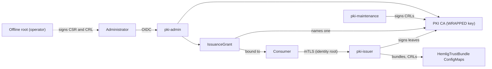
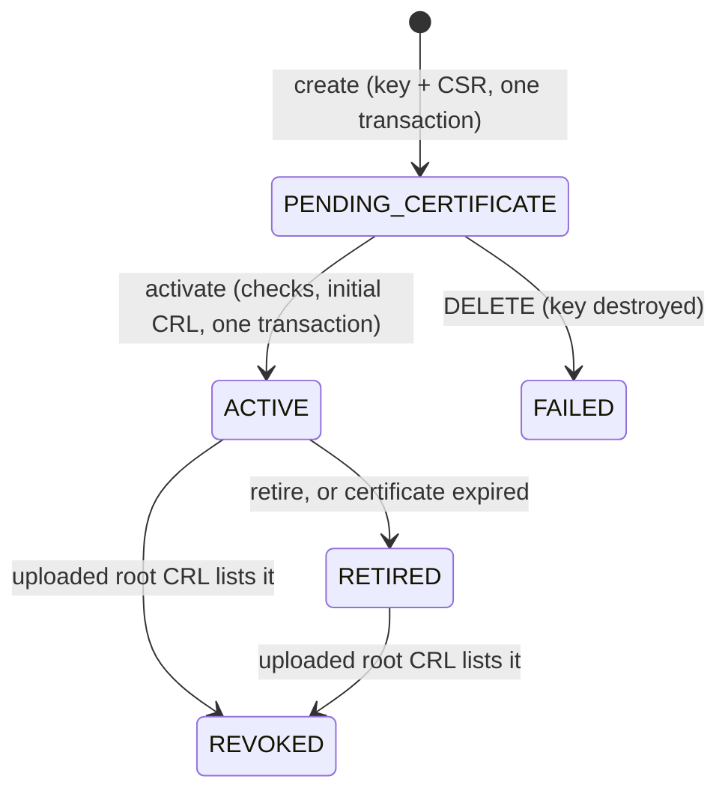

# Hemlig PKI plan

::: info Proposed design
Written November 2026. Nothing here is implemented yet. Current behavior is in the [guide](/guide/what-is-hemlig).
:::

## Purpose and scope

Hemlig issues X.509 certificates from an issuing CA that it holds, to consumers that an administrator has entitled. The must-have is automated in-cluster renewal through a cert-manager external issuer. The leaf certificates are signed by a Hemlig-held intermediate in `WRAPPED` custody, under the operator's offline root, and need no human step after setup. Every other part of this plan serves that path. The PKI never touches Hemlig's identity root, its truststore or its client certificates.

| Scope                | Contents                                                                                                                                                                                                                                                                                                                                                                                   |
| -------------------- | ------------------------------------------------------------------------------------------------------------------------------------------------------------------------------------------------------------------------------------------------------------------------------------------------------------------------------------------------------------------------------------------ |
| MVP (Phases 1–6)     | `EXTERNAL_INTERMEDIATE` CAs (Hemlig generates the key and CSR, and an offline root signs it directly) in `WRAPPED` custody. IssuanceGrant entitlements and the policy engine. Consumer and admin leaf issuance. Inventory and revocation. Hemlig-generated CRLs and upload of the offline root's CRL. The cert-manager issuer. `HemligTrustBundle`. An OpenSSL recipe for the offline root |
| Next phase (Phase 7) | Hemlig-generated `ROOT` and `INTERMEDIATE`. v1 is built for them (see "Designed for later")                                                                                                                                                                                                                                                                                                |
| Phase 8              | Console and Pulumi                                                                                                                                                                                                                                                                                                                                                                         |
| Later                | KMS custody, CA import, public CRL hosting, an offline-root CLI helper, longer external chains, and the rest of "Designed for later"                                                                                                                                                                                                                                                       |
| Out of scope         | OCSP, delta CRLs, ACME/EST/SCEP/CMP, the `certificates.k8s.io` signer, cross-signing, Certificate Transparency, SSH certificates, S/MIME, code signing, timestamping, PKCS#12, CA key export or escrow, an AWS Private CA backend, namespace-templated name rules, managed certificates (Hemlig-held leaf keys), consumer sub-CAs                                                          |

## Primary use case: automated in-cluster renewal

The topology is the operator's offline root → `prod-issuing-1` (`EXTERNAL_INTERMEDIATE`, `WRAPPED`, pathLen 0, name-constrained) → cert-manager leaves. Flag names are indicative.

1. **Create the offline root** once, on an offline machine ("Offline root recipe" below).
2. **Enroll the cluster** (existing flow): a HemligConsumer `payments-prod` with a PKI-only AgentGrant (empty secret scope).
3. **Create the intermediate.** Hemlig generates the key and returns a CSR:

   ```sh
   hemlig pki ca create --environment prod --name prod-issuing-1 \
     --key-algorithm ECDSA_P256 \
     --subject 'CN=Example Prod Issuing CA 1,O=Example Corp' \
     --permit-dns example.com --permit-dns svc.cluster.local --csr-out issuing.csr
   ```

4. **Sign it offline** with the root (recipe step 2), producing `issuing.pem`.
5. **Activate** with the root certificate and the root's first CRL:

   ```sh
   hemlig pki ca activate prod-issuing-1 --certificate issuing.pem \
     --chain root.pem --root-crl root.crl.pem
   ```

6. **Grant the cluster:** `hemlig pki grant create payments-prod web --ca prod-issuing-1 --file grant.json` (the policy format is under "Entitlements").
7. **Declare the issuer, the certificate and the trust bundle:**

   ```yaml
   apiVersion: hemlig.zyno.io/v1alpha1
   kind: HemligIssuer
   metadata: { name: payments-web, namespace: payments }
   spec: { consumerRef: payments-prod, issuanceGrant: web }
   ---
   apiVersion: cert-manager.io/v1
   kind: Certificate
   metadata: { name: api, namespace: payments }
   spec:
     secretName: api-tls
     dnsNames: [api.payments.example.com]
     privateKey: { algorithm: ECDSA, size: 256 }
     duration: 2160h
     issuerRef:
       { group: hemlig.zyno.io, kind: HemligIssuer, name: payments-web }
   ---
   apiVersion: hemlig.zyno.io/v1alpha1
   kind: HemligTrustBundle
   metadata: { name: payments-trust, namespace: payments }
   spec:
     consumerRef: payments-prod
     caIds: [ca-0a1b2c3d-…]
     target: { name: payments-trust }
   ```

8. **Renewal is automatic.** By default cert-manager creates a new CertificateRequest when one third of the lifetime remains. The chart's default approver (on by default) approves it. The controller issues it through the grant with the stable key `hml-cr-<uid>`, and cert-manager updates `api-tls` in place.
9. **Revocation reaches workloads** through the trust bundle. It writes `ca.crt` (the offline root), `chain.crt` (the intermediate) and one CRL ConfigMap per issuer on the path: the intermediate's generated CRL and the uploaded root CRL. Relying parties check the full chain (`-crl_check_all` or equivalent).
10. **Refresh the root CRL** before its `nextUpdate`. Hemlig alarms 30 days ahead. Run `openssl ca -gencrl` offline, then `hemlig pki external-ca upload-crl --for-ca prod-issuing-1 --crl root.crl.pem`. This is the one recurring offline step. Without it, relying parties that check the root CRL fail when it lapses.
11. **If the intermediate's key is compromised,** revoke it at the root (recipe step 4) and upload the new CRL. Hemlig marks the CA `REVOKED`: issuance and replay stop at once and its key is disabled. Bundles deliver the root CRL, so relying parties reject every leaf under the intermediate. Then roll over.
12. **Near intermediate expiry,** leaf lifetimes clamp to its `notAfter`. Maintenance alarms at `notAfter − max leaf lifetime − 30 days`. Roll over as described under "CA lifecycle". HemligIssuers name the grant, so Certificates keep renewing.

**MVP acceptance:** gates PKI-5 (a certificate renewed at least twice) and PKI-6 (mounted full-chain revocation).

### Offline root recipe (OpenSSL 3)

Shipped as `docs/operations/pki-offline-root.md` instead of a CLI helper. The root must sign the Hemlig CSR directly, its subject must be in the restricted form (printable ASCII, see "Subject names and the registry"), and a new root key needs a new root DN.

```ini
# root-ca.cnf
[ ca ]
default_ca = root_ca

[ root_ca ]
dir              = .
database         = $dir/index.txt
new_certs_dir    = $dir/certs
serial           = $dir/serial
crlnumber        = $dir/crlnumber
certificate      = $dir/root.pem
private_key      = $dir/private/root.key
default_md       = sha384
default_days     = 730          # intermediate validity; keep WRAPPED intermediates short
default_crl_days = 180          # root CRL validity; re-sign and upload before it lapses
policy           = policy_hemlig
preserve         = yes          # keep the subject exactly as Hemlig built it
unique_subject   = no
copy_extensions  = copyall      # take Hemlig's requested CA extensions; review the CSR first
x509_extensions  = intermediate_ext
crl_extensions   = crl_ext

[ policy_hemlig ]
countryName            = optional
stateOrProvinceName    = optional
localityName           = optional
organizationName       = optional
organizationalUnitName = optional
commonName             = supplied

[ intermediate_ext ]
subjectKeyIdentifier   = hash
authorityKeyIdentifier = keyid:always

[ crl_ext ]
authorityKeyIdentifier = keyid:always

[ req ]
prompt             = no
default_md         = sha384
string_mask        = utf8only
distinguished_name = root_dn
x509_extensions    = root_ext

[ root_dn ]
O  = Example Corp
CN = Example Offline Root CA 1

[ root_ext ]
basicConstraints     = critical, CA:true
keyUsage             = critical, keyCertSign, cRLSign
subjectKeyIdentifier = hash
```

```sh
# 1. Once: create and back up the root
mkdir -p offline-root/certs offline-root/private && cd offline-root && chmod 700 private
touch index.txt && echo 01 > crlnumber && openssl rand -hex 16 > serial
openssl genpkey -algorithm EC -pkeyopt ec_paramgen_curve:P-384 \
  -pkeyopt ec_param_enc:named_curve -aes256 -out private/root.key
openssl req -config root-ca.cnf -new -x509 -key private/root.key -days 7300 -out root.pem
openssl x509 -in root.pem -noout -fingerprint -sha256   # record it; PKI-5 asserts it
# Copy the directory (encrypted key, root.pem, index.txt, serial, crlnumber, root-ca.cnf)
# to two offline media after every operation. Store the passphrase separately.

# 2. Per intermediate: review, then sign Hemlig's CSR
openssl req -in issuing.csr -noout -text    # subject, CA:TRUE pathlen:0, name constraints
openssl ca -config root-ca.cnf -in issuing.csr -out issuing.pem -notext

# 3. Issue the root CRL now, and again before each nextUpdate
openssl ca -config root-ca.cnf -gencrl -out root.crl.pem

# 4. Revoke an intermediate, then reissue and upload the CRL
openssl ca -config root-ca.cnf -revoke issuing.pem -crl_reason keyCompromise
openssl ca -config root-ca.cnf -gencrl -out root.crl.pem
```

## Fixed decisions

| Decision            | Chosen design                                                                                                                      | Why                                                                                     |
| ------------------- | ---------------------------------------------------------------------------------------------------------------------------------- | --------------------------------------------------------------------------------------- |
| CA kinds in v1      | `EXTERNAL_INTERMEDIATE` only, signed directly by an offline root                                                                   | The must-have needs one issuing CA. An offline root keeps the long-lived key out of AWS |
| Custody             | `WRAPPED` only: PKCS#8 envelope-encrypted under the application CMK, `purpose=pki-ca`                                              | About $0 per CA, and it can sign unattended. KMS comes later                            |
| Identity root       | Unchanged and fully separate (`SYSTEM#ISSUER`, node-forge)                                                                         | A PKI certificate must never authenticate to Hemlig                                     |
| X.509 stack         | New `src/pki/` on `@peculiar/asn1-schema`, `@peculiar/asn1-x509` and `@peculiar/asn1-csr` (MIT). `node:crypto` signs and verifies  | node-forge can't parse EC keys and signs synchronously                                  |
| Entitlement         | IssuanceGrant: one consumer, one CA, a named policy                                                                                | An AgentGrant `PUT` replaces its scope in full. A separate record has its own ETag      |
| Who holds grants    | Any active consumer: agents (with an ACTIVE AgentGrant) and direct consumers                                                       | The IssuanceGrant is the one boundary for both                                          |
| Lambdas             | Three new: `pki-admin` (JWT), `pki-issuer` (mTLS), `pki-maintenance` (every 15 minutes)                                            | Only these decrypt `purpose=pki-ca`. None holds `issuer-ca`                             |
| Storage             | Every PKI `pk` starts with `PKI_` (except human idempotency). One GSI, `pki-directory`. One private bucket                         | IAM can allow and deny by prefix                                                        |
| Issuance            | Sign and verify in memory, then one transaction commits the certificate, replay record, quota and pointer under fresh conditions   | No reservation state and no recovery worker. Nothing leaves Hemlig before the commit    |
| CRLs                | Full CRLs stored as immutable S3 objects behind a DynamoDB pointer. No public hosting. Delivered by routes and `HemligTrustBundle` | One linearization point, and no mutable object to reconcile                             |
| External revocation | The offline root's CRL is uploaded, verified and distributed. It also stops issuance under any intermediate it lists               | Without it, a stolen intermediate key can't be revoked for in-cluster relying parties   |
| CSR handling        | The CSR is input to policy, never a template. Hemlig builds every extension                                                        | A cluster can't smuggle in extensions                                                   |
| Lifetime            | Clamped, never denied (except below the minimum), never past the chain                                                             | Matches cert-manager expectations                                                       |
| Names, usages, keys | Denied, never silently dropped. The one exception is dropping cert-manager's default `keyEncipherment` on EC and Ed25519 keys      | The requester gets the names it asked for, or a clear failure                           |
| Kubernetes API      | `HemligIssuer`, `HemligClusterIssuer` and `HemligTrustBundle` in `hemlig.zyno.io/v1alpha1`. Existing CRDs stay `hemlig.io/v1beta1` | A new surface that may change before beta                                               |
| Deployment          | Always deployed, with no `pkiEnabled` flag                                                                                         | Idle cost is about $0, and maintenance exits early when no CAs exist                    |
| CA keys on the wire | Never sent. Every key is generated in `pki-admin`                                                                                  | Nothing to protect in transit                                                           |

## Concepts

| Term                               | Definition                                                                                                                                                                                                                                                                       |
| ---------------------------------- | -------------------------------------------------------------------------------------------------------------------------------------------------------------------------------------------------------------------------------------------------------------------------------- |
| PKI CA                             | An environment-owned CA record (`ca-<uuid>`) with a `WRAPPED` key, a certificate and its chain. Its kind is `EXTERNAL_INTERMEDIATE` in v1, plus `ROOT` and `INTERMEDIATE` in Phase 7. "Issuing root" keeps its current meaning (the identity root) and never appears in PKI APIs |
| CA name                            | An immutable slug, unique per environment and never reused. URLs use `caId`                                                                                                                                                                                                      |
| External CA                        | A public-only, deployment-wide record (`ext-<hash of its SPKI>`) for an issuer outside Hemlig, which in v1 is the offline root. It holds no key, and its CRL is uploaded                                                                                                         |
| Anchor                             | The self-signed certificate at the top of a CA's chain, returned as `ca.crt` and `status.ca`                                                                                                                                                                                     |
| CRL issuer                         | An issuer whose CRL a relying party needs to validate a CA's leaves: the CA itself (CRL generated by Hemlig) and each issuer above it (uploaded for an external CA, generated for a Hemlig root). Each becomes one CRL slot in a trust bundle                                    |
| Subject registry                   | Deployment-wide claims on canonical subject names, so two issuers never publish full CRLs under one name                                                                                                                                                                         |
| IssuanceGrant                      | An administrator-owned, deny-by-default entitlement for one consumer. It names one CA and sets the names, subject, usages, key algorithms, lifetimes and quotas the consumer may request, plus forced attributes. Identified by `(consumerId, name)`, with an immutable `uid`    |
| Forced attribute                   | A subject attribute, SAN or policy OID that Hemlig adds to every certificate under a grant                                                                                                                                                                                       |
| Issued certificate                 | The inventory record for one serial under one CA                                                                                                                                                                                                                                 |
| Revocation entry                   | `PKI_CA#caId / REVOKED#serial`, an input to CRL generation                                                                                                                                                                                                                       |
| Replay record                      | A compact, consumer-scoped record mapping an `Idempotency-Key` to its request digest and result                                                                                                                                                                                  |
| Capacity count                     | The maintenance-computed number of a CA's certificates whose revocation could appear on its next CRL                                                                                                                                                                             |
| Drained                            | A retired CA whose certificates have all expired, and whose last published CRL, issued after that point, covers every revocation                                                                                                                                                 |
| HemligIssuer / HemligClusterIssuer | cert-manager external issuers that bind a HemligConsumer to one IssuanceGrant name                                                                                                                                                                                               |
| HemligTrustBundle                  | Writes the anchors, intermediates and CRLs of a set of CAs to ConfigMaps                                                                                                                                                                                                         |



## Trust boundaries and separation

| Caller                     | Authenticates with                        | Route and Lambda                    | May do                                                                                  |
| -------------------------- | ----------------------------------------- | ----------------------------------- | --------------------------------------------------------------------------------------- |
| Administrator              | OIDC JWT, plus the optional PKI roles     | `/v1/admin/pki/*` → `pki-admin`     | CA lifecycle, root CRL upload, grants, admin issuance, revocation                       |
| Consumer (agent or direct) | Hemlig client certificate (identity root) | `/v1/pki/*` → `pki-issuer`          | Read its own grants, issue within a grant, read the bundles and CRLs of its environment |
| Scheduler                  | Lambda role                               | `pki-maintenance`, every 15 minutes | CRL refresh, capacity counts, drain, alarms                                             |

v1 has no unauthenticated relying-party endpoint.

**The invariant is that a PKI-issued certificate never authenticates to the delivery API, AWS IoT or any Hemlig route.** Seven independent layers enforce it:

| #   | Layer               | Enforcement                                                                                                                                                                                                                                                                                                                                                                                                                                                                                                                                                                                                                     | Test                                                                                                                                 |
| --- | ------------------- | ------------------------------------------------------------------------------------------------------------------------------------------------------------------------------------------------------------------------------------------------------------------------------------------------------------------------------------------------------------------------------------------------------------------------------------------------------------------------------------------------------------------------------------------------------------------------------------------------------------------------------- | ------------------------------------------------------------------------------------------------------------------------------------ |
| 1   | TLS                 | The API Gateway truststore is built only from `TRUSTSTORE#ROOTS` items, which only the enrollment path writes (`src/repositories/dynamo.ts:732-855`, driven by `src/services/consumers.ts:404-473`). PKI roles get no truststore bucket access and no `apigateway:*` (contrast `grantTruststorePublisher`, `cdk/stack.ts:1257`)                                                                                                                                                                                                                                                                                                 | CDK assertion. Unit test: creating PKI CAs leaves the truststore unchanged. Gate PKI-3                                               |
| 2   | Identity lookup     | `consumerActorFromEvent` requires an `IDENTITY#<sha256>` of kind `api` that is `ACTIVE` and inside its validity (`src/auth/actors.ts:71-101`). PKI never writes `IDENTITY#`                                                                                                                                                                                                                                                                                                                                                                                                                                                     | IAM deny (layer 4), repository test                                                                                                  |
| 3   | Keys                | PKI roles decrypt the application CMK only with `purpose=pki-ca`. They get no `issuer-ca` or `secret-payload`. The existing roles' grants are already purpose-scoped (`cdk/stack.ts:420-494`, `grantEnvelopeDataKey` at `:1238`), so none can decrypt `pki-ca`                                                                                                                                                                                                                                                                                                                                                                  | CDK assertions in both directions, gate PKI-1                                                                                        |
| 4   | Data-plane IAM      | No `grantReadWriteData` for PKI roles. Each gets a per-role write allowlist with `ForAllValues:StringLike dynamodb:LeadingKeys` (precedent at `cdk/stack.ts:396-405`). Transactions are authorized per item, so one key outside the list fails the whole `TransactWriteItems`. `pki-issuer` gets `ConditionCheckItem` on `IDENTITY#*` and `AGENT_GRANT#*`, which checks but never writes. PKI roles get no access to `TRUSTSTORE#*`, `SYSTEM#TRUSTSTORE`, `ENROLLMENT#*` or `BOOTSTRAP#*`, plus an explicit deny on writes to every identity prefix. The non-PKI roles (`cdk/stack.ts:385-391`) get a deny on writes to `PKI_*` | Gate PKI-1: mixed-key batch and transactional writes are denied. Gate PKI-4: a real issuance commit succeeds under the deployed role |
| 5   | Code                | `src/pki/**` must not import `services/issuer`, `services/consumers` or `services/agent-notifications`                                                                                                                                                                                                                                                                                                                                                                                                                                                                                                                          | `src/pki/import-boundary.test.ts`                                                                                                    |
| 6   | Reserved identities | A CA subject, a chain certificate or an external subject equal to the identity root is refused. The check is a strongly consistent read of `SYSTEM#ISSUER` (SPKI, fingerprint, subject), or, before the root exists, its fixed subject `CN=Hemlig <deployment name> Issuing Root` (`src/services/issuer.ts:159-166`). The URI prefix `spiffe://hemlig/` (the identity SAN, `issuer.ts:63`) is always denied                                                                                                                                                                                                                     | Policy unit tests                                                                                                                    |
| 7   | IoT                 | PKI roles have no `iot:*`, and PKI certificates are never registered                                                                                                                                                                                                                                                                                                                                                                                                                                                                                                                                                            | CDK assertion                                                                                                                        |

The rule is symmetric: no API adds an arbitrary root to the truststore, and the plan keeps it that way.

## Key custody (WRAPPED)

- **At rest:** a PKCS#8 DER key, envelope-encrypted. `GenerateDataKey` on the application CMK with context `{service: "hemlig", purpose: "pki-ca", caId, environment}` produces a data key, used for AES-256-GCM with the context as AAD. This is the same shape as `IssuerKeyEnvelope` (`src/services/issuer.ts:208-238`), stored as `key.wrapped` on the CA record. `caId` and `environment` bind the blob to its CA cryptographically, while IAM can condition only on `purpose`.
- **Generation:** `pki-admin` calls `node:crypto.generateKeyPair`, wraps the key immediately and zeroes the plaintext buffer. No key ever arrives from a client.
- **Signing:** `kms:Decrypt` (`purpose=pki-ca`), then `node:crypto.sign`, then the decrypted buffer is zeroed. This is best effort, because Node's `KeyObject` copy lives until garbage collection. Plaintext is never cached across requests. ECDSA output is DER (`dsaEncoding: "der"`). Ed25519 output is the raw 64 bytes (RFC 8410).
- **Key states:** `ACTIVE`. `DISABLED` means no signing; it is set in the same write as `REVOKED`, or by maintenance once a retired CA is drained. `DESTROYED` means `destroy-key` removed the envelope. Table point-in-time recovery (`cdk/stack.ts:144`) still holds earlier item images for its retention window.
- **Signer abstraction:** `CaSigner { algorithm; sign(tbs): Promise<Uint8Array> }`, with `WrappedCaSigner` as the only v1 implementation. MiniStack's symmetric KMS already covers `WRAPPED`, so there's no software signer.
- **Trade-off:** a compromised PKI role can decrypt and copy an intermediate key and sign offline until the root revokes the intermediate or it expires. Mitigations are the offline root, short intermediates (1–2 years), NameConstraints, and alerting on CloudTrail `Decrypt` events with `purpose=pki-ca`. For comparison, AWS Private CA costs $400 per month per general-purpose CA ($50 in short-lived mode) plus per-certificate fees.

| CA key (WRAPPED) | Signature algorithm       | Notes                                                     |
| ---------------- | ------------------------- | --------------------------------------------------------- |
| ECDSA P-256      | `ecdsa-with-SHA256`       | Default                                                   |
| ECDSA P-384      | `ecdsa-with-SHA384`       |                                                           |
| RSA 3072, 4096   | `sha256WithRSAEncryption` |                                                           |
| Ed25519          | Ed25519 (RFC 8410)        | Compatibility warning                                     |
| Not offered      | —                         | RSA 2048 and P-521 as CA keys; ML-DSA (no client support) |

**Ed25519 compatibility warning** (shown by the CLI, the console and the docs): browsers don't accept Ed25519 chains, and some TLS stacks, libraries and hardware don't support them. Go, OpenSSL 1.1.1 and later, and rustls do. Test BoringSSL-based and JVM stacks (such as Envoy and Java) yourself. Prefer P-256 or P-384 unless every verifier is known.

**Leaf keys** in CSRs are independent of the CA key and governed by `LeafKeyAlgorithm`. P-256 and P-384 are allowed by default, as are RSA 2048, 3072, 4096 and 8192 (the CSR validator accepts 2048–8192 bits with e = 65537, and other sizes are `key_algorithm_not_permitted`). P-521 and Ed25519 are allowed only when a grant lists them.

## Data model

### Records

Everything lives in the existing control table, and its TTL attribute `ttl` (epoch seconds) does the expiry. The table stream's filter only passes `NOTIFICATION#` inserts (`cdk/stack.ts:588-597`), so PKI items never reach the notification Lambda.

| `pk`                                         | `sk`                              | Purpose                                                                                                                                             | Lifetime                                                                             |
| -------------------------------------------- | --------------------------------- | --------------------------------------------------------------------------------------------------------------------------------------------------- | ------------------------------------------------------------------------------------ |
| `PKI_CA#caId`                                | `PROFILE`                         | CA record: kind, status, key envelope, certificate, chain, policy                                                                                   | Forever                                                                              |
| `PKI_CA#caId`                                | `CRL`                             | CRL state: revision, number, lease, published pointer, capacity count. Kept apart so CRL work never conflicts with issuance conditions on `PROFILE` | Forever                                                                              |
| `PKI_CA#caId`                                | `REVOKED#serial`                  | Revocation entry: serial, time, reason, invalidity date, certificate `notAfter`                                                                     | No TTL until a published CRL with `thisUpdate > notAfter` has carried it, then 1 day |
| `PKI_CA_NAME#env#name`                       | `LOOKUP`                          | Name → `caId`. Never released                                                                                                                       | Forever                                                                              |
| `PKI_SUBJECT#sha256`                         | `LOOKUP`                          | Subject registry: canonical subject → owner (`caId`, or `extId` plus its SPKI digest). Never released                                               | Forever                                                                              |
| `PKI_EXTCA#extId`                            | `PROFILE`                         | External CA: certificate, dependents, environments, uploaded CRL pointer                                                                            | Forever                                                                              |
| `PKI_CERT#caId#serial`                       | `PROFILE`                         | Issued certificate                                                                                                                                  | TTL `notAfter` + 90 days                                                             |
| `PKI_CONSUMER#consumerId`                    | `CERT#issuedAt#caId#serial`       | Strongly consistent per-consumer inventory pointer                                                                                                  | TTL `notAfter` + 90 days                                                             |
| `PKI_GRANT#consumerId`                       | `NAME#name`                       | IssuanceGrant. A `DELETED` tombstone keeps the `uid`                                                                                                | Forever                                                                              |
| `PKI_QUOTA#grantUid`, `PKI_QUOTA#admin#caId` | `HOUR#yyyymmddhh`, `DAY#yyyymmdd` | Issuance counters                                                                                                                                   | TTL 48 hours or 3 days                                                               |
| `PKI_IDEMPOTENCY#consumerId`                 | `REQUEST#key`                     | Compact replay record: digest, `caId`, serial, `notAfter`, grant `uid`                                                                              | TTL `notAfter` + 400 days                                                            |
| `PKI_CURSOR#token`                           | cursor store                      | Pagination state. The existing store writes `CURSOR#` (`dynamo.ts:2540`), which PKI roles can't touch                                               | Existing cursor TTL                                                                  |
| `IDEMPOTENCY#human#actorId`                  | `REQUEST#key`                     | Admin operations (existing key format, `dynamo.ts:2547`) plus a result pointer                                                                      | Existing                                                                             |

### GSI `pki-directory` (`pkiDirectoryPk`, `pkiDirectorySk`, ALL projection, sparse)

| Item                        | `pkiDirectoryPk`     | `pkiDirectorySk`  | Used for                                                      |
| --------------------------- | -------------------- | ----------------- | ------------------------------------------------------------- |
| CA                          | `PKI_CAS`            | `env#name`        | Listing CAs (`begins_with` the environment), maintenance pass |
| External CA                 | `PKI_EXTCAS`         | `extId`           | Listing external CAs                                          |
| IssuanceGrant (not deleted) | `PKI_CA_GRANTS#caId` | `consumerId#name` | Grants by CA: migration, issuance budget, retire warning      |
| Issued certificate          | `PKI_CERTS#caId`     | `notAfter#serial` | Inventory, expiring-soon views, capacity count                |

Revocation entries, replay records and grants are always read strongly consistent from the base table, never from the GSI.

### Record shapes (load-bearing fields)

```ts
// src/pki/types.ts
type CaKind = "EXTERNAL_INTERMEDIATE" | "ROOT" | "INTERMEDIATE"; // v1 creates EXTERNAL_INTERMEDIATE only
type CaStatus =
  "PENDING_CERTIFICATE" | "ACTIVE" | "RETIRED" | "REVOKED" | "FAILED";
type IssuerRef = { type: "ca"; id: string } | { type: "external"; id: string }; // ca-… | ext-…
type PkiKeyAlgorithm =
  "ECDSA_P256" | "ECDSA_P384" | "RSA_3072" | "RSA_4096" | "ED25519";
type LeafKeyAlgorithm =
  | "ECDSA_P256"
  | "ECDSA_P384"
  | "ECDSA_P521"
  | "ED25519"
  | "RSA_2048"
  | "RSA_3072"
  | "RSA_4096"
  | "RSA_8192"; // P-521 and Ed25519 only when listed

interface CaRecord {
  // PKI_CA#caId / PROFILE
  caId: string;
  environment: string;
  name: string;
  displayName?: string;
  kind: CaKind;
  status: CaStatus;
  version: string; // ETag, bumped by status and policy changes
  parent?: IssuerRef; // issuer of this CA's certificate; absent for a ROOT
  parentCaId?: string; // Hemlig parent (Phase 7)
  crlIssuers: IssuerRef[]; // [self, parent, …]: the CRL slots for this CA's leaves
  key: {
    custody: "WRAPPED";
    algorithm: PkiKeyAlgorithm;
    spkiSha256: string;
    state: "ACTIVE" | "DISABLED" | "DESTROYED";
    wrapped?: {
      algorithm: "AES-256-GCM";
      encryptedDataKey: string;
      iv: string;
      tag: string;
      ciphertext: string;
    };
  };
  subject: CaSubject;
  subjectKey: string; // restricted form; registry hash
  requested: {
    pathLen: 0;
    nameConstraints?: NameConstraintSet;
    extendedKeyUsages?: string[];
  };
  acceptBroaderConstraints?: boolean;
  csrPem?: string;
  certificatePem?: string;
  chainPem?: string; // chain: ancestors up to and including the anchor
  serial?: string;
  fingerprint?: string;
  subjectDer?: string;
  subjectKeyIdentifier?: string;
  notBefore?: string;
  notAfter?: string;
  effective?: {
    nameConstraints?: NameConstraintSet;
    extendedKeyUsages?: string[];
  };
  policy: {
    issueLeaves: boolean;
    issueSubordinates: boolean; // v1: true, false
    maxLeafLifetimeSeconds: number;
    leafKeyAlgorithms: LeafKeyAlgorithm[];
    capacity: number;
    crlValiditySeconds: number;
  }; // 8,000; 604,800
  maxIssueLifetimeEverSeconds: number; // monotone; sets the drain point
  createdAt: string;
  createdBy: Actor;
  retiredAt?: string;
  revokedAt?: string;
  revocationReason?: string;
  revocationSource?: "EXTERNAL" | "HEMLIG";
  revocationEvidence?: string;
}

interface CaCrlState {
  // PKI_CA#caId / CRL
  revision: number;
  lastNumber: number;
  dirtySince?: string;
  lease?: { owner: string; expiresAt: string };
  published?: {
    number: number;
    objectKey: string;
    sha256: string;
    thisUpdate: string;
    nextUpdate: string;
    revision: number;
    entryCount: number;
    dropDueAt?: string;
  };
  capacity?: { count: number; countFrom: string; countedAt: string };
}

interface ExternalCaRecord {
  // PKI_EXTCA#extId / PROFILE; extId = "ext-" + first 40 hex of sha256(canonical SPKI)
  extId: string;
  certificatePem: string;
  fingerprint: string;
  spkiSha256: string;
  subjectDer: string;
  subjectKey: string;
  subjectKeyIdentifier: string;
  notAfter: string;
  dependents: Set<string>;
  environments: Set<string>;
  version: string;
  crl?: {
    numberHex: string;
    thisUpdate: string;
    nextUpdate: string;
    sha256: string;
    objectKey: string;
    uploadedAt: string;
    uploadedBy: Actor;
  }; // numberHex: 40 hex digits, zero-padded
}

interface IssuedCertificateRecord {
  // PKI_CERT#caId#serial / PROFILE
  caId: string;
  environment: string;
  serial: string;
  status: "ISSUED" | "REVOKED";
  certificatePem: string;
  fingerprint: string;
  spkiSha256: string;
  subject: string;
  sans: { dns: string[]; ip: string[]; uri: string[] };
  keyAlgorithm: string;
  keyUsages: string[];
  extendedKeyUsages: string[];
  isCa: boolean;
  childCaId?: string; // CA certificates, Phase 7
  notBefore: string;
  notAfter: string;
  issuedAt: string;
  requester: {
    type: "consumer" | "human";
    id: string;
    consumerId?: string;
    issuanceGrant?: { name: string; uid: string; version: string };
    asserted?: {
      kubernetes?: {
        namespace: string;
        name: string;
        uid: string;
        certificateName?: string;
        revision?: string;
      };
    };
  };
  revocation?: {
    at: string;
    reason: RevocationReason;
    invalidityDate?: string;
    by: Actor;
  };
}

interface ReplayRecord {
  // PKI_IDEMPOTENCY#consumerId / REQUEST#key
  requestDigest: string;
  caId: string;
  serial: string;
  notAfter: string;
  grantUid: string;
}
```

IssuanceGrant records carry `uid`, `consumerId`, `environment`, `name`, `caId`, `status` (`ACTIVE`, `DISABLED`, `DELETED`), `policy`, `policyDigest`, `version`, `expiresAt?` and the created and updated actors. A leaf's effective status is computed at read time: `EXPIRED` once `notAfter` has passed, and `CA_REVOKED` once its CA is `REVOKED`. There is no fan-out write.

### Concurrency and idempotency

- Mutable records (CA policy, IssuanceGrant) carry `version` (`pkv-<uuid>`) as the ETag. `PUT` and `DELETE` require `If-Match`, and a mismatch is `412 precondition_failed`. Creates use `POST` plus `Idempotency-Key`. Every mutation requires `Idempotency-Key`.
- Admin operations write `IDEMPOTENCY#human#<actor.id>` **in the operation's own commit transaction**. `actor.id` comes from `adminActorSubjectClaim` (`src/auth/actors.ts:18`), and the record holds `operationType`, `requestDigest = sha256(stableJson(request))` and a result pointer. A conflicting replay is `409 conflict` (the `assertIdempotency` semantics, `src/services/consumers.ts:758-771`). The terminal audit marker uses `humanOperation` and `markAuditSucceeded` (`src/services/operations.ts:6-27`). No admin operation leaves recoverable state behind, so there's no `PKI_OP#` record.
- Consumer issuance is keyed by `PKI_IDEMPOTENCY#<consumerId>`, not by the identity fingerprint. A cert-manager retry that spans an mTLS identity rotation therefore replays to the same certificate.
- Every write to a `PKI_CA#` item retries with jitter on `TransactionConflict`.

### Limits (new section of `docs/reference/limits.md`)

| Item                            | Value                                                                                                                                                                 |
| ------------------------------- | --------------------------------------------------------------------------------------------------------------------------------------------------------------------- |
| CAs per environment             | 50                                                                                                                                                                    |
| CA validity at activation       | At least 30 days remaining. 1–2 years is recommended for `WRAPPED`                                                                                                    |
| Leaf lifetime                   | Minimum 300 s, maximum 397 days (a private-PKI ceiling; public TLS allows 200 days as of March 2026), default 90 days. Per-CA and per-grant ceilings apply below that |
| CSR                             | ≤ 32 KiB, one PEM block (matches `issuer.ts:28`)                                                                                                                      |
| SANs per certificate            | 100. A grant's `maxSans` may lower it                                                                                                                                 |
| DNS name, label, URI            | 253 bytes, 63 bytes, 1,024 bytes                                                                                                                                      |
| Encoded certificate             | ≤ 16 KiB DER, checked on the TBS before signing (`certificate_too_large`). This bounds the inventory item well under DynamoDB's 400 KB                                |
| Grant policy                    | ≤ 32 KiB of canonical JSON, at most 200 name rules, 10 forced SANs and 10 policy OIDs                                                                                 |
| IssuanceGrants per consumer     | 20                                                                                                                                                                    |
| Grant quota                     | Defaults of 100 per hour and 1,000 per day. `perHour` is bounded by the CA's issuance budget                                                                          |
| Admin issuance                  | 100 per CA per hour                                                                                                                                                   |
| Capacity per CA                 | Default 8,000 CRL-exposed certificates, with `capacity + 2 × rate ≤ 12,000` (see "Capacity")                                                                          |
| Issue route throttle            | 20 rps, burst 40 (configurable)                                                                                                                                       |
| CRL validity                    | 1 hour to 30 days, default 7 days                                                                                                                                     |
| Uploaded CRL                    | ≤ 512 KiB, `nextUpdate − thisUpdate` ≤ 400 days                                                                                                                       |
| Inventory and consumer pointers | Kept until `notAfter` + 90 days                                                                                                                                       |
| Replay record                   | Kept until `notAfter` + 400 days                                                                                                                                      |

## CA lifecycle



### Subject names and the registry

RFC 5280 identifies a CRL issuer by name, so a new CA that reused an old DN would publish a competing full CRL. The registry makes that impossible inside a deployment.

- **Restricted form.** This applies to Hemlig CA subjects, and in v1 to the external root's subject as well. Each RDN holds one value. The allowed attributes are C, ST, L, O, OU and CN for Hemlig subjects, plus any string-typed attribute such as DC for external names. Values are PrintableString, UTF8String or IA5String with printable ASCII only (0x20–0x7E), and Hemlig-built values have no leading, trailing or doubled spaces. Hemlig encodes C as PrintableString and the rest as UTF8String, in the order C, ST, L, O, OU, CN. A non-conforming external root is refused (`chain_invalid`, reason `issuer_name_unsupported`).
- **Canonical key.** `sha256` over the ordered `(type OID, ASCII-lowercased value with whitespace runs collapsed)` pairs. For printable ASCII this matches RFC 4518 caseIgnore matching and OpenSSL's canonical comparison. It is broader than byte-exact comparison, so it is never less strict than any validator.
- **Claims.** `PKI_SUBJECT#<key> / LOOKUP` is written with `attribute_not_exists`. A Hemlig CA claims its subject at creation. Activation claims the external root's subject for its `extId` and SPKI digest, conditioned on `attribute_not_exists(pk) OR (ownerType = external AND spkiSha256 = :spki)`. A second CA under the same root therefore passes, while a different key, or a Hemlig CA taking the root's name, is refused in either order (`409 ca_subject_in_use`). Claims are never released, so rollover always needs a new DN, such as a generation suffix.

### Creating an external intermediate

`POST /cas` (CA admin), with the environment, name, key algorithm, subject, requested constraints, policy and CRL validity:

1. Validate the request. Refuse a subject equal to the identity root's (layer 6) and any kind other than `EXTERNAL_INTERMEDIATE` (`bad_request` until Phase 7).
2. Generate and wrap the key. Build a CertificationRequest with the subject, the SPKI and the requested extensions (critical BasicConstraints `cA=true, pathLen 0`, critical KeyUsage `keyCertSign` and `cRLSign`, optional critical NameConstraints, optional EKU, SKI), and sign it with the new key.
3. One transaction: put `PKI_CA_NAME#…` (`attribute_not_exists`), the subject claim, the `PKI_CA#caId / PROFILE` record as `PENDING_CERTIFICATE` with `key.wrapped`, `csrPem` and `requested`, and the human idempotency record. On a cancellation the unused key is zeroed. A replay returns the stored CA and CSR. A taken name or subject is a `409`.

A CA can wait in `PENDING_CERTIFICATE` indefinitely. `DELETE /cas/{caId}` moves it to `FAILED` and destroys the key, while the name and subject claims stay.

### Activation

`POST /cas/{caId}/certificate {certificatePem, chainPem, rootCrl?, acceptBroaderConstraints?}` (CA admin). Before anything is written, it verifies the following (failure is `400 chain_invalid` with `details.reason`):

1. The chain is exactly one certificate: a self-signed root (issuer equals subject and the signature verifies under its own key), inside its validity, with `cA=true`, KeyUsage containing `keyCertSign` and `cRLSign`, an SKI, and a restricted-form subject.
2. The CA certificate verifies under the root's key, its issuer equals the root subject, its AKI (when present) equals the root SKI, its SPKI equals the CA key, and it carries an SKI.
3. The CA certificate has `cA=true`, KeyUsage with `keyCertSign` and `cRLSign`, and at least 30 days of validity left.
4. Its subject canonically equals the requested subject, and its constraints are no broader than requested: pathLen ≤ 0, permitted subtrees ⊆ requested, excluded subtrees ⊇ requested, and EKU ⊆ requested (a missing EKU when one was requested counts as broader). A broader certificate needs `acceptBroaderConstraints: true`, which is recorded on the CA.
5. No certificate carries `policyConstraints`, `inhibitAnyPolicy`, `policyMappings` or an unrecognized critical extension.
6. The chain doesn't contain the identity root (layer 6).
7. The root's stored CRL, or the supplied `rootCrl` (validated by the upload rules), doesn't list the CA's serial (`409 ca_not_active`, reason `revoked_by_parent`).

The CA then signs its empty initial CRL #1 in memory and writes it as an immutable object. One transaction commits all of the following:

- `PROFILE` from `PENDING_CERTIFICATE` to `ACTIVE` with the certificate, chain, `parent`, `crlIssuers = [self, ext]` and effective constraints. Conditioned on status and `version`.
- The `CRL` item with the published pointer.
- An upsert of the `ext-…` record: immutable fields if absent, `ADD dependents :caId, environments :env`, a new `version`, and the supplied CRL pointer under the number rule. Conditioned on `attribute_not_exists(pk) OR version = :loaded`.
- The root's subject claim.
- The human idempotency record.

A crash before the commit leaves only an orphaned object, and a retry redoes the activation. A version conflict on the `ext-…` record, from a concurrent upload or activation, re-runs the checks against the fresh record.

### Retirement, drain and key disposal

- **Retire** (CA admin): `ACTIVE` to `RETIRED`, with `retiredAt` and a version bump. It takes effect at once because the issuance commit checks `status = ACTIVE`. The response warns when the GSI still lists grants. CRLs keep publishing.
- **CA expiry:** maintenance retires an `ACTIVE` CA whose certificate has expired (system actor, `retiredAt = notAfter`).
- **Drain point:** `D = min(retiredAt + maxIssueLifetimeEverSeconds, CA notAfter)`. `maxIssueLifetimeEverSeconds` is the largest leaf lifetime the CA's policy ever allowed, raised by every policy update and never lowered. Every certificate the CA issued expires by `D`.
- **Drained:** a published CRL with `thisUpdate > D` and `published.revision = revision`. Maintenance forces that publication once `D` has passed, then sets the key `DISABLED` and stops refresh and staleness alarms. Revoking an expired certificate writes no entry (see "Leaf revocation"), so a drained CA stays drained.
- **REVOKED:** the key is set `DISABLED` in the same write, CRL refresh stops, and the last CRL stays served.
- **`destroy-key`** (CA admin): allowed only while the key is `DISABLED`, which means a drained retired CA or any `REVOKED` CA. It removes the envelope (`DESTROYED`). The CA record, inventory and revocation entries remain.

### Rollover

1. Create `prod-issuing-2` with a new DN (`CN=Example Prod Issuing CA 2`). The CLI flag `--rollover-from prod-issuing-1` suggests the next name and DN. Have the root sign it, and activate it.
2. Add the new `caId` to every `HemligTrustBundle.spec.caIds`. Confirm its CRL ConfigMap is mounted (bundle status, then `openssl crl` on the file).
3. Issue a test leaf under the new CA (admin issuance) and verify it against the mounted bundle with `-crl_check_all`.
4. Run `hemlig pki grant migrate --from prod-issuing-1 --to prod-issuing-2`, with `--dry-run` first. The CLI lists grants by CA through the GSI (paginated) and `PUT`s each with the new `caId` under `If-Match`, preserving status and `uid`. Server-side write-time validation reports errors and warnings, and `--dry-run` uses `?validateOnly=true`.
5. Rerun the listing until the old CA shows no grants. GSI lag can hide an existing grant as well as a concurrent one. A missed grant surfaces as `CaNotActive` on its HemligIssuer once the old CA retires.
6. Retire the old CA. Keep it in bundles until it shows `Drained`, then remove it.

## Issuance pipeline

One implementation (`src/pki/issuance-service.ts`) serves consumer and admin issuance. The policy engine (`src/pki/policy.ts`) is pure: it returns an `IssuancePlan` or a `Denial`, plus a decision trace that `evaluate` returns.

### Evaluation order

1. **Authenticate and parse.** On the consumer path, names come from the CSR alone, and a body with `sans` or `subject` is `400 bad_request`. `isCA: true` on any path is `issuance_denied` (`ca_not_permitted`).
2. **Replay lookup.** A strongly consistent read of the replay record (consumer path) or the human idempotency record (admin path). A digest mismatch is `409 conflict`. A match goes to "Replay" and never consults quota.
3. **Preconditions** (strongly consistent reads, each asserted again at commit). The identity is `ACTIVE` and unexpired. An agent's AgentGrant is `ACTIVE` in the same environment. The grant is `ACTIVE`, unexpired and in the same environment. The CA is `ACTIVE` with `issueLeaves` and inside its validity, and its key is `ACTIVE`.
4. **Pre-checks.** The capacity count, recounted if it is older than 1 hour, must be below `capacity` (otherwise `ca_capacity_exceeded`). The current quota counters must be below their limits (otherwise `429`). This avoids signing doomed requests, and the commit enforces both again.
5. **Parse and verify the CSR.**
6. **Normalize.** Collect names (CSR only, or CSR plus API on the admin path). Apply the CN mode. Canonicalize. Map usages and apply the KeyUsage matrix.
7. **Entitlement.** Key algorithm. KeyUsage and EKU ⊆ allowed, where an empty EKU takes the grant default. SAN count. DNS, IP and URI rules, deny first. The CN rule. Subject attributes.
8. **CA constraints.** The CA's leaf key algorithms and maximum lifetime, the chain's effective NameConstraints and EKU, and lifetime clamping.
9. **Forced attributes** from the grant: subject attributes, SANs and policy OIDs.
10. **Final name check.** The final names, requested plus forced, are checked against the chain's NameConstraints and the reserved names. It runs after step 9, so a forced value can never produce an invalid chain.
11. **Build, sign and verify.** Build the TBS and check that it is ≤ 16 KiB. Sign. Verify the signature against the CA certificate, then re-parse and assert the extensions equal the plan.
12. **Commit** (see "Sign, then commit").

### CSR validation (`src/pki/csr.ts`)

- Exactly one `CERTIFICATE REQUEST` PEM block, ≤ 32 KiB, CertificationRequest version 0.
- The signature verifies over `certificationRequestInfo` with `node:crypto.verify` (RSA PKCS#1 v1.5 or PSS, ECDSA, Ed25519).
- RSA keys: 2048–8192 bits, odd modulus, no prime factor below 1,000, e = 65537. EC keys: named curves only. DSA and unknown algorithms are rejected.
- Any attribute other than `extensionRequest` is rejected. Of the requested extensions, only SAN, KU, EKU and BasicConstraints are read. Everything else is ignored and never copied.
- A CSR key equal to a CA key or the identity root key isn't checked: proof of possession means the requester would already hold that key.

### Names (`src/pki/names.ts`)

Normalization: lowercase ASCII, no trailing dot, LDH labels of 1–63 characters and a total ≤ 253. Any `xn--` label must round-trip through `domainToUnicode` and back through `domainToASCII`. U-labels and `_` are rejected, and `*` may appear only as the whole leftmost label. IPs are byte-canonical, with IPv4-mapped IPv6 converted to IPv4. URIs are WHATWG-parsed with no userinfo or fragment, a lowercase host and a normalized path.

| Rule form                                                    | Type | Permits                                                                                                                                        | Does not permit                   |
| ------------------------------------------------------------ | ---- | ---------------------------------------------------------------------------------------------------------------------------------------------- | --------------------------------- |
| `api.example.com`                                            | DNS  | `api.example.com`                                                                                                                              | `x.api.example.com`               |
| `*.example.com`                                              | DNS  | `a.example.com`                                                                                                                                | `example.com`, `a.b.example.com`  |
| `**.example.com`                                             | DNS  | `a.example.com`, `a.b.example.com`                                                                                                             | `example.com`                     |
| requested `*.x.example.com` (only with `allowWildcardNames`) | DNS  | Permitted by `**.example.com` or an exact `*.x.example.com`                                                                                    | `*.example.com` (two labels deep) |
| `10.20.0.0/16`, `fd00::/8`                                   | IP   | Addresses inside                                                                                                                               | —                                 |
| `spiffe://prod.example.com/ns/payments/**`                   | URI  | Exact scheme and host (the host may use DNS rule syntax). `*` matches one path segment; `**` matches the rest of the path (final segment only) | Ports, query strings              |

- Deny rules use the same grammar and win over allow rules. A requested wildcard is denied if any name it could cover matches a deny rule.
- A rule's base needs at least two labels (`**.com` is rejected), except exact single-label names such as `localhost`.
- `spiffe://hemlig/**` is always denied.
- **CN modes:** `san` (default) requires a present CN to equal a final DNS or IP SAN, and `addToSans` defaults to true. `forbid` denies any CN.
- **Subject:** the CN plus `subject.allow` attributes (glob value patterns) pass through, and any other requested attribute is `subject_not_permitted`. Forced attributes are added, and a conflicting requested value is denied. Order is C, ST, L, O, OU, CN; C is PrintableString and the rest UTF8String. A leaf with an empty subject needs a non-empty, critical SAN.

### Usages

| cert-manager usage             | Hemlig                | Notes                                                                      |
| ------------------------------ | --------------------- | -------------------------------------------------------------------------- |
| `digital signature`, `signing` | KU `digitalSignature` |                                                                            |
| `key encipherment`             | KU `keyEncipherment`  | RSA only. Silently dropped on EC and Ed25519 keys (cert-manager's default) |
| `server auth`, `client auth`   | EKU                   |                                                                            |
| Anything else                  | —                     | Denied (`key_usage_not_permitted` or `extended_key_usage_not_permitted`)   |

KeyUsage matrix for leaves: RSA allows `digitalSignature` and `keyEncipherment`. EC (P-256, P-384, P-521) and Ed25519 allow `digitalSignature` only. The final KeyUsage is never empty. If no usage remains after normalization, it defaults to `digitalSignature` when the grant permits it and is denied otherwise. A leaf always carries an EKU, from the grant's `extendedKeyUsages.default` when none is requested, so Hemlig never issues an any-purpose leaf.

### Lifetime

- `notBefore = max(now − 60 s, CA notBefore)`.
- `notAfter = min(notBefore + requested or default, notBefore + grant max, notBefore + CA max, earliest notAfter in the chain)`.
- Below the grant's `minSeconds` (default 1 hour) the request is denied with `lifetime_too_short`, and the detail is `ca_validity_insufficient` when CA expiry is the cause. A clamped lifetime sets `lifetimeClamped: true`.
- An explicit `renewBefore` can exceed a clamped lifetime and cause continuous re-issuance, so the docs recommend `renewBeforePercentage` for Hemlig issuers.

### Extensions Hemlig builds (leaf)

| Extension              | Value                                              |
| ---------------------- | -------------------------------------------------- |
| BasicConstraints       | Critical, `cA=false`                               |
| KeyUsage               | Critical, the evaluated set                        |
| ExtendedKeyUsage       | Non-critical, always present                       |
| SubjectAltName         | Critical only when the subject is empty            |
| SubjectKeyIdentifier   | RFC 7093 method 1 (SHA-256 truncated to 160 bits)  |
| AuthorityKeyIdentifier | The issuer's SKI bytes, taken from its certificate |
| CertificatePolicies    | Forced OIDs, non-critical                          |
| CRL DP, AIA            | None in v1                                         |

The `issuer` field is a byte-exact copy of the CA certificate's subject DER. Times use UTCTime before 2050 and GeneralizedTime from 2050. The serial is 20 random bytes with the top bit cleared (159 bits, positive, non-zero), stored as lowercase hex.

### Sign, then commit

The signed certificate stays in Lambda memory until one `TransactWriteItems` commits it. `ClientRequestToken` is derived from `(consumerId, key, serial)`.

| Item                                       | Operation and condition                                                                                                                   |
| ------------------------------------------ | ----------------------------------------------------------------------------------------------------------------------------------------- |
| `PKI_CERT#caId#serial`                     | `Put` the full `ISSUED` record, `attribute_not_exists(pk)`                                                                                |
| `PKI_IDEMPOTENCY#consumerId / REQUEST#key` | `Put` the replay record, `attribute_not_exists(pk)` (admin path: `IDEMPOTENCY#human#…`)                                                   |
| `PKI_QUOTA#grantUid / HOUR#…` and `DAY#…`  | `ADD count :one`, condition `attribute_not_exists(count) OR count < :limit` (admin path: `PKI_QUOTA#admin#caId / HOUR#…`)                 |
| `PKI_CONSUMER#consumerId / CERT#…`         | `Put` the pointer (consumer path)                                                                                                         |
| `PKI_GRANT#consumerId / NAME#name`         | `ConditionCheck uid = :loadedUid AND version = :loaded AND status = ACTIVE AND (attribute_not_exists(expiresAt) OR expiresAt > :now)`     |
| `PKI_CA#caId / PROFILE`                    | `ConditionCheck status = ACTIVE AND version = :loaded AND key.state = ACTIVE`. Policy changes and parent revocation both change this item |
| Hemlig ancestors (Phase 7)                 | `ConditionCheck status <> REVOKED` (none in v1)                                                                                           |
| `IDENTITY#fp / PROFILE`                    | `ConditionCheck status = ACTIVE AND notAfter > :now AND consumerId = :consumerId`                                                         |
| `AGENT_GRANT#grantId / PROFILE`            | `ConditionCheck status = ACTIVE AND environment = :env` (agents)                                                                          |

Immediately before committing, the service checks `notAfter > now + 60 s`, and fails with `issuance_expired` otherwise. The commit is the linearization point: a concurrent grant change, CA policy change, retirement, parent revocation, or identity or AgentGrant revocation either precedes it (and the request is refused) or follows it.

| Outcome                                            | Handling                                                                                                                                                                                      |
| -------------------------------------------------- | --------------------------------------------------------------------------------------------------------------------------------------------------------------------------------------------- |
| Replay record already exists                       | Strongly read it. A digest mismatch is `409 conflict`. Otherwise discard the local certificate (never stored, never returned, not charged) and replay the winner                              |
| Quota condition failed                             | Strongly read the replay record first: an earlier ambiguous commit of this same request may have used the slot. If present, replay it. Otherwise `429` with `Retry-After` until the next hour |
| Grant, CA, identity or AgentGrant condition failed | Re-run the pipeline once from step 2 with fresh reads, which produces the correct denial or a new certificate. A second failure is `503`                                                      |
| Serial collision                                   | New serial, then sign again                                                                                                                                                                   |
| `TransactionConflict`                              | Retry the same commit, up to 3 times with jitter, then `503`                                                                                                                                  |
| Ambiguous (timeout, network)                       | Retry with the same `ClientRequestToken`, then read the replay record before reporting anything                                                                                               |

Invariants: no certificate leaves Hemlig without its inventory record, at most one certificate exists per `(caId, serial)`, and one request key maps to one serial.

### Replay

A matching replay record returns the stored certificate only after these strongly consistent checks:

- The certificate status is `REVOKED` → `409 issuance_revoked`.
- The issuing CA is `REVOKED` (including by an uploaded root CRL) → `409 issuance_revoked`.
- `notAfter ≤ now + 60 s` → `409 issuance_expired`.
- The inventory item has expired (`notAfter` + 90 days) → `issuance_expired`, decided from the record's `notAfter` alone.

Both errors are terminal. The controller marks the request `Failed`, and cert-manager creates a new CertificateRequest with a new UID. The pattern matches identity rotation, whose replay fails once the stored result is inactive or expired (`rotationReplayInactive`, `src/services/agent-identities.ts:111-118`). The chain in a replay comes from the current CA record.

### Admin issuance

`POST /cas/{caId}/certificates` (operator) issues **leaf certificates only** from a CSR. There is no grant, but CSR verification and normalization always run, followed by the CA constraints, the Hemlig ceilings, the reserved names and the final name check. Names come explicitly from `sans` and `subject`, or from the CSR with `useCsrNames: true`. The digest covers every field. Quota is `PKI_QUOTA#admin#caId` (100 per hour). The requester is recorded as a human. Renewal is a fresh issue from the same CSR.

**Key errors:** KMS throttling or a 5xx is `503` (nothing committed, so a retry is safe). A key that is not `ACTIVE`, or that fails to decrypt or parse, is `409 ca_key_unavailable`. KMS `AccessDenied` is `503` plus an alarm.

## Revocation and CRLs

### Leaf revocation

- **Reasons:** `unspecified` (encoded by omitting the reason), `keyCompromise`, `affiliationChanged`, `superseded`, `cessationOfOperation`, `privilegeWithdrawn`. Phase 7 adds `caCompromise` for CA certificates. `certificateHold` and `removeFromCRL` aren't supported, and revocation is irreversible. A repeated revoke returns the current state. The first reason wins, except that an upgrade to `keyCompromise` is allowed. `invalidityDate` is optional and applies to `keyCompromise` only.
- **Transaction:** update the certificate from `ISSUED` to `REVOKED` (condition `status = ISSUED AND notAfter > :now`), put `REVOKED#serial` (`attribute_not_exists`), and on the `CRL` item set `revision = revision + 1` and `dirtySince = if_not_exists(dirtySince, :now)`, plus the human idempotency record.
- **Already expired** (the `notAfter` condition fails): the status becomes `REVOKED` and is audited, with no entry and no revision bump, and the response reports `crlEntry: false`. A drained CA therefore stays clean, and a CRL never gains an entry for a certificate the capacity count no longer covers.
- **Bulk revoke by consumer** (`POST /consumers/{id}/certificates/revoke`, optionally filtered by grant) walks the unexpired pointers and revokes in batches per CA: up to 30 certificate updates, 30 entries and one `CRL` item update per transaction. It is idempotent per certificate and finishes with one publication per affected CA.
- Revocation is never refused. Under a `REVOKED` CA it updates the inventory only, because the key can't sign a CRL.
- Grant deletion and identity or AgentGrant revocation don't revoke certificates. An administrator uses the bulk action.

### Generated CRLs (`src/pki/crl-service.ts`)

1. Acquire the 60-second lease on the `CRL` item, the same pattern as `acquireTruststoreLease` (`dynamo.ts:1582`).
2. Read `startRevision`, then allocate `number = lastNumber + 1`, conditioned on the lease owner.
3. Set `thisUpdate = now` before reading entries. Query `REVOKED#` strongly consistent and include every entry with `notAfter ≥ published.thisUpdate`. An entry therefore stays until a published CRL issued after its `notAfter` has carried it, however long the signer or maintenance was down.
4. Build a full v2 CRL: the CA's signature algorithm and issuer DER, `nextUpdate = thisUpdate + validity`, and entries with serial, revocation date, `reasonCode` and `invalidityDate`. Extensions are AKI and CRLNumber only, with no IssuingDistributionPoint and no delta CRLs. Sign it and verify it.
5. Put the immutable object `crl/<caId>/<number>-<sha256[:16]>.crl`.
6. Commit `published = {number, objectKey, sha256, thisUpdate, nextUpdate, revision: startRevision, entryCount, dropDueAt}`, conditioned on the lease owner and `published.number < :number`. `dropDueAt` is the earliest `notAfter` among included entries that were still unexpired at `thisUpdate`. The same update removes `dirtySince` when `revision = startRevision`; if that condition fails, it is retried without the removal.
7. Set the 1-day TTL on entries with `notAfter < thisUpdate`. This is derivable, so maintenance finishes it after an interruption.

A crash before step 6 leaves an orphaned object and a skipped number, which RFC 5280 allows. After step 6 the CRL is published. Readers always resolve the pointer, so there is no mutable "current" object, no S3 ETag recovery and no MiniStack `If-Match` dependency. Objects are retained; they are typically under 2 KB, and cleanup is Later.

**Triggers:**

- Inline after a revoke commits, with a 5-second budget. The response reports `crlPublished` and `crlNumber`.
- `POST /cas/{caId}/crl` (operator, force).
- `pki-maintenance` every 15 minutes, for any CA that is:
  - dirty (`revision > published.revision`);
  - due for refresh (`now ≥ nextUpdate − margin`, where `margin = min(max(validity/3, 45 min), validity/2)`);
  - due for a drop (`now > dropDueAt`), so expired revoked entries leave within about one pass;
  - retired past `D` and not yet drained.

Drained, `REVOKED` and key-disabled CAs never sign. With the 7-day default, refresh happens with about 2.3 days left.

**Alarm:** `CrlSecondsToNextUpdate` below `min(2 days, margin / 3)` for `ACTIVE` CAs and undrained `RETIRED` CAs, plus maintenance errors and a pass missing for 45 minutes. A freshly published CRL, or one refreshed on schedule, is always above the threshold.

### Uploaded root CRLs

`POST /external-cas/{extId}/crl {crl}` (CA admin), where `crl` is PEM or base64 DER. Activation's optional `rootCrl` follows the same rules. The CRL must meet all of these, or the request fails with `400 crl_invalid` and a `details.reason`:

- One CRL, ≤ 512 KiB, v2 with a CRLNumber.
- **Exact issuer:** the issuer name canonically equals the external CA's subject, the signature verifies under its key, its certificate has KeyUsage `cRLSign` (checked at activation), and the CRL's AKI is present and equals that certificate's SKI.
- **Current:** `thisUpdate ≤ now + 5 minutes`, and `nextUpdate` is present, after now and within `thisUpdate + 400 days`.
- **Direct and full:** no IssuingDistributionPoint, DeltaCRLIndicator or FreshestCRL extension, no entry with `certificateIssuer` or reason `removeFromCRL`, and no unrecognized critical extension.

The per-issuer ordering is atomic:

1. The same SHA-256 as the stored CRL returns `200` with no change, so an identical retry succeeds.
2. A number at or below the stored one, or an earlier `thisUpdate`, is `409 crl_not_newer`. Numbers are compared as 40-digit zero-padded hex, which covers RFC 5280's 20 octets.
3. Otherwise, write the immutable object. Next, flip every dependent CA whose serial the CRL lists (any reason, `certificateHold` included) to `REVOKED`, with `revocationSource: EXTERNAL`, the entry's date and reason, evidence `crl:<number>` and key `DISABLED`. The flips are conditional and run in batches of 25. Finally, commit the pointer, conditioned on the `ext-…` record's `version` and the number rule. A version conflict means a concurrent activation added a dependent, so the flips run again.

Because the flips commit before the pointer, once the new CRL is visible no listed CA can commit an issuance, replays return `issuance_revoked`, and activating a listed CA is refused. The same CRL is served to every bundle that includes any dependent CA. CA detail and the external CA record show `rootCrl.state` (`MISSING`, `CURRENT` or `STALE`) and `nextUpdate`. Alarms fire 30 days before `nextUpdate`, and when a CA with dependents has had no CRL for 24 hours. Bundles report `CrlMissing` and `CrlStale`. Issuance continues whatever the root CRL's freshness.

### Capacity

A CRL must fit one ConfigMap (1 MiB) as DER `binaryData`. A worst-case entry is 80 bytes: a 20-byte serial, `reasonCode` and `invalidityDate`. 12,000 entries come to about 960 KB with the header and signature, leaving room for about 1,000 more.

- **Count.** `capacity = {count, countFrom, countedAt}` on the `CRL` item. `count` is the number of the CA's certificates, of any status, with `notAfter > countFrom`, from a paginated GSI `COUNT` on `PKI_CERTS#caId`. `countFrom = min(now, dirtySince, dropDueAt)`.
  - Entries are created only for unexpired certificates, and each stays until a post-expiry CRL carries it. So every entry the next CRL can hold belongs to a counted certificate or to one issued after the count.
  - Maintenance recounts on every pass. An issuance that finds the count older than 1 hour recounts first and stores the result.
- **Cap.** Issuance is refused (`409 ca_capacity_exceeded`) while `count ≥ capacity` (default 8,000). Revocation is never refused.
- **Lag.** A count is used for at most one hour, and an hour-long window touches at most two quota hours. Certificates issued after a count therefore number at most `2 × rate`, where `rate` is the sum of `quotas.perHour` over the CA's `ACTIVE` grants plus the admin quota of 100.
- **Budget.** Grant writes and CA policy updates keep `capacity + 2 × rate ≤ 12,000` (`409 ca_issuance_budget_exceeded`), summing the rates through the GSI. At the default capacity this allows `rate ≤ 2,000`, or about 19 grants at the default quota.
- **Bound.** No CRL exceeds 12,000 entries. The residual is concurrent grant writes inside the GSI's propagation delay, which can each pass the sum check. The roughly 1,000-entry spare absorbs five default-quota grants racing.
- **Alarms:** a count above 80% of capacity, and any CRL with more than `capacity` entries.
- **PEM:** PEM adds a third. A PEM ConfigMap holds about 9,600 entries, so a guaranteed PEM fit needs `capacity + 2 × rate ≤ 9,600`.

### Delivery latency

- **Generated CRL:** inline publication, so the CRL route shows a revoked serial within seconds. If inline publication fails, the next maintenance pass publishes it (≤ 15 minutes).
- **Root CRL:** as soon as it's uploaded.
- **Bundles:** refreshed by the controller every 5 minutes with conditional GETs, followed by kubelet's ConfigMap volume propagation (about a minute).
- **Short lifetimes:** these bound exposure for relying parties that ignore CRLs.

## Entitlements (IssuanceGrant)

### Shape

```json
{
  "name": "web",
  "caId": "ca-0a1b2c3d-…",
  "displayName": "payments web certificates",
  "names": {
    "dns": {
      "allow": [
        "**.payments.svc.cluster.local",
        "api.payments.example.com",
        "*.payments.example.com"
      ],
      "deny": ["internal.payments.example.com"],
      "allowWildcardNames": false
    },
    "ip": { "allow": ["10.20.0.0/16"] },
    "uri": { "allow": ["spiffe://prod.example.com/ns/payments/**"] },
    "commonName": { "mode": "san", "addToSans": true },
    "maxSans": 50
  },
  "subject": { "allow": { "organizationalUnit": ["payments-*"] } },
  "keyAlgorithms": ["ECDSA_P256", "ECDSA_P384", "RSA_2048", "RSA_3072"],
  "keyUsages": ["digitalSignature", "keyEncipherment"],
  "extendedKeyUsages": {
    "allow": ["serverAuth", "clientAuth"],
    "default": ["serverAuth", "clientAuth"]
  },
  "lifetime": {
    "defaultSeconds": 7776000,
    "maxSeconds": 7776000,
    "minSeconds": 3600
  },
  "forced": {
    "subject": { "organization": "Example Corp", "country": "US" },
    "sans": { "uri": ["spiffe://prod.example.com/cluster/prod-a"] },
    "certificatePolicies": ["1.3.6.1.4.1.55555.1.1"]
  },
  "quotas": { "perHour": 100, "perDay": 1000 },
  "expiresAt": "2027-12-31T00:00:00Z"
}
```

Everything is deny by default: an empty `allow` permits nothing. `ip` and `uri` accept `deny` lists too. A grant has no `ca` section: consumer CA requests are always denied, and adding one later is additive.

### Validation at write time (`src/pki/grant-service.ts`)

On create and on update, including migration `PUT`s and `?validateOnly=true`:

- **Consumer:** has an AgentGrant (`PENDING` allowed, so grants can be pre-created before bootstrap) or an `ACTIVE` ConsumerRecord, in the CA's environment.
- **CA:** `ACTIVE` with `issueLeaves`, in the same environment.
- **Rules:** every rule parses and uses no reserved name. A rule entirely outside the CA's effective NameConstraints is an error, and a partial overlap is a warning. Forced SANs satisfy the CA constraints and the reserved names.
- **Keys, usages, lifetime:** key algorithms ⊆ the CA's leaf policy; usages and EKUs come from the supported set and fit any CA EKU constraint; `300 ≤ minSeconds ≤ defaultSeconds ≤ maxSeconds ≤ CA maximum ≤ 397 days`.
- **Budget:** the CA's issuance budget holds after the change (see "Capacity").
- **Size:** the canonical JSON is ≤ 32 KiB (`400 bad_request`, reason `policy_too_large`).
- **Digest:** `policyDigest = sha256(stableJson(policy))` is stored and audited.
- **Deletion:** leaves a `DELETED` tombstone. Re-creating the name produces a new `uid`, so old certificates never point at a different policy.

### AgentGrant, direct consumers, administrators

- An IssuanceGrant is a separate object bound to `consumerId`, and AgentGrant semantics are unchanged.
- **Change:** `AgentGrantService.create` accepts `capabilities: []` with `secretGrants: []` for a PKI-only cluster. Today it calls `parseAgentCapabilities(input.capabilities)` and `parseSecretGrants(…, false)` (`src/services/agent-grants.ts:71-75`). The change passes `allowEmpty = true` to both, only when both are empty. `CreateAgentGrantRequest` in `openapi/consumer-secrets.yaml` drops `minItems: 1` on both arrays under that pairing rule. `docs/reference/limits.md` changes "1 to 1,000 on create" to "0 to 1,000". The unrelated OpenAPI `secretGrants` cap of 20 versus the service's 1,000 is fixed in its own PR.
- Bootstrap, MQTT and identity rotation are reused unchanged. An agent's PKI access ends when its identity is revoked.
- Direct consumers may hold grants, which lets a VM or CI job renew its own certificate.
- Administrators bypass grants (admin issuance) but not CA constraints, Hemlig ceilings or reserved names.

### Admin roles

The two optional IdP roles are checked in the handler with the existing role parser (`hasRequiredRole`, `src/auth/actors.ts:129-139`). When a role is unset, the existing admin authorization applies.

| Role                  | Required for                                                                                                          |
| --------------------- | --------------------------------------------------------------------------------------------------------------------- |
| `oidcPkiCaAdminRole`  | CA create, activate, update, retire, delete and `destroy-key`; root CRL upload                                        |
| `oidcPkiOperatorRole` | IssuanceGrant create, update (including migration) and delete; admin issue; revoke and bulk revoke; CRL force-publish |
| Admin JWT only        | Every PKI `GET` and `evaluate`                                                                                        |

### Audit events

There is one event per outcome: `succeeded` or `failed`, never `attempted` or `authorized`, because each event is one Object Lock S3 object (`src/services/audit.ts:38-50`). Every event carries the actor, correlation ID, environment and `caId` where one applies.

| Operation                                                                                                                         | Actor             | Extra target fields                                                                                                                                                                           |
| --------------------------------------------------------------------------------------------------------------------------------- | ----------------- | --------------------------------------------------------------------------------------------------------------------------------------------------------------------------------------------- |
| `pki.ca.create`, `pki.ca.activate`, `pki.ca.update`, `pki.ca.retire`, `pki.ca.delete`, `pki.ca.destroy-key`, `pki.ca.key-disable` | human or system   | `kind`, `keyAlgorithm`, `fingerprint`, `anchorFingerprint`, `extId`, `version`, `reason`                                                                                                      |
| `pki.external-ca.upload-crl`                                                                                                      | human             | `extId`, `crlNumber`, `revokedCaIds`                                                                                                                                                          |
| `pki.crl.publish`                                                                                                                 | system or human   | `crlNumber`, `entryCount`                                                                                                                                                                     |
| `pki.grant.create`, `pki.grant.update`, `pki.grant.delete`                                                                        | human             | `consumerId`, `issuanceGrant`, `issuanceGrantUid`, `policyDigest`, `version`                                                                                                                  |
| `pki.certificate.issue`                                                                                                           | consumer or human | `serial`, `fingerprint`, `consumerId`, `issuanceGrant`, `notAfter`, `k8sNamespace` (caller-asserted), `replayed`. On failure: `reasonCode`, `deniedNameType`, `deniedName` (≤ 253 characters) |
| `pki.certificate.revoke`                                                                                                          | human             | `serial`, `reason`, `crlEntry`, `count` (bulk)                                                                                                                                                |

- **Never logged:** private keys, key envelopes, CSR PEM or certificate PEM.
- **Successful consumer reads** write no events, following the agent sync precedent (`src/handlers/consumer.ts:51-76`). Failures are recorded.
- **Repeated identical failures** from one identity (same grant and reason) are recorded at most once per 10 minutes. This uses `AUDIT_SUPPRESS#<fingerprint>`, the `claimIdentityRejectionAudit` pattern (`dynamo.ts:668-693`).
- **`reasonCode`:** `withErrorResponse` uses `ApiError.safeReason` (`src/domain/errors.ts:6`) as the failed event's `reasonCode` instead of `request_failed` (`src/handlers/shared.ts:60`).

## API surface

New paths go into `openapi/consumer-secrets.yaml` under the tags `pki-admin` and `pki`, with `Pki*` schemas. CRL bodies are `application/pkix-crl` DER, returned with `isBase64Encoded`.

| ID       | Pattern                                       |
| -------- | --------------------------------------------- |
| `caId`   | `^ca-[a-z0-9-]{3,80}$`                        |
| `extId`  | `^ext-[0-9a-f]{40}$`                          |
| `name`   | `^[a-z][a-z0-9-]{2,63}$` (`validation.ts:11`) |
| `serial` | `^[0-9a-f]{2,40}$`                            |

Pagination reuses `CursorService` with a `PKI_CURSOR#` store and the scope `admin:pki:<route>:<actor.id>:<filters digest>` (pattern from `src/handlers/admin.ts:152`).

### Admin routes (`/v1/admin/pki/*` → `pki-admin`)

| Method and path                                                                              | Purpose                                                                        | Role           |
| -------------------------------------------------------------------------------------------- | ------------------------------------------------------------------------------ | -------------- |
| `GET /cas?environment=`                                                                      | List CAs                                                                       | read           |
| `POST /cas`                                                                                  | Create (v1: `EXTERNAL_INTERMEDIATE`), returns the CA and `csrPem`              | ca-admin       |
| `GET /cas/{caId}`                                                                            | Detail: certificate, chain, constraints, policy, CRL, capacity, root CRL state | read           |
| `PUT /cas/{caId}`                                                                            | Policy settings (`If-Match`)                                                   | ca-admin       |
| `DELETE /cas/{caId}`                                                                         | Abandon a `PENDING_CERTIFICATE` CA (`FAILED`, key destroyed)                   | ca-admin       |
| `POST /cas/{caId}/certificate`                                                               | Activate                                                                       | ca-admin       |
| `POST /cas/{caId}/retire`, `POST /cas/{caId}/destroy-key`                                    | Lifecycle                                                                      | ca-admin       |
| `POST /cas/{caId}/crl`                                                                       | Force-publish                                                                  | operator       |
| `GET /crls/{caId or extId}`                                                                  | Download a CRL (`ETag`, `304`)                                                 | read           |
| `GET /external-cas`, `GET /external-cas/{extId}`                                             | External CAs: certificate, dependents, CRL state                               | read           |
| `POST /external-cas/{extId}/crl`                                                             | Upload a root CRL                                                              | ca-admin       |
| `GET /cas/{caId}/certificates?status=&expiringBefore=&cursor=`, `GET …/{serial}`             | Inventory                                                                      | read           |
| `POST /cas/{caId}/certificates`                                                              | Admin leaf issuance from a CSR                                                 | operator       |
| `POST /cas/{caId}/certificates/{serial}/revoke`                                              | Revoke                                                                         | operator       |
| `GET /cas/{caId}/issuance-grants`                                                            | Grants by CA                                                                   | read           |
| `GET`, `POST /consumers/{consumerId}/issuance-grants`                                        | List, create                                                                   | read, operator |
| `GET`, `PUT` (`?validateOnly=true`), `DELETE /consumers/{consumerId}/issuance-grants/{name}` | `If-Match` on `PUT` and `DELETE`                                               | read, operator |
| `POST /consumers/{consumerId}/issuance-grants/{name}/evaluate`                               | Dry run with names or a CSR, returns the decision trace and plan               | read           |
| `GET /consumers/{consumerId}/certificates`, `POST …/certificates/revoke`                     | Per-consumer inventory, bulk revoke                                            | read, operator |

### Consumer routes (`/v1/pki/*` → `pki-issuer`)

| Method and path                                    | Purpose                                                                                                                                    |
| -------------------------------------------------- | ------------------------------------------------------------------------------------------------------------------------------------------ |
| `GET /v1/pki/issuance-grants`, `GET …/{name}`      | The caller's grants: name, `uid`, status, version, policy view, and a CA summary (`caId`, name, fingerprint, `notAfter`, status)           |
| `POST /v1/pki/issuance-grants/{name}/certificates` | Issue (requires `Idempotency-Key`)                                                                                                         |
| `GET /v1/pki/cas/{caId}/bundle`                    | `{anchorPem, chainPem, crlIssuers: [{id, source: GENERATED or UPLOADED}], status}` for any CA in the caller's environment                  |
| `GET /v1/pki/crls/{caId or extId}`                 | Current DER CRL (`ETag`, `If-None-Match` → `304`). A `ca-…` must be in the caller's environment; an `ext-…` must list it in `environments` |

Bundle and CRL routes are readable by any active consumer in the environment, not only grant holders, because the material is public.

### Issue request and response

```json
// POST /v1/pki/issuance-grants/web/certificates   Idempotency-Key: hml-cr-<CertificateRequest uid>
{
  "certificateSigningRequestPem": "-----BEGIN CERTIFICATE REQUEST-----…",
  "durationSeconds": 7776000,
  "usages": ["digitalSignature", "keyEncipherment", "serverAuth"],
  "isCA": false,
  "requester": { "kubernetes": { "namespace": "payments", "name": "api-1", "uid": "…",
                                 "certificateName": "api", "revision": "3" } }
}
// 201
{
  "caId": "ca-0a1b2c3d-…", "serial": "4f1c…", "fingerprint": "…",
  "certificatePem": "<leaf>", "chainPem": "<intermediates, excluding the anchor>", "caPem": "<anchor>",
  "notBefore": "…", "notAfter": "…", "issuanceGrant": "web", "lifetimeClamped": false
}
```

`requestDigest = sha256(stableJson({op, consumerId, grantName, csrDerSha256, durationSeconds, sortedUsages, isCA}))`. Names come from the CSR alone, so this covers every issuance-affecting input. Requester metadata is caller-asserted, bounded and charset-validated. It is recorded but never used for authorization and isn't part of the digest.

A create request is a sketch of `{environment, name, kind, keyAlgorithm, subject: {commonName, organization?, organizationalUnit?, country?, locality?, state?}, requestedConstraints: {nameConstraints?, extendedKeyUsages?}, policy: {maxLeafLifetimeSeconds, leafKeyAlgorithms, capacity}, crl: {validitySeconds}, displayName?}`, answered with `201`, the CA detail, `csrPem` and an `ETag`.

### Errors (new rows in `docs/reference/api/errors.md`)

`ApiError` gains optional `details` (safe, non-secret) and response `headers`, and `errorResponse` adds `error.details` (`src/http/responses.ts:15-24`).

| Code                                                                            | Status              | Meaning                                                                                                                                                                                                                                                                                                                                                 | Controller                   |
| ------------------------------------------------------------------------------- | ------------------- | ------------------------------------------------------------------------------------------------------------------------------------------------------------------------------------------------------------------------------------------------------------------------------------------------------------------------------------------------------- | ---------------------------- |
| `bad_request`, `invalid_csr`                                                    | 400                 | Existing codes: malformed body or CSR, consumer `sans` or `subject`, oversized policy                                                                                                                                                                                                                                                                   | Failed                       |
| `issuance_denied`                                                               | 403                 | `details.reason`: `name_not_permitted`, `wildcard_not_permitted`, `reserved_name`, `common_name_not_permitted`, `subject_not_permitted`, `key_algorithm_not_permitted`, `key_usage_not_permitted`, `extended_key_usage_not_permitted`, `ca_not_permitted`, `too_many_names`, `certificate_too_large`, `lifetime_too_short`, `name_constraint_violation` | Failed                       |
| `issuance_grant_not_found`, `issuance_grant_inactive`                           | 404, 403            | No such grant, or disabled or expired                                                                                                                                                                                                                                                                                                                   | Pending                      |
| `ca_not_active`, `ca_capacity_exceeded`, `ca_key_unavailable`                   | 409                 | CA not `ACTIVE` (retired, revoked, pending, expired), at capacity, or key unusable                                                                                                                                                                                                                                                                      | Pending (key: plus an alarm) |
| `issuance_revoked`, `issuance_expired`                                          | 409                 | Replay of a revoked certificate or a certificate under a revoked CA; result within 60 s of `notAfter`. Terminal                                                                                                                                                                                                                                         | Failed                       |
| `issuance_rate_limited`                                                         | 429 + `Retry-After` | Grant or admin quota                                                                                                                                                                                                                                                                                                                                    | Pending, honor `Retry-After` |
| `ca_subject_in_use`, `ca_issuance_budget_exceeded`                              | 409                 | Admin: subject already claimed; a grant change would exceed the CA's budget                                                                                                                                                                                                                                                                             | —                            |
| `chain_invalid`, `crl_invalid`, `crl_not_newer`                                 | 400, 400, 409       | Activation or upload verification failed (`details.reason`); CRL not newer than the stored one                                                                                                                                                                                                                                                          | —                            |
| `conflict`, `precondition_failed`, `service_unavailable`, `identity_not_active` | 409, 412, 503, 403  | Existing codes                                                                                                                                                                                                                                                                                                                                          | Failed, —, Pending, Pending  |

## cert-manager external issuer

### Contract (mirrors Go `issuer-lib`, which can't be used from TypeScript)

- cert-manager creates `CertificateRequest` (`cert-manager.io/v1`) with `spec.request` (base64 PEM CSR), `spec.issuerRef {group, kind, name}`, `spec.duration`, `spec.usages`, `spec.isCA`, `spec.username` and `spec.groups`, and the annotations `cert-manager.io/certificate-name` and `cert-manager.io/certificate-revision`.
- The issuer acts only when `issuerRef.group` and `kind` are its own. An empty kind means cert-manager's `Issuer`.
- It **must not sign until `Approved=True`**, and never once `Denied=True`. On denial it sets `Ready=False`, reason `Denied`, and `status.failureTime`.
- **Success:** `status.certificate` (leaf plus chain), `status.ca` (the anchor), `Ready=True`, reason `Issued`.
- **Permanent failure:** `Ready=False`, reason `Failed`, plus `failureTime`. cert-manager retries with a new request after its backoff (1 hour, doubling to 32 hours).
- **Transient failure:** `Ready=False`, reason `Pending`, and the issuer retries. Terminal states are never changed.
- **Approval signer names:** `hemligissuers.hemlig.zyno.io/<namespace>.<name>` and `hemligclusterissuers.hemlig.zyno.io/<name>`.

### CRDs (`hemlig.zyno.io/v1alpha1`, status subresource, CEL syntax validation)

```yaml
apiVersion: hemlig.zyno.io/v1alpha1
kind: HemligIssuer
metadata: { name: payments-web, namespace: payments }
spec:
  consumerRef: payments-prod # HemligConsumer; same namespace by default
  # consumerNamespace: hemlig-system  # needs that consumer's allowCrossNamespaceReferences: true
  issuanceGrant: web
status:
  observedGeneration: 1
  consumerId: payments-prod
  environment: prod
  caId: ca-0a1b2c3d-…
  caFingerprint: "…"
  caNotAfter: "…"
  issuanceGrantVersion: pkv-…
  grantUid: pkg-… # informational
  conditions: [{ type: Ready, status: "True", reason: Ready }]
---
apiVersion: hemlig.zyno.io/v1alpha1
kind: HemligClusterIssuer
metadata: { name: mesh }
spec:
  consumerRef: { name: cluster-pki, namespace: hemlig-system } # consumer needs allowClusterIssuers: true
  issuanceGrant: mesh
  allowedNamespaces: { matchLabels: { pki.example.com/mesh: "true" } } # optional; default all
```

- Short names are `hmlissuer` and `hmlclusterissuer`. Printer columns are Ready, Reason, CA, Grant and Age. `spec` is immutable except `issuanceGrant`.
- HemligConsumer (`hemlig.io/v1beta1`) gains an additive `spec.allowClusterIssuers` (default false). A cluster issuer is usable from any namespace, so it is a separate opt-in from `allowCrossNamespaceReferences` (`v1beta.ts:121,235`).
- The provider namespace selector applies to the issuer's namespace (HemligIssuer) or the consumer's namespace (cluster issuer). `assertNamespaceAllowed` runs today while the **consumer** is reconciled (`v1beta.ts:478,1648`). The issuer reconciler and the CertificateRequest path therefore re-check at use time.
- Hemlig can't see namespaces. Give mutually untrusted namespaces their own HemligConsumer and grant. A cluster issuer's grant is the union.

### Issuer reconciliation

The issuer reconciles on create or change, on a consumer status change, and on each resync. It resolves the HemligConsumer under the reference rules, requires it `Ready`, calls `GET /v1/pki/issuance-grants/{name}`, and sets status. Reasons are `Ready`, `ConsumerNotFound`, `ConsumerNotReady`, `ConsumerReferenceNotPermitted`, `ClusterIssuerNotPermitted`, `ProviderNotPermitted`, `IssuanceGrantNotFound`, `IssuanceGrantInactive` and `CaNotActive`.

### CertificateRequest reconciliation

| Observed state                                                                                                                                | Action                                                                | Resulting status                                                       |
| --------------------------------------------------------------------------------------------------------------------------------------------- | --------------------------------------------------------------------- | ---------------------------------------------------------------------- |
| Not our group or kind; or terminal (`Ready=True`, `Ready=False` with `Failed` or `Denied`, `status.certificate` set)                          | Ignore                                                                | —                                                                      |
| `Denied=True` or `InvalidRequest=True`                                                                                                        | Stop, never sign                                                      | `Ready=False Denied` or `Failed`, `failureTime`                        |
| No `Approved=True`                                                                                                                            | Wait for a watch event (relist and resync re-enqueue)                 | `Ready=False Pending` "Waiting for approval", set once                 |
| Cluster issuer `allowedNamespaces` excludes the request's namespace                                                                           | Stop                                                                  | `Ready=False Failed` `NamespaceNotPermitted`                           |
| `allowClusterIssuers` or `allowCrossNamespaceReferences` withdrawn on the **current** consumer, re-evaluated immediately before each issuance | Stop before any remote call, requeue 30 s → 5 min, enqueue the issuer | `Ready=False Pending` with the reason                                  |
| Issuer missing, not Ready, or `status.observedGeneration ≠ metadata.generation`                                                               | Requeue 30 s → 5 min, enqueue the issuer                              | `Ready=False Pending` with the issuer reason                           |
| `isCA: true` or an unsupported usage                                                                                                          | Stop, no remote call                                                  | `Ready=False Failed`                                                   |
| Issued                                                                                                                                        | —                                                                     | `certificate` = leaf + `chainPem`, `ca` = `caPem`, `Ready=True Issued` |
| `400 bad_request` or `invalid_csr`, `403 issuance_denied`, `409 issuance_revoked`, `409 issuance_expired`, `409 conflict`                     | Stop                                                                  | `Ready=False Failed` (safe reason plus `deniedName`), `failureTime`    |
| Grant missing or inactive, `ca_not_active`, `ca_capacity_exceeded`, `ca_key_unavailable`, `identity_not_active`                               | Back off 30 s → 5 min                                                 | `Ready=False Pending`                                                  |
| `429` with a Hemlig envelope and `Retry-After`                                                                                                | Wait `retryAfterSeconds`                                              | `Ready=False Pending`                                                  |
| `429` from the gateway, `5xx`, network                                                                                                        | Back off 1 s → 5 min with jitter                                      | `Ready=False Pending`                                                  |

- **Idempotency key:** `hml-cr-<metadata.uid>`, stable for the request's life (its spec is immutable). A lost response or a failed status write replays to the same certificate.
- **Status writes:** read the request, keep foreign conditions (`Approved`, `Denied`, `InvalidRequest`), then `PUT …/status` with `resourceVersion`. On `409`, re-read, check that the UID is unchanged, and re-run the terminal checks before any write. Never merge-patch `conditions`. `CustomApi` (`v1beta.ts:177`) gains `replaceNamespacedCustomObjectStatus` and `getNamespacedCustomObject`.
- **Inputs:** `spec.request` is base64-decoded to PEM, `spec.duration` is parsed to seconds, and `spec.usages` maps through the usage table.
- **Logging:** none of CSR, certificate, response body or tokens. Events and conditions carry only safe reasons, the serial and the CA ID.

### Runtime

- **Module:** `packages/kubernetes-controller/src/pki/`, with a keyed work queue: per-key dedupe, global concurrency 4 (`HEMLIG_PKI_CONCURRENCY`), at most 2 in flight per consumer, and a per-key backoff map like `rotationBackoff` (`v1beta.ts:278`). Issuance is request-driven and doesn't use the full-pass loop.
- **Consumer registry:** `HemligV1BetaController` exposes a read-only `ConsumerRegistry` (ReadyConsumer by key, with its `HemligClient`), refreshed each pass. It is the module's only source of an mTLS client, so it always uses the current identity.
- **Watches** are added in `startWatches` (`v1beta.ts:1913`) while the cert-manager CRD is present: certificaterequests, hemligissuers, hemligclusterissuers and hemligtrustbundles.
  - At startup, on `410 Gone` and after CRD rediscovery, the module relists CertificateRequests (`limit=500`) and filters them client-side. It enqueues every non-terminal Hemlig request and restarts the watch from the list's `resourceVersion`.
  - A jittered resync every 5 minutes re-enqueues non-terminal requests.
  - A missing CRD disables the module, which is re-probed each resync.
- **Replicas:** a single replica stays required until Lease leadership ships. The chart already uses `maxSurge: 0, maxUnavailable: 1` (`templates/deployment.yaml:15-19`). `config/manager.yaml` has no strategy today and gets the same one.

### Approval (the chart approves by default)

cert-manager's built-in approver only approves its own issuer types, so a Hemlig request would otherwise sit pending forever. The IssuanceGrant is the authoritative boundary, and in-cluster approval is an extra layer.

| Option                                       | Setup                                                                                                                                                                                                                                                                                                                                           |
| -------------------------------------------- | ----------------------------------------------------------------------------------------------------------------------------------------------------------------------------------------------------------------------------------------------------------------------------------------------------------------------------------------------- |
| Chart default (`grantDefaultApprover: true`) | A ClusterRole and binding give cert-manager's ServiceAccount (`certManager.approval.serviceAccount`, `.namespace`) `approve` on `signers` for `hemligissuers.hemlig.zyno.io/*` and `hemligclusterissuers.hemlig.zyno.io/*`                                                                                                                      |
| cert-manager Helm `approveSignerNames`       | Add the two signer patterns                                                                                                                                                                                                                                                                                                                     |
| approver-policy                              | Set `grantDefaultApprover: false` and disable cert-manager's default approver. A `CertificateRequestPolicy` selects `issuerRef {group: hemlig.zyno.io, kind: HemligIssuer, name: "*"}`. Give approver-policy's ServiceAccount `approve` on both signers, and bind `use` of the policy to the requester (normally cert-manager's ServiceAccount) |

The Hemlig controller's own ServiceAccount never gets `approve`. `NOTES.txt` says that approval is on and how to switch.

### RBAC and Helm

- **RBAC** in both `chart/hemlig-controller/templates/rbac.yaml` (always rendered) and `config/manager.yaml`:
  - `cert-manager.io` `certificaterequests`: get, list, watch; `/status`: get, update, patch.
  - `hemlig.zyno.io` `hemligissuers`, `hemligclusterissuers`, `hemligtrustbundles`: get, list, watch; `/status`: get, update, patch.
  - `configmaps`: get, list, watch, create, update, delete (new; the chart grants only secrets today).
- **CRDs:** `crds/hemlig.zyno.io-pki.yaml` and `config/crds.yaml`. The HemligConsumer schema adds `allowClusterIssuers`.
- **Approval template:** `templates/cert-manager-approval.yaml`, rendered unless `grantDefaultApprover` is false.
- **Values and schema:** `certManager.maxConcurrentRequests: 4` and `certManager.approval.{grantDefaultApprover: true, serviceAccount, namespace}`. The deployment sets `HEMLIG_PKI_CONCURRENCY` and `HEMLIG_PKI_BUNDLE_INTERVAL_MS` (default 300,000).

## Trust bundles

```yaml
apiVersion: hemlig.zyno.io/v1alpha1
kind: HemligTrustBundle
metadata: { name: payments-trust, namespace: payments }
spec:
  consumerRef: payments-prod # same reference rules as HemligIssuer
  caIds: [ca-0a1b2c3d-…, ca-4e5f6a7b-…] # explicit, immutable IDs
  includeCrl: true # default
  crlFormat: der # der (default, covered by the capacity bound) or pem
  target: { name: payments-trust }
status:
  observedGeneration: 1
  acceptedCaIds: [ca-0a1b2c3d-…]
  crls:
    [
      {
        id: ext-…,
        source: UPLOADED,
        number: "…",
        nextUpdate: "…",
        configMap: payments-trust-crl-ext-…,
        state: Current,
      },
    ]
  conditions: [{ type: Ready, status: "True", reason: Ready }]
```

- **ConfigMaps:**
  - `<target>` holds `ca.crt`, the deduplicated anchors only, so a relying party that loads it as its root pool can never stop at an intermediate. It also holds `chain.crt`, each CA certificate and any intermediates below its anchor, deduplicated.
  - Each distinct CRL issuer across the listed CAs gets one ConfigMap, `<target>-crl-<id>`, with `binaryData` `crl.der` (or `data` `crl.pem`). An uploaded root CRL appears once even when several CAs depend on it.
  - The sources are `GET /v1/pki/cas/{caId}/bundle` and `GET /v1/pki/crls/{id}`.
- **Included CAs:** `ACTIVE`, `RETIRED` and `REVOKED` CAs are kept. A retired CA's CRL still covers its leaves, and a revoked CA's root CRL is what rejects them. A drained CA reports `CaDrained` as a hint to remove it. Missing, `FAILED` and `PENDING_CERTIFICATE` CAs report `CaNotFound` or `CaNotActive`.
- **Rejection:** if the API server rejects the certificate ConfigMap (for example, too large), the bundle reports `Ready=False` `ConfigMapRejected`, keeps the previous ConfigMap, and **keeps refreshing the CRL ConfigMaps of `acceptedCaIds`**. A revocation on an existing issuer still lands, and healthy CRLs don't expire. A rejected CRL ConfigMap reports `CrlRejected` for that issuer only, which the capacity bound makes unreachable for DER.
- **Freshness:** an uploaded CRL that hasn't been supplied yet is `CrlMissing` (`Ready=False`). One past its `nextUpdate` is `CrlStale`, and the last copy is kept.
- **Refresh:** on spec or consumer change and every 5 minutes (jittered), with conditional GETs, so an unchanged CRL costs a `304`. The client's binary mode returns exact bytes plus the ETag.
- **Ownership:** exact-owner markers (`hemlig.zyno.io/managed-by: trust-bundle`, `hemlig.zyno.io/trust-bundle-owner`), following the import-owner pattern. A ConfigMap without them is never overwritten (`ConfigMapConflict`).
- **Relying parties** check the full chain. With OpenSSL (DER CRLs converted with `openssl crl -inform DER`): `openssl verify -CAfile ca.crt -untrusted chain.crt -crl_check_all -CRLfile ca.crl.pem -CRLfile root.crl.pem leaf.pem`. Envoy and nginx need `crlFormat: pem`.

## Console, CLI and Pulumi (v1 scope)

- **Client** (`packages/client/src/index.ts`, `node.ts`):
  - PKI types, consumer methods (`listIssuanceGrants`, `getIssuanceGrant`, `issueCertificate`, `getCaBundle`, `getCrl`) and every admin route.
  - A binary response mode in both transports, which today decode UTF-8 JSON and discard anything else (`node.ts:31-38`, `index.ts:810-821`). It returns bytes plus the ETag, with an explicit `304` result.
  - `HemligError.details` and a parsed `retryAfterSeconds`. `responseBody` discards both today when it throws (`index.ts:774-785`).
- **CLI** (`packages/cli/src/pki.ts`, dispatched from `index.ts`), in its feature's phase:
  - `hemlig pki ca list|get|create|activate|update|retire|delete|destroy-key|crl publish|crl get`.
  - `hemlig pki external-ca list|get|upload-crl (<extId> | --for-ca <name>) --crl <file>`.
  - `hemlig pki grant list|get|create|update|delete|evaluate|migrate --from --to [--dry-run]`.
  - `hemlig pki cert list|get|issue|revoke` and `hemlig pki consumer revoke-certificates <id> [--grant]`.
  - `ca create` prints the Ed25519 warning when it applies, and `--rollover-from` suggests the next name and DN.
  - PEM or DER files are accepted everywhere.
- **Console** (Phase 8, `packages/console/src/views/`):
  - `PkiOverview.vue`: CAs per environment with status, expiry, CRL and root CRL state.
  - `CaDetail.vue`: certificate and chain download, constraints, CRL and capacity, root CRL upload, inventory, grants, retire and `destroy-key`.
  - `CaCreate.vue`: external intermediate CSR download and certificate upload; Phase 7 kinds with the root recommendation callout; the Ed25519 warning; rollover pre-fill that blocks a reused DN.
  - `IssuanceGrantEditor.vue`: structured rules plus a live evaluate tester.
  - `CertificateDetail.vue` with a revoke dialog.
  - A ConsumerDetail tab "Certificate grants" with bulk revoke.
- **Pulumi** (Phase 8, `packages/pulumi-provider/src/index.ts`):
  - `hemlig.CertificateAuthority`: `EXTERNAL_INTERMEDIATE` in two phases (output `csrPem`, input `signedCertificatePem` and `chainPem`), plus the Phase 7 kinds. Delete means retire, and `protect: true` is recommended.
  - `hemlig.IssuanceGrant` with ETag read-modify-write.
  - Root CRL upload stays an operational step (CLI or console).

## CDK and IAM

### DeploymentConfig additions (`cdk/config.ts`, with matching context keys and validation)

| Prop                                            | Default | Rule                                                                               |
| ----------------------------------------------- | ------- | ---------------------------------------------------------------------------------- |
| `oidcPkiCaAdminRole`, `oidcPkiOperatorRole`     | —       | Optional; one role token each, the same check as `oidcAdminRole` (`config.ts:152`) |
| `pkiIssuanceRateLimit`, `pkiIssuanceBurstLimit` | 20, 40  | Issue route throttle                                                               |

### Resources (all unconditional)

- **GSI** `pki-directory`, also added in `src/scripts/dev-ministack.ts`.
- **Lambdas** `hml-NAME-pki-admin`, `-pki-issuer` and `-pki-maintenance`, built with the existing function helper (Node 24, 512 MB, 29 s, `cdk/stack.ts:1161-1175`). `pki-maintenance` exits early with no CAs.
- **Admin routes:** `GET|POST|PUT|DELETE /v1/admin/pki/{proxy+}`. These are explicit methods, **not `ANY`**, so the `OPTIONS /{proxy+}` preflight route (`cdk/stack.ts:668-677`) still answers.
- **Consumer routes:** `GET|POST /v1/pki/{proxy+}` on the consumer API, with a stage `routeSettings` throttle on `POST /v1/pki/{proxy+}`. The consumer stage has no default throttle today; the admin stage's is 50 rps, burst 100 (`:729-732`).
- **Schedule:** EventBridge `rate(15 minutes)` → `pki-maintenance`.
- **Bucket:** a private PKI bucket like the truststore bucket (`cdk/stack.ts:128-137`): `bucketNamePrefix: ${prefix}-pki`, `ACCOUNT_REGIONAL`, BlockPublicAccess all, SSE-S3, `enforceSSL`. `-pki` is shorter than `-truststore`, so the name adds no new length constraint. CDK passes the resolved name as `PKI_BUCKET_NAME`.
- **Denies:** `PKI_*` write denies on every non-PKI role.
- **Alarms:**
  - CRL staleness, external CRL staleness and missing CRLs;
  - CA expiry (`notAfter − max leaf lifetime − 30 days`);
  - maintenance errors and missed passes;
  - capacity above 80%, and CRL entries above capacity;
  - `ca_key_unavailable` and KMS `AccessDenied`.

### IAM per Lambda

| Lambda          | DynamoDB                                                                                                                                                                                                                          | KMS (application CMK)                           | S3                                |
| --------------- | --------------------------------------------------------------------------------------------------------------------------------------------------------------------------------------------------------------------------------- | ----------------------------------------------- | --------------------------------- |
| pki-admin       | Writes `PKI_*` and `IDEMPOTENCY#human#*`. Reads `CONSUMER#*`, `AGENT_GRANT#*`, `SYSTEM#ISSUER` and `SYSTEM#ENVIRONMENTS` (`requireEnvironment`). `ConditionCheckItem` on `PKI_*`. GSI query                                       | `GenerateDataKey`, `Decrypt` (`purpose=pki-ca`) | PKI bucket get and put; audit put |
| pki-issuer      | Writes `PKI_*` and `AUDIT_SUPPRESS#*`. Reads `CONSUMER#*` (the AgentGrant mapping, `dynamo.ts:461-475`), `IDENTITY#*` and `AGENT_GRANT#*`. `ConditionCheckItem` on `PKI_*`, `IDENTITY#*` and `AGENT_GRANT#*`. GSI query (recount) | `Decrypt` only (`purpose=pki-ca`)               | PKI bucket get; audit put         |
| pki-maintenance | Writes `PKI_*`. `ConditionCheckItem` on `PKI_*`. GSI query                                                                                                                                                                        | `Decrypt` only (`purpose=pki-ca`)               | PKI bucket get and put; audit put |

- No PKI role gets IoT, API Gateway, truststore access, `issuer-ca` or `secret-payload`.
- The KMS statements condition on `kms:EncryptionContext:service = hemlig` and `kms:EncryptionContext:purpose = pki-ca` (the `grantEnvelopeDataKey` pattern), plus `ForAllValues:StringEquals kms:EncryptionContextKeys` ∈ {`service`, `purpose`, `caId`, `environment`}.
- GSI queries are covered by the same `LeadingKeys` allowlist, because every index partition value starts with `PKI_`.
- Each PKI role gets an explicit deny on writes to the identity prefixes (`IDENTITY#`, `CONSUMER#`, `AGENT_GRANT#`, `TRUSTSTORE#`, `SYSTEM#`, `ENROLLMENT#`, `BOOTSTRAP#`).

### Application wiring

- `src/pki/app.ts` `createPkiApplication(config)` builds the repository, ObjectStore, AuditWriter, a CursorService with the `PKI_CURSOR#` store, `PkiRepository`, `WrappedCaSigner` and the PKI services. It never builds `IssuerService`, `ConsumerService` or `SecretService`. `withErrorResponse` (`src/handlers/shared.ts:21`) takes an application factory.
- `AppConfig` (`src/aws/config.ts`) gains optional `PKI_DIRECTORY_INDEX`, `PKI_BUCKET_NAME`, `ADMIN_PKI_CA_ROLE` and `ADMIN_PKI_OPERATOR_ROLE`. A separate `loadPkiConfig` requires the first two in PKI Lambdas.
- **Local development:** `WRAPPED` runs on MiniStack's (1.4.21) symmetric KMS. `dev-admin-bridge.ts` routes `/v1/admin/pki/*`. `verify-ministack.ts` probes `TransactWriteItems` with `ConditionCheck` and `ClientRequestToken` and skips with a notice if unsupported, because the code also falls back to reading back the replay record.

## Threat model additions (new "PKI" section of `docs/security/threat-model.md`)

| Threat                                                                     | Control                                                                                                                | Residual risk                                                                                                                                                                 |
| -------------------------------------------------------------------------- | ---------------------------------------------------------------------------------------------------------------------- | ----------------------------------------------------------------------------------------------------------------------------------------------------------------------------- |
| A PKI certificate authenticates to Hemlig                                  | Seven trust-separation layers                                                                                          | None known                                                                                                                                                                    |
| A compromised cluster mints names outside its grant                        | Deny-by-default policy; the CSR is never a template; the final name check runs after forced attributes                 | Anything inside its own grant                                                                                                                                                 |
| A compromised cluster mints a CA                                           | `isCA` is rejected on every v1 path; Hemlig builds `cA=false`                                                          | None                                                                                                                                                                          |
| Issuance flood or cost exhaustion                                          | Grant quotas in the commit, the route throttle, the CA capacity cap                                                    | Up to the quota until the grant is disabled                                                                                                                                   |
| Grant narrowed, CA retired or revoked, or identity revoked during issuance | Commit-time conditions on grant `uid`, version, status and expiry, CA version, status and key, identity and AgentGrant | A certificate committed before the change stands until revoked                                                                                                                |
| Two certificates for one request, or one serial for two                    | Serial and replay records `attribute_not_exists`; the duplicate-race loser returns the winner                          | One extra certificate per distinct consumer after an issuer repoint (accepted)                                                                                                |
| A revoked or expired certificate delivered by replay                       | Replay checks certificate and CA revocation and `notAfter > now + 60 s`                                                | None known                                                                                                                                                                    |
| Unrecorded issuance or key copy by a compromised PKI role                  | Nothing is released before the commit; purpose-scoped decrypt; CloudTrail `Decrypt` events with `purpose=pki-ca`       | A `WRAPPED` key can be copied and used offline until the root revokes the intermediate or it expires. Relying parties outside the cluster need the root CRL from the operator |
| Forged, stale or regressed Hemlig CRL                                      | CA-signed; numbers strictly increase; lease plus a monotone pointer commit; staleness alarm                            | Relying parties that ignore CRLs                                                                                                                                              |
| Forged or rolled-back root CRL                                             | Verified against the stored root key and exact issuer; numbers must increase; only identical retries are accepted      | A compromised CA admin can withhold uploads (alarmed) but can't forge them                                                                                                    |
| Compromised offline root                                                   | Outside Hemlig; the recipe keeps the key offline and encrypted, with backups                                           | Rotate the root. Hemlig can't detect it                                                                                                                                       |
| CRL too large to deliver                                                   | Capacity count, cap and issuance budget                                                                                | Racing grant writes (absorbed by the spare)                                                                                                                                   |
| Two issuers publish CRLs under one name                                    | Deployment-wide subject registry, external names included                                                              | Across separate Hemlig deployments                                                                                                                                            |
| Name confusion (IDN, case, trailing dot, wildcard reach)                   | A-label round trip, canonicalization, wildcard coverage semantics                                                      | Clients that compare U-labels                                                                                                                                                 |
| Spoofed requester metadata                                                 | Recorded as caller-asserted, never used for authorization                                                              | Misleading inventory annotations                                                                                                                                              |
| Private key or CSR in logs or audit                                        | Field allowlists; tests scan output for `-----BEGIN`                                                                   | None known                                                                                                                                                                    |
| A namespace user gets certificates through a shared issuer                 | `allowClusterIssuers`, `allowedNamespaces`; the grant is the server-side boundary                                      | A shared consumer carries the union of its grants. With default approval, anyone who can create a Certificate referencing the issuer is approved                              |
| A compromised administrator                                                | Optional PKI roles; every mutation audited with policy digests                                                         | A CA admin can create CAs and grants, and issue anything within the CA's constraints                                                                                          |

## Designed for later

| Deferred feature                           | v1 structures it builds on                                                                                                                                                                                                                                                                                                                  | What it adds                                                                                                                                                                                                                                                      |
| ------------------------------------------ | ------------------------------------------------------------------------------------------------------------------------------------------------------------------------------------------------------------------------------------------------------------------------------------------------------------------------------------------- | ----------------------------------------------------------------------------------------------------------------------------------------------------------------------------------------------------------------------------------------------------------------- |
| Hemlig `ROOT` and `INTERMEDIATE` (Phase 7) | The `CaKind` enum; `parent` and `parentCaId`; `crlIssuers` with `GENERATED` slots; inventory rows with `isCa` and `childCaId`; the per-CA CRL service and `CRL` item; the subject registry; `issueSubordinates`; the drain rule on `maxIssueLifetimeEverSeconds`; `CaSigner`; the commit builder with its ancestor `status <> REVOKED` slot | One-transaction creation for both kinds; CA revoke of a Hemlig intermediate; local distrust of a root; parent checks; the root recommendation UX                                                                                                                  |
| KMS custody                                | The `key.custody` field; `CaSigner`; key states that map to `DisableKey` and `ScheduleKeyDeletion`; purpose-scoped IAM                                                                                                                                                                                                                      | CDK-declared keys only: `pkiKmsCaKeys: [{name, keySpec, automation}]` with key, alias and per-ARN grants; `KmsCaSigner` (digest signing, no Ed25519); `kmsKeyName` on create. No runtime key creation                                                             |
| CA import (never-issued CAs first)         | Subject registry; activation's chain checks; CRL numbers starting at 1                                                                                                                                                                                                                                                                      | Key transport (a wrapping key or KMS import), an import route, a duplicate-SPKI check                                                                                                                                                                             |
| Public CRL and AIA hosting                 | Immutable CRL objects behind a pointer; no CDP dependency in the profile                                                                                                                                                                                                                                                                    | A public copy `crl/<id>.crl` after each commit; CloudFront (OAC) at `pkiPublicationFqdn`, documented as immutable; CDP and AIA frozen into **new** CAs only                                                                                                       |
| Offline-root CLI helper                    | The recipe's directory layout; the activation and upload APIs                                                                                                                                                                                                                                                                               | `hemlig pki offline-root init                                                                                                                                                                                                                                     | sign-csr | revoke | crl` over a local directory, with the key in the existing PBKDF2 and AES-GCM format |
| Longer external chains                     | `ext-…` records keyed by SPKI; `crlIssuers` with `UPLOADED` slots; external subject claims                                                                                                                                                                                                                                                  | One external record and uploaded CRL per external issuer; full-path checks (validity, pathLen, NameConstraints, policy extensions); flipping a Hemlig CA when any upper CRL lists any certificate on its path                                                     |
| MQTT `pki.*` hints                         | The bundle refresh loop                                                                                                                                                                                                                                                                                                                     | Immediate bundle refresh on publication or upload, and re-issue hints on CA revocation                                                                                                                                                                            |
| Automated intermediate rollover            | `grant migrate`; generation-suffixed DNs                                                                                                                                                                                                                                                                                                    | Scheduled creation and migration                                                                                                                                                                                                                                  |
| Other                                      | —                                                                                                                                                                                                                                                                                                                                           | Consumer self-revocation, grant policy history, custom forced extensions, CRL archive cleanup, CloudTrail reconciliation, OCSP, delta CRLs, ML-DSA, two-person approval for CA operations. Consumer sub-CAs and managed certificates were cut and aren't designed |

## Phases

Each phase is one PR. PKI is always deployed, so routes return `404` until their phase lands. Every phase passes `yarn lint`, `yarn test`, the relevant workspace tests and `yarn docs:lint`, and updates docs in the same PR. **The MVP is Phases 1–6.**

### Phase 1: crypto core (no API, no infrastructure)

- **Adds:** `src/pki/asn1/{certificate,crl,csr,names,extensions}.ts`; `src/pki/{csr,names,subject,policy,chain,crl-verify,signer,wrapped-keys,types}.ts`; the dependencies `@peculiar/asn1-schema`, `@peculiar/asn1-x509` and `@peculiar/asn1-csr`.
- **Tests:**
  - Name grammar table tests, plus a property test that rule matching agrees with brute-force expansion; wildcard coverage, deny precedence, CIDR, URI.
  - CSR negatives: multiple blocks, bad signature, weak RSA, explicit EC parameters, extra attributes.
  - Usage mapping and the KeyUsage matrix, including EC `keyEncipherment` normalization and the non-empty default.
  - Lifetime clamping, and chain checks (pathLen, NameConstraints subsets, EKU nesting, policy extensions rejected).
  - The restricted subject form: PrintableString and UTF8String give one key; non-ASCII and multi-valued RDNs are refused.
  - DER golden files: criticality, AKI bytes, byte copy of the issuer DN, UTCTime and GeneralizedTime around 2050.
  - CRL encoding.
  - Uploaded-CRL verifier negatives: wrong issuer, bad signature, AKI mismatch, expired, future `thisUpdate`, IDP, delta indicator, `removeFromCRL`, unknown critical extension, oversize.
  - `WrappedCaSigner` against mocked KMS: context, zeroing, DER ECDSA.
  - CI cross-checks with `openssl verify -x509_strict -purpose sslserver`, a NameConstraints violation OpenSSL must reject, and `openssl crl -verify`. A CRL produced by the recipe's `openssl ca -gencrl` must pass the verifier.
  - `src/pki/import-boundary.test.ts`.

### Phase 2: storage and infrastructure

- **Adds:**
  - `src/repositories/pki.ts`, `src/pki/app.ts`, config, error and response `details` and `headers`, the `shared.ts` factory and the `safeReason` audit code.
  - CDK: the GSI, three Lambdas, routes, IAM (both deny directions, decrypt conditions), the PKI bucket, the schedule, alarms and config validation. The GSI is added to `dev-ministack.ts`.
  - AgentGrant empty-scope creation: the service change plus the OpenAPI create schema.
- **Tests:**
  - MiniStack: the commit transaction with every condition, each cancellation reason classified, the first quota window, GSI keys and TTL attributes.
  - `cdk/stack.test.ts`: PKI roles decrypt only `pki-ca` and lack truststore, IoT and `apigateway`; other roles lack `pki-ca`; routes exclude `ANY`; the throttle; the bucket uses `ACCOUNT_REGIONAL`; no `grantReadWriteData` on PKI roles. Plus `cdk/config.test.ts`.
  - Agent-grant tests for empty scope: no secret operation is authorized and sync returns an empty scope. An OpenAPI contract test accepts the same bodies as the service.
- **Gates:**
  - PKI-0: deploy. The PKI Lambdas, routes, GSI and bucket exist, and maintenance exits early.
  - PKI-1 (IAM policy simulator):
    - `pki-issuer` can't `PutItem` `IDENTITY#x`.
    - No PKI role can `BatchWriteItem` or `TransactWriteItems` a `PKI_` key mixed with a `CONSUMER#`, `IDENTITY#` or `AGENT_GRANT#` key.
    - The admin role can't `PutItem` `PKI_CA#x`.
    - `pki-admin` can decrypt `purpose=pki-ca` but not `issuer-ca`, and the identity, admin and consumer roles can't decrypt `pki-ca`.
  - Gate 1 is re-run for `OPTIONS /v1/admin/pki/cas`.

### Phase 3: external intermediate lifecycle, CRLs, root CRL upload

- **Adds:**
  - `src/pki/{ca-service,crl-service,external-ca-service}.ts`.
  - CA routes: create, activate, get, list, update, retire, delete, `destroy-key`, force-publish, admin CRL download. External CA routes: list, get, upload.
  - Maintenance: refresh, cleanup, drain, expiry retirement, metrics.
  - OpenAPI, client admin methods, the CLI `pki ca` and `pki external-ca` commands.
  - Docs: `guide/pki.md` (leading with the external-root topology), `operations/pki-offline-root.md`, `operations/pki-ca-rollover.md`, `reference/api/admin-pki.md`, the data model, limits, AWS resources, glossary.
- **Tests:**
  - **Creation and the registry:** creation is idempotent; a duplicate subject is refused; a second CA under the same root passes; a Hemlig subject equal to the root's is refused in either order; the identity-root subject is refused; a `FAILED` creation keeps its DN.
  - **Activation:** each check has a negative; the CRL ConfigMap fits; the root CRL listing the CA is refused; activation racing an upload produces a version conflict, a retry, and the CA flipped.
  - **Generated CRLs:**
    - Lease, the revision dirty race, and the monotone pointer (a stale generator can't commit).
    - A crash after the object write gives a higher number next time; a crash after the commit is finished by maintenance.
    - An entry stays until a post-expiry CRL carries it, even across a simulated outage.
    - The `dropDueAt` republish, and `dirtySince` kept when a revocation lands mid-generation.
    - The margin for a 1-hour CRL, and the alarm clears after a scheduled refresh.
  - **Retirement and keys:** a retired CA drains at `D`, disables its key and stops refreshing; `destroy-key` is refused before that; an expired CA is auto-retired.
  - **Uploads:** an identical retry returns `200`; a lower or equal number is `409`; listed dependents are flipped `REVOKED` with keys disabled; `certificateHold` counts as revoked; staleness and missing metrics.
- **Gate PKI-2:**
  - An OpenSSL offline root made with the recipe signs Hemlig's CSR against real KMS, and activation succeeds.
  - The stored envelope has the expected context, and CloudTrail shows `Decrypt` with `purpose=pki-ca`.
  - `openssl verify` accepts the CA, and `openssl crl -verify` accepts the initial CRL.
  - A root CRL upload is accepted. A forged one, one signed by another key, and one with a lower number are refused.

### Phase 4: grants, issuance, revocation, capacity

- **Adds:**
  - `src/pki/{grant-service,issuance-service}.ts` and `src/handlers/pki-issuer.ts`.
  - Grant routes with `validateOnly`, `evaluate`, admin issuance, revoke and bulk revoke, quotas, the capacity count and recount, the issuance budget, and the consumer grant and issue routes.
  - Client consumer methods; CLI `pki grant` (including `migrate`), `pki cert` and `pki consumer`.
  - Docs: `reference/api/pki.md`, errors, the threat model section.
- **Tests:**
  - **Policy:** integration with the step-order trace; grant validation (overlap error and warning, forced SAN conflicts, size limit, budget sum).
  - **Commit outcomes:**
    - The replay-record race: the loser returns the winner and isn't charged.
    - The last quota slot used by its own ambiguous commit replays instead of returning `429`; a new request at quota still gets `429` with `Retry-After`.
    - A grant narrowed, deleted and recreated, or disabled between read and commit is re-evaluated, and a recreated grant fails the `uid` condition.
    - A CA retired or flipped `REVOKED` between signing and commit means no certificate is delivered.
    - Identity revocation, transaction-conflict retry, an ambiguous commit read back.
  - **Replay:** a revoked certificate, or one under a revoked CA, gives `issuance_revoked`; expired or within 60 s gives `issuance_expired`; replay works across identity rotation; replay after the inventory TTL is decided from the record alone.
  - **Capacity:**
    - Refused at `count ≥ capacity`, and recounted when the count is stale.
    - `countFrom` follows `dirtySince` and `dropDueAt`.
    - A simulated worst case (capacity plus `2 × rate`, all revoked with reason and invalidity date) fits a ConfigMap.
    - Grant writes over the budget are refused.
  - **Revocation:** an expired revoke is audit-only; bulk revoke batches correctly.
  - **Request validation:** consumer `sans` and `subject` are rejected; an admin retry with changed `sans` is a digest conflict; `isCA` is denied; the KU defaults hold; RSA-8192 is issued only when listed; `certificate_too_large`.
  - **Audit:** no events for successful reads; failure suppression; one event per outcome; the log and audit scan finds no `-----BEGIN`.
- **Gates:**
  - PKI-3: provision and publish the identity root, confirm the truststore version, then present a PKI client certificate to `apiFqdn`. It is rejected with `403` before integration, and the anchor count is unchanged.
  - PKI-4:
    - A consumer issues a leaf under the activated intermediate through the deployed `pki-issuer` role, which proves the `ConditionCheckItem` grants, and `openssl verify` chains it to the offline root.
    - A revoke appears on the CRL route within 60 seconds.
    - Quota exhaustion returns `429`.

### Phase 5: cert-manager external issuer

- **Adds:**
  - `packages/kubernetes-controller/src/pki/{types,cert-manager,issuers,certificate-requests,queue}.ts`, `ConsumerRegistry` and watches in `v1beta.ts`.
  - `allowClusterIssuers`, the CRDs, chart and raw-manifest RBAC, values, schema and the approval template.
  - The zero-surge strategy in `config/manager.yaml`.
  - Docs: `guide/cert-manager.md`, `reference/crds.md`, `guide/kubernetes.md`.
- **Tests** (node:test with fakes):
  - **Gating:** group and kind filtering; no call before `Approved`; `Denied` and `InvalidRequest` handling; terminal states untouched.
  - **Status writes:** foreign conditions preserved across a `409` retry; the UID re-checked before attaching; a re-read terminal state never overwritten. A manifest test asserts `maxSurge: 0` in both manifests.
  - **Error handling:** `issuance_revoked` ends `Failed` and nothing is written to the Secret; `Retry-After` is honored; a gateway `429` uses jitter; the error-classification table.
  - **Stability:** a stable key across restart and identity rotation; the generation gate (a request stays `Pending` while `observedGeneration` lags, then proceeds).
  - **Watches:** approval during a `410 Gone` gap reaches issuance through the relist; the resync re-enqueues.
  - **Opt-ins:** a withdrawn opt-in stops the next issuance before any remote call; cluster-issuer and cross-namespace rules; the issuer-namespace check at use time.
  - **Inputs and output:** usage and duration parsing; local `Failed` for `isCA` and unsupported usages; nothing logged.
- **Kind e2e:** cert-manager plus the controller against an in-test mTLS PKI double. Covers Ready, a denial ending `Failed`, default approval and approver-policy gating, repeated renewals, and a restart during issuance.
- **Gate PKI-5 (primary use case):**
  - Kind or EKS against the deployed stack, with chart default approval and the Phase 3 intermediate.
  - A `Certificate` with `duration: 1h` and `renewBefore: 40m` becomes Ready, then renews **at least twice** with no human step.
  - Each distinct serial verifies against the independently retained offline `root.pem`, and `ca.crt`'s fingerprint is asserted separately against the recorded value.
  - A name outside the grant fails with `name_not_permitted`.

### Phase 6: trust bundles and CRL delivery

- **Adds:**
  - Consumer routes `GET /v1/pki/cas/{caId}/bundle` and `GET /v1/pki/crls/{id}`.
  - The client binary mode.
  - The `HemligTrustBundle` CRD and `packages/kubernetes-controller/src/pki/trust-bundles.ts`, with ConfigMap RBAC.
  - Docs: `guide/trust-bundles.md`, `reference/crds.md`.
- **Tests:**
  - **Routes:** `ETag` and `304`; exact DER bytes in binary mode; environment scoping, so an `ext-…` is readable only by consumers in an environment listed in its `environments`; non-grant holders can read.
  - **ConfigMap content:** `ca.crt` holds anchors only and `chain.crt` the intermediates; one CRL ConfigMap per issuer, deduplicated across CAs.
  - **Rejection:** a rejected certificate ConfigMap keeps refreshing CRLs for `acceptedCaIds`, and a revocation during that state still lands.
  - **Freshness:** `CrlMissing` and `CrlStale`.
  - **Size:** a 12,000-entry DER CRL fits; a PEM CRL over the limit gives `CrlRejected` and the previous copy stays.
  - **Ownership:** a foreign ConfigMap is never overwritten.
  - **Rollover:** the cutover sequence with both CRLs mounted.
- **Gate PKI-6 (mounted full-chain revocation):**
  - In a pod that mounts the deployed bundle, a cert-manager leaf verifies with `openssl verify -CAfile ca.crt -untrusted chain.crt -crl_check_all` against both mounted CRLs (converted from DER).
  - After an admin revoke and a bundle refresh, the same command rejects the leaf as revoked.
  - After the intermediate is revoked at the offline root and the CRL uploaded, a different unrevoked leaf under it is rejected at depth 1. New issuance returns `ca_not_active`, and a replay returns `issuance_revoked`.
- **The MVP is complete here.**

### Phase 7: Hemlig ROOT and INTERMEDIATE

- **Adds:**
  - `ROOT` (self-signed, `WRAPPED`, `issueSubordinates` only, ≤ 20 years). The CLI and console show the "external offline root strongly recommended" callout.
  - `INTERMEDIATE`, signed by a Hemlig root in the same environment, leaves only, pathLen 0. The parent checks are:
    - the parent is `ACTIVE` with `issueSubordinates`;
    - child NameConstraints ⊆ the parent's (permitted ⊆, excluded ⊇), copied from the parent when absent;
    - child EKU ⊆ the parent's;
    - validity is clamped to the parent, with a 30-day minimum.
  - **Creation** is sign-then-commit in one transaction: the child CA `ACTIVE` with its initial CRL pointer, name and subject claims, the parent's inventory row (`isCa`, `childCaId`, counted in the parent's capacity and admin quota), a `ConditionCheck` on the parent's status and version, and the human idempotency record.
  - **CA revoke** (`POST /cas/{caId}/revoke`, CA admin, Hemlig intermediates) is one transaction: the child `REVOKED` with its key disabled, the parent inventory row `REVOKED`, the parent's `REVOKED#` entry (`caCompromise` or another reason), and the parent's revision and `dirtySince`. The parent CRL is then published inline. An already expired child serial is audit-only. The leaf revoke route rejects `childCaId` rows (`use_ca_revoke`).
  - **Local distrust of a root:** `/revoke` on a `ROOT` sets it `REVOKED`, disables its key and walks its children one level. Children's commits check ancestors `status <> REVOKED`.
  - **Root retirement** needs no child-count fence: children require ancestors that are not `REVOKED` rather than `ACTIVE`, so retiring a root doesn't stop their renewals. A retired root keeps signing CRLs until it drains at `retiredAt` + the largest subordinate lifetime it ever allowed.
  - Bundles get `[intermediate, root]` slots, both `GENERATED`.
- **Tests:**
  - Each parent-check negative.
  - The creation transaction under a concurrent parent policy change.
  - CA revoke atomicity, and the expired-child path.
  - Retiring the root while a child renews.
  - Root distrust stops child issuance, and replay returns `issuance_revoked`.
  - Drain of a root with live children waits for their expiry.
  - Subject claims across Hemlig and external CAs.
- **Gate PKI-7:**
  - A `WRAPPED` root and intermediate in real KMS issue a cert-manager leaf through a grant.
  - The mounted bundle verifies with `-crl_check_all`.
  - After a CA revoke of the intermediate, a leaf under it is rejected using the generated root CRL.

### Phase 8: console and Pulumi

- **Console:** the views listed above, with vitest tests.
- **Pulumi:** the resources and tests: the two-phase external CA, grant ETag behavior, and delete meaning retire.
- **Ordering:** depends only on the routes from Phases 3–7, so it can run in parallel with Phase 7.

### Later

Everything in "Designed for later", in roughly this order: KMS custody, public hosting, the offline-root CLI helper, longer external chains, MQTT hints, automated rollover, then the remaining items.

## Resolved decisions

| Decision                                                                                                                             | Rationale                                                                                                                                                 |
| ------------------------------------------------------------------------------------------------------------------------------------ | --------------------------------------------------------------------------------------------------------------------------------------------------------- |
| The MVP CA kind is `EXTERNAL_INTERMEDIATE` under a directly signing offline root; Hemlig `ROOT` and `INTERMEDIATE` follow in Phase 7 | The strongly recommended topology is the only one the must-have needs. The data model already carries the hierarchy                                       |
| `WRAPPED` is the only custody in v1; KMS later as CDK-declared keys                                                                  | About $0 per CA, and unattended signing. KMS's runtime provisioning was the largest source of complexity                                                  |
| Ed25519 is offered for CA keys, with a warning                                                                                       | `node:crypto` signs it natively; compatibility varies                                                                                                     |
| Sign-then-commit, with no reservations                                                                                               | The signature never leaves memory before the commit, so "record before release" gives the guarantee without PENDING state or a recovery worker            |
| Root CRL upload is in v1 and replaces `record-external-revocation`                                                                   | It closes the one gap an offline root leaves (an in-cluster revocation of the intermediate), and the uploaded CRL is verifiable evidence                  |
| One deployment-wide subject registry in a restricted ASCII form, external names included                                             | Canonical comparison is then exact under every validator, and no two issuers can share a CRL scope                                                        |
| Capacity is a maintenance count plus an issuance budget, not slots or an alarm alone                                                 | It gives a provable CRL size with no hot counter on the issuance path                                                                                     |
| Immutable CRL objects behind a DynamoDB pointer                                                                                      | One atomic commit; no mutable-object reconciliation                                                                                                       |
| Trust bundles use explicit `caIds`                                                                                                   | No hierarchy discovery or anchor promotion. Rollover adds the new ID first                                                                                |
| Consumer-scoped replay records, with no deployment-wide request record or `expectedGrantUid`                                         | The server-loaded grant `uid` check and the controller's generation, namespace and consumer checks remain. The accepted duplicate is visible in inventory |
| One audit event per outcome, with failure suppression                                                                                | Every event is an Object Lock object                                                                                                                      |
| Direct consumers may hold grants                                                                                                     | A VM or CI job can renew its own certificate                                                                                                              |
| Two optional PKI roles that fall back to the admin role                                                                              | They separate CA lifecycle from daily issuance                                                                                                            |
| No environment crossing                                                                                                              | CAs, grants and consumers are environment-local. Only the external root record is shared, and its CRL is public material                                  |
| No `pkiEnabled` flag                                                                                                                 | Idle cost is about $0                                                                                                                                     |
| cert-manager support is auto-detected                                                                                                | The module disables itself without the CRD and re-probes                                                                                                  |
| `status.ca` and `ca.crt` are the anchor                                                                                              | Workloads use `ca.crt` as their trust root                                                                                                                |
| CRL validity defaults to 7 days                                                                                                      | Pre-signed, cheap, and rides out a multi-day outage                                                                                                       |
| Grant deletion and identity revocation don't revoke; bulk revoke by consumer is offered                                              | Avoids surprise outages. Short lifetimes bound exposure                                                                                                   |
| The chart approves Hemlig requests by default                                                                                        | Otherwise requests sit pending forever. The grant is the boundary                                                                                         |
| Lifetimes are clamped and reported; the leaf ceiling is 397 days                                                                     | Matches cert-manager                                                                                                                                      |
| Admin renewal was dropped                                                                                                            | Re-issue from the same CSR                                                                                                                                |

## Accepted limitations

| Limitation                                                                                                                                         | Consequence and mitigation                                                                                                                                                                                |
| -------------------------------------------------------------------------------------------------------------------------------------------------- | --------------------------------------------------------------------------------------------------------------------------------------------------------------------------------------------------------- |
| No non-exportable or HSM-backed CA keys before KMS custody                                                                                         | A compromised PKI role can copy an intermediate key and sign offline until the root revokes it or it expires. Use short intermediates, NameConstraints and CloudTrail alerts                              |
| Signed certificates can briefly exist in a crashed Lambda's memory                                                                                 | They are never released. A compromised Lambda could already sign without a record                                                                                                                         |
| A certificate committed just before a grant, identity or CA change stands                                                                          | Revoke it. Identity revocation doesn't revoke certificates by design                                                                                                                                      |
| After an issuer is repointed to another consumer, a CertificateRequest can get one more certificate per distinct consumer                          | Both are in inventory and both are policy-compliant. Within one consumer, a changed grant name is a digest conflict, and a same-name recreated grant replays the original result                          |
| UID squatting (the old `PKI_REQUEST#` residual) no longer applies                                                                                  | Replay records are consumer-scoped, so another consumer can't claim a cluster's request UID                                                                                                               |
| Replay records expire at `notAfter` + 400 days, and inventory at `notAfter` + 90 days                                                              | A controller offline longer than that and replaying a non-terminal request gets a fresh certificate. Expired inventory beyond 90 days lives only in audit                                                 |
| Issuance under one CA serializes on its `PROFILE` item                                                                                             | Tens of issuances per second per CA, above the default route throttle                                                                                                                                     |
| Capacity: issuance stops at 8,000 CRL-exposed certificates, grant quotas are bounded by the CA budget, and a stale count costs one slower issuance | Racing grant writes can exceed the budget within the GSI delay; the spare absorbs it. Short-lived, high-churn fleets may need several CAs                                                                 |
| CA and external root subjects must be printable ASCII; the registry is deployment-wide and never releases a DN                                     | A failed or retired CA's DN is gone for good: use generation suffixes. The same DN is refused across unrelated hierarchies and environments. Separate deployments sharing a root must choose distinct DNs |
| The offline root must sign the intermediate directly                                                                                               | Longer external chains are Later                                                                                                                                                                          |
| The root CRL is refreshed manually                                                                                                                 | A lapsed root CRL breaks full-chain checks in relying parties. Hemlig alarms 30 days ahead but can't re-sign it                                                                                           |
| `certificateHold` on a Hemlig intermediate in the root CRL is treated as permanent revocation                                                      | Don't put intermediates on hold                                                                                                                                                                           |
| v1 certificates carry no CDP or AIA                                                                                                                | Relying parties outside the cluster get CRLs from the operator (admin download). URLs can only arrive with a later CA                                                                                     |
| Grant migration is a CLI loop over an eventually consistent GSI                                                                                    | Rerun until empty. A missed grant fails visibly (`CaNotActive`)                                                                                                                                           |
| Trust bundles list CAs explicitly, and chains must end in a self-signed certificate                                                                | Rollover adds the new `caId` first. Deployments that anchor on an intermediate aren't supported                                                                                                           |
| While the API server rejects a bundle's certificate ConfigMap, newly listed CAs get nothing                                                        | CRLs for already accepted CAs keep refreshing                                                                                                                                                             |
| PEM CRL ConfigMaps aren't covered by the default bound                                                                                             | Use DER, or keep `capacity + 2 × rate ≤ 9,600` for PEM consumers                                                                                                                                          |
| `destroy-key` is logical until the table's point-in-time recovery window passes                                                                    | Earlier item images remain recoverable for that window                                                                                                                                                    |
| No automatic renewal for workloads that can run neither cert-manager nor a client                                                                  | Direct consumers can call the API. Managed certificates were cut                                                                                                                                          |
| No S/MIME, code-signing, timestamping or email SANs                                                                                                | TLS only                                                                                                                                                                                                  |
| Default chart approval approves every request that references a Hemlig issuer                                                                      | The grant is the boundary. Use approver-policy for an in-cluster gate                                                                                                                                     |

## References

- RFC 5280 (path validation, NameConstraints, CRLs, §3.3 and §5), RFC 4518 (string preparation), RFC 7093 (key identifiers), RFC 8410 (Ed25519 in X.509), RFC 5480 (EC keys)
- [DynamoDB fine-grained access (`dynamodb:LeadingKeys`)](https://docs.aws.amazon.com/amazondynamodb/latest/developerguide/specifying-conditions.html), [transaction conflict handling](https://docs.aws.amazon.com/amazondynamodb/latest/developerguide/transaction-apis.html)
- [AWS KMS condition keys](https://docs.aws.amazon.com/kms/latest/developerguide/policy-conditions.html)
- [cert-manager external issuers](https://cert-manager.io/docs/contributing/external-issuers/), [CertificateRequest approval](https://cert-manager.io/docs/usage/certificaterequest/#approval), [approver-policy](https://cert-manager.io/docs/policy/approval/approver-policy/), [trust-manager](https://cert-manager.io/docs/trust/trust-manager/)
- [OpenSSL `ca`](https://docs.openssl.org/3.0/man1/openssl-ca/), [OpenSSL `verify`](https://docs.openssl.org/3.0/man1/openssl-verify/)
- [Kubernetes ConfigMap size limit](https://kubernetes.io/docs/concepts/configuration/configmap/)
