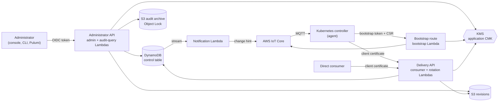

# Architecture

Hemlig is a set of AWS Lambda functions around one DynamoDB table and a few S3 buckets, so workloads outside AWS can read secrets without holding AWS credentials.

Read [Concepts](concepts.md) first for the vocabulary. This page shows the parts and the boundaries between them.

## Components

| Component | Job |
| --- | --- |
| Administrator API | Secret, consumer, grant and audit management. The audit-query Lambda is the only role that can read the archive. |
| Delivery API | Mutual TLS endpoint that returns payloads and change snapshots to consumers. |
| Bootstrap route | Trades a one-use bootstrap token and a CSR for a first client certificate. |
| Control table | Every record except payload ciphertext. See [data model](../reference/data-model.md). |
| Recovery and retention workers | Finish interrupted workflows every 5 minutes; delete expired revisions daily. |

Each Lambda gets its own IAM role. The permissions are in [AWS resources](../reference/aws-resources.md).

## Trust boundaries

| Caller | Proves identity with | Checked by | May do |
| --- | --- | --- | --- |
| Administrator | OIDC token | API Gateway JWT authorizer, then the handler re-checks issuer, audience and scope | Manage secrets, consumers, grants, audit |
| Direct consumer | Client certificate | API Gateway truststore, then a DynamoDB lookup of the certificate fingerprint | Read secrets on its [ACL](../reference/glossary.md#acl) |
| Agent | Bootstrap token once, then client certificate | The same checks, plus its [AgentGrant](../reference/glossary.md#agentgrant) | Read or write only its granted secret UIDs |
| Worker | Lambda execution role | IAM | Recovery or retention only |

Three rules hold at every boundary:

- A caller never names its own consumer ID or environment. Both come from the stored certificate record.
- The DynamoDB check is strongly consistent, so revocation applies on the next request without waiting for the truststore.
- The change-hint channel is a prompt only. It carries no payload and grants no access.

Token requirements are in [Identity provider](identity-provider.md). Certificate mechanics are in [Identity and trust](identity-and-trust.md).

## One request, end to end

1. An administrator writes a secret. The admin Lambda encrypts the payload and stores an immutable revision in S3.
2. A transaction switches the head record in DynamoDB and queues a change hint.
3. The Lambda writes a `succeeded` audit event, then returns.
4. The stream triggers the notification Lambda, which publishes the hint to each affected consumer's topic.
5. The controller wakes, calls the Delivery API with its client certificate, and applies the change.

The mutation protocol is in [Secrets and encryption](secrets-and-encryption.md). Hints and resync are in [Sync and notifications](sync-and-notifications.md).

## What Hemlig deliberately does not do

- It has no public delete route for secrets. Archiving frees the name; history stays.
- It does not rotate the issuing root. Rotating it needs a reviewed overlap protocol.
- It does not hash-chain audit events. It relies on Object Lock. See [Audit evidence](audit-evidence.md).

See also the [threat model](../security/threat-model.md) and the [design archive](../design/index.md).
