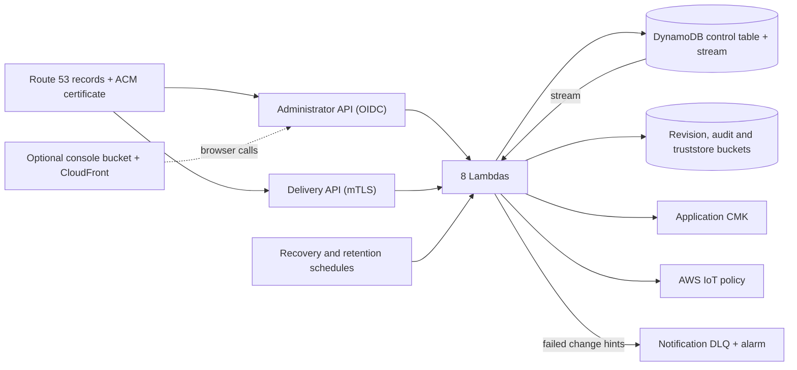

# Deploy Hemlig to AWS

Deploy the Hemlig CDK stack into an AWS account, connect DNS and your identity provider, and create your first environment.

Hemlig is pre-1.0. Run the [acceptance gates](../operations/acceptance.md) in an isolated account before any production use.

**Before you start**

| You need | Why |
| --- | --- |
| An AWS account, with CDK bootstrapped in the target region | The stack deploys through CloudFormation |
| A Route 53 zone, or the ability to delegate one | Three DNS names are created in it |
| An OIDC app registration | See [Connect your identity provider](identity-provider.md) |
| Node.js 24 and Corepack | Build and CDK tooling |
| About 30 minutes | Most of it is CloudFormation waiting |

## What gets deployed



The eight Lambdas are admin, audit-query, consumer, bootstrap, identity-rotation, notification publisher, recovery and retention. Every resource, its permissions and the stack outputs are listed in [AWS resources and IAM](../reference/aws-resources.md).

## 1. Choose names

| Setting | Rule | Example |
| --- | --- | --- |
| `environmentName` | The [deployment name](../reference/glossary.md#deployment-name). Lowercase, `^[a-z][a-z0-9-]{1,31}$`. Prefixes every resource as `hml-prod-...` | `prod` |
| `adminFqdn` | Administrator API host | `admin.example.com` |
| `apiFqdn` | Public mTLS delivery API host | `api.example.com` |
| `zoneDomain` | Route 53 zone name | `example.com` |
| `consoleFqdn` | Optional. Enables the [console](console.md) | `console.example.com` |

All hosts must be lowercase FQDNs, distinct from each other, and inside `zoneDomain`. The deployment name is **not** an [environment](../reference/glossary.md#environment): environments are created at runtime in step 7.

::: warning Changing `apiFqdn` later replaces the delivery domain
mTLS clients fail until the 5-minute recovery schedule reattaches the truststore, then each client must move to the new host. Existing client certificates stay valid.
:::

## 2. Create the CDK app

The root `hemlig` package is not published to npm. Build it from a release tag, pack it, and depend on the archive. Run this once per release.

```sh
git clone --branch v0.3.2 --depth 1 https://github.com/zyno-io/hemlig.git
cd hemlig
corepack enable
yarn install
yarn build:cdk
yarn pack --out ../hemlig-v0.3.2.tgz
cd ..
```

Then choose how to deploy it:

::: code-group

```sh [Your CDK app]
# In your own CDK project. The path is relative to your package.json.
npm install ./hemlig-v0.3.2.tgz
```

```sh [Reference app]
# Skip the install: the reference app is in the checkout you just built.
cd hemlig
```

:::

For your own app, create `bin/hemlig.ts`:

```ts
import { App } from "aws-cdk-lib";
import { HemligStack, type DeploymentConfig } from "hemlig/cdk";

const app = new App();
const config: DeploymentConfig = {
  environmentName: "prod",
  adminFqdn: "admin.example.com",
  apiFqdn: "api.example.com",
  zoneDomain: "example.com",
  oidcIssuer: "https://login.example.com/tenant/v2.0",
  oidcClientId: "00000000-0000-0000-0000-000000000000", // one app registration; also the default audience
  oidcAdminScope: "hemlig.admin",
  oidcSubjectClaim: "sub",
  existingHostedZoneId: "Z0123456789ABCDEF", // omit to create a new zone
};
new HemligStack(app, "hml-prod", config);
```

Your app owns the account, region and pipeline. TypeScript needs `moduleResolution` set to `node16`, `nodenext` or `bundler` to resolve `hemlig/cdk`. The archive depends on `aws-cdk-lib` and `esbuild`, so Lambda bundling needs no Docker. Every field is in [Configuration](../reference/configuration.md#cdk-deploymentconfig).

## 3. Fill in the OIDC values

Four values connect the administrator API to your identity provider. One app registration can serve as both the API and the console client, so you set the client ID once and leave `oidcAudience` and `oidcConsoleAccessScope` out. This holds both for CDK context and for `HemligStack` props in your own CDK app.


| Field | Value |
| --- | --- |
| `oidcIssuer` | HTTPS issuer URL, exactly as it appears in the token's `iss` claim |
| `oidcAudience` | Exact access-token `aud`. For Microsoft Entra v2 this is the API's bare client ID, never the `api://` URI. Defaults to `oidcClientId`, which requires `oidcAdminScope`; set it explicitly for a split API and console app, or an API-only deployment with no client ID |
| `oidcClientId` | The one app registration's client ID, used by the console and as the default audience |
| `oidcSubjectClaim` | Immutable actor claim. The reference app defaults it to `sub` |

[Connect your identity provider](identity-provider.md) shows where to find each one per provider. Console fields are covered in [Console](console.md).

## 4. Deploy

::: warning Object Lock Compliance data cannot be deleted
The revision bucket keeps objects for 90 days and the audit bucket for 7 years. Nobody can delete them earlier, and they block stack teardown. Deploy into an account you intend to keep.
:::

::: code-group

```sh [Your CDK app]
npx cdk deploy hml-prod
```

```sh [Reference app]
yarn cdk:deploy \
  -c environment=prod \
  -c adminFqdn=admin.example.com \
  -c apiFqdn=api.example.com \
  -c zoneDomain=example.com \
  -c existingHostedZoneId=Z0123456789ABCDEF \
  -c oidcIssuer=https://login.example.com/tenant/v2.0 \
  -c oidcClientId=00000000-0000-0000-0000-000000000000 \
  -c oidcAdminScope=hemlig.admin
```

:::

Run `yarn cdk:synth` with the same `-c` flags first if you want to check the configuration without touching AWS. Expected stack outputs:

| Output | Meaning |
| --- | --- |
| `AdminUrl`, `ApiUrl` | The two API origins |
| `IotEndpoint` | AWS IoT data endpoint used for change hints |
| `AdminOidcIssuer`, `AdminOidcAudience` | Echo of your config |
| `AdminOidcScope`, `AdminOidcRole` | Only when configured |
| `RevisionBucketName`, `AuditBucketName` | The two Object Lock buckets |
| `CreatedHostedZoneNameServers` | Only when the stack created the zone |
| `ConsoleUrl`, `ConsoleBucketName`, `ConsoleDistributionId` | Only with `consoleFqdn` |
| `ConsoleAssetsPending` | Only when the console build output was missing at synth time |

## 5. Delegate DNS

Skip this step unless `CreatedHostedZoneNameServers` was printed. Add its comma-separated values as `NS` records for `zoneDomain` at the parent zone's registrar. The certificate validates once delegation resolves.

## 6. Verify the admin API

Get an administrator access token from your provider ([how](identity-provider.md#verify-your-token)), then list environments.

```sh
export HEMLIG_ADMIN_URL=https://admin.example.com
export TOKEN=paste-an-access-token-here
curl -sS "$HEMLIG_ADMIN_URL/v1/admin/environments" \
  -H "authorization: Bearer $TOKEN"
```

Expected output on a fresh deployment:

```json
{"environments":[],"generatedAt":"2030-01-01T00:00:00.000Z"}
```

| Status | Meaning |
| --- | --- |
| `401` | API Gateway rejected the token: missing, invalid, expired, or wrong audience or issuer |
| `403` | A required scope is missing (API Gateway), or the Lambda refused the token: configuration drift |

See [Troubleshooting](../operations/troubleshooting.md#administrator-api).

## 7. Create your first environment

A fresh deployment has no [environments](../reference/glossary.md#environment). Create one; names are 1 to 64 lowercase characters.

```sh
curl -sS -X POST "$HEMLIG_ADMIN_URL/v1/admin/environments" \
  -H "authorization: Bearer $TOKEN" \
  -H "content-type: application/json" \
  -d '{"name":"prod"}'
```

Expected output, with `201`:

```json
{"name":"prod","createdAt":"2030-01-01T00:00:00.000Z","createdBy":{"type":"human","id":"user-subject"}}
```

## 8. Create the issuing root now (optional)

The [issuing root](../reference/glossary.md#issuing-root) is otherwise created lazily by the first enrollment. Pre-creating it avoids a first-enrollment delay, which matters because a [bootstrap token](../reference/glossary.md#bootstrap-token) is valid for only 30 minutes.

```sh
curl -sS -X POST "$HEMLIG_ADMIN_URL/v1/admin/issuer" \
  -H "authorization: Bearer $TOKEN" \
  -H "idempotency-key: create-issuer-0001"
```

It returns `201` with `rootFingerprint` and `rootCertificatePem`, or `200` if the root already exists.

## 9. Run the acceptance gates

Before production use, work through the [acceptance runbook](../operations/acceptance.md).

## Next steps

- [Host the console](console.md)
- [Install the Kubernetes controller](kubernetes.md)
- [Tutorial: your first secret in Kubernetes](first-secret.md)
