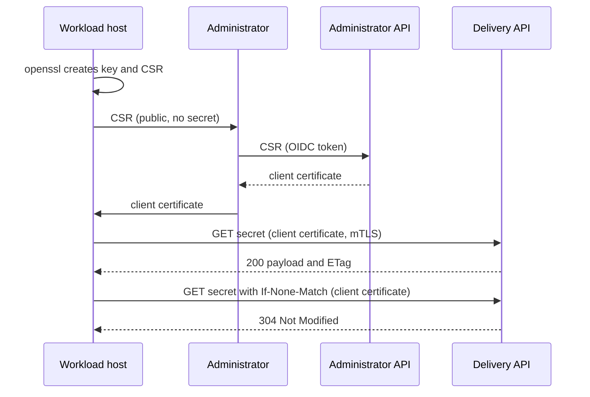

# Connect a workload without Kubernetes

Enroll a workload as a direct consumer, then read a secret from the delivery API with its client certificate and cache it with `If-None-Match`.

A [direct consumer](../reference/glossary.md#direct-consumer) is a workload an administrator enrolls from a certificate signing request ([CSR](../reference/glossary.md#csr)). Its access comes from secret ACLs. In Kubernetes use the [controller](kubernetes.md) and an [AgentGrant](agent-grants.md) instead.

**Before you start**

- Role: administrator with an OIDC access token ([get one](cli.md#get-an-administrator-token)). The workload host needs `openssl` and `curl`.
- The `prod` [environment](../reference/glossary.md#environment) exists, and the secret `payments/stripe/api-key` is `ACTIVE` ([create it](managing-secrets.md)).
- Time: a few minutes of hands-on work.

Set these once on the machine where you run the commands:

```sh
export HEMLIG_ADMIN_URL=https://admin.example.com
export HEMLIG_API_URL=https://api.example.com
export HEMLIG_ADMIN_TOKEN=$(cat "$HOME/.hemlig-token")
```



## 1. Create the issuing root first (optional)

The issuing root is created at the first enrollment. Creating it now avoids a delay at the first enrollment and lets you distribute the trust anchor early.

```sh
curl -sS -X POST "$HEMLIG_ADMIN_URL/v1/admin/issuer" \
  -H "Authorization: Bearer $HEMLIG_ADMIN_TOKEN" \
  -H "Idempotency-Key: $(uuidgen)"
```

Expected output: JSON with the root `fingerprint` and truststore details. It is safe to repeat. See [`POST /v1/admin/issuer`](../reference/api/admin-consumers.md#post-v1-admin-issuer).

## 2. Generate a private key and CSR

Run this on the workload host. The private key never leaves it.

```sh
openssl req -new -newkey rsa:3072 -nodes \
  -keyout client.key -out client.csr -subj "/CN=payments-prod"
chmod 600 client.key
```

Expected output: two files, `client.key` and `client.csr`. Hemlig requires an RSA key of at least 2048 bits. It ignores the subject and sets the identity itself.

::: warning Protect client.key
Anyone holding `client.key` and the certificate can read every secret the consumer may read. Store it with the same care as the secrets it unlocks.
:::

## 3. Enroll the consumer

Send the CSR as an administrator. Hemlig signs it, publishes the truststore and activates the consumer.

```sh
jq -n --arg csr "$(cat client.csr)" \
  '{consumerId:"payments-prod",environment:"prod",apiCertificateSigningRequestPem:$csr}' > enroll.json

curl -sS -X POST "$HEMLIG_ADMIN_URL/v1/admin/consumers" \
  -H "Authorization: Bearer $HEMLIG_ADMIN_TOKEN" \
  -H "Idempotency-Key: $(uuidgen)" \
  -H "Content-Type: application/json" \
  --data @enroll.json > enrolled.json

jq -r .apiCertificatePem enrolled.json > client.crt
```

Expected output in `enrolled.json`, trimmed:

```json
{ "consumerId": "payments-prod", "environment": "prod", "status": "ACTIVE", "apiFingerprint": "41ab..." }
```

Copy `client.crt` to the workload host. If the call returns `409 enrollment_failed`, see [Errors](../reference/api/errors.md).

## 4. Give the consumer read access

Add the consumer to the secret's ACL. Follow [step 4 of Manage secrets](managing-secrets.md#_4-share-the-secret-with-a-consumer), using `payments-prod` with `read`.

## 5. Read the secret with mutual TLS

On the workload host, present the certificate and key:

```sh
curl -sS -D headers.txt \
  --cert client.crt --key client.key \
  "$HEMLIG_API_URL/v1/secrets/payments/stripe/api-key" > secret.json
```

Expected output: HTTP `200` in `headers.txt`, an `etag` header, and `secret.json` like this:

```json
{
  "secretId": "payments/stripe/api-key",
  "controlVersionId": "ctl-...",
  "payloadVersionId": "pay-...",
  "payload": { "api-key": { "encoding": "utf8", "value": "sk_test_example" } }
}
```

## 6. Check for changes with If-None-Match

Send the ETag you stored. An unchanged secret returns `304` with no body and no decryption.

```sh
etag=$(jq -r .controlVersionId secret.json)
curl -sS -o /dev/null -w '%{http_code}\n' \
  --cert client.crt --key client.key \
  -H "If-None-Match: $etag" \
  "$HEMLIG_API_URL/v1/secrets/payments/stripe/api-key"
```

Expected output: `304`. A changed secret returns `200` with the new payload and a new `etag`. A `304` writes no audit events, so polling is cheap. See [audit behavior](../reference/api/audit.md#which-requests-write-events).

## Verify

Decode the value you read:

```sh
jq -r '.payload["api-key"].value' secret.json
```

Expected output: `sk_test_example`. The consumer also appears in the console under Consumers.

## Renew the certificate before it expires

A client certificate is valid for 365 days ([limits](../reference/limits.md#identity)). Issue a second one first, switch the workload, then revoke the old one.

```sh
openssl req -new -newkey rsa:3072 -nodes \
  -keyout client-next.key -out client-next.csr -subj "/CN=payments-prod"

jq -n --arg csr "$(cat client-next.csr)" '{apiCertificateSigningRequestPem:$csr}' > renew.json
curl -sS -X POST "$HEMLIG_ADMIN_URL/v1/admin/consumers/payments-prod/api-identities" \
  -H "Authorization: Bearer $HEMLIG_ADMIN_TOKEN" \
  -H "Idempotency-Key: $(uuidgen)" \
  -H "Content-Type: application/json" \
  --data @renew.json > renewed.json
jq -r .apiCertificatePem renewed.json > client-next.crt
```

After the workload uses `client-next.crt`, revoke the old certificate by its fingerprint:

```sh
old=$(jq -r .apiFingerprint enrolled.json)
curl -sS -X DELETE "$HEMLIG_ADMIN_URL/v1/admin/consumers/payments-prod/api-identities/$old" \
  -H "Authorization: Bearer $HEMLIG_ADMIN_TOKEN" \
  -H "Idempotency-Key: $(uuidgen)"
```

Revocation takes effect on the next request. Enrollment and revocation mechanics are owned by [Identity and trust](identity-and-trust.md).

## If it fails

| Symptom | Likely cause | Fix |
| --- | --- | --- |
| TLS handshake error | Certificate not yet in the truststore, or the wrong key and certificate pair | Confirm enrollment returned `ACTIVE`; check `client.crt` matches `client.key` |
| `403 identity_not_active` | Certificate revoked or unknown to Hemlig (an expired or untrusted one fails the TLS handshake) | Issue a new certificate |
| `403 forbidden` | Consumer is not on the secret's ACL, or the environment differs | Add the ACL entry; see step 4 |
| `403 forbidden` | The secret ID is wrong, or the secret is not `ACTIVE` (same status as a missing ACL entry) | Check the ID; write a payload |

All codes are in [Errors](../reference/api/errors.md). For more, see [Troubleshooting](../operations/troubleshooting.md).

## Next steps

- [Manage secrets](managing-secrets.md)
- [Identity and trust](identity-and-trust.md)
- [HTTP API: delivery routes](../reference/api/delivery.md)
