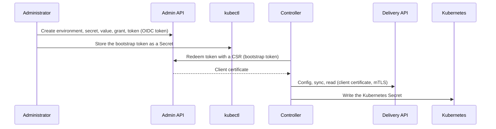

# Tutorial: your first secret in Kubernetes

Starting from a deployed Hemlig stack and a Kubernetes cluster, you deliver one secret into a Kubernetes Secret and read it from a Pod, in about 30 minutes.

## Before you start

You need a deployed stack, an administrator token and a cluster. Parts 1 and 2 are for an [administrator](../reference/glossary.md#administrator), part 3 for the platform team, part 4 for the app team.

| You need | Check | Expected |
| --- | --- | --- |
| A deployed stack | The `AdminUrl` and `ApiUrl` stack outputs ([Deploy Hemlig to AWS](deploying.md)) | Two `https://` URLs |
| An administrator token | `curl -sS -H "Authorization: Bearer $TOKEN" "$HEMLIG_ADMIN_URL/v1/admin/environments"` ([Verify your token](identity-provider.md#verify-your-token)) | HTTP 200 |
| A cluster you administer | `kubectl auth can-i create customresourcedefinitions` | `yes` |
| Tools | `helm version`, `jq --version`, `uuidgen` | Helm 3, any `jq` |

This tutorial uses these values throughout:

| Thing | Value |
| --- | --- |
| Environment | `prod` |
| Secret | `payments/stripe/api-key`, entry `api-key` |
| Namespace | `payments` |
| Consumer ID | `payments-prod` |
| HemligProvider | `production` |

## How the pieces connect



## Part 1: Prepare the secret (administrator)

### 1. Set your variables

Replace the three values with your own. `TOKEN` is your OIDC access token.

```sh
export HEMLIG_ADMIN_URL=https://admin.example.com
export HEMLIG_API_URL=https://api.example.com
export TOKEN=your-access-token
export ENV=prod
```

No output. Every `curl` below sends `Authorization: Bearer $TOKEN`.

### 2. Create the environment

```sh
curl -sS -X POST "$HEMLIG_ADMIN_URL/v1/admin/environments" \
  -H "Authorization: Bearer $TOKEN" \
  -H 'content-type: application/json' \
  -d "{\"name\":\"$ENV\"}" | jq
```

Expected output (HTTP 201):

```json
{
  "name": "prod",
  "createdAt": "2030-01-01T00:00:00.000Z",
  "createdBy": { "type": "human", "id": "alice@example.com" }
}
```

If the environment already exists, the API returns HTTP 409. That is fine; continue.

### 3. Create the secret

The request needs `metadata` and `acl`, even when empty. Leave `acl` empty: the grant in part 2 manages the cluster's access.

```sh
CONTROL=$(curl -sS -X POST "$HEMLIG_ADMIN_URL/v1/admin/secrets" \
  -H "Authorization: Bearer $TOKEN" \
  -H "Idempotency-Key: $(uuidgen)" \
  -H 'content-type: application/json' \
  -d "{\"secretId\":\"payments/stripe/api-key\",\"environment\":\"$ENV\",\"metadata\":{\"description\":\"Stripe API key\"},\"acl\":[]}" \
  | tee /dev/stderr | jq -r .controlVersionId)
```

Expected output (HTTP 201), trimmed: `"state": "PENDING_VALUE"`. The variable `CONTROL` holds the [ETag](../reference/glossary.md#etag).

### 4. Write the value

```sh
curl -sS -X PUT "$HEMLIG_ADMIN_URL/v1/admin/secrets/payments/stripe/api-key/payload?environment=$ENV" \
  -H "Authorization: Bearer $TOKEN" \
  -H "Idempotency-Key: $(uuidgen)" \
  -H "If-Match: $CONTROL" \
  -H 'content-type: application/json' \
  -d '{"payload":{"api-key":{"encoding":"utf8","value":"sk_test_example_123"}}}' | jq
```

Expected output (HTTP 200), trimmed: `"state": "ACTIVE"` and a `payloadVersionId`.

The [CLI, console and Pulumi provider](managing-secrets.md) can do steps 3 and 4 too.

## Part 2: Grant the cluster access (administrator)

### 5. Create the AgentGrant

An [AgentGrant](../reference/glossary.md#agentgrant) says which secrets one cluster identity may use.

```sh
GRANT_ID=$(curl -sS -X POST "$HEMLIG_ADMIN_URL/v1/admin/agent-grants" \
  -H "Authorization: Bearer $TOKEN" \
  -H 'content-type: application/json' \
  -d "{\"consumerId\":\"payments-prod\",\"environment\":\"$ENV\",\"capabilities\":[\"read\"],\"secretGrants\":[{\"secretId\":\"payments/stripe/api-key\",\"permissions\":[\"read\"]}]}" \
  | tee /dev/stderr | jq -r .grantId)
```

Expected output (HTTP 201), trimmed: a `grantId` such as `grant-...` and `"status": "PENDING"`.

Three rules apply:

- The consumer ID `payments-prod` must be unused.
- Every secret you list must already exist, as it does after part 1.
- Do not add `payments-prod` to the secret's ACL. The grant manages that access, and the API rejects it.

### 6. Issue the bootstrap token

```sh
BOOTSTRAP_TOKEN=$(curl -sS -X POST "$HEMLIG_ADMIN_URL/v1/admin/agent-grants/$GRANT_ID/bootstrap-capabilities" \
  -H "Authorization: Bearer $TOKEN" \
  | tee /dev/stderr | jq -r .token)
```

Expected output (HTTP 201):

```json
{
  "grantId": "grant-...",
  "token": "hmlb_...",
  "expiresAt": "2030-01-01T00:30:00.000Z"
}
```

::: warning The token is shown once and lasts 30 minutes
Finish step 10 inside that window. Hemlig stores only a hash, so a lost token cannot be recovered. You can issue a new one only while the grant is still `PENDING`.
:::

On a brand-new deployment, run `POST /v1/admin/issuer` with an `Idempotency-Key` header before this step. It creates the issuing root now, so the first enrollment does not have to.

## Part 3: Install and connect the controller (platform team)

### 7. Install the controller

```sh
helm repo add zyno https://zyno-io.github.io/charts
helm repo update
helm upgrade --install hemlig-controller zyno/hemlig-controller \
  --namespace hemlig-system --create-namespace
kubectl -n hemlig-system rollout status deploy/hemlig-controller
```

Expected output ends with `deployment "hemlig-controller" successfully rolled out`. The chart installs the custom resource definitions and a cluster-wide ClusterRole. Review it first; see [Kubernetes controller](kubernetes.md).

### 8. Declare the provider and label the namespace

A [HemligProvider](../reference/glossary.md#hemligprovider) holds the two Hemlig URLs and says which namespaces may use them.

```sh
kubectl create namespace payments
kubectl apply -f - <<EOF
apiVersion: hemlig.io/v1beta1
kind: HemligProvider
metadata:
  name: production
spec:
  bootstrapUrl: $HEMLIG_ADMIN_URL
  apiUrl: $HEMLIG_API_URL
  allowedNamespaces:
    matchLabels:
      hemlig.io/provider-production: "true"
EOF
kubectl label namespace payments hemlig.io/provider-production=true
```

Expected output: `hemligprovider.hemlig.io/production created` and `namespace/payments labeled`.

### 9. Store the bootstrap token

```sh
kubectl -n payments create secret generic payments-bootstrap \
  --from-literal=token="$BOOTSTRAP_TOKEN"
```

Expected output: `secret/payments-bootstrap created`.

### 10. Create the consumer

A [HemligConsumer](../reference/glossary.md#hemligconsumer) makes the controller redeem the token and keep the resulting [client certificate](../reference/glossary.md#client-certificate).

```sh
kubectl apply -f - <<'EOF'
apiVersion: hemlig.io/v1beta1
kind: HemligConsumer
metadata:
  name: payments
  namespace: payments
spec:
  providerRef: production
  bootstrapTokenRef: { name: payments-bootstrap, key: token }
  identity: { secretName: hemlig-payments-client }
EOF
kubectl -n payments get hmlconsumer payments -w
```

Expected output, ending when the consumer is ready:

```text
NAME       READY   REASON          IDENTITY-EXPIRES           ROTATION   AGE
payments   True    IdentityReady   2031-01-01T00:00:00Z                  20s
```

On a fresh deployment the first enrollment also publishes the [truststore](../reference/glossary.md#truststore), so you may first see `ReconcileFailed` or a 503. That is normal; the controller retries. Press Ctrl+C when `READY` is `True`. If it stays false, see [Troubleshooting](../operations/troubleshooting.md#controller).

::: warning Never delete the identity Secret
The Secret `hemlig-payments-client` holds the controller's private key. If you delete it after the token is redeemed, this consumer cannot enroll again with the same grant.
:::

## Part 4: Import the secret (app team)

### 11. Create the import

```sh
kubectl apply -f - <<'EOF'
apiVersion: hemlig.io/v1beta1
kind: HemligSecretImport
metadata:
  name: stripe-api-key
  namespace: payments
spec:
  consumerRef: payments
  secretId: payments/stripe/api-key
  target: { name: stripe-api-key, type: Opaque }
EOF
kubectl -n payments wait --for=condition=Ready hmlimport/stripe-api-key --timeout=2m
```

Imports have no printer columns, so `wait` is the check. Expected output: `hemligsecretimport.hemlig.io/stripe-api-key condition met`.

### 12. Read the Kubernetes Secret

```sh
kubectl -n payments get secret stripe-api-key -o jsonpath='{.data.api-key}' | base64 -d
```

Expected output: `sk_test_example_123`. Each payload entry becomes a key of the Secret, so the entry `api-key` is the key `api-key`.

The controller also records where the value came from:

```sh
kubectl -n payments get secret stripe-api-key -o jsonpath='{.metadata.annotations}' | jq
```

Expected output includes `hemlig.io/secret-id`, `hemlig.io/control-version-id` and `hemlig.io/payload-version-id`.

### 13. Use it from a Pod

```sh
kubectl -n payments apply -f - <<'EOF'
apiVersion: v1
kind: Pod
metadata:
  name: api-key-check
spec:
  restartPolicy: Never
  containers:
    - name: check
      image: busybox:1.37
      command: ["sh", "-c", 'echo "API key length: ${#API_KEY}"']
      env:
        - name: API_KEY
          valueFrom:
            secretKeyRef: { name: stripe-api-key, key: api-key }
EOF
kubectl -n payments wait --for=jsonpath='{.status.phase}'=Succeeded pod/api-key-check --timeout=2m
kubectl -n payments logs api-key-check
```

Expected output: `API key length: 19`. The Pod prints the length, never the value.

## Part 5: Watch an update arrive

### 14. Write a new value

Back as the administrator, read the current ETag, then write a new value with it.

```sh
CONTROL=$(curl -sS "$HEMLIG_ADMIN_URL/v1/admin/secrets/payments/stripe/api-key/payload?environment=$ENV" \
  -H "Authorization: Bearer $TOKEN" | jq -r .controlVersionId)
curl -sS -X PUT "$HEMLIG_ADMIN_URL/v1/admin/secrets/payments/stripe/api-key/payload?environment=$ENV" \
  -H "Authorization: Bearer $TOKEN" \
  -H "Idempotency-Key: $(uuidgen)" \
  -H "If-Match: $CONTROL" \
  -H 'content-type: application/json' \
  -d '{"payload":{"api-key":{"encoding":"utf8","value":"sk_test_example_456"}}}' | jq .state
```

Expected output: `"ACTIVE"`.

### 15. Verify

```sh
kubectl -n payments get secret stripe-api-key -o jsonpath='{.data.api-key}' | base64 -d
```

Expected output: `sk_test_example_456`. A change hint delivers it promptly. If hints are not working, the controller's [10-minute resync](../reference/limits.md#controller) picks it up. The `hemlig.io/control-version-id` annotation changes too.

## Clean up

```sh
kubectl -n payments delete pod api-key-check
kubectl -n payments delete hmlimport stripe-api-key
kubectl -n payments delete secret stripe-api-key
```

Deleting an import does **not** delete its Secret: the controller does not read `deletionPolicy`, so delete the Secret yourself. The grant stays `ACTIVE`, and you can archive the secret from the [console or CLI](managing-secrets.md).

## What you learned

- A secret becomes `ACTIVE` once its first value is written.
- An AgentGrant, not the secret's ACL, gives a cluster access.
- The bootstrap token enrolls the controller once; its client certificate does the rest.
- An import turns each payload entry into a key of a Kubernetes Secret and keeps it current.

## Next steps

- [Import a secret into your namespace](import-secret.md), for app teams
- [Give a cluster access](agent-grants.md)
- [Rotate identities](../operations/identity-rotation.md)
