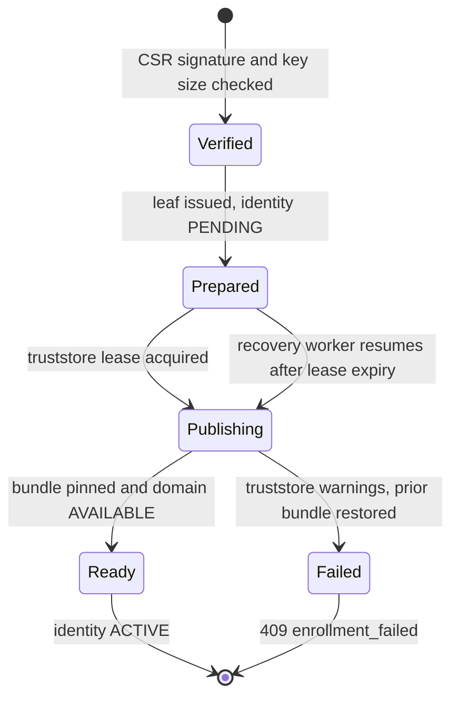

# Identity and trust

Hemlig issues its own client certificates and trusts only those, so a consumer proves who it is with a certificate and never with an AWS credential.

This page owns the mechanics of enrollment, the truststore, rotation and revocation. Other pages link here.

## The pieces

| Piece | What it is |
| --- | --- |
| [Issuing root](../reference/glossary.md#issuing-root) | One self-signed root per deployment. Created on first enrollment. |
| [Client certificate](../reference/glossary.md#client-certificate) | A leaf signed by the root for one consumer. The consumer keeps the private key. |
| [Truststore](../reference/glossary.md#truststore) | The PEM bundle API Gateway uses to accept client certificates. Holds the root only. |
| [Fingerprint](../reference/glossary.md#fingerprint) | SHA-256 of the certificate's DER bytes. Hemlig looks identities up by it. |

Sizes and lifetimes are in [Limits](../reference/limits.md#identity).

The root's private key is encrypted under the application key (CMK) with the encryption context `purpose=issuer-ca`. Three Lambda roles can decrypt it: administrator, bootstrap and identity rotation. Consumer read roles never can. See [Secrets and encryption](secrets-and-encryption.md#kms-contexts).

Hemlig accepts a CSR, never a private key or a CA certificate. The issued leaf carries the identity `spiffe://hemlig/consumer/` followed by the consumer ID.

To avoid delay on the first enrollment, create the issuer ahead of time with `POST /v1/admin/issuer`.

## Enrollment

Enrollment turns a CSR into an active client certificate. An administrator enrolls a direct consumer with `POST /v1/admin/consumers`. An agent redeems a [bootstrap token](../reference/glossary.md#bootstrap-token) within its 30-minute window.

An identity becomes active only after API Gateway reports the new truststore as available. Writing the S3 object is not enough.

- Only one enrollment holds the truststore lease. Another enrollment gets `503` and can retry.
- If the request times out, the recovery worker resumes the same operation with the same bundle version.
- Sending the same CSR again returns the same certificate. A different CSR does not.
- `409 enrollment_failed` is terminal. Repair the issuer or truststore, then submit a new enrollment.
- The bundle is checked against API Gateway's size limits before any write.

## Verification on every request

API Gateway checks the certificate chain. The Lambda then hashes the certificate and reads the identity record with a strongly consistent read. It requires status `ACTIVE` and a valid date range.

The consumer ID and environment come from that record. The caller supplies neither.

## Self-rotation <Badge type="tip" text="v0.3.0+" />

An agent with an active certificate can replace it without an administrator. It sends a CSR with a new key to `POST /v1/agent/identities/rotate`. Hemlig issues a successor and registers it with AWS IoT.

The predecessor stays ACTIVE. This is deliberate: it is the overlap during the switch and the rollback if the successor fails. It stays valid until it expires or an administrator revokes it.

Self-rotation is refused with `identity_limit_reached` while 3 or more certificates are active, until one is revoked. Administrators can issue more.

The procedure, controller settings and recovery steps are in [Identity rotation](../operations/identity-rotation.md). The route contract is in [the delivery API](../reference/api/delivery.md#post-v1-agent-identities-rotate).

## Revocation

An administrator revokes one certificate with `DELETE /v1/admin/consumers/{consumerId}/api-identities/{apiFingerprint}`.

1. Hemlig marks the identity `REVOKED` in DynamoDB. The next request with that certificate is rejected.
2. Hemlig revokes the certificate in AWS IoT so it can no longer connect for change hints.

Revocation does not wait for the truststore, because the DynamoDB check runs on every request. A repeated request is safe: it re-applies the IoT revocation if the first attempt failed after step 1.

Revoking one certificate leaves the consumer's other certificates and its grant untouched.

## Next steps

- [Rotate an identity](../operations/identity-rotation.md)
- [Threat model](../security/threat-model.md)
- [Glossary: identity revocation](../reference/glossary.md#identity-revocation)
