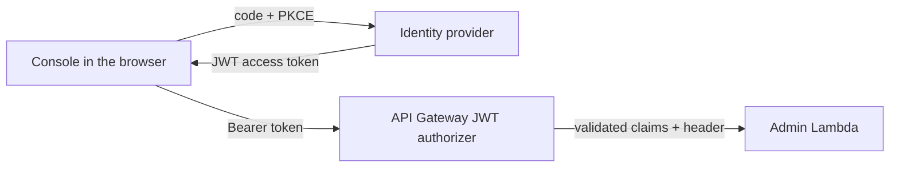

# Connect your identity provider

Configure one OIDC app registration so its access tokens satisfy the administrator API, then verify a real token with curl before you rely on it.

Hemlig does not create users, app registrations or administrator groups. Any provider that publishes an HTTPS OIDC issuer with a JWKS and issues RSA-signed JWT access tokens works. Per-provider steps are in the [recipes](#provider-recipes).

**Before you start:** you need admin rights in your provider and the [CDK config](deploying.md#_3-fill-in-the-oidc-values) fields in front of you. About 15 minutes.

## What Hemlig needs from any provider

Every administrator request is checked twice: by API Gateway, then again by the admin Lambda. Your provider must be able to produce all of the following.

| Need | Why | Config field |
| --- | --- | --- |
| A JWT access token, not an opaque string | API Gateway verifies the signature (RSA) and reads the claims. Only access tokens are supported; ID-token mode is not shipped | none |
| `iss` equal to the issuer, character for character | Both checks compare it exactly | `oidcIssuer` |
| An `aud` that contains your audience (or `client_id` when `aud` is absent) | Binds the token to this API | `oidcAudience`, default `oidcClientId` |
| A scope claim (`scope` or `scp`) containing the admin scope | Rejects ID tokens and tokens minted for other purposes | `oidcAdminScope` |
| A stable subject claim | Recorded as the owner of every change and used for idempotency. Pick a claim that never changes for a person | `oidcSubjectClaim`, default `sub` |
| A role claim that contains an administrator role | Limits administrators to the people you choose | `oidcRoleClaim`, `oidcAdminRole` |
| A public single-page client with the authorization-code flow and PKCE | The console is a browser app with no client secret | `oidcClientId` |
| CORS allowed on the token endpoint for the console origin | The browser redeems the code directly | none (provider setting) |

The scope and role are optional for API-only use, but `oidcAdminScope` is **required** whenever the [console](console.md) is enabled or `oidcAudience` is omitted. A scope is one token, not a list. Role checks are optional, but a console without `oidcAdminRole` makes synthesis warn that any holder of the admin scope is an administrator.

### Why the scope matters

With one app registration, an ID token issued to the console can carry the same `aud` as the access token. The audience check then passes, and the scope check is what rejects the ID token, because ID tokens carry no `scp` or `scope`. That is why `oidcAdminScope` is required when the audience is the client ID. See the [threat model](../security/threat-model.md#access-and-identity).

## The one-app model

Register the console once. That one registration is the console's OAuth client and, where the provider allows it, the token audience, so you set the client ID once and leave `oidcAudience` out.



Some providers model the API separately, such as an Okta custom authorization server or an Auth0 API. That is configuration on the same client, not a second client: set `oidcAudience` to the API's identifier.

The CLI needs no registration. `hemlig login` goes through the console's `/cli-login` page, either POSTing the token to a `127.0.0.1` listener or showing a copy code, so no CLI redirect URI exists to register. The CLI caches the same bearer the console uses.

Keep two registrations only if you must: set `oidcAudience`, `oidcClientId` and, on Entra, `oidcConsoleAccessScope` explicitly, and an explicit value always wins.

## Field mapping

| Hemlig field | Required | Default | Matches |
| --- | --- | --- | --- |
| `oidcIssuer` | yes | none | `iss`, and the discovery URL root |
| `oidcClientId` | with `consoleFqdn` | none | The console app's client ID. Also the default audience |
| `oidcAudience` | no | `[oidcClientId]` | `aud` (any of a list of 1 to 8), or `client_id` when `aud` is absent |
| `oidcAdminScope` | with `consoleFqdn` | none | One value inside `scope` or `scp` |
| derived console scope | no | `api://<audience>/<oidcAdminScope>` on Entra issuer hosts, the bare scope elsewhere | What the browser requests. Override with `oidcConsoleAccessScope` |
| `oidcSubjectClaim` | yes | `sub` (context) | A string claim present in the token |
| `oidcRoleClaim` | no | `roles`, then `role` | A claim name, or an RFC 6901 JSON Pointer |
| `oidcAdminRole` | no | none | One or more role values, any-of |
| `oidcPkiCaAdminRole`, `oidcPkiOperatorRole` | no | none | Further values in the same role claim |
| `oidcAuthorizeParams` | no | none | Extra authorize-request parameters, such as Auth0 `audience` |
| `oidcProviderOrigins` | no | none | Extra console CSP origins for a token endpoint on another host |

Every field is specified in the [configuration reference](../reference/configuration.md#cdk-deploymentconfig). Replace placeholder hosts and IDs with your own.

## How the role claim works

`oidcRoleClaim` says where the role values live in the access token. `oidcAdminRole` lists the values that make someone an administrator. The Lambda reads the claim from the `Authorization` bearer itself, so nested claims work.

- A name without a leading `/` is a top-level claim, used as-is: `roles`, `groups`, `permissions`, `cognito:groups`.
- A name starting with `/` is a JSON Pointer, so dots and slashes are unambiguous: `/realm_access/roles`. Write `~1` for `/` and `~0` for `~` inside a segment.
- A string claim is one value. An array gives its string elements. An object gives its **keys** (for Zitadel role objects). A number or boolean gives its string form.
- `oidcAdminRole` accepts a list and matches any of its values. A value may contain spaces (`Hemlig Admins`) but not a comma.
- The two PKI roles are further values in the **same** claim. Unset PKI roles let any administrator through. `oidcRoleClaim` requires `oidcAdminRole`.

| Provider | `oidcRoleClaim` | Example `oidcAdminRole` |
| --- | --- | --- |
| Entra (app roles) | unset (`roles`) | `Hemlig.Administrator` |
| Okta (groups claim) | `groups` | `Hemlig Admins` |
| Auth0 (RBAC permissions) | `permissions` | `admin:hemlig` |
| Keycloak (realm roles) | `/realm_access/roles` | `hemlig-admin` |
| Keycloak (client roles) | `/resource_access/CLIENT_ID/roles` | `admin` |
| Cognito (user pool groups) | `cognito:groups` | `hemlig-admins` |
| Zitadel (project roles) | `urn:zitadel:iam:org:project:roles` | `hemlig-admin` |

Do not use Entra's `groups` claim. Above the provider's size limit it is replaced by a reference the Lambda will not follow, and every request is refused with `role_overage` (see [troubleshooting](#_403-from-the-lambda)). Use app roles instead.

## Redirect URIs, CORS and CSP

The console needs these three redirect URIs for your `consoleFqdn`. Register them on the single-page application platform of the one app.

| Purpose | URI |
| --- | --- |
| Sign-in callback | `https://console.example.com/auth/callback` |
| Silent token renewal | `https://console.example.com/silent.html` |
| Post-logout, and the origin | `https://console.example.com` |

The browser redeems the authorization code at the provider's token endpoint, so the provider must allow CORS for `https://console.example.com` there. The setting is called Trusted Origins in Okta, Allowed Web Origins and Allowed Origins in Auth0, and Web origins in Keycloak; Entra implies it for the single-page application platform.

The console's Content-Security-Policy trusts the issuer's origin in `connect-src` and `frame-src`. When the token endpoint or the silent-renew frame is on a different origin than the issuer, add it with `oidcProviderOrigins`. Cognito's managed-login domain is the usual case.

## Sign-out

When discovery publishes an `end_session_endpoint`, sign-out is RP-initiated: the console redirects to the provider and returns to the console origin. Add the origin to the provider's post-logout list.

When it does not (Cognito, Google, Dex), sign-out clears only the console session and shows "You're signed out" with a **Sign in** button. It does not end the provider's own session, so the next sign-in may complete without a password prompt until that session expires.

## Provider recipes

Each recipe gives the app setup, how to get a JWT access token with the right `aud` and scope, where roles come from, a sample config and caveats. Anything a recipe cannot state with confidence is marked **verify in your tenant**.

| Provider | Console sign-in | Page |
| --- | --- | --- |
| Microsoft Entra ID | Supported, one app | [Entra recipe](identity-providers/entra.md) |
| Okta | Supported, custom authorization server | [Okta recipe](identity-providers/okta.md) |
| Auth0 | Supported, `audience` parameter | [Auth0 recipe](identity-providers/auth0.md) |
| Keycloak | Supported | [Keycloak recipe](identity-providers/keycloak.md) |
| Google | Only through a broker | [Google recipe](identity-providers/google.md) |
| Authentik, Zitadel, Cognito | Supported, less verified | [Other providers](identity-providers/others.md) |

## Verify your token

Obtain an access token with your provider's normal tooling, then check it in two steps. Do not paste production tokens into third-party decoders.

1. Decode the claims locally.

   ```sh
   export TOKEN=paste-an-access-token-here
   python3 -I -c "import base64,json,sys;p=sys.argv[1].split('.')[1];print(json.dumps(json.loads(base64.urlsafe_b64decode(p+'='*(-len(p)%4))),indent=1))" "$TOKEN"
   ```

   Expected output is a JSON object. Compare it with your config:

   | Claim | Must equal |
   | --- | --- |
   | `iss` | `oidcIssuer`, character for character (watch trailing slashes and `/v2.0`) |
   | `aud` | Contains `oidcAudience`. A client ID that is not the audience, or an ID token, means you asked for the wrong thing |
   | `scp` or `scope` | Contains `oidcAdminScope` |
   | the role claim | Contains `oidcAdminRole`, when configured, at the path `oidcRoleClaim` names |
   | your `oidcSubjectClaim` | Is present and is a string |

2. Call the API.

   ```sh
   export HEMLIG_ADMIN_URL=https://admin.example.com
   curl -sS -o /dev/null -w '%{http_code}\n' \
     "$HEMLIG_ADMIN_URL/v1/admin/environments" \
     -H "authorization: Bearer $TOKEN"
   ```

   Expected output:

   ```text
   200
   ```

| Status | Meaning | Fix |
| --- | --- | --- |
| `401` | API Gateway rejected the token before Lambda | Missing or invalid token, audience, issuer, signature or expiry. Get a new token |
| `403` | Insufficient scope (API Gateway), or the Lambda refused the token | Request the required scope. If the scope is present, the gateway and Lambda disagree on issuer, audience, scope or role: fix the config |

## Troubleshoot sign-in and authorization

Match the symptom, then follow the fix. Decode the token first with [Verify your token](#verify-your-token).

### 401 from the gateway

The gateway answers with its own body, not a Hemlig error envelope. The console shows "The identity provider token was rejected before the request reached Hemlig."

| Cause | How to tell | Fix |
| --- | --- | --- |
| Wrong `iss` | The decoded `iss` differs from `oidcIssuer` by a slash, a scheme or `/v2.0`. Entra v1 tokens use a different issuer host | Set `oidcIssuer` to the exact `iss`. On Entra, set `api.requestedAccessTokenVersion` to 2 |
| Wrong `aud` | `aud` does not contain `oidcAudience`. An Entra v2 `aud` is the bare client ID, not the `api://` URI. Auth0 and Okta need their API or authorization-server audience | Set `oidcAudience` to the value in the token, or request the right resource (`oidcAuthorizeParams` for Auth0) |
| Opaque access token | The token has no two dots, or does not decode as JSON | Make the provider issue JWT access tokens for this audience (see the recipe). Auth0 without the `audience` parameter and Google issue opaque access tokens |
| Unsupported signature | The JWT header `alg` is not RS256 or another RSA algorithm | Choose an RSA signing key. Authentik falls back to HS256 without one |
| Expired or not yet valid | `exp` is past, or `nbf` or `iat` is ahead of the gateway's clock | Get a fresh token. See [clock skew](#clock-skew) |

### 403 from the gateway

A `403` with no Hemlig body is the gateway refusing the route scope.

| Cause | How to tell | Fix |
| --- | --- | --- |
| Missing scope | Neither `scope` nor `scp` contains `oidcAdminScope` | Request the scope, grant it to the app and user, and add it to the console's requested scopes. On Entra a bare scope is read as a Microsoft Graph scope: the derived `api://<audience>/<scope>` form exists for that reason |

### 403 from the Lambda

The body is a Hemlig error with code `forbidden` and the message "The administrator JWT does not satisfy this API configuration." The reason is only in the log. Search the admin, audit-query and pki-admin log groups for `admin_jwt_rejected_by_handler`, which logs a `reason`, match booleans and claim names, never values.

| `reason` | Cause | Fix |
| --- | --- | --- |
| `role` | The role claim is missing, holds no `oidcAdminRole` value, or `oidcRoleClaim` points at the wrong place. Check `roleClaimType` in the log: `missing` means the path resolved to nothing | Fix `oidcRoleClaim` or the value. On Entra it is a role value such as `Hemlig.Administrator`, not a group name. On Keycloak a group path starts with `/` |
| `role_overage` | An Entra `groups` claim was replaced by a reference. The message is "The administrator JWT carries a group-overage reference instead of its groups, so roles cannot be read. Use app roles, or restrict the groups claim to the groups assigned to this application." | Use app roles, or `ApplicationGroup` group membership claims with groups assigned to the enterprise app |
| `binding` | The bearer's claims differ from the gateway's: `iss`, `exp`, the subject claim, `aud`, or any other claim. A proxy rewrote the token, or the claim is missing | Send the validated token unchanged. A missing subject claim also lands here |
| `bearer_unreadable` | The `Authorization` header is absent or is not a three-part JWT with a JSON payload | Send `Authorization: Bearer <JWT>` |
| `audience`, `issuer` | The Lambda re-check disagrees with the gateway config | Fix the config so both agree, then redeploy |
| `scope` | The scope is not in `scope` or `scp` | As for the gateway 403 |
| `subject` | `oidcSubjectClaim` is absent or not a string | Choose a claim the token carries as a string (`oid` on Entra, `uid` on Okta) |
| `tenant` | A configured tenant pin did not match | Not set by the CDK stack; check any manual Lambda environment edits |
| none (not logged) | The request has no validated authorizer claims. The body message is "A validated administrator JWT is required." The route is not behind the JWT authorizer | Do not invoke the Lambda directly |

A PKI route can also return `403` with code `pki_role_required` and "The administrator role for this PKI operation is required." That is `oidcPkiCaAdminRole` or `oidcPkiOperatorRole` missing from the same role claim.

### Console sign-in loops

The console redirects to the provider whenever it has no session. A loop means the provider returns without a usable session or the callback fails.

| Cause | How to tell | Fix |
| --- | --- | --- |
| Redirect URI not registered | The provider shows its own error page | Register the three URIs on the single-page application platform |
| Callback fails | The console shows "Sign-in could not be completed." with a message | Read the message: a state error usually means a stale tab; a token error means the client or CORS is wrong |
| Silent renew blocked | Sessions drop at token expiry; the browser console shows a CSP `frame-src` violation or an X-Frame-Options refusal | Add the frame's origin with `oidcProviderOrigins`. If the provider refuses framing, the redirect fallback still works but interrupts the session. Safari and Firefox third-party cookie rules can also block it (verify in your tenant) |
| Short token lifetime | The session ends within minutes and the CLI hand-off is nearly useless | Raise the access-token lifetime in the provider. Keycloak's default is short |

### CORS or CSP errors

| Symptom | Cause | Fix |
| --- | --- | --- |
| Browser blocks the token request: no `Access-Control-Allow-Origin` | The provider does not allow the console origin on its token endpoint | Add `https://console.example.com` to the provider's CORS setting (Trusted Origins, Allowed Web Origins, Web origins) |
| Browser blocks `connect-src` or `frame-src` to a host that is not the issuer | The token endpoint or session frame is on another origin | Add that bare HTTPS origin to `oidcProviderOrigins` (at most 4) and redeploy the console |
| API calls fail preflight | The console origin differs from `consoleFqdn` | Use the configured console host |

### Clock skew

A token whose `iat` or `nbf` is ahead of the gateway's clock can get `401` right after sign-in. The gateway's leeway is not documented, so verify in your tenant how much skew it tolerates. Check the provider's and your host's time first.

The CLI compares `exp` with the local clock. A hand-off fails with "Token is expired or has no expiry" (HTTP 400 to the console page), and a pasted code with "The pasted token is expired or has no expiry; no login was saved." Fix the machine's clock.

### Signed straight back in

You select sign-out and, after the provider returns, the console is in again with no password prompt. When discovery has no `end_session_endpoint`, the console cannot end the provider's session. It clears its own session, remembers the sign-out for the tab and shows "You're signed out", but **Sign in** reuses the provider session.

| Cause | Fix |
| --- | --- |
| No `end_session_endpoint` (Cognito, Google, Dex) | Expected. End the session in the provider, or shorten its session lifetime. Use a provider that supports RP-initiated logout if you need it |
| Endpoint exists but returns to the provider | Add `https://console.example.com` to the provider's post-logout redirect list |
| Auth0 | Whether discovery advertises an end-session endpoint can depend on tenant settings. Verify in your tenant |

## Next steps

- [Deploy Hemlig to AWS](deploying.md)
- [Host the console](console.md)
- [Configuration reference](../reference/configuration.md)
