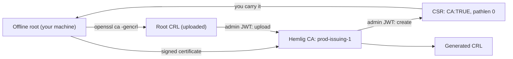

# PKI: certificate authorities and CRLs

Hemlig can hold an intermediate certificate authority (CA) that your offline root signs, and publishes that CA's certificate revocation lists (CRLs).

Issuing leaf certificates, issuance grants, cert-manager and trust bundles arrive in later releases. This page covers the CA lifecycle and CRLs.

## The topology

Your organization keeps a root offline. Hemlig generates the intermediate's key, hands you a certificate signing request (CSR), and never sees the root key.



The CA is an `EXTERNAL_INTERMEDIATE`: its path length is 0, so it can sign leaf certificates but not other CAs. Its key is wrapped by KMS and decrypted only to sign.

## Create, sign and activate

All steps use the [CLI](cli.md). Set the environment once:

```sh
export HEMLIG_ENVIRONMENT=prod
```

1. **Create the CA.** Hemlig returns a CSR. Name constraints and extended key usages in the request limit what the CA may ever certify.

   ```sh
   hemlig pki ca create --name prod-issuing-1 --key-algorithm ECDSA_P256 \
     --subject 'CN=Example Prod Issuing CA 1,O=Example Corp' \
     --permit-dns example.com --csr-out issuing.csr
   ```

2. **Sign it offline** with the root, then issue the root's first CRL. The recipe is in [Offline root recipe](../operations/pki-offline-root.md).
3. **Activate** with the signed certificate, the root certificate and the root CRL:

   ```sh
   hemlig pki ca activate prod-issuing-1 --certificate issuing.pem \
     --chain root.pem --root-crl root.crl.pem
   ```

Activation checks the chain, the CA certificate, its constraints and the root CRL before anything is written. Then it signs the CA's empty CRL number 1. A failed check returns `chain_invalid` or `crl_invalid` with a `details.reason`; see [Admin: PKI](../reference/api/admin-pki.md#errors).

Hemlig CA names and subject DNs are claimed permanently, so a new CA, even after a failed one, needs a new DN.

## CA states

| State                 | Meaning                                                                                           |
| --------------------- | ------------------------------------------------------------------------------------------------- |
| `PENDING_CERTIFICATE` | Created, waiting for the signed certificate. `DELETE` moves it to `FAILED` and destroys its key   |
| `ACTIVE`              | Activated and able to publish CRLs                                                                |
| `RETIRED`             | Retired by an administrator, or its certificate expired. CRLs keep publishing until it is drained |
| `REVOKED`             | Your root's CRL lists the CA. Its key is disabled and its last CRL stays served                   |
| `FAILED`              | Abandoned while pending                                                                           |

A retired CA is drained once every certificate it could have issued has expired. Hemlig then disables its key. `destroy-key` removes the wrapped key for good, and works only after the key is disabled.

## Roles

Two optional identity-provider roles narrow who may change PKI state. Reads need only the normal administrator token.

| Role setting          | Required for                                                              |
| --------------------- | ------------------------------------------------------------------------- |
| `oidcPkiCaAdminRole`  | Create, update, delete, activate, retire, destroy-key and root CRL upload |
| `oidcPkiOperatorRole` | Force-publishing a CRL                                                    |

When a role is unset, any administrator may perform those operations. See [Configuration](../reference/configuration.md).

## The root CRL

Relying parties check your root's CRL as well as the CA's. Hemlig stores the latest root CRL you upload and revokes any CA that CRL lists, whatever the reason, including `certificateHold`. A hold is permanent in Hemlig: removing it later does not restore the CA.

Refresh the root CRL before its `nextUpdate`:

```sh
openssl ca -config root-ca.cnf -gencrl -out root.crl.pem
hemlig pki external-ca upload-crl --for-ca prod-issuing-1 --crl root.crl.pem
```

An upload must be newer than the stored CRL. An identical retry succeeds without changes. Maintenance alarms 30 days before the stored CRL's `nextUpdate`, and when a CA has had no root CRL for 24 hours. This is the one recurring offline step.

## Generated CRLs

Hemlig signs a full CRL for each CA and stores each one as an immutable object. It refreshes a CRL well before `nextUpdate`: a third of its validity before, within 45 minutes and half of the validity. With the 7-day default that is about 2.3 days. Maintenance runs every 15 minutes, and `hemlig pki ca crl publish` forces a publication. See [Limits](../reference/limits.md#pki).

Download a CRL, for either a CA or a root, with `hemlig pki ca crl get`.

## If the intermediate's key is compromised

Revoke the intermediate at the root (`openssl ca -revoke`), regenerate the root CRL and upload it. Hemlig marks the CA `REVOKED` and disables its key. Then roll over to a new CA; see [Roll over a CA](../operations/pki-ca-rollover.md).

## Alarms

| Alarm                                             | Fires when                                                              |
| ------------------------------------------------- | ----------------------------------------------------------------------- |
| `pki-generated-crl-stale`                         | An active or undrained CA's CRL is close to its `nextUpdate`            |
| `pki-external-crl-stale`                          | A root CRL with a live dependent is within 30 days of `nextUpdate`      |
| `pki-external-crl-missing`                        | A root with a live dependent has had no CRL for 24 hours                |
| `pki-ca-expiring`                                 | An active CA is within its longest leaf lifetime plus 30 days of expiry |
| `pki-crl-over-capacity`                           | A CRL carries more entries than the CA's capacity                       |
| `pki-ca-key-unavailable`, `pki-kms-access-denied` | Signing failed because the key or KMS access is unusable                |
| `pki-maintenance-errors`                          | A maintenance pass failed for at least one CA                           |

## Next steps

- [Offline root recipe](../operations/pki-offline-root.md)
- [Roll over a CA](../operations/pki-ca-rollover.md)
- [Admin: PKI](../reference/api/admin-pki.md)
