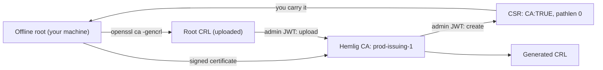
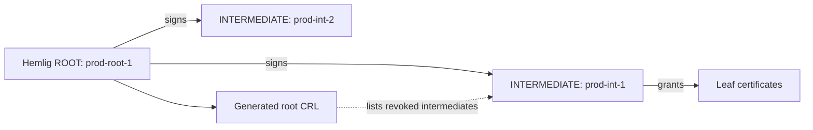

# PKI: certificate authorities and CRLs

Hemlig can hold an intermediate certificate authority (CA) that your offline root signs, and publishes that CA's certificate revocation lists (CRLs). It can also act as a root and sign its own intermediates; see [A Hemlig root and intermediates](#a-hemlig-root-and-intermediates).

Consumers get leaf certificates through issuance grants. [cert-manager](cert-manager.md) can request and renew them unattended. [Trust bundles](trust-bundles.md) deliver CA anchors, intermediates and CRLs to Kubernetes. This page covers the CA lifecycle, grants, issuance, revocation and CRLs.

## The topology

Your organization keeps a root offline. Hemlig generates the intermediate's key, hands you a certificate signing request (CSR), and never sees the root key.



The CA is an `EXTERNAL_INTERMEDIATE`: its path length is 0, so it can sign leaf certificates but not other CAs. Its key is wrapped by KMS and decrypted only to sign.

## Create, sign and activate

All steps use the [CLI](cli.md). Set the environment once:

```sh
export HEMLIG_ENVIRONMENT=prod
```

1. **Create the CA.** Hemlig returns a CSR. Name constraints and extended key usages in the request limit what the CA may ever certify.

   ```sh
   hemlig pki ca create --name prod-issuing-1 --key-algorithm ECDSA_P256 \
     --subject 'CN=Example Prod Issuing CA 1,O=Example Corp' \
     --permit-dns example.com --csr-out issuing.csr
   ```

2. **Sign it offline** with the root, then issue the root's first CRL. The recipe is in [Offline root recipe](../operations/pki-offline-root.md).
3. **Activate** with the signed certificate, the root certificate and the root CRL:

   ```sh
   hemlig pki ca activate prod-issuing-1 --certificate issuing.pem \
     --chain root.pem --root-crl root.crl.pem
   ```

Activation checks the chain, the CA certificate, its constraints and the root CRL before anything is written. Then it signs the CA's empty CRL number 1. A failed check returns `chain_invalid` or `crl_invalid` with a `details.reason`; see [Admin: PKI](../reference/api/admin-pki.md#errors).

Hemlig CA names and subject DNs are claimed permanently, so a new CA, even after a failed one, needs a new DN.

You can also do these steps in the [console](console.md#pki), which shows the CSR and takes the pasted certificate and chain, or declare the CA in [Pulumi](pulumi-pki.md), which activates it on the second apply.

## CA states

| State                 | Meaning                                                                                           |
| --------------------- | ------------------------------------------------------------------------------------------------- |
| `PENDING_CERTIFICATE` | Created, waiting for the signed certificate. `DELETE` moves it to `FAILED` and destroys its key   |
| `ACTIVE`              | Activated and able to publish CRLs                                                                |
| `RETIRED`             | Retired by an administrator, or its certificate expired. CRLs keep publishing until it is drained |
| `REVOKED`             | Your root's CRL lists the CA. Its key is disabled and its last CRL stays served                   |
| `FAILED`              | Abandoned while pending                                                                           |

`REVOKED` has two other meanings for a Hemlig CA. An `INTERMEDIATE` is `REVOKED` by `hemlig pki ca revoke`, or because its root was distrusted. A `ROOT` is `REVOKED` when you distrust it locally. In both cases the key is disabled.

A retired CA is drained once every certificate it could have issued has expired. Hemlig then disables its key. `destroy-key` removes the wrapped key for good, and works only after the key is disabled.

## Grant a consumer

An issuance grant says what one consumer may get from one CA. The consumer is a direct consumer or an agent's consumer. A grant can be created before an agent bootstraps. Everything is denied unless the grant allows it.

Write the policy as JSON. This one lets a consumer request server certificates for one DNS zone:

```json
{
  "names": { "dns": { "allow": ["*.payments.example.com"] }, "maxSans": 10 },
  "keyUsages": ["digitalSignature", "keyEncipherment"],
  "extendedKeyUsages": { "allow": ["serverAuth"], "default": ["serverAuth"] },
  "lifetime": { "defaultSeconds": 7776000, "maxSeconds": 7776000, "minSeconds": 3600 },
  "quotas": { "perHour": 100, "perDay": 1000 }
}
```

```sh
hemlig pki grant create payments-prod web --ca prod-issuing-1 --file grant.json --validate-only
hemlig pki grant create payments-prod web --ca prod-issuing-1 --file grant.json
```

`--validate-only` writes nothing and prints errors and warnings. A rule outside the CA's name constraints is an error, and a partial overlap is a warning. See the [grant fields](../reference/api/admin-pki.md#issuance-grants).

Before you rely on a grant, dry-run a request against it. `evaluate` returns the decision, the engine trace and the planned certificate without issuing anything:

```sh
hemlig pki grant evaluate payments-prod web --dns api.payments.example.com --key-algorithm ECDSA_P256
```

The console grant editor runs the same validation and evaluation; the evaluation tests the saved grant, not an unsaved draft. You can also declare grants in [Pulumi](pulumi-pki.md).

A consumer can hold up to 20 grants. A delete leaves a tombstone, and creating the name again makes a new grant identity, so old certificates never point at a different policy. Disable a grant by updating its `status` to `DISABLED`.

## Issue and renew

The consumer sends a CSR with its mTLS client certificate. Hemlig takes the names from the CSR, checks them against the grant and the CA's constraints, signs, and returns the leaf, the chain and the anchor.

```sh
curl --cert consumer.crt --key consumer.key -H 'content-type: application/json' \
  -H 'idempotency-key: web-renew-0001' --data @request.json \
  https://api.example.com/v1/pki/issuance-grants/web/certificates
```

Use one `Idempotency-Key` per intended certificate. Retrying with it returns the same certificate while it is valid, and never charges the quota twice. A replay of a certificate that was revoked or is about to expire fails instead of redelivering it. Renewal is a new request with a new key and a new CSR, ideally with a new key pair.

Hemlig clamps the lifetime to the grant's maximum, the CA's maximum and the CA certificate's remaining validity. The response says so with `lifetimeClamped`. The details are in [PKI consumer routes](../reference/api/pki.md).

## Admin issuance

An administrator can issue a certificate without a grant, for infrastructure that has no consumer:

```sh
hemlig pki cert issue prod-issuing-1 --csr server.csr --dns api.example.com \
  --duration 24h --out leaf.pem --chain-out chain.pem --ca-out root.pem
```

Use `--use-csr-names` to take the names from the CSR. The CA's constraints, the Hemlig ceilings and the reserved names still apply. Administrators have their own quota of 100 certificates per hour per CA.

## Revoke

Revoke one certificate, or every certificate of a consumer:

```sh
hemlig pki cert revoke prod-issuing-1 4f1c --reason keyCompromise
hemlig pki consumer revoke-certificates payments-prod --reason keyCompromise
```

Revocation is one transaction that marks the certificate, writes its CRL entry and publishes a fresh CRL, usually within seconds. If inline publication fails, the next maintenance pass publishes it within 15 minutes. Expired certificates, and certificates under a revoked CA, are only marked in the inventory because no CRL needs them.

A consumer-wide revoke commits in batches and stops after about 20 seconds. The CLI repeats the call with the same idempotency key until it reports `complete`. Revoking a consumer's leaves does not revoke its client certificate: do that too if the consumer itself is compromised.

`hemlig pki cert revoke` refuses a row that is a CA certificate with `409 use_ca_revoke`. Revoke an intermediate with `hemlig pki ca revoke`, which puts it on its root's CRL; see [A Hemlig root and intermediates](#a-hemlig-root-and-intermediates).

The console revokes one certificate from its detail page, and a consumer's certificates in bulk from the consumer's Certificate grants tab. Deleting a grant or removing it in Pulumi never revokes.

List what a CA or consumer holds with `hemlig pki cert list`, and read one certificate with `hemlig pki cert get`.

## Capacity and rate

A CRL must stay deliverable, so Hemlig bounds how many certificates a CA can hold.

| Setting | Default | Meaning |
| --- | --- | --- |
| `capacity` | 8,000 | Issuance is refused (`ca_capacity_exceeded`) once the CA's count reaches this. The count covers certificates of every status that are not yet expired |
| `issuancePerHour` | 2,000 | Certificates per clock hour for the whole CA, across all grants and administrators (`ca_hour`) |

`capacity + 2 x issuancePerHour` stays at or below 12,000, so no CRL exceeds 12,000 entries.

- Maintenance recounts every active CA each pass. An issuance recounts when the stored count is older than 30 minutes.
- The per-CA hourly counter bounds what is issued between counts.
- The CA detail shows `capacity.count` and `capacity.countedAt`. The `pki-capacity-high` alarm fires above 80%.
- Revocation is never refused for capacity.

See [Limits](../reference/limits.md#pki).

Grants also have their own `perHour` and `perDay` quotas, 100 and 1,000 by default. They are per grant only. Deleting and recreating a grant cannot bypass the CA's hourly counter.

## Roles

Two optional identity-provider roles narrow who may change PKI state. Reads need only the normal administrator token.

| Role setting          | Required for                                                              |
| --------------------- | ------------------------------------------------------------------------- |
| `oidcPkiCaAdminRole`  | Create, update, delete, activate, retire, destroy-key and root CRL upload |
| `oidcPkiOperatorRole` | Issuance grants, administrator issuance, revoke, bulk revoke, CRL publish |

When a role is unset, any administrator may perform those operations. See [Configuration](../reference/configuration.md).

## The root CRL

Relying parties check your root's CRL as well as the CA's. Hemlig stores the latest root CRL you upload and revokes any CA that CRL lists, whatever the reason, including `certificateHold`. A hold is permanent in Hemlig: removing it later does not restore the CA.

Refresh the root CRL before its `nextUpdate`:

```sh
openssl ca -config root-ca.cnf -gencrl -out root.crl.pem
hemlig pki external-ca upload-crl --for-ca prod-issuing-1 --crl root.crl.pem
```

An upload must be newer than the stored CRL. An identical retry succeeds without changes. Maintenance alarms 30 days before the stored CRL's `nextUpdate`, and when a CA has had no root CRL for 24 hours. This is the one recurring offline step. Upload it with the CLI or from the console's offline roots card; Pulumi never uploads a root CRL.

## Generated CRLs

Hemlig signs a full CRL for each CA and stores each one as an immutable object. It refreshes a CRL well before `nextUpdate`: a third of its validity before, within 45 minutes and half of the validity. With the 7-day default that is about 2.3 days. Maintenance runs every 15 minutes, and `hemlig pki ca crl publish` forces a publication. See [Limits](../reference/limits.md#pki).

Download a CRL, for either a CA or a root, with `hemlig pki ca crl get`. A [trust bundle](trust-bundles.md) delivers the generated and root CRLs to your workloads.

## If the intermediate's key is compromised

Revoke the intermediate at the root (`openssl ca -revoke`), regenerate the root CRL and upload it. Hemlig marks the CA `REVOKED` and disables its key. A [trust bundle](trust-bundles.md) picks up the new root CRL on its next refresh, so workloads reject the revoked CA's certificates. Then roll over to a new CA; see [Roll over a CA](../operations/pki-ca-rollover.md).

If the CA is a Hemlig `INTERMEDIATE`, run `hemlig pki ca revoke <ca> --reason caCompromise` instead. Hemlig revokes it, disables its key, writes it into its root's generated CRL and publishes that CRL at once. Bundles that list the root deliver the new CRL on their next refresh.

## A Hemlig root and intermediates

::: warning An external offline root is strongly recommended
A Hemlig `ROOT` key is `WRAPPED` and online. Anyone who can use the PKI roles' decrypt can copy it and mint certificates inside its constraints. The only remedy is local distrust, which reaches only relying parties that use Hemlig trust bundles. Use a Hemlig root for test, lab or short-lived internal hierarchies, and keep production roots offline with the [recipe](../operations/pki-offline-root.md).
:::

Hemlig can generate a self-signed root and sign intermediates under it, with no offline step. The hierarchy is two deep: a `ROOT` (path length 1) signs an `INTERMEDIATE` (path length 0), which issues leaves through grants as in the rest of this page.



Create the root, then an intermediate under it. Both are `ACTIVE` as soon as the call returns, with no CSR and no `activate` step.

```sh
hemlig pki ca create --kind ROOT --name prod-root-1 --key-algorithm ECDSA_P384 \
  --subject 'CN=Example Prod Root CA 1,O=Example Corp' --permit-dns example.com --validity 3650d
hemlig pki ca create --kind INTERMEDIATE --parent prod-root-1 --name prod-int-1 \
  --key-algorithm ECDSA_P256 --subject 'CN=Example Prod Intermediate CA 1,O=Example Corp' --validity 365d
```

A root refuses the leaf policy fields `--max-leaf-lifetime` and `--leaf-key-algorithm`, because it issues no leaves. Creating a root prints the warning above on stderr.

Creating an intermediate checks the parent first:

- The parent is an `ACTIVE` `ROOT` in the same environment, with a usable key, and an end date that leaves the intermediate at least 30 days of validity.
- The intermediate's name constraints and extended key usages are no broader than the root's. When you omit them it inherits the root's.
- It is a subordinate of a root only: an intermediate cannot sign another CA.

The validity defaults to 3,650 days for a root and 365 days for an intermediate, and an intermediate's is clamped to its root's remaining validity. The creation counts against the root's hourly counters and its capacity, so a root with many intermediates is a bounded CA like any other. See [Limits](../reference/limits.md#pki).

Revoke an intermediate with `hemlig pki ca revoke`. Hemlig marks it `REVOKED`, disables its key and puts it on the root's generated CRL, which it publishes at once. Revoking a root is local distrust instead: there is no CRL above it. The root and each of its intermediates become `REVOKED` with disabled keys, and a trust bundle drops the root from `ca.crt`.

```sh
hemlig pki ca revoke prod-int-1 --reason caCompromise
hemlig pki ca revoke prod-root-1 --reason caCompromise
```

Issuance under a distrusted root stops at once, because every issuance and replay checks that no ancestor is `REVOKED`. The walk that flips the children is best effort, and maintenance finishes it within 15 minutes.

A root revoke reports `revokedCaIds` and `complete`. `complete` means every child the directory listed is `REVOKED`; the listing is eventually consistent, so maintenance also finishes any child created just before the revoke. Repeat the revoke with the same idempotency key while `complete` is `false`.

A retired root keeps signing its CRL and drains only after its longest intermediate lifetime has passed. Rolling a hierarchy is in [Roll over a CA](../operations/pki-ca-rollover.md#hemlig-hierarchy).

## Alarms

| Alarm                                             | Fires when                                                              |
| ------------------------------------------------- | ----------------------------------------------------------------------- |
| `pki-generated-crl-stale`                         | An active or undrained CA's CRL is close to its `nextUpdate`            |
| `pki-external-crl-stale`                          | A root CRL with a live dependent is within 30 days of `nextUpdate`      |
| `pki-external-crl-missing`                        | A root with a live dependent has had no CRL for 24 hours                |
| `pki-ca-expiring`                                 | An active CA is within its longest leaf lifetime plus 30 days of expiry |
| `pki-capacity-high`                               | An active CA holds more than 80% of its capacity                        |
| `pki-crl-over-capacity`                           | A CRL carries more entries than the CA's capacity                       |
| `pki-ca-key-unavailable`, `pki-kms-access-denied` | Signing failed because the key or KMS access is unusable                |
| `pki-maintenance-errors`                          | A maintenance pass failed for at least one CA                           |

## Next steps

- [Offline root recipe](../operations/pki-offline-root.md)
- [Roll over a CA](../operations/pki-ca-rollover.md)
- [Admin: PKI](../reference/api/admin-pki.md)
