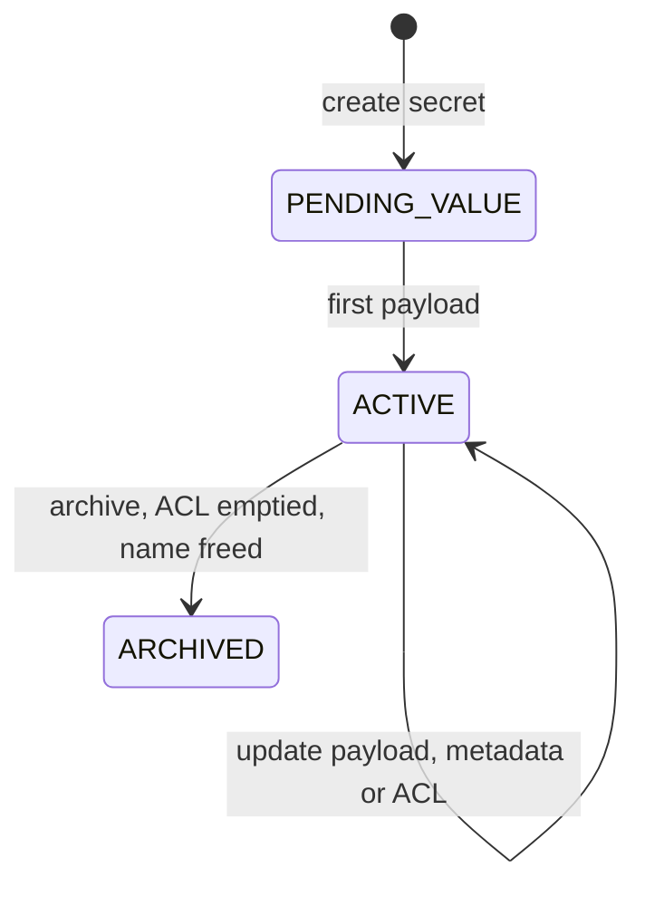

# Secrets, revisions and encryption

Every secret is a chain of immutable revisions encrypted with a fresh key, so a change never overwrites history and a copied revision cannot be decrypted elsewhere.

Terms: [secret UID](../reference/glossary.md#secret-uid), [control revision](../reference/glossary.md#control-revision), [payload revision](../reference/glossary.md#payload-revision), [encryption context](../reference/glossary.md#encryption-context).

## Secret lifecycle

There is no delete route. Removing a consumer from the [ACL](../reference/glossary.md#acl) leaves that consumer a retained `REVOKED` [tombstone](../reference/glossary.md#tombstone), which it sees as `secret.revoked`.

## Revisions and UIDs

Each secret gets a random, immutable secret UID at creation. The human-readable secret ID is unique within an environment and is used in URLs. Storage and encryption use the UID.

Archiving releases only the name. A later secret with the same name is a different UID with separate history.

Each change creates a control revision. A payload change also creates a payload revision.

| S3 object | Holds |
| --- | --- |
| `secrets/UID/control/VERSION.json` | Metadata, ACL, state, actor, time, pointer to a payload revision |
| `secrets/UID/payload/VERSION.json` | An encrypted envelope only |

The DynamoDB head record points at the current versions. The control version is the HTTP ETag. An ACL or description edit writes only a control revision and never decrypts the payload.

## Mutation protocol

A write is safe to retry and cannot half-apply.

1. Validate the caller, body, idempotency key and `If-Match` ETag.
2. Encrypt the new payload in the Lambda, before anything reaches S3.
3. Write `PREPARED` workflow records and take the head lease in one transaction.
4. Write each S3 object once, with `If-None-Match: *` and a SHA-256 checksum.
5. Extend Object Lock retention on the superseded versions.
6. In one transaction, mark the workflows ready, switch the head, update access rows and queue change hints.
7. Write the terminal audit event, then return success.

If a Lambda dies between steps, the recovery worker releases the lease. It never promotes a half-written head. See [Audit evidence](audit-evidence.md) for step 7.

## Encryption

Each payload revision uses a new AES-256 data key from KMS. Hemlig encrypts the payload with AES-256-GCM, and stores the encrypted data key, IV, tag and ciphertext. Plaintext keys are cleared from memory.

### KMS contexts

One customer-managed key (the application CMK) protects everything. Hemlig separates uses by encryption context instead of by key.

| Purpose | Context | Who may decrypt |
| --- | --- | --- |
| Payload | `service=hemlig`, `purpose=secret-payload`, environment, secret UID, payload version | Consumer and administrator roles |
| Issuing root | `service=hemlig`, `purpose=issuer-ca` | Administrator role only |

The same values are bound into the GCM additional data. A ciphertext copied to another secret or version fails to decrypt. The per-role IAM conditions are in [AWS resources](../reference/aws-resources.md).

Revisions created before UIDs existed keep their original secret-ID binding. They are read-only compatibility cases.

## Integrity checks on read

Before decrypting, the handler requires the control and payload documents to repeat the secret ID, environment and exact versions from the head it read. It also verifies the S3 checksum and the GCM tag. A mismatch fails closed, so a copied revision is never a decryption oracle.

An administrator can read plaintext through the authenticated admin route. That read is audited without the value.

## Retention

Revision and audit buckets are versioned with Object Lock in Compliance mode, set at creation. Superseded revisions are deleted by the retention worker only after their lock expires. DynamoDB stores exact S3 version IDs so it cannot delete a different version. The periods are in [Limits](../reference/limits.md#storage-and-retention).

## Next steps

- [Data model](../reference/data-model.md)
- [Managing secrets](managing-secrets.md)
- [Safety and deletion](../operations/safety.md)
