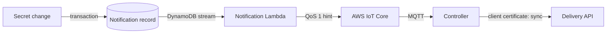

# Sync and change hints

Hemlig tells consumers that something changed with a small MQTT hint, but they always confirm the change over mutual TLS, so a lost or forged hint cannot change what they receive.

Terms: [change snapshot](../reference/glossary.md#change-snapshot), [agent sync](../reference/glossary.md#agent-sync), [sync checkpoint](../reference/glossary.md#sync-checkpoint), [change hint](../reference/glossary.md#change-hint).

## Two ways to learn about changes

| Mechanism | Used by | What you get |
| --- | --- | --- |
| `GET /v1/changes` | Direct consumers | Current access snapshot, paged. Not an event log. |
| `GET /v1/agent/sync` | Agents and the controller | Current version index scoped to the AgentGrant, with incremental checkpoints. |
| MQTT change hint | Controllers | A prompt to sync now. Never a payload. |

Route contracts are in [the delivery API](../reference/api/delivery.md).

## Change snapshots

`GET /v1/changes` lists every secret a consumer can read, in its own environment, with the control and payload version of each. A removed grant appears as `secret.revoked`. Pages continue with an opaque cursor bound to one consumer.

## Agent sync

`GET /v1/agent/sync` keeps a per-environment index with one current entry per secret. Every publication advances an environment sequence in the same transaction that switches the head.

1. Call with no parameters for a full snapshot, following `nextCursor` until the last page.
2. The last page returns the checkpoint as `syncCursor`.
3. Apply everything, then save the checkpoint.
4. Next time, send `?syncCursor=` to receive only changes since.

The checkpoint is bound to the consumer, environment, grant scope and epoch. If any of them change, or it expires, the next call returns a fresh snapshot.

The index is current state plus short-lived tombstones, not history. A secret that is archived or loses read access appears as a revoked entry so the controller can remove its Kubernetes Secret. Cursor and checkpoint lifetimes are in [Limits](../reference/limits.md#pagination-and-sync).

Entries never contain ACLs or payloads. An agent fetches a payload only when a version differs from what it holds.

## Change hints over MQTT

The hint is published to the topic `hemlig/DEPLOYMENT/consumers/CONSUMER`. `DEPLOYMENT` is the [deployment name](../reference/glossary.md#deployment-name) chosen at install, not a runtime environment.

It contains only the secret ID, environment, event kind and revision IDs. A failed record is retried, then sent to a dead-letter queue that raises an alarm.

An agent's certificate lets it connect as its own consumer ID and receive only its own topic. It cannot publish, use wildcards or hold AWS credentials. Revoking the certificate also revokes the IoT certificate. See [Identity and trust](identity-and-trust.md#revocation).

## Why hints are only a prompt

Controllers also sync after every reconnect and on the [resync interval](../reference/glossary.md#resync-interval), by default every 10 minutes. A missed, duplicated or delayed hint therefore costs latency, not correctness.

The controller saves its checkpoint only after the cluster has converged. If applying a change fails, it keeps the old checkpoint and retries.

## Next steps

- [Kubernetes controller](kubernetes.md)
- [Troubleshooting sync](../operations/troubleshooting.md#sync)
- [Limits and timings](../reference/limits.md)
