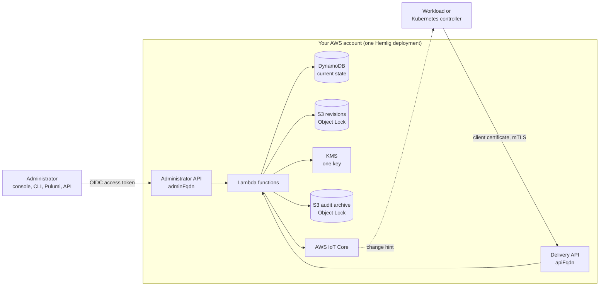
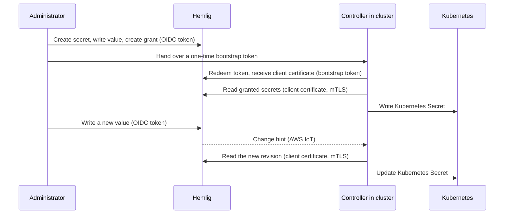

# What is Hemlig

Hemlig is a secrets service you deploy in your own AWS account. It delivers secrets over [mutual TLS](../reference/glossary.md#mtls) to workloads outside AWS, which never hold an AWS credential.

## The problem it solves

- Kubernetes clusters, VMs and CI runners outside AWS still need secrets such as API keys and database passwords.
- The usual fix is to hand those workloads AWS keys. Those keys are the risk: they leak, they outlive their purpose and they grant more than one secret.
- Hemlig keeps AWS KMS, S3 and DynamoDB as the system of record and gives workloads only a short path to the secrets they were granted.

## How it works in one picture

Everything inside the box is in your AWS account.

The [Administrator API](../reference/glossary.md#administrator-api) and the [Delivery API](../reference/glossary.md#delivery-api) are two separate hosts with two separate credentials. A change hint is a small notification that tells a workload to look for updates sooner. It carries no secret.

## The life of a secret

1. **An administrator creates a secret and writes its value.** Each write is a new immutable revision. It is encrypted with a fresh KMS data key, so no two revisions share a key.
2. **An administrator grants access.** For a single workload, add it to the secret's [ACL](../reference/glossary.md#acl). For a Kubernetes cluster, create an [AgentGrant](../reference/glossary.md#agentgrant). [Concepts](concepts.md#direct-consumer-or-agent) explains the choice.
3. **The workload proves its identity with a [client certificate](../reference/glossary.md#client-certificate)** issued by Hemlig's own certificate authority. Hemlig checks the certificate's [fingerprint](../reference/glossary.md#fingerprint) on every request, so revoking it works at once.
4. **The [Kubernetes controller](../reference/glossary.md#kubernetes-controller) writes the value into a Kubernetes Secret.** A change hint makes updates prompt. A [10-minute resync](../reference/limits.md#controller) is the safety net.

Follow this path end to end in [Tutorial: your first secret in Kubernetes](first-secret.md).

## Who does what

| Role | Works with | Credential | Typical tasks |
| --- | --- | --- | --- |
| Platform engineer | CDK, Helm | AWS deploy rights, cluster-admin | Deploy the stack, install the controller |
| Administrator | Console, CLI, Pulumi, API | OIDC access token | Create secrets, grants and bootstrap tokens |
| App team | `HemligSecretImport` and Kubernetes RBAC | Kubernetes RBAC only | Ask for a secret in their namespace |
| Security reviewer | Audit route, threat model | OIDC access token | Review who read what |

## What you get

| You get | In plain words | Read more |
| --- | --- | --- |
| Encryption at rest | Every revision has its own KMS-protected key | [Secrets and encryption](secrets-and-encryption.md) |
| Immutable history | Changes add a revision; none is overwritten | [Secrets and encryption](secrets-and-encryption.md) |
| No AWS credentials on workloads | Workloads hold a Hemlig certificate only | [Identity and trust](identity-and-trust.md) |
| An audit trail | Events go to a separate write-once archive | [Audit evidence](audit-evidence.md) |
| Kubernetes integration | A controller imports and exports Secrets | [Kubernetes controller](kubernetes.md) |
| Your choice of tool | Console, CLI, Pulumi provider or HTTP API | [Manage secrets](managing-secrets.md) |

## What Hemlig does not do

- It has no delete route. Secrets are archived, not deleted.
- It does not manage your identity provider, users or administrator groups.
- It does not rotate the issuing root certificate.
- Its console and CLI cannot create AgentGrants or bootstrap tokens. Use the API or the Pulumi provider.
- Local emulation proves nothing about IAM, API Gateway mTLS or Object Lock. See the [acceptance runbook](../operations/acceptance.md).

::: warning Pre-1.0
Hemlig is pre-1.0. Run the [acceptance gates](../operations/acceptance.md) in an isolated AWS account before you deliver production credentials with it.
:::

## Choose your path

| I want to... | Go to |
| --- | --- |
| Try it on my laptop | [Quickstart](quickstart.md) |
| Evaluate the security model | [Threat model](../security/threat-model.md) |
| Deploy it to AWS | [Deploy Hemlig to AWS](deploying.md) |
| Get a secret into my namespace | [Import a secret](import-secret.md) |
| Automate secret management | [Manage secrets](managing-secrets.md) |
| Understand the vocabulary | [Concepts](concepts.md) and the [glossary](../reference/glossary.md) |
