# Upgrade: API group hemlig.zyno.io

Move a cluster's Hemlig resources and managed Secrets from the `hemlig.io` API group and key prefix to `hemlig.zyno.io`, offline, with backups and rollback.

The controller reads only the new group and the new keys. It has no compatibility mode, so every object must be converted while the controller is stopped. Run this once per cluster before or while you upgrade to a chart whose CRDs use `hemlig.zyno.io`.

**Before you start**

- Role: cluster administrator. You need to create CRDs, read every Secret and patch status subresources.
- Tools: `kubectl` 1.24 or later (for `--subresource`), `jq` 1.6 or later, and `helm` for Helm installs.
- Time: about 30 minutes per cluster. Imports and exports do not sync while the controller is stopped. Pods keep reading their existing Secrets.

## What changes

| Old                                                            | New                                                 | Where                                                                                                                                    |
| -------------------------------------------------------------- | --------------------------------------------------- | ---------------------------------------------------------------------------------------------------------------------------------------- |
| `hemlig.io/v1beta1`, `hemlig.io/v1alpha1`                      | `hemlig.zyno.io/v1beta1`, `hemlig.zyno.io/v1alpha1` | `apiVersion` of every Hemlig resource                                                                                                    |
| `hemligconsumers.hemlig.io` (and the other three)              | `hemligconsumers.hemlig.zyno.io`                    | CRD names and RBAC `apiGroups`                                                                                                           |
| `hemlig.io/` label and annotation keys                         | `hemlig.zyno.io/`                                   | Hemlig resources, [import targets](../reference/glossary.md#import-target), [identity Secrets](../reference/glossary.md#identity-secret) |
| `hemlig.io.` data keys (`next-tls.key`, `previous-tls.crt`, …) | `hemlig.zyno.io.`                                   | Identity Secrets                                                                                                                         |

Label values do not change. The full key list is in [Kubernetes CRDs](../reference/crds.md#annotations-and-labels).

Namespace labels that a `HemligProvider` selects on, such as `hemlig.io/provider-production`, are your own keys. The controller compares them literally, so they keep working. Rename them only together with `spec.allowedNamespaces.matchLabels`.

## What the controller code implies

- **No ownerReferences, no finalizers.** The controller sets neither on any object. Deleting an old CRD cannot garbage-collect a managed Secret or hang on a finalizer.
- **Ownership is labels and annotations.** An import target is the controller's only if it has `hemlig.zyno.io/managed-by=import` and a matching `hemlig.zyno.io/import-owner`. An identity Secret needs `managed-by=consumer` and a matching `hemlig.zyno.io/consumer-owner`. A Secret still carrying old keys fails with `TargetOwnershipConflict` or `IdentityOwnershipConflict`.
- **Status carries sync state.** An export with no prior status pushes its payload again, as a new payload version. The idempotency key includes the resource UID, which changes on re-creation. Step 5 therefore restores `status` after creating each resource.
- **Deleting a resource never deletes its Secret.** There is no orphan sweep. An import target outlives its `HemligSecretImport` (see [`deletionPolicy`](../reference/crds.md#hemligsecretimport-namespaced)).

## Overview

```mermaid
flowchart LR
  check["1. Preconditions"] --> stop["2. Stop controller"]
  stop --> backup["3. Back up"]
  backup --> crds["4. New CRDs"]
  crds --> crs["5. Convert resources"]
  crs --> secrets["6. Relabel Secrets"]
  secrets --> start["7. Upgrade and start"]
  start --> verify["8. Verify"]
  verify --> cleanup["9. Delete old group"]
```



Old and new CRDs exist side by side from step 4 to step 9. Both claim the short names `hmlconsumer`, `hmlimport`, `hmlexport` and `hmlprovider`, so every command below uses full names such as `hemligconsumers.v1beta1.hemlig.io`.

## Set up

Set the variables once. `NEW_CHART_VERSION` is the chart release whose CRDs use `hemlig.zyno.io`. The installed chart version and Helm revision are recorded for the rollback, and saved to `env.sh` in case your shell exits. Without Helm, leave them empty.

```sh
export HEMLIG_NAMESPACE=hemlig-system
export NEW_CHART_VERSION=REPLACE_WITH_NEW_CHART_VERSION
export BACKUP_DIR="$HOME/hemlig-crd-migration"
mkdir -p "$BACKUP_DIR" && chmod 700 "$BACKUP_DIR"
release() { helm -n "$HEMLIG_NAMESPACE" list -o json | jq -r ".[] | select(.name == \"hemlig-controller\") | $1"; }
export OLD_CHART_VERSION="$(release '.chart | sub("^hemlig-controller-"; "")')"
export OLD_REVISION="$(release .revision)"
declare -p HEMLIG_NAMESPACE NEW_CHART_VERSION BACKUP_DIR OLD_CHART_VERSION OLD_REVISION > "$BACKUP_DIR/env.sh"
echo "chart $OLD_CHART_VERSION, revision $OLD_REVISION"
```

Expected output: the installed chart and revision, for example `chart 0.3.6, revision 4`. After a lost shell, `source "$HOME/hemlig-crd-migration/env.sh"` restores the variables.

Write the two transforms. Both take `from` and `to` prefixes, so the rollback reuses them in reverse.

```sh
cat > "$BACKUP_DIR/resources.jq" <<'EOF'
def rekey: with_entries(.key |= (if startswith($from + "/") then $to + .[($from | length):] else . end));
{apiVersion: "v1", kind: "List", items: [.items[]
  | .apiVersion = ($to + "/" + (.apiVersion | split("/")[1]))
  | del(.status)
  | .metadata |= (del(.uid, .resourceVersion, .creationTimestamp, .generation, .managedFields, .selfLink,
                      .annotations["kubectl.kubernetes.io/last-applied-configuration"])
      | if .labels then .labels |= rekey else . end
      | if .annotations then .annotations |= rekey else . end)]}
EOF
cat > "$BACKUP_DIR/secrets.jq" <<'EOF'
def rekey(sep): with_entries(.key |= (if startswith($from + sep) then $to + .[($from | length):] else . end));
{apiVersion: "v1", kind: "List", items: [.items[]
  | if .metadata.labels[$from + "/managed-by"] == "consumer" and .data then .data |= rekey(".") else . end
  | .metadata |= (del(.managedFields)
      | if .labels then .labels |= rekey("/") else . end
      | if .annotations then .annotations |= rekey("/") else . end)]}
EOF
ls "$BACKUP_DIR"
```

Expected output:

```text
resources.jq
secrets.jq
```

Data keys are renamed only on identity Secrets. Import target data is your secret payload and stays byte-identical, so its `data-checksum` annotation stays valid.

## 1. Check preconditions

If Flux or another GitOps tool manages the controller or your Hemlig resources, suspend it now. Otherwise it scales the controller back up or recreates old-group resources mid-migration.

```sh
flux suspend helmrelease hemlig-controller -n "$HEMLIG_NAMESPACE"
```

Confirm no [identity rotation](../reference/glossary.md#identity-rotation) is in flight. A pending rotation leaves `hemlig.io.next-*` keys in the identity Secret.

```sh
kubectl get secrets -A -l hemlig.io/managed-by=consumer -o json \
  | jq -r '.items[] | select(.data // {} | keys | any(startswith("hemlig.io.next-"))) | "\(.metadata.namespace)/\(.metadata.name)"'
```

Expected output: nothing.

If a Secret is listed, let the running controller finish. Watch the `IdentityRotation` condition with `kubectl get hemligconsumers.v1beta1.hemlig.io -A` and rerun the check. A rotation stuck on a failure needs the action in [Failure modes](identity-rotation.md#failure-modes). Stale keys from an abandoned rotation can be removed as in [If the certificate already expired](identity-rotation.md#if-the-certificate-already-expired).

## 2. Stop the controller

```sh
kubectl -n "$HEMLIG_NAMESPACE" scale deploy/hemlig-controller --replicas=0
until [ -z "$(kubectl -n "$HEMLIG_NAMESPACE" get pods -l app.kubernetes.io/name=hemlig-controller -o name)" ]; do sleep 2; done
kubectl -n "$HEMLIG_NAMESPACE" get deploy hemlig-controller -o jsonpath='{.status.replicas}{"\n"}'
```

Expected output: an empty line. `status.replicas` is unset once no pod exists.

## 3. Back up

::: danger The backup contains secret material
`secrets.json` holds every imported secret value and every identity private key. Keep `$BACKUP_DIR` on an encrypted disk, readable only by you, and delete it after the migration and its soak period.
:::

Export every Hemlig resource, and every Secret with a `hemlig.io/` label or annotation. Identity Secrets carry `hemlig.io/managed-by=consumer`, so they are included.

```sh
for k in hemligproviders hemligconsumers hemligsecretimports hemligsecretexports; do
  kubectl get "$k.v1beta1.hemlig.io" -A -o json > "$BACKUP_DIR/$k.json"
done
kubectl get secrets -A -o json \
  | jq '{apiVersion: "v1", kind: "List", items: [.items[]
      | select([(.metadata.labels // {}), (.metadata.annotations // {}) | keys[]] | any(startswith("hemlig.io/")))]}' \
  > "$BACKUP_DIR/secrets.json"
chmod 600 "$BACKUP_DIR"/*.json
```

Verify the counts per file and the Secret kinds:

```sh
for f in "$BACKUP_DIR"/*.json; do echo "$(jq '.items | length' "$f") ${f##*/}"; done
jq -r '.items[] | (.metadata.labels["hemlig.io/managed-by"] // "unlabelled")' "$BACKUP_DIR/secrets.json" | sort | uniq -c
```

Expected output, with your own counts:

```text
2 hemligconsumers.json
1 hemligproviders.json
4 hemligsecretexports.json
9 hemligsecretimports.json
11 secrets.json
   2 consumer
   9 import
```

## 4. Install the new CRDs

Helm never upgrades CRDs from a chart, so apply them yourself. Without Helm, apply `packages/kubernetes-controller/config/crds.yaml` from the release tag instead.

```sh
helm repo update zyno
helm show crds zyno/hemlig-controller --version "$NEW_CHART_VERSION" | kubectl apply -f -
kubectl wait --for=condition=Established --timeout=60s \
  crd/hemligproviders.hemlig.zyno.io crd/hemligconsumers.hemlig.zyno.io \
  crd/hemligsecretimports.hemlig.zyno.io crd/hemligsecretexports.hemlig.zyno.io
```

Expected output:

```text
customresourcedefinition.apiextensions.k8s.io/hemligproviders.hemlig.zyno.io condition met
customresourcedefinition.apiextensions.k8s.io/hemligconsumers.hemlig.zyno.io condition met
customresourcedefinition.apiextensions.k8s.io/hemligsecretimports.hemlig.zyno.io condition met
customresourcedefinition.apiextensions.k8s.io/hemligsecretexports.hemlig.zyno.io condition met
```

## 5. Convert the resources

Create each resource under the new group. The transform rewrites `apiVersion` and `hemlig.io/` metadata keys. It strips `uid`, `resourceVersion`, `creationTimestamp`, `generation`, `managedFields`, `status` and the `kubectl apply` annotation. Providers go first.

```sh
for k in hemligproviders hemligconsumers hemligsecretimports hemligsecretexports; do
  jq --arg from hemlig.io --arg to hemlig.zyno.io -f "$BACKUP_DIR/resources.jq" "$BACKUP_DIR/$k.json" > "$BACKUP_DIR/$k.new.json"
  [ "$(jq '.items | length' "$BACKUP_DIR/$k.new.json")" -eq 0 ] || kubectl create -f "$BACKUP_DIR/$k.new.json"
done
```

Expected output: one `created` line per resource. On a rerun, `AlreadyExists` for resources created earlier is expected.

Restore each saved `status` onto its new resource. `observedGeneration` is mapped to the new generation only when the old status was current. Otherwise it is dropped and the controller reconciles from scratch. Consumer conditions are not restored, so a consumer's `Ready=True` in step 8 proves the new controller ran.

```sh
restore_status() {
  for k in hemligproviders hemligconsumers hemligsecretimports hemligsecretexports; do
    jq -c '.items[] | select(.status) | {ns: (.metadata.namespace // "default"), name: .metadata.name,
      current: (.status.observedGeneration == .metadata.generation), status}' "$BACKUP_DIR/$k.json" |
    while read -r row; do
      ns=$(jq -r .ns <<<"$row"); name=$(jq -r .name <<<"$row")
      gen=$(kubectl -n "$ns" get "$k.v1beta1.$1" "$name" -o jsonpath='{.metadata.generation}')
      kubectl -n "$ns" patch "$k.v1beta1.$1" "$name" --subresource=status --type merge \
        -p "$(jq -c --argjson gen "$gen" --arg k "$k" '{status: (.status + {observedGeneration: (if .current then $gen else null end)}
          | if $k == "hemligconsumers" then del(.conditions) else . end)}' <<<"$row")"
    done
  done
}
restore_status hemlig.zyno.io
```

Expected output: one `patched` line per resource that had a status.

Verify that every resource exists under both groups, per namespace, with the same status presence:

```sh
list() { kubectl get "$1" -A -o json | jq -r '.items[] | "\(.metadata.namespace // "cluster")/\(.metadata.name) status=\(.status != null)"' | sort; }
for k in hemligproviders hemligconsumers hemligsecretimports hemligsecretexports; do
  diff <(list "$k.v1beta1.hemlig.io") <(list "$k.v1beta1.hemlig.zyno.io") && echo "$k: match"
done
```

Expected output:

```text
hemligproviders: match
hemligconsumers: match
hemligsecretimports: match
hemligsecretexports: match
```

Update the `apiVersion` in every manifest you keep in Git or in Helm charts now. Otherwise the next sync recreates old-group resources.

## 6. Relabel the managed Secrets

Rename the `hemlig.io/` label and annotation keys and, on identity Secrets only, the `hemlig.io.` data keys. Values, types and all other keys stay as they are. `kubectl replace` keeps the backed-up `resourceVersion`, so it refuses any Secret that changed since step 3.

```sh
jq --arg from hemlig.io --arg to hemlig.zyno.io -f "$BACKUP_DIR/secrets.jq" "$BACKUP_DIR/secrets.json" > "$BACKUP_DIR/secrets.new.json"
kubectl replace -f "$BACKUP_DIR/secrets.new.json"
```

Expected output: one `secret/… replaced` line per Secret.

A `Conflict` means that Secret changed since step 3. Never rerun step 3: relabelled Secrets would drop out of `secrets.json`. Back up only the conflicted Secret, under its own name, then relabel it:

```sh
export CONFLICT_NS=payments CONFLICT_NAME=stripe-api-key
retry="$BACKUP_DIR/secrets.retry-$CONFLICT_NS-$CONFLICT_NAME.json"
kubectl -n "$CONFLICT_NS" get secret "$CONFLICT_NAME" -o json | jq '{items: [.]}' > "$retry" && chmod 600 "$retry"
jq --arg from hemlig.io --arg to hemlig.zyno.io -f "$BACKUP_DIR/secrets.jq" "$retry" | kubectl replace -f -
```

Verify no Secret still carries an old key, and that the new label count matches the backup:

```sh
kubectl get secrets -A -o json | jq -r '.items[]
  | select([(.metadata.labels // {}), (.metadata.annotations // {}),
      (if .metadata.labels["hemlig.zyno.io/managed-by"] == "consumer" then .data // {} else {} end) | keys[]]
      | any(startswith("hemlig.io")))
  | "\(.metadata.namespace)/\(.metadata.name)"'
echo "$(kubectl get secrets -A -l hemlig.zyno.io/managed-by -o name | wc -l | tr -d ' ') relabelled, $(jq '[.items[] | select(.metadata.labels["hemlig.io/managed-by"])] | length' "$BACKUP_DIR/secrets.json") in backup"
```

Expected output: no Secret names, then two equal counts, such as `11 relabelled, 11 in backup`.

## 7. Upgrade the chart and start the controller

The new image reads only `hemlig.zyno.io`, and the new RBAC grants only `hemlig.zyno.io`. Upgrade both together. A new image with old RBAC, or an old image with new RBAC, gets `403` on every list.

| Install                       | Action                                                                                                                                                                   |
| ----------------------------- | ------------------------------------------------------------------------------------------------------------------------------------------------------------------------ |
| Helm                          | Run the commands below. If your values pin `image.tag`, set it to the new release too. Pass your usual values file instead of `--reuse-values` if you keep one.          |
| Helm with `rbac.create=false` | Also change `apiGroups` in your own ClusterRole from `hemlig.io` to `hemlig.zyno.io`.                                                                                    |
| Flux                          | Pin `NEW_CHART_VERSION` and the matching `image.tag` in Git, merge, then `flux resume helmrelease hemlig-controller -n hemlig-system`. Skip `helm upgrade`.              |
| Without Helm                  | Apply `config/manager.yaml` from the release tag with its image set, as in [Install the controller](../guide/kubernetes.md#install-the-controller). Skip `helm upgrade`. |

```sh
helm upgrade hemlig-controller zyno/hemlig-controller -n "$HEMLIG_NAMESPACE" \
  --version "$NEW_CHART_VERSION" --reuse-values
kubectl -n "$HEMLIG_NAMESPACE" scale deploy/hemlig-controller --replicas=1
kubectl -n "$HEMLIG_NAMESPACE" rollout status deploy/hemlig-controller
kubectl -n "$HEMLIG_NAMESPACE" get deploy hemlig-controller -o jsonpath='{.spec.template.spec.containers[0].image}{"\n"}'
kubectl auth can-i list hemligconsumers.hemlig.zyno.io \
  --as="system:serviceaccount:$HEMLIG_NAMESPACE:hemlig-controller"
```

Expected output:

```text
deployment "hemlig-controller" successfully rolled out
ghcr.io/zyno-io/hemlig-controller:vX.Y.Z
yes
```

The image tag must be the new release. The pod has no readiness probe, so a successful rollout alone does not prove the controller works.

## 8. Verify

Give the controller a minute for its first pass. Every resource must be `Ready=True`. Consumers start without conditions, so a consumer with none has not been reconciled yet. A missed relabel shows up as `TargetOwnershipConflict` or `IdentityOwnershipConflict` (see [Status reasons](../reference/crds.md#status-reasons)).

```sh
kubectl get hemligconsumers.hemlig.zyno.io,hemligsecretimports.hemlig.zyno.io,hemligsecretexports.hemlig.zyno.io -A -o json \
  | jq -r '.items[] | select(([.status.conditions[]? | select(.type == "Ready")][0].status) != "True")
      | "\(.kind) \(.metadata.namespace)/\(.metadata.name) \([.status.conditions[]? | select(.type == "Ready")][0].reason)"'
```

Expected output: nothing.

Check that each import target still matches the version its import recorded:

```sh
kubectl get hemligsecretimports.hemlig.zyno.io -A -o json \
  | jq -r '.items[] | "\(.metadata.namespace) \(.spec.target.name // .metadata.name) \(.status.controlVersionId)"' |
while read -r ns name version; do
  actual=$(kubectl -n "$ns" get secret "$name" -o jsonpath='{.metadata.annotations.hemlig\.zyno\.io/control-version-id}')
  [ "$actual" = "$version" ] || echo "stale: $ns/$name"
done
```

Expected output: nothing.

Check that no export pushed a new payload version. A changed line is expected only for an export whose source Secret changed during the migration.

```sh
pv() { jq -r '.items[] | "\(.metadata.namespace)/\(.metadata.name) \(.status.payloadVersionId)"' | sort; }
diff <(pv < "$BACKUP_DIR/hemligsecretexports.json") \
     <(kubectl get hemligsecretexports.hemlig.zyno.io -A -o json | pv) && echo "exports: no new payload versions"
```

Expected output:

```text
exports: no new payload versions
```

Finally, check that no reconciliation pass failed:

```sh
kubectl -n "$HEMLIG_NAMESPACE" logs deploy/hemlig-controller --since=10m | grep -c 'reconciliation failed'
```

Expected output: `0`. Imports and exports above reuse restored state, so this check and the consumer `Ready` check are the ones that prove the new controller works.

## 9. Delete the old group

Do this only after step 8 is clean. Until then the old resources are your rollback path.

Delete the old resources one kind at a time, then the old CRDs. With no finalizers, nothing hangs. With no ownerReferences, no Secret is garbage-collected, and the new controller does not watch the old group.

Deleting a CRD removes all its resources at once. Deleting resources first shows exactly what is removed. It also surfaces anything that still recreates them, such as a GitOps sync on the old `apiVersion`, while the CRD still exists.

```sh
for k in hemligsecretexports hemligsecretimports hemligconsumers hemligproviders; do
  kubectl delete "$k.v1beta1.hemlig.io" --all -A
done
kubectl delete crd hemligproviders.hemlig.io hemligconsumers.hemlig.io \
  hemligsecretimports.hemlig.io hemligsecretexports.hemlig.io
```

Verify only the new CRDs remain and every managed Secret survived:

```sh
kubectl get crd -o name | grep hemlig
kubectl get secrets -A -l hemlig.zyno.io/managed-by -o name | wc -l
```

Expected output: the four `hemlig.zyno.io` CRDs, then the count from step 6.

Resume any GitOps Kustomizations you suspended in step 1, once their manifests use the new `apiVersion`.

## Roll back

Roll back from the files in `$BACKUP_DIR`. Run `source "$BACKUP_DIR/env.sh"` first if your shell exited, and redefine `restore_status` from step 5.

### Stop the controller

Flux users suspend the HelmRelease first, as in [step 1](#_1-check-preconditions). Otherwise Flux upgrades the release back to the pinned chart. Then stop the controller as in [step 2](#_2-stop-the-controller).

### Recreate the old resources

Skip this before step 9: the old resources are untouched. After step 9, reinstall the old CRDs and recreate the resources.

```sh
helm show crds zyno/hemlig-controller --version "$OLD_CHART_VERSION" | kubectl apply -f -
for k in hemligproviders hemligconsumers hemligsecretimports hemligsecretexports; do
  jq --arg from hemlig.io --arg to hemlig.io -f "$BACKUP_DIR/resources.jq" "$BACKUP_DIR/$k.json" > "$BACKUP_DIR/$k.old.json"
  [ "$(jq '.items | length' "$BACKUP_DIR/$k.old.json")" -eq 0 ] || kubectl create -f "$BACKUP_DIR/$k.old.json"
done
restore_status hemlig.io
```

### Restore the Secrets

Restoring an identity Secret from the backup reverts any rotation since step 3. If a rotation completed after the migration, keep that Secret's current certificate: set `KEEP_NS` and `KEEP_NAME` to it, and its keys are renamed back instead of restored. Leave both empty otherwise.

```sh
export KEEP_NS= KEEP_NAME=
restore() { jq --arg ns "$KEEP_NS" --arg name "$KEEP_NAME" '.items |= map(
  select(.metadata.namespace != $ns or .metadata.name != $name)
  | del(.metadata.resourceVersion, .metadata.uid, .metadata.managedFields))' "$1"; }
for f in "$BACKUP_DIR"/secrets*.json; do
  case "$f" in *.new.json) continue ;; esac
  restore "$f" | kubectl replace -f -
done
[ -z "$KEEP_NAME" ] || kubectl -n "$KEEP_NS" get secret "$KEEP_NAME" -o json | jq '{items: [.]}' \
  | jq --arg from hemlig.zyno.io --arg to hemlig.io -f "$BACKUP_DIR/secrets.jq" | kubectl replace -f -
```

Expected output: one `replaced` line per Secret. Retry files restore after `secrets.json`, so their newer content wins. A `NotFound` means that Secret was deleted since step 3. Rerun the same `restore` output through `kubectl create -f -` to recreate it. `AlreadyExists` for the others is expected.

### Remove the new group

With the controller stopped and no finalizers, this deletes only the new resources.

```sh
kubectl delete crd hemligproviders.hemlig.zyno.io hemligconsumers.hemlig.zyno.io \
  hemligsecretimports.hemlig.zyno.io hemligsecretexports.hemlig.zyno.io
```

### Reinstall the previous chart

`OLD_REVISION` is the release revision recorded during set-up. Rolling back to it is safe even if step 7 never ran. Flux users instead revert the chart and image pin in Git, merge, and resume the HelmRelease. Without Helm, apply the previous release's `config/manager.yaml`.

```sh
helm -n "$HEMLIG_NAMESPACE" rollback hemlig-controller "$OLD_REVISION"
kubectl -n "$HEMLIG_NAMESPACE" scale deploy/hemlig-controller --replicas=1
kubectl -n "$HEMLIG_NAMESPACE" rollout status deploy/hemlig-controller
```

Verify with the [step 8](#_8-verify) checks, using the `hemlig.io` group and keys.

## Next steps

- [Upgrades and migrations](upgrades.md)
- [Roll out controller upgrades with Flux](flux-rollout.md)
- [Kubernetes CRDs](../reference/crds.md)
