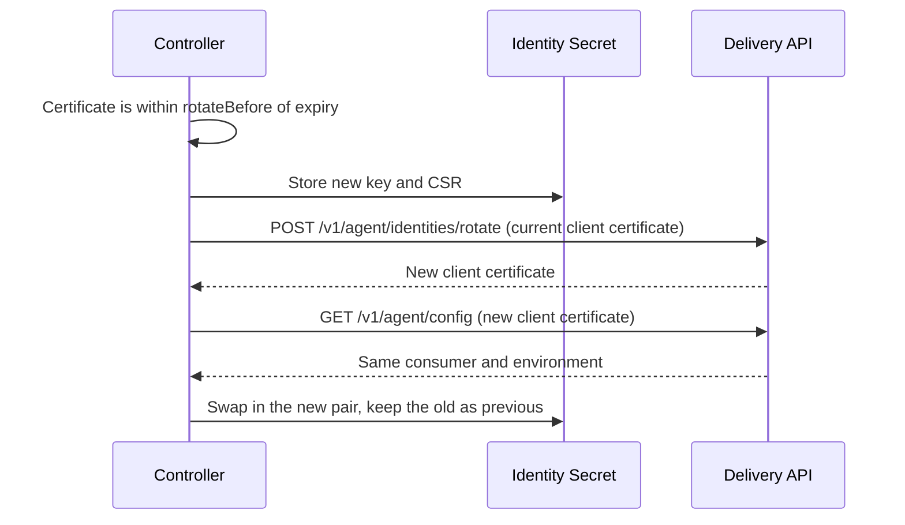

# Identity rotation

A controller renews its own [client certificate](../reference/glossary.md#client-certificate) before it expires. This page shows how to watch that happen, force it, clean up the old certificate and recover when it fails.

Each controller uses a 365-day certificate (see [Limits and timings](../reference/limits.md#identity)) stored in its [identity Secret](../reference/glossary.md#identity-secret). Without renewal the cluster stops syncing when it expires.

**Role:** platform operator and Hemlig administrator.

## Version requirements <Badge type="tip" text="v0.3.0+" />

Self-rotation needs both halves at v0.3.0 or later: the Hemlig service (the rotation Lambda and route) and the controller. Older controllers never read `rotateBefore`. Renew them by hand, as in [If the certificate already expired](#if-the-certificate-already-expired), well before expiry.

These behaviors also arrived in v0.3.0:

| Behavior | Before v0.3.0 |
| --- | --- |
| A certificate issued by an administrator is registered with AWS IoT, so MQTT hints work | Not registered with AWS IoT |
| Revoking a certificate also revokes its IoT certificate | The IoT certificate stayed active |
| Concurrent rotations of one consumer are serialized; the loser gets `identity_rotation_conflict` (reason `RotationConflict`) | Rotation did not exist |

## How a rotation works



1. **Stage.** The controller generates an RSA-3072 key and CSR and stores them in the identity Secret.
2. **Issue.** It calls the rotation route, authenticated with its **current** certificate. The `Idempotency-Key` is the SHA-256 of the CSR, so a retry after a crash replays the same certificate. The route contract is in [`POST /v1/agent/identities/rotate`](../reference/api/delivery.md#post-v1-agent-identities-rotate).
3. **Verify.** It calls `GET /v1/agent/config` with the new certificate. The reply must name the same consumer and environment.
4. **Swap.** Only then does it replace `tls.crt` and `tls.key`. The old pair is kept as `hemlig.io.previous-tls.crt` and `hemlig.io.previous-tls.key`, and the annotations `hemlig.io/api-fingerprint` and `hemlig.io/rotated-at` are updated.

Crashes are safe at every step. The staged key, the CSR and the issued certificate persist in the Secret, and the swap is one guarded write. The same issuing root signs the new certificate, so the API Gateway truststore does not change.

### The old certificate stays active

Rotation does **not** revoke the old certificate. It remains `ACTIVE` until it expires or an administrator revokes it. This is intentional:

- **Overlap.** Anything still using the old pair keeps working during the swap.
- **Rollback.** If the new certificate misbehaves you can restore the old pair (see [Roll back](#roll-back-to-the-previous-certificate)).

The cost is that every rotation leaves one more active certificate. Self-rotation is refused once 3 are active (administrators can issue more). Revoke the old one once the new one is confirmed. See [Revoke the old certificate](#revoke-the-old-certificate).

## Set `rotateBefore`

`spec.identity.rotateBefore` is a duration matching `^[0-9]+[smhd]$`, for example `2160h` or `90d`.

| Setting | Effect |
| --- | --- |
| unset | Rotate 720 hours (30 days) before expiry |
| `0s` or `0h` | Automatic rotation off; the manual annotation still works |
| any other value | Rotate when the remaining validity is at most this long |

The effective window is `min(rotateBefore, certificateLifetime / 2)`, so a large value cannot cause a rotation loop.

```yaml
spec:
  identity:
    secretName: hemlig-payments-client
    rotateBefore: 2160h   # 90 days
```

## Observe rotation

```sh
kubectl -n payments get hmlconsumer payments
kubectl -n payments get hmlconsumer payments -o jsonpath='{.status.identity}'
```

The columns `Identity-Expires` and `Rotation` show expiry and the `IdentityRotation` reason. The status fields are listed in the [CRD reference](../reference/crds.md#status). `IdentityRotation=False` never turns `Ready` false while the old certificate still works.

To inspect the certificate itself:

```sh
kubectl -n payments get secret hemlig-payments-client -o jsonpath='{.data.tls\.crt}' \
  | base64 -d | openssl x509 -noout -enddate -fingerprint -sha256
```

## Force a rotation

Annotate the consumer with any token that differs from `status.identity.rotationRequest`:

```sh
kubectl -n payments annotate hmlconsumer payments \
  hemlig.io/rotate-identity="$(date +%s)" --overwrite
```

One rotation runs on the next pass. Use it to test staging, or after a suspected key compromise (then also revoke the old certificate). The same token does nothing twice. A new token also skips any failure backoff.

## Failure modes

Failures appear on the `IdentityRotation` condition and in `status.identity.lastRotationError`. Retries back off from 60 seconds up to 6 hours (see [Limits and timings](../reference/limits.md#controller)). Every reason is listed with its action in [Status reasons](../reference/crds.md#status-reasons). The ones that need a person:

| Reason | Cause | What to do |
| --- | --- | --- |
| `RotationUnsupported` | The server has no rotation route | Deploy a server at v0.3.0 or later |
| `IdentityLimitReached` | Three active certificates already exist | [Revoke old certificates](#revoke-the-old-certificate) |
| `IdentityAlreadyRotated` | This certificate already has an active successor | Revoke the unwanted successor, or install its key pair |
| `AuthenticationFailed` | The current certificate is expired or revoked | [Recover by hand](#if-the-certificate-already-expired) |
| `RotationForbidden` | The consumer has no `ACTIVE` AgentGrant | Check the grant |
| `RotationConflict` <Badge type="tip" text="v0.3.0+" /> | Another rotation of the same consumer committed at the same moment | Nothing. It retries with the same staged key |

## Runbook: renew cluster identities

1. **Deploy the server first.** Controllers on an older server report `RotationUnsupported` and keep their certificate.
2. **Take inventory.** List consumers and when their certificates expire:

   ```sh
   kubectl get hmlconsumer -A
   ```

   Handle anything inside 30 days first.
3. **Upgrade the controller on staging** ([Flux rollout](flux-rollout.md)).
4. **Set `rotateBefore` on staging** and force one rotation with the annotation above.
5. **Verify.** `IdentityRotation=True`, a new `apiFingerprint`, `Ready=True`, imports current, and `hemlig.io.previous-tls.*` present in the identity Secret.
6. **Roll to production** the same way.
7. **Revoke old certificates** once a cluster has run healthy on the new one.

## Revoke the old certificate

List a consumer's certificates, then revoke the superseded fingerprint. The routes are in [Administrator consumer routes](../reference/api/admin-consumers.md).

```sh
export HEMLIG_ADMIN_URL=https://admin.example.com
export HEMLIG_ADMIN_TOKEN=eyJ...   # a short-lived OIDC access token
export CONSUMER_ID=payments-prod
export OLD_FINGERPRINT=0123abcd...   # from the listing

curl -sS -H "Authorization: Bearer $HEMLIG_ADMIN_TOKEN" \
  "$HEMLIG_ADMIN_URL/v1/admin/consumers/$CONSUMER_ID/api-identities"

curl -sS -X DELETE -H "Authorization: Bearer $HEMLIG_ADMIN_TOKEN" \
  -H "Idempotency-Key: $(uuidgen)" \
  "$HEMLIG_ADMIN_URL/v1/admin/consumers/$CONSUMER_ID/api-identities/$OLD_FINGERPRINT"
```

Revocation takes effect on the next request. <Badge type="tip" text="v0.3.0+" /> It also revokes the certificate's AWS IoT certificate, so the old identity can no longer receive hints. If the IoT call fails, repeat the `DELETE`: it re-applies the IoT revocation for an already revoked identity.

::: warning Revoke only after the new certificate works
If you revoke too early the controller loses access and you are in the expired-certificate case below. Confirm `IdentityRotation=True` and `Ready=True` first.
:::

### Certificates revoked before the upgrade

Certificates you revoked before upgrading to v0.3.0 are still active in AWS IoT. Run the maintenance script once from a checkout of the release you deployed, with AWS credentials for the deployment.

::: warning The script is a dry run by default
Without `--apply` it only counts the affected identities. Run it twice: first to see the count, then with `--apply` to revoke them.
:::

```sh
export AWS_REGION=<region>
export CONTROL_TABLE_NAME=<control-table>   # from your stack
yarn revoke:iot-for-revoked-identities
yarn revoke:iot-for-revoked-identities --apply
```

Both variables and the required credentials are described in [Upgrades](upgrades.md).

Expected output:

```text
Dry run: 3 revoked API identities found; re-run with --apply to revoke their AWS IoT certificates.
Revoked the AWS IoT certificate of 3 revoked API identities.
```

The script is idempotent. The full list of maintenance scripts is in [Upgrades](upgrades.md).

## Roll back to the previous certificate

If the new certificate misbehaves, copy `hemlig.io.previous-tls.crt` and `hemlig.io.previous-tls.key` back over `tls.crt` and `tls.key` in the identity Secret. This only works while the previous certificate is valid and not revoked.

Then revoke the faulty successor with the admin API. A certificate may have only one active successor, so revoking it lets the restored one rotate again later.

## If the certificate already expired

A controller whose certificate expired or was revoked cannot rotate itself, and its bootstrap token cannot be reused.

- A new bootstrap token can only be issued for a `PENDING` grant. Once the first redemption succeeded the grant is `ACTIVE`, so the consumer **cannot be re-bootstrapped**.
- An administrator **can** sign a replacement certificate for an active consumer with `POST /v1/admin/consumers/{consumerId}/api-identities`. It needs only the administrator token. <Badge type="tip" text="v0.3.0+" /> The new certificate is registered with AWS IoT, so MQTT hints work.

Recover by hand:

1. Generate a key and CSR (RSA 2048 bits or larger; the controller uses 3072):

   ```sh
   openssl req -new -newkey rsa:3072 -nodes \
     -keyout new.key -out new.csr -subj "/CN=Hemlig Kubernetes agent"
   ```

2. An administrator issues the certificate (`Idempotency-Key` 8 to 128 characters):

   ```sh
   jq -Rs '{apiCertificateSigningRequestPem: .}' new.csr | curl -sS -X POST \
     -H "Authorization: Bearer $HEMLIG_ADMIN_TOKEN" -H "Content-Type: application/json" \
     -H "Idempotency-Key: $(uuidgen)" --data-binary @- \
     "$HEMLIG_ADMIN_URL/v1/admin/consumers/$CONSUMER_ID/api-identities" \
     | jq -r .apiCertificatePem > new.crt
   ```

3. Write the pair into the identity Secret. Patch it; do not recreate it, or you lose the owner markers.

   ```sh
   kubectl -n payments patch secret hemlig-payments-client --type merge -p \
     "{\"data\":{\"tls.crt\":\"$(base64 < new.crt | tr -d '\n')\",\"tls.key\":\"$(base64 < new.key | tr -d '\n')\"}}"
   ```

   Remove any stale `hemlig.io.next-tls.key`, `hemlig.io.next-csr` and `hemlig.io.next-tls.crt` keys left by an interrupted rotation, with `kubectl edit secret`.
4. The controller picks the Secret up on its next pass. Delete `new.key` from your workstation.
5. Optionally revoke the superseded certificate. The controller rotates the new one automatically inside `rotateBefore`.

Alternatively, start over: create a **new** AgentGrant with a new consumer ID, issue a bootstrap token, point the `HemligConsumer` at it with a new `identity.secretName`, and retire the old consumer's certificates. You must grant the secrets to the new consumer again. See [Give a cluster access](../guide/agent-grants.md).

## Next steps

- [Status reasons](../reference/crds.md#status-reasons)
- [Safety: auth failures vs revoked grants](safety.md)
- [Troubleshooting](troubleshooting.md#controller)
