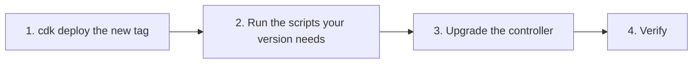

# Upgrades and migrations

Upgrade the server first, then run any maintenance scripts your starting version needs, then upgrade the Kubernetes controller. This page lists all seven scripts with their dry-run and apply commands.

**Before you start:** the role is platform administrator. You need a checkout of the release tag you deployed, Node.js 24, and AWS credentials for the deployment account. Budget 10 minutes per script plus any quiet window.

## Upgrade order



1. Deploy the new release with the [same procedure as a first deploy](../guide/deploying.md#_4-deploy).
2. Run the scripts below that apply to the version you came from.
3. Upgrade the controller. It needs a server that supports `GET /v1/agent/sync`, so [`backfill:agent-sync`](#backfill-agent-sync) must have run first. Moving from a chart whose CRDs use the `hemlig.io` API group needs the offline [API group migration](crd-group-migration.md).
4. Verify a secret can still be read and an import still syncs.

New deployments need none of the scripts: new records are written in the current shape.

## Common setup

Run every script from a clone of the release tag. Each `yarn` script rebuilds the project first.

```sh
git clone --branch v0.3.2 --depth 1 https://github.com/zyno-io/hemlig.git
cd hemlig
corepack enable
yarn install
export AWS_REGION=us-east-1
export CONTROL_TABLE_NAME=hml-prod-control
export REVISION_BUCKET_NAME=REPLACE_WITH_REVISION_BUCKET_NAME
```

Set `AWS_REGION` to the deployment's region. Use `RevisionBucketName` from the [stack outputs](../reference/aws-resources.md#stack-outputs). The credentials need access to the table and, for some scripts, the buckets and AWS IoT. A role with at least the admin Lambda's [permissions](../reference/aws-resources.md#permissions-by-lambda) is enough.

Three rules hold for every script:

- **Dry run first.** Every script except `reconcile:agent-grant-access` is a dry run unless you pass `--apply`. Output contains counts only, never secret contents.
- **Quiesce for data migrations.** `--apply` on `migrate:secret-identity` and `migrate:secret-uids`, and every run of `reconcile:agent-grant-access`, refuses to start unless `HEMLIG_UPGRADE_QUIESCED=1`. Set it only after stopping all writers and readers.
- **Scripts are idempotent.** Rerunning after an interruption is safe, as long as you keep the service quiesced where required.

## Which scripts do I need?

| Script | Run it if you upgrade from | Quiesce | Dry run |
| --- | --- | --- | --- |
| [`migrate:secret-identity`](#migrate-secret-identity) | A release before environment-scoped secrets | `--apply` | Default |
| [`backfill:secret-id-folders`](#backfill-secret-id-folders) | A release before folders derived from secret IDs | No | Default |
| [`migrate:secret-uids`](#migrate-secret-uids) | A release before immutable secret UIDs | `--apply` | Default |
| [`reconcile:agent-grant-access`](#reconcile-agent-grant-access) | Right after `migrate:secret-uids` | Always | None |
| [`backfill:console-indexes`](#backfill-console-indexes) | A release before the console list and history indexes | No | Default |
| [`backfill:agent-sync`](#backfill-agent-sync) | A release before agent sync, before upgrading controllers | No | Default |
| [`revoke:iot-for-revoked-identities`](#revoke-iot-for-revoked-identities) | A release before `v0.3.0` | No | Default |

Run them in the table's order. The first three and `reconcile` form one chain: each assumes the previous shape of the data.

## `migrate:secret-identity`

Moves secret records from names keyed by secret ID alone to records scoped by environment and secret ID. It copies the immutable S3 revisions to the new keys, moves access records, and backfills the environment on pending change-hint records.

Needs `CONTROL_TABLE_NAME`, `REVISION_BUCKET_NAME` and, to apply, `HEMLIG_UPGRADE_QUIESCED=1`.

```sh
yarn migrate:secret-identity
HEMLIG_UPGRADE_QUIESCED=1 yarn migrate:secret-identity --apply
```

Expected dry-run output:

```text
Dry run: 12 secret record(s), 4 access record(s), and 30 immutable object(s) require migration (prod:6 secret head(s)).
Pending notification records: 0; environment backfills required: 0.
```

Apply ends with `Secret identity migration completed successfully.` It verifies that no legacy record remains. With nothing to migrate it changes nothing.

## `backfill:secret-id-folders`

Writes the catalog path that [folders](../reference/glossary.md#folder) are derived from, on every secret head that lacks it. Run it before the console shows correct folders on old data.

Needs `CONTROL_TABLE_NAME`.

```sh
yarn backfill:secret-id-folders
yarn backfill:secret-id-folders --apply
```

Expected dry-run output:

```text
Dry run: 6 secret head(s) need ID-derived catalog paths. Re-run with --apply to write them.
```

A head changed by a concurrent writer is skipped, because the writer already installed a correct one.

## `migrate:secret-uids`

Gives every secret an immutable [secret UID](../reference/glossary.md#secret-uid) and replaces AgentGrant prefix scopes with exact secret grants. It has its own procedure with backups and verification: follow [Upgrade: immutable secret UIDs](upgrade-secret-uids.md).

Needs `CONTROL_TABLE_NAME` and, to apply, `HEMLIG_UPGRADE_QUIESCED=1`.

```sh
yarn migrate:secret-uids
HEMLIG_UPGRADE_QUIESCED=1 yarn migrate:secret-uids --apply
```

## `reconcile:agent-grant-access`

Rebuilds the read-delivery projection from every active AgentGrant. It removes ACL-only access held by agents and adds missing delivery rows. Run it straight after `migrate:secret-uids`.

Unlike the others it has no dry run and no `--apply`. It always writes, so it always requires `HEMLIG_UPGRADE_QUIESCED=1`. Needs `CONTROL_TABLE_NAME` and `REVISION_BUCKET_NAME`.

```sh
HEMLIG_UPGRADE_QUIESCED=1 yarn reconcile:agent-grant-access
```

Expected output:

```text
Reconciled derived delivery access for 3 active AgentGrant(s).
```

## `backfill:console-indexes`

Adds the derived attributes behind the three sparse indexes that the console's consumer directory, identity list and revision history read. It only adds attributes. It never changes secret, identity or certificate material.

Run it after deploying a release that introduces those indexes, before relying on the list and history routes against old data. New records are indexed automatically.

Needs `CONTROL_TABLE_NAME`.

```sh
yarn backfill:console-indexes
yarn backfill:console-indexes --apply
```

Expected dry-run output:

```text
Dry run: 18 item(s) need console index attributes. Re-run with --apply to write them.
```

## `backfill:agent-sync`

Publishes every ready secret head into the agent sync index and marks each environment's index ready. Run it **once, before upgrading controllers**, on any deployment that existed before agent sync. New environments initialize their index automatically.

Needs `CONTROL_TABLE_NAME`. It fails, without marking anything ready, if a head still needs the identity or UID migrations above, so run those first.

```sh
yarn backfill:agent-sync
yarn backfill:agent-sync --apply
```

Expected output, JSON on one line, first the dry run and then the apply:

```text
{"mode":"dry-run","heads":6,"environments":1}
{"mode":"apply","heads":6,"environments":1}
```

::: warning Do not upgrade controllers first
A controller talking to an index that is not ready fails visibly and backs off. It never falls back to per-secret polling.
:::

## `revoke:iot-for-revoked-identities`

<Badge type="tip" text="v0.3.0+" />

Revokes the AWS IoT certificate of every revoked API identity. Identities revoked before the API revoked IoT certificates stay active in IoT, so run this once after upgrading. See [Rotate identities](identity-rotation.md).

It is a dry run unless you pass `--apply`. Needs `CONTROL_TABLE_NAME` and `AWS_REGION` (it defaults to `us-east-1`, which is wrong for any other region). It needs IoT access to update certificates.

```sh
yarn revoke:iot-for-revoked-identities
yarn revoke:iot-for-revoked-identities --apply
```

Expected output: the dry run prints the first line, `--apply` the second.

```text
Dry run: 2 revoked API identities found; re-run with --apply to revoke their AWS IoT certificates.
Revoked the AWS IoT certificate of 2 revoked API identities.
```

A certificate that was never registered counts as already revoked.

## Next steps

- [Upgrade: immutable secret UIDs](upgrade-secret-uids.md)
- [Roll out controller upgrades with Flux](flux-rollout.md)
- [Environment variables](../reference/configuration.md#maintenance-script-environment-variables)
