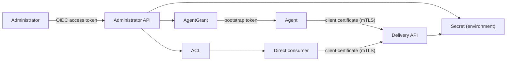

# Glossary

Every Hemlig term in one place, each with a short definition and a link to the page that owns the topic. Other pages link here the first time they use a term.

Numbers such as lifetimes and maximum sizes are listed in [Limits and timings](limits.md).

## How the terms fit together

An administrator creates secrets and decides who may read them. A direct consumer gets access from a secret's ACL. An agent gets access only from its AgentGrant. Both prove who they are with a client certificate.

## People, APIs and tools

### Administrator

A person or automation whose OIDC access token the administrator API accepts. Only administrators create secrets, grants and consumers.

See: [Connect your identity provider](../guide/identity-provider.md).

### Actor

The identity recorded in audit events. For administrators it is the configured subject claim (`sub` by default). Delivery requests record the client certificate fingerprint, and the background workers record a system actor.

See: [Audit evidence](../guide/audit-evidence.md).

### Administrator API

The HTTPS API at `adminFqdn`, behind an API Gateway JWT authorizer. It also hosts the bootstrap route.

See: [HTTP API](api/index.md).

### Delivery API

The HTTPS API at `apiFqdn`. It accepts only requests that present a Hemlig-issued client certificate (mTLS).

See: [Delivery and agent routes](api/delivery.md).

### Bootstrap route

`POST /v1/bootstrap/redeem` on the administrator API. It accepts only a bootstrap token plus a CSR, and returns the first client certificate.

See: [Give a cluster access](../guide/agent-grants.md).

### Console

The static web app for the administrator API, hosted when `consoleFqdn` is set. It cannot create an AgentGrant or issue a bootstrap token; it can only update an existing grant.

See: [Console](../guide/console.md).

### CLI

The `hemlig` command. It is JSON-only and covers the secret lifecycle: `create`, `update`, `write-payload`, `read`, `read-payload` and `archive`.

See: [CLI](../guide/cli.md).

### Pulumi provider

A dynamic provider that manages `secret` and `agentGrant` resources declaratively.

See: [Pulumi provider](../guide/pulumi.md).

### Kubernetes controller

The in-cluster agent that redeems bootstrap tokens, keeps its client certificate fresh and reconciles the Hemlig custom resources.

See: [Install the Kubernetes controller](../guide/kubernetes.md).

### MiniStack

A local AWS emulator (DynamoDB, S3, KMS) used for development. It has no API Gateway, IAM, IoT or mTLS, so it proves nothing about those.

See: [Quickstart](../guide/quickstart.md).

## Deployments and environments

### Deployment

One `HemligStack`. It has one issuing root, one application CMK, and resources named `hml-` plus the deployment name.

See: [Deploy Hemlig to AWS](../guide/deploying.md).

### Deployment name

The CDK `environmentName`, matching `^[a-z][a-z0-9-]{1,31}$` (the reference app defaults to `dev`). It forms resource names and the MQTT topic prefix. It is **not** an environment.

See: [Configuration](configuration.md).

### Environment

A runtime namespace for secrets and consumers inside one deployment, such as `prod`. Created with `POST /v1/admin/environments`; names are 1 to 64 characters and a deployment holds at most 100.

See: [Concepts](../guide/concepts.md).

## Secrets

### Secret

An environment-scoped record with metadata, an ACL and an encrypted payload.

See: [Secrets, revisions and encryption](../guide/secrets-and-encryption.md).

### Secret ID

A slash-separated name such as `payments/stripe/api-key`. It is unique among live secrets in an environment and can be reused after the secret is archived.

See: [Limits and timings](limits.md#secrets-and-grants).

### Secret UID

The immutable `sec-...` identifier assigned at creation. Storage, encryption context and AgentGrants bind to it, so a reused name never inherits access.

See: [Secrets, revisions and encryption](../guide/secrets-and-encryption.md).

### Folder

The parent prefix of a secret ID, derived for browsing. A folder never grants access.

See: [Data types](api/data-types.md).

### Payload

The secret value: a map of entry names to `{encoding, value}`, where encoding is `utf8` or `base64`. The serialized payload has a size limit.

See: [Limits and timings](limits.md#secrets-and-grants).

### Payload entry

One key of the payload. It becomes one key of the Kubernetes Secret's `data`.

See: [Import a secret into your namespace](../guide/import-secret.md).

### Metadata

A `description` and `tags`, used for browsing only. Metadata never affects delivery.

See: [Data types](api/data-types.md).

### Secret state

`PENDING_VALUE` (created, no value yet), then `ACTIVE`, then `ARCHIVED`, which is terminal.

See: [Manage secrets](../guide/managing-secrets.md).

### Archive

The terminal operation on a secret. It empties the ACL, revokes readers and frees the secret ID. There is no delete.

See: [Manage secrets](../guide/managing-secrets.md).

### Control revision

An immutable S3 object holding a secret's metadata, ACL, state and payload pointer. Its ID (`ctl-...`) is the ETag.

See: [Secrets, revisions and encryption](../guide/secrets-and-encryption.md).

### Payload revision

An immutable S3 object holding only the encrypted payload. Its ID starts with `pay-`.

See: [Secrets, revisions and encryption](../guide/secrets-and-encryption.md).

### ETag

The current control-revision ID. Updates send it as `If-Match`; a stale value returns `412`.

See: [HTTP API](api/index.md).

### Idempotency key

A client-chosen key, 8 to 128 characters, sent with each mutation. Reusing it on a secret route returns `409`; on enrollment routes the recorded result is replayed.

See: [Idempotency](api/index.md#idempotency).

## Consumers and access

### Consumer

A workload identity: a consumer ID bound to one environment and authenticated by a client certificate.

See: [Concepts](../guide/concepts.md).

### Direct consumer

*Docs term.* A consumer an administrator enrolls from a CSR (`POST /v1/admin/consumers`). Its access comes from secret ACLs.

See: [Connect a workload without Kubernetes](../guide/direct-consumers.md).

### Agent

A consumer created by redeeming a bootstrap token. Its access comes only from its AgentGrant, even on the ordinary delivery routes.

See: [Concepts](../guide/concepts.md).

### ACL

A per-secret list of direct consumers allowed to `read`. Agents cannot be added to it; their AgentGrant manages that access.

See: [Concepts](../guide/concepts.md).

### AgentGrant

An administrator-created policy for an unused consumer ID: an environment, capabilities and a list of exact secret grants. It is `PENDING` until its bootstrap token is redeemed, then `ACTIVE`.

See: [Give a cluster access](../guide/agent-grants.md).

### Capability

`read` and/or `write`, set at grant level. Each secret grant's permissions must be a subset of the grant's capabilities.

See: [Give a cluster access](../guide/agent-grants.md).

### Secret grant

One `{secretId, secretUid, permissions}` entry of an AgentGrant. The UID is resolved when the grant is written, so the secret must already exist.

See: [Give a cluster access](../guide/agent-grants.md).

### Bootstrap token

A one-use token (`hmlb_` prefix) that lets a new agent enroll. The API calls it a bootstrap capability. It is issued only for a `PENDING` grant, expires quickly and is stored only as a SHA-256 hash.

See: [Limits and timings](limits.md#identity).

### Access revocation

Removing `read` from an ACL or an AgentGrant. The consumer then sees `secret.revoked`, and the controller deletes the import target after confirming.

See: [Revocation and deletion safety](../operations/safety.md).

### Tombstone

A retained `REVOKED` access row that tells an offline consumer its access was removed.

See: [Sync and change hints](../guide/sync-and-notifications.md).

## Identity and trust

### mTLS

Mutual TLS: the server and the client both present certificates. Hemlig's delivery API requires it.

See: [Identity and trust](../guide/identity-and-trust.md).

### Issuing root

The deployment's single self-signed RSA-3072 CA. Its key is KMS-encrypted (`purpose=issuer-ca`). It is created at first enrollment or by `POST /v1/admin/issuer`, and is never rotated.

See: [Identity and trust](../guide/identity-and-trust.md).

### Client certificate

The certificate a consumer presents to the delivery API. Also called a leaf or API identity in older text and API field names. It is a non-CA certificate with URI SAN `spiffe://hemlig/consumer/` plus the consumer ID, and its private key never leaves the workload.

See: [Limits and timings](limits.md#identity).

### CSR

A certificate signing request, RSA with at least 2048 bits. It is the only key material a consumer sends to Hemlig.

See: [Connect a workload without Kubernetes](../guide/direct-consumers.md).

### Fingerprint

The SHA-256 of the client certificate's DER bytes. Hemlig looks it up on every delivery request, and it must be `ACTIVE` and within its validity window.

See: [Identity and trust](../guide/identity-and-trust.md).

### Truststore

The PEM bundle of the issuing root, kept in a versioned S3 bucket and pinned by version to the delivery domain. API Gateway uses it to verify client certificates.

See: [Identity and trust](../guide/identity-and-trust.md).

### Enrollment

Issuing a client certificate and activating it once truststore publication is confirmed.

See: [Identity and trust](../guide/identity-and-trust.md).

### Identity rotation

Obtaining an overlapping client certificate before the current one expires. Agents rotate themselves at `POST /v1/agent/identities/rotate` <Badge type="tip" text="v0.3.0+" />, within a per-consumer limit of active certificates.

See: [Rotate identities](../operations/identity-rotation.md).

### Identity revocation

`DELETE /v1/admin/consumers/{consumerId}/api-identities/{apiFingerprint}`. It takes effect on the next request and also revokes the AWS IoT certificate.

See: [Rotate identities](../operations/identity-rotation.md).

## Sync and notifications

### Change snapshot

`GET /v1/changes`: the paginated current access list for a consumer, reported as `secret.changed` and `secret.revoked`. It is a snapshot, not an event log.

See: [Sync and change hints](../guide/sync-and-notifications.md).

### Agent sync

`GET /v1/agent/sync`: the incremental version index an agent uses to find what changed since its last checkpoint.

See: [Sync and change hints](../guide/sync-and-notifications.md).

### Sync checkpoint

The `syncCursor` an agent saves after its resources converge. It expires, so a controller that is offline too long must resync from scratch.

See: [Limits and timings](limits.md#pagination-and-sync).

### Change hint

A payload-free QoS 1 MQTT message on `hemlig/` plus the deployment name, `/consumers/` and the consumer ID, sent through AWS IoT Core. It only tells the controller to sync now; a lost hint is harmless.

See: [Sync and change hints](../guide/sync-and-notifications.md).

### Resync interval

The controller's periodic safety-net sync. The chart default is 10 minutes.

See: [Limits and timings](limits.md#controller).

## Storage, encryption and audit

### Application CMK

The deployment's one KMS key, `alias/hml-` plus the deployment name plus `-application`. It protects payloads and the issuer key under different encryption contexts.

See: [AWS resources and IAM](aws-resources.md).

### Envelope encryption

Each payload revision gets a fresh KMS data key and is encrypted with AES-256-GCM, bound to the environment, secret UID and payload version.

See: [Secrets, revisions and encryption](../guide/secrets-and-encryption.md).

### Encryption context

The KMS key-value binding (`service=hemlig`, `purpose=secret-payload` or `issuer-ca`) that IAM policies check.

See: [AWS resources and IAM](aws-resources.md).

### Object Lock

S3 Compliance-mode retention that nobody, including the account root, can shorten. Revisions and audit events use it with different retention periods.

See: [Limits and timings](limits.md#storage-and-retention).

### Audit event

A JSON record with an outcome (`attempted`, `authorized`, `succeeded` or `failed`), an actor, an operation and safe targets. It never contains secret values or tokens.

See: [Audit evidence](../guide/audit-evidence.md).

### Audit archive

The Object Lock bucket that holds audit events under `audit/YYYY/MM/DD/`.

See: [Audit evidence](../guide/audit-evidence.md).

### Recovery worker

A scheduled Lambda that releases stuck writes and resumes truststore publication.

See: [Limits and timings](limits.md#storage-and-retention).

### Retention worker

A scheduled Lambda that deletes superseded revision versions after their Object Lock retention expires.

See: [Limits and timings](limits.md#storage-and-retention).

## Kubernetes

### HemligProvider

A cluster-scoped resource holding the administrator and delivery URLs plus the namespace labels allowed to use them.

See: [Kubernetes CRDs](crds.md).

### HemligConsumer

A namespaced resource that points at the bootstrap Secret and owns the identity Secret.

See: [Kubernetes CRDs](crds.md).

### HemligSecretImport

A namespaced resource that copies one granted secret into a Kubernetes Secret.

See: [Import a secret into your namespace](../guide/import-secret.md).

### HemligSecretExport

A namespaced resource that pushes a Kubernetes Secret to an existing Hemlig secret through a write grant.

See: [Export a Kubernetes Secret to Hemlig](../guide/export-secret.md).

### Identity Secret

The Opaque Kubernetes Secret holding the controller's `tls.key` and `tls.crt` for one consumer. Deleting it after bootstrap loses the identity.

See: [Install the Kubernetes controller](../guide/kubernetes.md).

### Import target

The Kubernetes Secret an import writes and owns, labelled `hemlig.zyno.io/managed-by=import`.

See: [Revocation and deletion safety](../operations/safety.md).

### Status reason

The `reason` on a resource's `Ready` or `IdentityRotation` condition. The full list is in the CRD reference.

See: [Status reasons](crds.md#status-reasons).

## PKI

### PKI CA

A certificate authority Hemlig holds the key for. Today it is an external intermediate, signed by your offline root.

See: [PKI](../guide/pki.md).

### CA name

The unique name of a PKI CA within an environment, for example `prod-issuing-1`. Names are never reused.

See: [PKI](../guide/pki.md#create-sign-and-activate).

### External CA

A root or other CA that Hemlig does not hold the key for. Hemlig records its certificate and the latest CRL you upload.

See: [Admin: PKI](api/admin-pki.md).

### Anchor

The self-signed root certificate at the top of a PKI CA's chain.

See: [PKI](../guide/pki.md).

### CRL issuer

The CA that signs a CRL. A PKI CA's leaves are covered by its own CRL and by its root's CRL.

See: [PKI](../guide/pki.md#generated-crls).

### Subject registry

The record of every CA subject DN in a deployment. A DN is claimed forever, so a new CA needs a new DN.

See: [Roll over a CA](../operations/pki-ca-rollover.md).

### Root CRL

The CRL your offline root signs. You upload it, and Hemlig revokes any dependent CA it lists.

See: [Offline root recipe](../operations/pki-offline-root.md#upload-a-fresh-root-crl).

### Drained

A retired CA whose published CRL covers every certificate it could have issued. Hemlig then disables its key.

See: [PKI](../guide/pki.md#ca-states).
